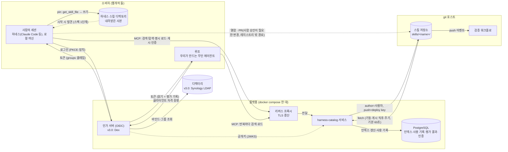
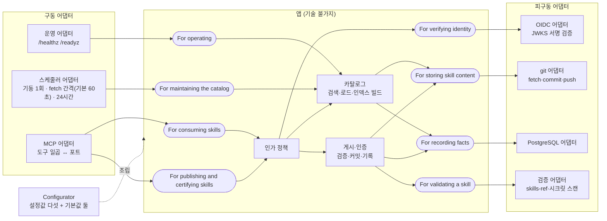
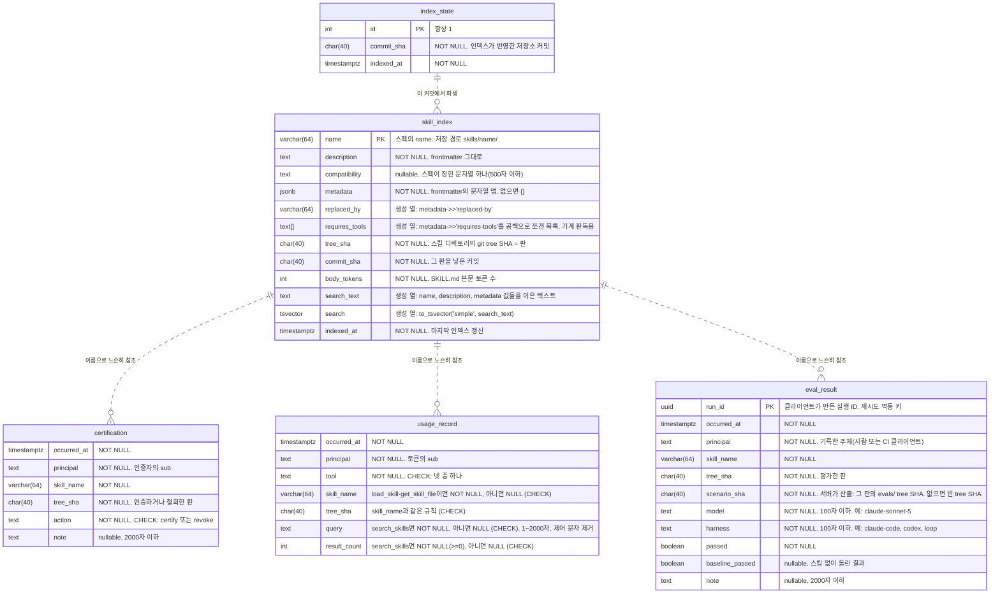
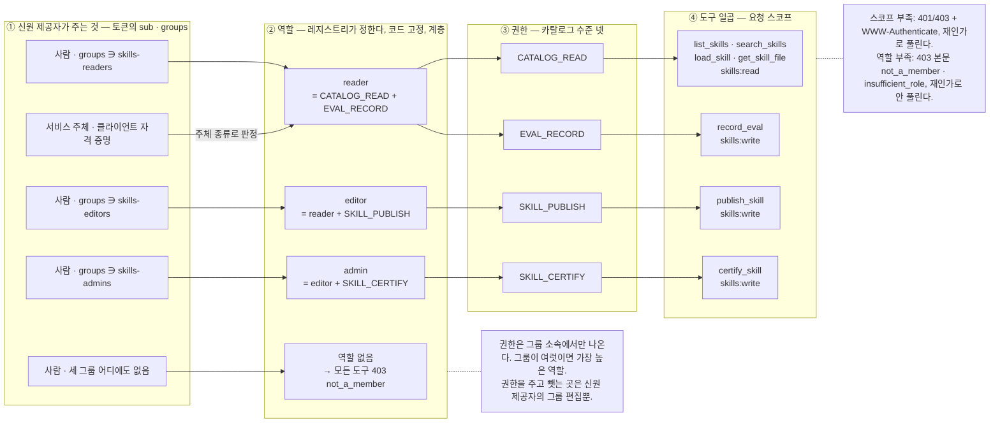

# harness-catalog 설계 v3.2 (초안, 2026-09-26) — 단일 팀

**이름.** 담는 것이 스킬만이 아니라 하네스 부품 전부(스킬, 나중에 프롬프트·도구 서버, 평가 결과. §1.3, §7)라 2026-09-26에 `skill-catalog`에서 `harness-catalog`로 바꿨다. 서비스도 저장소도 이 한 이름으로 부른다. 본문의 "레지스트리"는 이 서비스를 역할로 부르는 말이다. v2.x는 `~/workspace/skill-catalog/`의 `DESIGN.md`(v2.4)와 `DESIGN-v*.md`에 그대로 있다. v2.x를 고치지 않고 다시 썼다. v3.0(2026-09-25)에 Codex 적대 리뷰(§11)를 반영한 것이 v3.1이고, **v3.2는 범위를 팀 하나로 줄인 판이다**(v3.1은 v2.x와 같은 자리 `~/workspace/skill-catalog/DESIGN-v3.1.md`에 있다. 멀티 팀 문법이 필요한 날 읽는 문서라 이 저장소에 두지 않는다). 팀이 여럿이 되는 조건과 그때 바뀌는 것은 §7 한 행에 있다. `[it]` 요구에 맞는 가장 단순한 해법을 쓰고, yagni의 물음("나중에 넣기가 지금보다 어려운가")에 멀티 팀은 소비자 쪽에서 "아니오"라서다. `name`이 카탈로그 전체에서 유일하고 식별자가 `<name>`뿐이라(§3), 팀을 나중에 더해도 소비자 쪽 식별자(내려받은 사본의 `PINNED`, `replaced-by`, 사용 기록)는 그대로다. 생산자·운영자 쪽 이행 비용은 남는다(§7). **핵심 계약 몇 개가 §9에 미결로 남아 있어 아직 초안이다.**

한 문장: **스킬은 agentskills.io 디렉토리 하나이고, 스킬의 내용은 그 디렉토리들이 모인 git 저장소 하나에 있으며, 스킬에 대한 사실(사용 기록)은 PostgreSQL 하나에 있고, 그 앞에 선 레지스트리 서비스 하나가 사람과 에이전트에게 같은 MCP 도구 일곱 개를 낸다. 게시는 사람 승인 없이 즉시이고, 인증자가 판 하나를 인증하면 그 판이 소비의 기본값이 된다. 루프는 반복마다 검색해서 넣고 다음 반복에는 들고 가지 않는다. 사람은 매일 쓰는 스킬을 자기 하네스의 스킬 디렉토리에 내려받아 둘 수 있고, 그 사본은 그 시점의 판이다.**

---

## 0. v2.x는 무엇이 잘못됐는가

v2.x는 KB를 인용했지만 **이미 고른 기제를 정당화하는 데** 썼다. 구조 자체는 Claude Code의 기능 목록(마켓플레이스, plugin eval, OTel)에서 왔다. `[it]` Dehghani는 이것을 실패 양식으로 이름 붙인다. 플랫폼의 표현이 그것이 가능하게 하는 **경험**이 아니라 그것이 포함하는 **메커니즘**에 닻을 내리면 비대한 플랫폼이 나온다. 처방은 반대 순서다. 단일 경험(스킬을 발견한다)의 표현에서 시작해 그것을 가능하게 하는 가장 단순한 도구를 짓고, 헹구고 반복한다.

KB의 잣대로 v2.4를 다시 재면 이렇다.

| 잣대 | v2.4 | 판정 |
|---|---|---|
| `[it]` 깊은 모듈: 인터페이스가 구현보다 훨씬 단순해야 한다 | 팀원이 알아야 하는 것: 마켓플레이스, `/plugin`, `enabledPlugins`, `skillOverrides`, Tier A/B, budget-check, MCP 등록, managed settings, CATALOG 페이지, PR 템플릿, evals 형식, CHANGELOG, 버전, CODEOWNERS, policy.yaml | **얕다.** 기능(스킬을 찾고·쓰고·올린다)에 비해 인터페이스가 크다 |
| `[it]` 복잡성을 아래로: 설정 매개변수는 복잡성을 위로 민다 | 프로젝트마다 Tier 결정, 예산 문턱, skillOverrides, 분기 Tier 리뷰, policy.yaml 값들 | **위로 밀었다.** "사용자가 우리보다 더 나은 값을 정할 수 있는가"를 묻지 않았다 |
| `[it]` 범용 모듈이 더 깊다: 과잉 특수화가 복잡성의 최대 원인 | 같은 스킬에 전달 경로 둘(마켓플레이스 설치·MCP 로드), 소비 양식 넷, 각각 다른 grader·예산·제약 | **특수화됐다.** 하나의 범용 기제(식별자로 스킬을 가져온다)로 덮인다 |
| `[it]` 시간적 분해는 정보 누출을 낳는다 | 저자 → PR 게이트 → 게시 → 설치 → 세션 → 관측의 단계마다 모듈. "스킬이 무엇인가"라는 지식이 lint·catalog.py·publish.yml·budget-check·MCP·CATALOG에 흩어짐 | **누출.** 스펙 한 곳에 있어야 할 지식이 여섯 곳에 있다 |
| `[it]` 포장된 길: 강제하지 않는 것이 요점 | managed settings로 필수 플러그인·OTel 강제, strictKnownMarketplaces | **통치하려 들었다.** 쓰기 불편하면 우회당한다 |
| `[it]` 연합 컴퓨테이셔널 거버넌스: 수작업 인증·중앙 검증은 병목 | PR 게이트 5단, CODEOWNERS + 새 스킬은 리드 승인, evals 없으면 머지 불가 | **인증 병목.** 사람 승인이 게시 경로에 있다 |
| `[it]` 발견 가능성의 왼쪽 이동: 스킬 자신이 발견 정보를 갖는다 | SKILL.md가 갖고 있는데 CATALOG.md·MCP 인덱스·마켓플레이스 항목으로 세 번 파생 | **중복.** 파생물 셋 중 둘은 git 호스트의 디렉토리 열람으로 대체된다 |

`[웹]` Databricks UC Skills(2026-09-25 확인)가 단순한 이유는 사용자에게 보이는 표면이 작기 때문이다. 사람은 CLI 명령 셋(`ug configure`, `ug skills`, `ug skills add`)과 Catalog Explorer의 권한 화면과 자연어를 쓰고, 에이전트는 MCP 도구 여섯(`list_skills`, `load_skill`, `get_skill_files`, `create_skill`, `update_skill`, `delete_skill`)을 부른다. 문서에 리뷰·승인·eval 단계는 보이지 않는다(부재 관찰이지 증명은 아니다). 게시는 즉시이고 처음엔 비공개이며 공유는 복사가 아니라 grant다. 그 단위가 agentskills.io의 SKILL.md다.

---

## 1. 출발점 넷

0. **잣대는 사용자 부담이다. 운영자 부담이 아니다.** `[웹]` UC가 사용자에게 시키는 것은 명령 셋과 자연어와 권한 화면뿐이고, `[영상]` toolbox 패턴의 목적도 에이전트의 컨텍스트 부담을 줄이는 것이다. `[it]` 모듈은 개발자보다 사용자가 많으니 사용자보다 개발자가 고생하는 편이 낫다. 이 문서의 모든 결정은 "팀원과 에이전트가 알아야 하고 해야 하는 것이 줄었는가"로 판정한다. 서비스 수를 줄이는 것은 그 결과이지 목표가 아니다. v3.0 초안이 레지스트리를 팀원 머신에 두었던 것은 이 잣대를 뒤집은 오류였다. **가정:** 매 반복 검색이 사본 유지·재다운로드보다 사용자에게 싸다는 것은 아직 측정하지 않은 가정이다. 파일럿에서 잰다(§9).
1. **핵심 상호작용 하나.** `[it]` 플랫폼 설계는 생산자와 소비자 사이의 핵심 상호작용에서 시작한다. 여기서는 **스킬을 올린다 ↔ 스킬을 쓴다**다. 나머지는 전부 이것에서 파생되거나 없어도 된다.
2. **소비자는 사람과 에이전트, 둘 다 1급.** 출처를 가른다. `[웹]` agentskills.io 스펙(2026-09-26 확인)은 소비자를 에이전트로만 적는다. 정의는 "instructions that tell an agent how to perform a specific task", 본문 규정은 "Write whatever helps agents perform the task effectively", description 규정은 "keywords that help agents identify relevant tasks"이고, 사람은 저자로만 나온다("company-, team-, and user-specific context ... that agents load on demand"). 사람을 소비자로 더한 근거는 스펙이 아니라 다음이다. `[it]` 데이터 메시는 "데이터 프로덕트 사용자"를 프로덕트와 상호작용하는 모든 에이전트로 정의하고 거기에 사람(개발자·소유자·소비자·거버넌스 그룹)뿐 아니라 시스템도 포함하며(11장 p.196), 발견 가능성을 기계와 사람의 접근 양쪽에 대해 설계한다(13장 p.234). `[웹]` Netlify의 Agent Experience(2025)는 "AI 에이전트가 소프트웨어의 주 사용자가 되면서 그들의 경험이 사람의 경험만큼 중요하다"고 하되 통합 표면과 분리 표면 중 어느 쪽도 정하지 않는다. `[웹]` Wang 외(arXiv 2603.20300, 2026-03)는 사람 인터페이스(사용성)와 에이전트 인터페이스(신뢰성)의 최적화 목표가 다르다고 보아 분리를 권하면서도 "많은 실제 시스템은 사람과 AI 사용자를 둘 다 섬겨야 하므로 대체가 아니라 이중 청중 설계가 필요하다"고 적는다. `[웹]` Microsoft DevOps Playbook(2026-04)은 "에이전트를 사람 개발자와 나란히 1급 사용자로 다루는 내부 개발자 플랫폼"을 중기 방향으로 든다. `[웹]` Databricks UC Skills 문서는 사람("you")과 에이전트("your agent calls")를 함께 상정한다. 공통분모는 "둘 다 사용자다"이고, 갈리는 자리는 "같은 표면인가 다른 표면인가"이며, 이 설계는 같은 도구 일곱을 둘에게 내는 쪽을 고른다(§6). 스펙은 그것을 막지 않는다(SKILL.md는 사람이 읽는 마크다운이고 사람의 명시 호출은 활성화 단계를 사람이 촉발하는 것이다). 그래서 인터페이스를 둘로 나누지 않는다. 사람은 세션 안에서 검색·탐색하고 골라서 명시 호출하며, 에이전트 루프는 과제를 보고 스스로 검색·로드한다. 둘 다 같은 레지스트리의 같은 도구 일곱이다. 네트워크 호출을 실제로 내는 것은 어느 경우든 에이전트 프로세스이고(그림 1), "1급"은 호출 주체가 둘이라는 뜻이다. 사람이 세션 밖에서 볼 때는 git 호스트의 디렉토리를 본다.
3. **소비의 기본형은 루프다.** `[영상]` 34:19~35:10 toolbox 패턴: 스킬을 검색 가능하게 저장해 두고, 정말 필요할 때만 꺼내 컨텍스트에 넣고, 반복마다 아직 맞는지 보고 아니면 뺀다. 강연이 말하는 것은 이 일반 패턴이고, "반복마다 재검색하고 직전 본문을 버린다"는 그것을 이 설계가 고른 구체 정책이다. 그 정책이 성립하는 자리는 **우리가 만드는 루프**뿐이다. 루프가 반복 경계를 정하고 컨텍스트를 조립하므로 제거의 주체도 루프다. 일반 하네스 세션(Claude Code 등)은 이 정책을 보장하지 않고, 거기서는 한 세션에 한 번 로드하는 것까지가 이 설계의 약속이다(§4). 이 층 구분으로 말하면 이 설계가 만드는 것은 **하네스 부품**(스킬 파일·MCP 커넥터·권한)이고, 루프 엔지니어링의 다섯 장치(트리거·정지 조건·상태 파일·검증 서브에이전트·예산)는 카탈로그를 쓰는 루프 쪽이 따로 짓는다. 루프와 닿는 자리는 둘뿐이다. 반복마다 꺼내 쓰는 소비와, 개선 루프가 `publish_skill`로 되쓰는 갱신. 그래서 **루프에는 사본이 없다.** 사본은 세션 시작마다 프리픽스에 실리는 "항상 켜진 skills box"이고 그것이 v2.x의 Tier A였다. **사람의 일반 세션은 다르다.** `[웹]` UC는 다운로드의 이유를 "loads automatically each session, and works offline. Best for the handful you use daily"로 적고 라이브는 "a big, fast-changing set"에 권하며, `[altera-skills]` r10 실물 조사는 사람의 지배적 소비가 설치 시점의 큐레이션이고 상주 description 발동이 가장 빠른 길이라고 기록한다. 그래서 사람이 매일 쓰는 소수는 자기 하네스의 스킬 디렉토리에 **내려받아(pin)** 두고, 새 스킬을 만나는 길은 여전히 `search_skills`다(§4 두 맥락). 내려받은 것은 UC와 같은 뜻의 point-in-time 사본이고 갱신은 사용자가 다시 받는다. 루프에까지 사본을 두는 조건은 §7에 있다.
4. **단위는 agentskills.io 스펙 그대로.** `[웹]` 스펙(2026-09-25 확인)이 **강제**하는 것: `name`(1–64자, 소문자·숫자·하이픈, 디렉토리명 일치), `description`(1–1024자), `compatibility` 500자 이하, `metadata`는 문자열 맵. **권고**하는 것: 본문 500줄 이하, 본문 5000토큰 이하, `scripts/`·`references/`·`assets/` 배치, 점진적 공개(메타데이터는 시작 시, 본문은 활성화 시, 파일은 필요 시). **이 설계가 스펙과 갈라서는 자리는 점진적 공개의 1단계 하나다.** 스펙은 시작 시 모든 스킬의 이름·설명을 싣는 것으로 발견을 정하는데, 그것은 §7에서 뺀 상주 방식(Tier A)이다. 이 설계는 그 자리를 `search_skills`(§3, §4)로 대체하고 2단계(활성화 시 본문)와 3단계(필요 시 파일)는 그대로 따른다. 검증기 `skills-ref validate`가 강제하는 것은 앞의 강제 항목이다. **카탈로그가 스킬 파일 형식에 더하는 것은 없다.** 카탈로그가 더하는 것은 파일 밖의 둘, 식별자(`<name>`, 곧 저장 경로 `skills/<name>/`)와 스킬에 대한 사실(§2)이다. `metadata.replaced-by`는 스펙이 허용한 `metadata` 맵 안의 저자 선언이다.

---

## 2. 구조

**그림 1 — 시스템 경계.** 누가 누구와 이야기하고 신원과 권한이 어디서 정해지는가.



그림 1을 읽는 법. 소비자는 둘이고 둘 사이에 선이 없다. 사람의 세션(하네스가 사람 대신 MCP를 부른다)과 루프(코드가 반복마다 부른다)는 같은 인가 서버에서 다른 그랜트로 토큰을 받고, 같은 프록시로 같은 도구를 부른다. 다른 것은 그랜트(사람은 PKCE·장치, 루프는 클라이언트 자격 증명이라 읽기와 `record_eval`만 되고 내용 게시·인증은 안 된다)와 호출의 시점뿐이다. 인증(`certify_skill`)은 admin 역할의 사람만 부르며 같은 선을 탄다. 내려받기(pin)는 사람의 세션에만 있다. 게시 경로는 둘이다. 보통은 사람의 세션이 `publish_skill`로(프록시 → 레지스트리 → 저장소), 사람 승인이 필요한 변경은 git 호스트의 PR로(점선). 후자는 레지스트리를 거치지 않으므로 주기 fetch(설정, 기본 60초)가 받는다(§2 인덱스 갱신). 사람의 세션은 로컬 머신을 전제한다. 클라우드 샌드박스 세션은 홈 디렉토리를 읽지 않아 내려받은 사본이 닿지 않고 라이브만 쓴다(§4). 디렉터리(팀원이 누구인가)는 플랫폼 밖이고, v3.0의 인가 서버(Dex)는 플랫폼 compose 안에서 디렉터리를 연합해 OIDC 토큰을 낸다. 사내 IdP로 옮기면 인가 서버가 플랫폼 밖으로 나가고 레지스트리는 issuer만 바꾼다(§2 신원 제공자 표). `[it]` 신원 제공자는 주체가 누구인지를 주고 무엇을 하도록 허용할지는 체계가 정한다. 그래서 인가는 레지스트리 안에 있고(그림 2), 프록시는 TLS와 라우팅만 한다. `[it]` 게이트웨이는 기능을 떠맡을수록 결합 지점과 공격 표면이 커지고, `[it]` 요구에 맞는 가장 단순한 해법을 쓰라는 지침에서 리버스 프록시(단일 백엔드·TLS)로 충분하다. 인가·속도 제한·로깅을 주는 API 게이트웨이는 두지 않는다. **사람의 git 호스트 열람이 인가를 우회하지 않는 이유는 v3에 스킬 단위 읽기 제한이 없기 때문이다**(§5 공유). 읽기의 경계는 둘 다 "팀" 하나다 — 레지스트리는 `skills-readers`·`skills-editors`·`skills-admins` 그룹, 저장소는 git 호스트의 읽기 권한이고, 운영자가 두 명단을 같게 유지한다(§2.1 운영자 체크리스트). 그 안에서는 저장소를 읽을 수 있는 사람이 레지스트리로도 전부 읽고 그 역도 같다.

**그림 2 — 레지스트리 내부.** `[it]` 포트와 어댑터 규정대로 그린다. 앱은 외부 기술을 이름으로 부르지 않고 인수로 받으며, 포트는 의도별 대화이고 이름은 "For …ing"이다.



그림 2의 노드는 열아홉이고 역할은 아래 표다. "For …ing"으로 적힌 여덟이 **포트**다. `[it]` 포트는 앱과 바깥 사이의 의도별 대화이고, 앱이 바깥에 제공하는 것(제공 인터페이스, 구동 쪽)과 앱이 바깥에 요구하는 것(요구 인터페이스, 피구동 쪽)으로 나뉜다. 화살표 방향이 그 구분이다. 왼쪽 넷은 어댑터가 앱을 부르고, 오른쪽 넷은 앱이 어댑터를 부른다.

| 노드 | 종류 | 역할 | 코드에서의 형태 |
|---|---|---|---|
| MCP 어댑터 | 구동 어댑터 | MCP 요청을 받아 도구 일곱을 앱 함수 호출로 바꾸고 결과를 MCP 응답으로 돌려준다. 프로토콜·헤더·JSON-RPC는 여기서 끝난다 | SDK의 `Server` 도구 등록 + `streamable_http_app()` |
| 운영 어댑터 | 구동 어댑터 | 오케스트레이터의 헬스 체크를 받아 앱의 상태를 HTTP로 낸다 | Starlette 라우트 둘(`/healthz`, `/readyz`) |
| 스케줄러 어댑터 | 구동 어댑터 | 시계가 앱을 부른다. 기동 시 1회(구조 검사 + 첫 인덱스 빌드), fetch 주기마다(`FETCH_INTERVAL_SECONDS`, 기본 60. fetch → 바뀌었으면 인덱스 재구축), 24시간마다(보존 삭제). 인스턴스 안의 백그라운드 작업이고 클론 잠금(§2)을 쥔다 | asyncio 태스크 둘. Configurator가 uvicorn과 함께 띄운다 |
| For consuming skills | 제공 포트 | 소비자(사람의 세션, 루프)가 앱에 요구할 수 있는 것. 목록·검색·본문·파일 | 앱 함수 넷의 시그니처 |
| For publishing and certifying skills | 제공 포트 | 저자·평가자·인증자가 앱에 요구할 수 있는 것. 게시와 은퇴, 평가 결과 기록, 판의 인증·철회 | 앱 함수 셋의 시그니처 |
| For operating | 제공 포트 | 운영자·오케스트레이터가 앱에 물을 수 있는 것. 살아 있는가, 준비됐는가(구조 검사 통과와 인덱스 존재), 마지막 fetch가 언제인가, DB가 닿는가(`degraded` 사유) | 앱 함수 둘의 시그니처. 카탈로그의 상태를 읽는다 |
| For maintaining the catalog | 제공 포트 | 시계가 앱에 시킬 수 있는 것. 저장소 구조 검사, fetch와 인덱스 재구축(커밋 세대 검사 포함), 보존 삭제 | 앱 함수 셋의 시그니처. 사람도 에이전트도 부르지 않는다 |
| 인가 정책 | 앱 | 검증된 토큰의 주체와 그룹, 요청한 도구와 스코프로 이 호출을 허용할지 정한다. 모든 제공 포트 호출이 먼저 여기를 지난다 | 순수 함수. 입력은 주체·그룹·스코프·도구 |
| 카탈로그 | 앱 | 인덱스로 목록·검색을 하고 스킬 본문과 파일을 돌려준다. 읽기를 사용 기록으로 남긴다. 저장소 스냅샷에서 인덱스를 짓고(§2 인덱스 갱신, 그림 3 규칙 3) 같은 행 집합을 메모리에도 들어 DB 단절 시 깎아서 답한다(§2.1). 기동 시 구조 검사(§2.1)도 여기다 | 함수 넷 + 유지 함수 셋 |
| 게시·인증 | 앱 | 검증 → 커밋·push → 인덱스 동기 갱신의 순서와 원자성·멱등 규칙(§2 게시의 순서와 일관성)을 지킨다. 평가 결과는 검증 없이 사실 표에 붙인다. 인증은 판의 존재만 검사하고 사실 표에 붙인다 | 함수 셋 |
| For verifying identity | 요구 포트 | 앱이 바깥에 요구하는 것. "이 Bearer 토큰을 검증하고 주체·그룹·스코프를 돌려 달라" | `typing.Protocol` |
| For storing skill content | 요구 포트 | "fetch해 달라, 현재 스킬 트리를 달라, 이 디렉토리를 이 저자 명의로 커밋·push해 달라, 이 tree SHA의 판을 달라, 표지 파일과 지워진 스킬 이름의 이력을 달라" | `typing.Protocol` |
| For recording facts | 요구 포트 | "인덱스를 이 커밋의 내용으로 바꿔 달라(더 오래된 커밋이면 거부), 검색해 달라, 사용 기록을 한 건 적어 달라, 보존 일수 지난 사용 기록을 지워 달라, 평가 결과를 한 건 적어 달라, 현재 판의 최근 평가를 달라, 인증·철회를 한 건 적어 달라, 스킬의 현재 인증 판을 달라" | `typing.Protocol` |
| For validating a skill | 요구 포트 | "이 디렉토리가 스펙에 맞고 비밀이 없는지 판정해 달라" | `typing.Protocol` |
| OIDC 어댑터 | 피구동 어댑터 | issuer의 JWKS로 서명을 검증하고 `iss`·`aud`·`exp`·`nbf`·`scope`·`groups`를 확인해 주체를 만든다. 바깥 통신은 JWKS 가져오기뿐 | SDK `TokenVerifier` 구현 |
| git 어댑터 | 피구동 어댑터 | 로컬 클론을 유지하고 fetch·commit·push를 한다. non-fast-forward 재시도는 여기가 아니라 게시(앱)가 지시한다 | git CLI 호출 |
| PostgreSQL 어댑터 | 피구동 어댑터 | 인덱스·사용 기록·평가 결과·인증의 SQL. 어휘 검색(`tsvector`·`pg_trgm`)도 여기 | psycopg 3 + SQL 파일 |
| 검증 어댑터 | 피구동 어댑터 | `skills-ref validate`와 시크릿 스캔을 돌려 결과를 판정으로 바꾼다 | 라이브러리 호출 |
| Configurator | 패턴 밖, 필수 | 설정값 다섯(과 기본값 있는 하나)을 읽어 피구동 어댑터 넷을 만들고, 앱을 만들어 넷을 꽂고, 구동 어댑터 셋(MCP·운영·스케줄러)을 만들어 앱을 건넨다. 모든 참가자를 아는 유일한 자리 | `bootstrap(settings) -> App` 함수 하나 + uvicorn 기동 |

그림 2를 읽는 법. 앱 안에는 셋이 있다. **인가 정책**(토큰의 주체와 그룹으로 이 호출을 허용하는가), **카탈로그**(인덱스를 읽어 검색하고 본문을 돌려준다), **게시·인증**(검증하고 커밋하고 사실을 기록한다). 이 셋은 git도 PostgreSQL도 OIDC도 모른다. `[it]` 강한 준수의 기준은 "앱이 외부 기술에 대해 아무것도 모른다"이고, 그래야 어댑터를 갈아 끼울 수 있다(SQLite로 되돌리기, 다른 IdP, GitLab). 구동 포트는 액터마다 하나다. 소비하는 쪽(사람과 루프), 게시하는 쪽(저자와 평가자), 운영하는 쪽(오케스트레이터의 헬스 체크), 유지하는 쪽(시계. `[it]` 콕번은 타이머 같은 자동 트리거도 구동 액터로 센다). 넷째가 있어야 주기 fetch·보존 삭제·기동 검사가 앱 함수로 존재하고 시험에서는 시험 케이스가 시계 대신 그 함수를 부른다. `[it]` 인스턴스화·설정은 포트가 아니라 Configurator의 일이다. **Configurator**가 어댑터를 골라 앱에 꽂으며 `[it]` 패턴 밖이지만 반드시 필요한 다섯째 요소다. **레지스트리 프로세스**의 필수 설정값은 다섯이다. 카탈로그 저장소 URL, git deploy key, OIDC issuer, 레지스트리 공개 URL(토큰의 audience이자 RFC 9728 메타데이터의 `resource`), PostgreSQL 접속. 기본값이 있는 선택 설정값이 둘 더 있다. 사용 기록 보존 일수(`USAGE_RETENTION_DAYS`, 기본 90)와 주기 fetch 간격(`FETCH_INTERVAL_SECONDS`, 기본 60). 둘을 설정으로 뺀 근거는 `[it]` 외부 설정의 목록("세율처럼 외부에서 설정되는 매개변수", 환경별 매개변수)이고, 보존 기간은 조직의 데이터 정책이 정하는 값이고 fetch 간격은 git 호스트의 fetch 부하 한도와 우회 push의 허용 지연 사이에서 운영 환경이 정하는 값이라 `[it]` "사용자가 우리보다 더 나은 값을 정할 수 있는가"에 "그렇다"인 드문 경우다. 이 일곱 밖의 레지스트리 설정값은 없다. 플랫폼 운영 설정(Dex의 issuer·LDAP 연결·정적 클라이언트·그랜트, 백업 대상·스케줄)은 §2.1 "운영자가 아는 것"에 따로 센다.

**헥사고날은 여기까지다.** 패턴이 요구하는 것은 "외부 기술을 인수로 받는다" 하나이고, 이 설계는 그것을 강한 준수로 지킨다. 그 밖은 가져가지 않는다. `[it]` 이 패턴은 앱 내부 구조에 대해 아무 말도 하지 않으며 그 점에서 클린·양파와 갈리므로, 앱 안에 도메인·유스케이스·엔티티 층을 따로 세우지 않는다. `[it]` 파이썬에서는 포트가 코드에 드러나지 않아도 되고 추상 기반 클래스는 필수가 아니므로, 그림의 포트 여덟은 개념이고 코드에서는 어댑터를 인수로 받는 함수 시그니처가 포트다. `[it]` 클래스염을 피한다. 그리고 `[it]` DB 대역은 실물의 동작을 보장하지 않으므로 PostgreSQL 어댑터의 시험은 실제 컨테이너로 돌린다. "DB 없이 시험"의 이득은 git과 OIDC 어댑터에서 온다.

**MCP 전송 — Streamable HTTP, 개정판 2026-07-28, 무세션.** `[웹]` 최신 개정판(2026-07-28 확인)은 프로토콜 수준 세션과 `Mcp-Session-Id`를 없앴고 `initialize` 핸드셰이크도 없앴다. 요청마다 `_meta`에 프로토콜 버전과 클라이언트 능력을 싣고, 서버는 단일 엔드포인트에 POST만 받으며, 응답은 JSON 하나이거나 그 요청에 묶인 SSE 스트림이다. GET 스트림, 세션 종료 DELETE, `Last-Event-ID` 재개는 이 개정판에 없다. 서버는 `Origin`을 검증해야 하고, `MCP-Protocol-Version`·`Mcp-Method`·`Mcp-Name` 헤더가 본문과 일치하는지 검증해야 하며(불일치는 400 `HeaderMismatch`), `server/discover`를 구현해야 하고, `tools/list`는 결정적 순서와 `ttlMs`·`cacheScope`를 돌려준다. 이 설계가 이 개정판을 고르는 이유는 레지스트리가 어차피 무상태이기 때문이다. 세션 저장소가 없으니 인스턴스를 늘려도 붙임 세션(sticky session)이 필요 없고, 리버스 프록시는 헤더만 보고 라우팅할 수 있다. 호환은 SDK에 맡긴다. 2025-11-25 이하 개정판의 클라이언트(`initialize`·세션·GET 스트림)는 스펙의 호환 행렬대로 SDK가 감지해 그 시대의 동작으로 응답한다. 파일럿 대상 에이전트 셋이 어느 개정판을 말하는지는 §9의 확인 항목이다. 2024-11-05의 HTTP+SSE는 폐기 상태라 지원하지 않는다.

**인증·인가.**

| 물음 | 답 | 근거 |
|---|---|---|
| 누가 신원을 확인하는가 | 사내 OIDC 신원 제공자. 레지스트리는 액세스 토큰(JWT)의 서명을 JWKS 공개키로 검증할 뿐 요청마다 IdP를 부르지 않는다 | `[it]` OIDC가 최종 사용자 SSO의 지배적 기제. `[it]` ID 토큰을 액세스 토큰 대신 쓰지 말라 |
| 토큰 검증 계약 | `iss`가 설정된 issuer, `aud`가 레지스트리의 canonical URI(`[웹]` MCP 인가 스펙: 서버는 토큰이 자기를 대상으로 발급됐음을 RFC 8707대로 검증해야 하고, 클라이언트는 인가·토큰 요청에 `resource` 파라미터로 그 URI를 보내야 한다), `exp`·`nbf`에 60초 시계 오차 허용, 서명 알고리즘은 RS256·ES256만, 필수 클레임은 `sub`·`scope`. **주체 판별:** 서비스 주체는 인가 서버가 클라이언트 자격 증명 그랜트로 낸 토큰이다. 판별은 `groups` 유무가 아니라 토큰의 명시 표지로 한다. **가정:** Dex의 클라이언트 자격 증명 토큰이 `sub`=client ID를 내고 사람 토큰과 구별되는 표지(`azp` 또는 `groups` 부재 + `sub`가 등록된 client ID 중 하나)를 갖는다는 것은 파일럿에서 확인한다(§9). 확인 전에는 "`sub`가 Dex에 등록된 client ID 집합에 있으면 서비스 주체"를 쓴다. 그룹 클레임이 빠진 사람 토큰은 서비스 주체로 오인되지 않고 `not_a_member`로 거부된다. 서비스 주체의 `sub`는 사용 기록의 주체로 적힌다. **상태 코드 경계:** 토큰이 없거나 검증에 실패하면 401 + `WWW-Authenticate: Bearer resource_metadata="…", scope="skills:read"`. 토큰은 유효한데 스코프가 모자라면 403 + `WWW-Authenticate: Bearer error="insufficient_scope", scope="skills:write", resource_metadata="…"`(재인가로 풀린다). 스코프는 있는데 필요한 그룹이 아니면(읽기에 `skills-readers` 이상, 게시에 `skills-editors` 이상, 인증에 `skills-admins`) 403에 `WWW-Authenticate`를 붙이지 않고 본문에 사유(`not_a_member`·`insufficient_role`)만 적는다. 스코프를 더 받아도 풀리지 않는 것이라 재인가를 유도하지 않는다. **스코프와 도구:** `list_skills`·`search_skills`·`load_skill`·`get_skill_file`은 `skills:read`, `publish_skill`·`record_eval`·`certify_skill`은 `skills:write`이며 `skills:write`는 `skills:read`를 함의한다. 서비스 주체는 스코프와 무관하게 읽기 넷과 `record_eval`을 부를 수 있고 `publish_skill`은 못 부른다(주체 종류로 판정. 별도 스코프를 두지 않는 이유는 Dex 정적 클라이언트에 커스텀 스코프를 싣는 방법을 확인하지 못했고 서비스 주체에게 허용할 쓰기가 어차피 그 하나라서다). 첫 401의 챌린지 스코프는 `skills:read`이고, 게시에서 403을 받은 클라이언트가 `skills:write`를 더해 재인가하는 단계적 상승은 `[웹]` 스펙의 흐름을 따른다 | `[웹]` MCP 인가 스펙(2026-07-28): MCP 서버는 OAuth 2.1 자원 서버이고, RFC 9728 보호 자원 메타데이터를 **반드시** 내야 하며, 클라이언트는 그것으로 인가 서버를 찾는다. `[it]` 모든 종단점에 인가 검사를 두라 (시계 오차·알고리즘·스코프 이름은 이 설계의 결정) |
| 어떤 그랜트를 지원하는가 | 셋. 브라우저가 있는 사람·에이전트는 인가 코드 + PKCE(`[웹]` MCP 인가 흐름의 기본형이며 `resource` 파라미터와 RFC 9207 `iss` 검증이 붙는다). 브라우저 없는 샌드박스는 장치 인가. 무인 루프·CI는 클라이언트 자격 증명. 비밀번호 그랜트는 받지 않는다. 클라이언트 등록은 플랫폼 팀이 인가 서버에 에이전트 제품마다 사전 등록한 client ID를 쓰고(Dex는 `public: true` 정적 클라이언트), 인가 서버가 지원하면 `[웹]` 스펙이 권하는 Client ID Metadata Documents로 옮긴다. 동적 등록(RFC 7591)은 스펙에서 폐기 예정이라 쓰지 않는다 | `[it]` PKCE는 공개 클라이언트에 필수. 장치 인가는 브라우저 없는 클라이언트용. 클라이언트 자격 증명은 기계 대 기계이고 주체가 클라이언트 자신. `[it]` 필요한 그랜트만 지원하고 필요하면 더하라 |
| 토큰 수명과 폐기 | 액세스 토큰 수명은 IdP 정책을 따르되 1시간 이하를 요구한다. 갱신은 클라이언트와 IdP 사이(리프레시 토큰)이고 레지스트리는 관여하지 않는다. 레지스트리는 폐기 목록을 두지 않는다. 짧은 수명이 폐기를 대신하고, 즉시 차단이 필요하면 IdP에서 사용자나 클라이언트를 비활성화한다(최대 1시간 창). 서비스 자격 증명(클라이언트 시크릿)은 사내 시크릿 저장소에 두고 IdP 정책 주기로 회전한다. JWKS는 캐시(TTL 1시간)하되 모르는 `kid`를 만나면 즉시 재조회해 키 롤오버를 받는다 | `[it]` 짧은 수명의 토큰이 폐기 뒤 남는 창을 줄인다. `[it]` 리프레시 토큰은 안전하게 보관하고 폐기가 접근을 끊는 수단이다 |
| 주체가 둘이다 | 사람 주체(`sub`가 사용자, `groups`에 팀 그룹)와 서비스 주체(`sub`가 클라이언트). **v3.2에서 서비스 주체는 내용을 쓰지 못한다.** 게시는 사람 토큰으로만 한다(§6 "올리기"가 어차피 사람의 지시 뒤에만이다). 다만 평가 결과 기록(`record_eval`)은 서비스 주체(CI의 평가 러너)도 한다. 내용이 아니라 추가 전용 사실이고 주체가 기록되기 때문이다. 스코프가 아니라 주체 종류로 허용한다(토큰 검증 계약 행). 무인 게시가 필요해지면 §7의 권한 행이 그 자리다 | `[it]` 클라이언트 자격 증명에서는 주체가 자원 소유자를 대신한 것이 아니라 클라이언트 자신. "사용자 명의 커밋"은 사람 주체에서만 성립한다 |
| 팀원은 어디서 오는가 | IdP 그룹 셋이 역할 셋에 하나씩 대응한다. `skills-readers` → reader, `skills-editors` → editor, `skills-admins` → admin. 역할은 계층이라(admin ⊇ editor ⊇ reader) 한 그룹에만 넣으면 된다. 이름은 고정이고 매핑 표도 문법도 없다. 세 그룹 밖의 디렉터리 사용자는 로그인은 되지만 아무것도 못 한다. 가입·탈퇴는 IdP에서 하고 다음 토큰부터 반영된다(최대 1시간 지연). 중첩 그룹은 IdP가 평탄화해 클레임에 넣는 것을 전제한다 | `[it]` 조직이 일하는 방식을 본뜬 굵은 역할을 쓰고, 서비스 기능 하나에 특정한 세밀한 역할을 디렉터리에 넣지 말라. "publish 가능" 같은 역할을 IdP에 만들지 않는다. reader·editor·admin은 조직이 일하는 방식을 본뜬 굵은 역할이고 `[웹]` DataHub(Admin·Editor·Reader)·Langfuse(Owner·Admin·Member·Viewer)가 같은 꼴이다(2026-09-26 확인) |
| 어디서 인가하는가 | 레지스트리 안, 도구 호출마다. 프록시는 하지 않는다 | `[it]` 게이트웨이가 할 수 있는 것은 굵은 인가까지이고 그 이상은 서비스에 지역적이어야 한다. 상류에 인가를 모으면 배포가 게이트웨이 설정에 묶여 독립 배포 가능성이 깨진다 |
| 무엇을 인가하는가 | 읽기(검색·로드·파일)는 `groups`에 `skills-readers`·`skills-editors`·`skills-admins` 중 하나가 있는 사람 주체와 서비스 주체. 인증은 됐지만 두 그룹 어디에도 없는 사람은 403 본문 `not_a_member`(챌린지 없음) — 디렉터리에 있다는 것이 팀원이라는 뜻은 아니다. 내용 쓰기(게시·은퇴)는 `groups`에 `skills-editors`가 있는 사람 주체만. 평가 기록(`record_eval`)은 reader 이상 전부(서비스 주체 포함). 인증·철회(`certify_skill`)는 admin(`skills-admins`)인 사람 주체만(아니면 403 본문 `insufficient_role`, 챌린지 없음). 그 밖은 403. 권한·역할·주체의 층은 그림 4 | 위와 같다 |
| 혼란한 대리인은 | 레지스트리가 git에 push할 때 자기 deploy key를 쓰되 커밋 author는 토큰의 사용자다. 레지스트리가 사용자를 대신해 쓰는 유일한 하류가 git이고, 그 쓰기 범위는 인가 정책이 이미 판정한 경로 하나뿐이다 | `[it]` 상류가 중개자를 속여 해서는 안 될 일을 시키는 문제. 하류로 무엇을 보낼지 정하라는 조항에 따라 git으로 가는 것은 경로·파일·author뿐 |

**신원 제공자의 교체 가능성 — 어댑터는 하나, 디렉터리는 여럿.** 오픈소스 셀프호스팅 제품(Gitea·Langfuse 등)이 설정으로 LDAP·OAuth·SAML 등 여러 신원 원천을 고르게 하는 것은 그 제품이 자기 로그인 화면과 세션을 갖기 때문이다. 이 레지스트리는 그렇지 않다. 클라이언트가 브라우저가 아니라 에이전트이고, `[웹]` MCP 인가 스펙이 HTTP 전송의 인가를 OAuth 2.1로 정하며 인가 서버는 "자원 서버와 함께 호스팅되거나 별개 개체"로 범위 밖에 둔다. OAuth 2.1에는 비밀번호 그랜트가 없고 `[it]` 그것을 쓰지 말라는 것이 이 KB의 권고이기도 하다. 그래서 **레지스트리는 LDAP에 바인드하지 않는다.** 레지스트리가 아는 신원 유형은 OIDC 하나이고, 그림 2의 "For verifying identity" 어댑터는 JWT를 JWKS로 검증하는 것 하나다. `[it]` 마이크로서비스마다 신원 제공자와의 핸드셰이크를 직접 하면 기능이 중복되므로 그것을 한 자리에 모으라는 조문과 같은 배치다.

디렉터리 유형의 다양성은 그 한 자리, 곧 OIDC 인가 서버가 감당한다. 인가 서버가 LDAP·AD·SAML·소셜 로그인을 연합해 OIDC 토큰으로 바꿔 내면, 레지스트리 쪽 설정은 issuer URL 하나만 바뀐다. 이것이 "설정값으로 신원 제공자 유형을 고른다"의 이 설계 판이며, 고르는 자리가 레지스트리가 아니라 인가 서버다.

| 시작점 | 인가 서버 | 판정 |
|---|---|---|
| **v3.0: Synology NAS의 LDAP(Directory Server)** | 둘 중 하나. (a) `[웹]` Synology SSO Server. SAML·OIDC·Synology SSO를 지원하고 NAS가 가입한 디렉터리 사용자를 인증한다. **확인 필요:** 제3자 OIDC 앱 등록, PKCE, 장치 인가, 클라이언트 자격 증명, `groups` 클레임 지원 여부. KB 문서를 이 세션에서 읽지 못했다. (b) `[웹]` Dex. LDAP 커넥터로 사용자 검색·바인드·그룹 검색을 하고 `groups` 스코프로 그룹 클레임을 낸다. 인가 코드·리프레시·장치 코드·토큰 교환을 지원하고 클라이언트 자격 증명은 플래그로 켠다. 컨테이너 하나 | **Dex로 시작한다.** 이유 둘. 이 설계가 요구하는 것 중 인가 코드 + PKCE(`[웹]` Dex 2.26부터, `public: true` 클라이언트와 `pkce.enforce` 설정)·리프레시·클라이언트 자격 증명·그룹 클레임을 문서로 확인했고, compose에 컨테이너 하나를 더하는 것으로 끝나며 저장소는 같은 PostgreSQL 인스턴스의 **별도 데이터베이스**(`dex`, 별도 역할)를 쓴다. **확인 필요:** 장치 흐름. `[웹]` Dex 이슈 #3983은 장치 흐름이 client_secret을 요구해 RFC 8628과 어긋난다고 보고하므로, 브라우저 없는 샌드박스 경로는 파일럿에서 실측하고 안 되면 v3.0 범위에서 뺀다(§9). 클라이언트 자격 증명 토큰의 `sub`가 client ID로 나오는지도 확인. SSO Server가 (a)의 확인 항목을 전부 만족하면 Dex를 빼고 issuer만 바꾼다 |
| 이후: 사내 IdP(Keycloak·Okta·Entra 등) | 그 IdP가 곧 인가 서버 | issuer URL 교체. 레지스트리 코드 변경 없음. 그룹 `skills` 하나만 그쪽 디렉터리에 만든다 |

Dex를 두면 v3.0 compose는 서비스 1 + PostgreSQL 1 + Dex 1이 된다. 클라이언트 등록은 Dex의 정적 클라이언트 설정에 에이전트 제품마다 하나씩 사전 등록한다(Client ID Metadata Documents는 Dex 지원을 확인하지 못했다). 이 결정으로 **팀 소속의 정본은 Synology LDAP의 그룹**이 되고, 그룹 가입·탈퇴는 NAS에서 한다.

**구성 요소.** 그림 1의 노드는 열(사람의 세션, 루프, 하네스 스킬 디렉토리, 디렉터리, 리버스 프록시, 인가 서버, 레지스트리, PostgreSQL, 저장소, 검증 워크플로)이다. 이 중 이 설계가 새로 만드는 것은 아래 넷이며, 인가 서버(Dex)는 compose에 함께 뜨는 운영 부품이고 신원 제공자 표대로 v3.0에만 있는 임시 부품이다.

| 새로 만드는 것 | 무엇 | 크기 |
|---|---|---|
| **저장소** | git 저장소 하나. `skills/<name>/`. 스킬 **내용**의 정본. `main`은 강제 push 금지 | 저장소 1 |
| **PostgreSQL** | 스킬에 **대한 사실**의 정본(사용 기록, 평가 결과)과 저장소에서 파생한 인덱스(재구축 가능) | DB 1 |
| **harness-catalog 서비스** | 호스트 한 대에서 도는 MCP 서버(HTTP 전송). 저장소를 fetch해 인덱스를 짓고 도구 일곱을 낸다. 사내 SSO로 사용자를 알고, 게시는 그 사용자 명의 커밋으로 push한다 | 서비스 1, 플랫폼 팀 소유 |
| **CI 검증** | push마다 `skills-ref validate` + 시크릿 스캔을 돌려 보고한다. 레지스트리를 우회한 직접 push를 잡는 자리. 차단 수단이 아니라 알림이다. 인덱스 빌드가 같은 검증을 다시 돌려 통과하지 못한 스킬을 인덱스에서 뺀다(아래 인덱스 갱신) | 워크플로 1 |

운영자가 살려 둬야 하는 것: 서비스 1, DB 1, 인가 서버(Dex) 1. 사내 IdP로 옮기면 Dex는 빠진다. v2.4는 MCP 서버·collector·Grafana·gh-pages였고 DB를 "기록 시스템 하나 더"라며 뺐다. v3는 DB를 되돌리되 역할을 좁힌다.

**무엇이 어디에 있는가.**

| 데이터 | 자리 | 성질 | 근거 |
|---|---|---|---|
| SKILL.md 본문, `scripts/`·`references/`·`assets/` | git | 정본 | `[영상]` 13:14~14:25 파일은 쓰기 쉽고 POSIX 의미론을 따르며 비정형에 맞고 모델이 잘 다룬다. 이것을 "내용은 git"으로 옮긴 것은 이 설계의 판단이다 |
| 스펙 앞머리(`name`·`description`·`license`·`compatibility`·`metadata`), 그 안의 `metadata.replaced-by` | git (SKILL.md 안) | 정본 | `[웹]` 스펙이 정한 자리. 폐기·대체는 저자 선언이라 git이 유일한 정본이다. DB에 따로 두지 않는다(v3.0의 중복을 뺐다) |
| 인덱스(식별자·설명·`compatibility`·`metadata`·`replaced-by`·tree SHA·최근 commit·토큰 수, 어휘 검색용) | DB | 파생. git에서 언제든 재구축 | `[it]` 파생 데이터는 잃어도 원본에서 다시 만든다 |
| 사용 기록 `(주체, 도구, 스킬 식별자, tree sha, 시각, 검색어·결과 수는 search_skills만)` | DB (추가 전용, 보존 일수(기본 90)를 넘은 행은 하루 한 번 삭제) | 정본이되 **v3.0에서는 잃어도 되는 사실.** git은 읽기를 모르지만 §5대로 v3.0은 이 기록을 읽지 않으므로 복구 약속을 하지 않는다. 순위·폐기 후보가 이것을 읽기 시작할 때 백업 대상으로 승격한다(§7). 검색어는 `search_skills` 행에만 결과 수와 함께 저장한다. 결과 0인 검색어와 바꿔 말한 질의가 검색 개선의 재료다(`[altera-skills]` `evals/search/queries.yml`: 월간 보고의 결과 0 검색어를 골든에 편입). 검색어는 사람의 발화라 개인 데이터일 수 있고 같은 보존 삭제를 받는다 |
| 평가 결과 `(스킬, tree sha, 시나리오 sha, 모델, 하네스, 통과, baseline 통과, 시각, 주체)` | DB (추가 전용, 보존 삭제 없음) | 정본. `record_eval`이 붙인다. 잃으면 그 시점의 실행 사실은 돌아오지 않지만(모델·하네스가 바뀌었을 수 있다) v3.0은 그 손실을 감수해 백업하지 않는다(§2.1) | `[영상]` 0qySk1fcf6k 14:29 중앙 플랫폼의 구성 요소 "evaluation observability", 11:30~11:43 "최신 모델에 대해서도 검증하지 않으면 품질이 떨어진다". `[it]` 후옌: 모델마다 특이성이 있어 프롬프트는 모델을 알아 가며 고쳐 가는 반복. 결과는 정의(시나리오, git)와 분리된 실행 사실(DataHub assertionRunEvent 판례, `[altera-skills]` `schema/eval-result.yaml`) | `[영상]` 14:36~16:00 파일은 트랜잭션 일관성·복제·백업이 없고, 17:48~18:07 구조화된 것은 DB 같은 구조화된 자리에 두라 |
| 게시 사실(누가 언제 무엇을) | git 이력 (사용자 명의 커밋) | 정본. DB의 인덱스 행이 커밋에서 이것을 파생한다 | 커밋이 곧 기록 |
| 인증 `(스킬, tree sha, 행위(인증·철회), 시각, 주체, 메모)` | DB (추가 전용, 보존 삭제 없음) | 정본. `certify_skill`이 붙인다. 최근 행이 그 스킬의 현재 인증 판을 정한다. 잃으면 소비 기본값이 현재 판으로 되돌아가며 인증자가 다시 인증한다(호출 한 번씩). v3.0은 백업하지 않는다(§2.1) | `[웹]` Snowflake CoCo 스킬 카탈로그의 certify(2026-09-26 확인, 문면): 관리자가 판 하나를 인증하면 판 없는 링크가 저자의 최신 판이 아니라 최근 인증 판으로 풀린다. 게시를 막지 않고 소비의 기본값을 사람이 정하는 셋째 모델이다 |

**SHA는 둘이다.** 이 문서에서 `sha`는 스킬 디렉토리의 **git tree SHA**다. 그 스킬의 내용만으로 정해지고 다른 스킬의 변경에 영향받지 않는다. `expected_sha`, `load_skill(sha)`, 사용 기록의 `sha`가 전부 이것이다. 저장소의 **commit SHA**는 이력의 위치이고 응답에 `commit`으로 따로 실린다. 과거 판을 `load_skill(id, sha)`로 받을 때 레지스트리는 인덱스가 기억한 tree→commit 대응이나 `git log`로 그 tree를 찾는다.

경계 규칙은 하나다. **DB는 SKILL.md 내용을 인덱스 말고는 복제하지 않는다.** DB의 정본 사실은 사용 기록·평가 결과·인증 셋이고, 셋 다 호출에 걸리는 사실이라 그때의 SHA를 함께 적는다. 스킬 식별자에 걸리는 사실(현재 인증 판)은 인증 행에서 파생한다. `[it]` Meta Mart는 데이터에서 조달되지 않아 재구축할 수 없는 마트이며 백업 대상인데, 이 설계에서 그 후보는 사용 기록·평가 결과·인증 셋인데, 사용 기록은 v3.0이 읽지 않고(§5) 평가 결과와 인증은 손실을 감수하기로 해서(§2.1) 아직 어느 것도 Meta Mart로 다루지 않는다. 어느 하나에 복구 약속을 하는 시점이 백업의 시점이다(§7). `[영상]` 20:29~21:13 저장소가 여럿이면 에이전트용 동기화 로직의 오버헤드가 커진다. 그것을 근거로 이 설계는 git과 DB 둘에서 멈추기로 **결정**했다. 강연이 "둘이 최적"이라 말한 것은 아니다. 강연이 그다음(21:19~22:22)에 권하는 "한 데이터베이스에 전부"는 발표자 회사의 제품 홍보라 근거로 쓰지 않는다. **저장소는 하나만 지원한다.** 둘째 저장소(제한 스킬용 등)가 필요해지면 식별자에 저장소 접두를 더하고 검색을 병합하는 것이 확장 경로이며 §7의 조건이다.

**그림 3 — DB 스키마.** 업무 테이블 넷이고 §2 데이터 표의 행에 대응한다. `skill_index`는 git에서 파생한 인덱스, `usage_record`는 읽기 기록, `eval_result`는 평가 결과, `certification`은 인증·철회다. 그 밖에 인덱스가 어느 커밋에서 파생됐는지를 적는 한 행짜리 `index_state`와 마이그레이션 러너의 메타 테이블이 있다(§2.1). 저장소의 object format은 SHA-1로 고정하므로 SHA 열은 `char(40)`이다(SHA-256 저장소는 지원하지 않는다). 이름은 문서의 낱말(인덱스, 사용 기록)과 같게 두었다. `[it]` 에번스(6장 pp.160–161)의 "객체의 이름과 연관이 관계형 테이블의 그것에 세심하게 대응해야 한다"를 물리 이름에 적용한 것이다.



생성 열과 인덱스는 다음 DDL이 계약이다. `[웹]` PostgreSQL 저장 생성 열은 IMMUTABLE 함수만 허용하므로 텍스트 검색 구성은 `'simple'`로 고정해 명시하고, `metadata` 값 추출은 IMMUTABLE로 선언한 SQL 함수 하나로 감싼다. `pg_trgm`의 연산자 클래스는 `text`용이라 트라이그램 인덱스는 `search`가 아니라 `search_text`에 건다.

```sql
CREATE EXTENSION IF NOT EXISTS pg_trgm;

CREATE FUNCTION metadata_values(m jsonb) RETURNS text
  LANGUAGE sql IMMUTABLE AS
  $$ SELECT string_agg(v, ' ' ORDER BY k) FROM jsonb_each_text(m) AS t(k, v) $$;

ALTER TABLE skill_index
  ADD COLUMN replaced_by varchar(64)
    GENERATED ALWAYS AS (metadata->>'replaced-by') STORED,
  ADD COLUMN requires_tools text[]
    GENERATED ALWAYS AS (string_to_array(nullif(metadata->>'requires-tools', ''), ' ')) STORED,
  ADD COLUMN search_text text
    GENERATED ALWAYS AS (name || ' ' || description || ' ' || coalesce(metadata_values(metadata), '')) STORED,
  ADD COLUMN search tsvector
    GENERATED ALWAYS AS (to_tsvector('simple', name || ' ' || description || ' ' || coalesce(metadata_values(metadata), ''))) STORED;

CREATE INDEX skill_index_search ON skill_index USING gin (search);
CREATE INDEX skill_index_trgm   ON skill_index USING gin (search_text gin_trgm_ops);
CREATE INDEX skill_index_tools  ON skill_index USING gin (requires_tools);
CREATE INDEX usage_record_skill ON usage_record (skill_name, occurred_at);
CREATE INDEX usage_record_time  ON usage_record (occurred_at);
CREATE INDEX eval_result_latest ON eval_result (skill_name, tree_sha, model, harness, occurred_at DESC, run_id DESC);
CREATE INDEX certification_latest ON certification (skill_name, occurred_at DESC);

ALTER TABLE certification ADD CONSTRAINT certification_shape CHECK (
  action IN ('certify','revoke') AND (note IS NULL OR length(note) <= 2000));

ALTER TABLE usage_record ADD CONSTRAINT usage_record_shape CHECK (
  tool IN ('list_skills','search_skills','load_skill','get_skill_file')
  AND ((tool IN ('load_skill','get_skill_file') AND skill_name IS NOT NULL AND tree_sha IS NOT NULL)
    OR (tool IN ('list_skills','search_skills') AND skill_name IS NULL AND tree_sha IS NULL))
  AND ((tool = 'search_skills') = (query IS NOT NULL AND result_count IS NOT NULL))
  AND (query IS NULL OR (length(query) BETWEEN 1 AND 2000))
  AND (result_count IS NULL OR result_count >= 0));

ALTER TABLE eval_result ADD CONSTRAINT eval_result_shape CHECK (
  length(model) BETWEEN 1 AND 100 AND length(harness) BETWEEN 1 AND 100
  AND (note IS NULL OR length(note) <= 2000));

-- 보존 삭제. 레지스트리 프로세스가 기동 시와 24시간마다 실행한다. psycopg 3 자리표시자.
DELETE FROM usage_record
 WHERE occurred_at < now() - make_interval(days => %(retention_days)s);
```

읽는 규칙 일곱. 근거 라벨은 KB 페이지와 절·쪽을 적었고, 그 원칙에서 이 설계가 끌어낸 판단은 "판단"이라고 표시했다.

1. **`skill_index`는 저장 열에서 3정규형이고, 생성 열 셋은 의도한 파생 열이다.** `[it]` 라이스(8장 pp.291–294): 3NF는 각 테이블이 자기 기본 키와 관련된 필드만 담고 이행 의존이 없는 것이며, "데이터베이스는 3정규형이면 보통 정규화됐다고 여겨진다". `[it]` 클레프만(3장 p.74): "작거나 중간 규모의 시스템에서는 정규화된 데이터 모델이 대체로 최선". 저장 열(`description`·`compatibility`·`metadata`·`tree_sha`·`commit_sha`·`body_tokens`·`indexed_at`)은 전부 `name`에만 의존한다. `replaced_by`·`requires_tools`·`search_text`·`search`는 비키 열에서 나오므로 형식상 3NF 위반인 비정규화 열이고, 그것을 알고 둔다. 넷 다 **생성 열**이라 애플리케이션이 따로 쓰지 않고 DB가 유도한다. `[it]` 클레프만(3장 p.74)이 비정규화를 "중복 사본을 갱신하는 프로세스가 필요한 파생 데이터"로 보라고 한 것의 그 프로세스가 생성 열이다. 첫 판의 `replaced_by`는 저장 열이어서 `metadata`와 중복이었고 그것을 고쳤다. `metadata`를 jsonb로 둔 것은 `[it]` 클레프만(3장 p.80)의 판정("트리 전체가 한 번에 로드되고 중첩 항목을 직접 참조할 일이 없으면 문서 모델")에 맞는다. `compatibility`가 열 하나인 것은 `[웹]` 스펙이 그 필드를 문자열 하나(500자 이하)로 정했기 때문이다. 요구 사항이 여럿이어도 저자는 한 문자열에 적고("Requires git, docker, jq, and access to the internet") 카탈로그는 그것을 해석하지 않는다. 500자는 요구 목록에 부족한 길이가 아니고(스펙 예시가 80자 안팎), 문제는 길이가 아니라 기계 판독이다. 루프가 "이 머신에 ffmpeg가 있는가"를 문자열 해석 없이 거르려면 `metadata.requires-tools`에 공백 구분 목록을 적는 팀 규약을 쓴다(§5.1. 토큰 문법은 `[a-z0-9._+-]+`, 소문자, 버전 없음, 중복 무시). 스펙의 `metadata`는 문자열 맵이라 합법이고, DB는 그것을 `requires_tools text[]` 생성 열로 쪼개 GIN 인덱스를 걸며("ffmpeg가 필요한 스킬"을 `@>`로 찾는다), `list_skills`가 배열로 돌려주므로 루프가 자기 환경과 대조한다. `compatibility` 자체를 리스트로 만들지 않는 이유는 스펙이 그 필드를 문자열 하나로 정하고 구분자 규칙을 두지 않아, 쪼개는 순간 카탈로그가 스펙에 없는 해석을 지어내기 때문이다. 검사기는 강제하지 않는다.
2. **은퇴한 이름은 표가 아니라 git 질의다.** §3의 "은퇴한 이름 재사용 금지"를 위해 첫 판은 `retired_name` 표를 두었는데, 그 표는 git 이력의 파생일 뿐이고 읽는 곳이 `publish_skill`의 `name_taken` 검사 하나다. 게시는 드물고 레지스트리에 로컬 클론이 있으므로 그 검사는 `git log --diff-filter=D --name-only --format= -- 'skills/*/SKILL.md'` 한 번으로 한다. 지워진 `SKILL.md`의 경로에서 둘째 성분이 은퇴한 이름이다. 스크립트만 지운 커밋은 `SKILL.md`가 남아 걸리지 않고, 디렉토리 이름 바꾸기는 옛 `SKILL.md`의 삭제로 나타나 옛 이름이 은퇴한다(판단. 근거는 §7의 yagni와 `[it]` 클레프만의 "파생 데이터는 원본에서 다시 만든다"). 표를 없애면 두 표의 원자적 교체와 교집합 불변식(Codex 지적)이 사라진다. `name_taken` = 그 검사 시점의 로컬 클론 `main`에 `skills/<name>/SKILL.md`가 있거나 위 이력에 있는 이름. push가 non-fast-forward로 거부돼 fetch한 뒤 재시도할 때는 이 검사를 새 `main`에 대해 다시 한다.
3. **인덱스 갱신은 트랜잭션 하나이고 뒤로 가지 않는다.** 기동·게시 직후·주기 fetch의 인덱스 빌드는 같은 저장소 스냅샷(commit 하나)에서 행 전체를 만들어 `DELETE` + `INSERT`를 한 트랜잭션으로 커밋한다. MVCC 덕에 읽는 쪽은 커밋 전에는 온전한 구판, 뒤에는 온전한 신판만 본다. 그 트랜잭션은 먼저 `index_state` 행을 `SELECT … FOR UPDATE`로 잠그고, 새 커밋이 저장된 `commit_sha`의 자손(`git merge-base --is-ancestor`)일 때만 덮어쓰며 아니면 아무것도 하지 않고 끝낸다. 인스턴스가 둘일 때 낡은 커밋으로 시작한 빌드가 최신 인덱스를 되돌리는 것을 이것이 막는다(Codex 지적). 단일 인스턴스에서는 같은 규칙이 공짜다.
4. **`usage_record`에 기본 키가 없고 파티션도 없다.** grain은 도구 호출 하나로 `[it]` 라이스(8장 p.290)의 "가능한 가장 낮은 grain"이다. `[it]` 킴벌(3장 pp.102–103): 팩트 테이블 자체의 단일 열 대리 키는 필수가 아니며 그 쓸모는 행 식별·중단된 적재의 재개·갱신의 삽입+삭제 분해 같은 ETL 백룸에 있다. 이 표는 호출마다 한 행을 붙이고 갱신하지 않으므로 그 쓸모가 없다(판단). 같은 시각·주체·도구의 두 호출은 별개 사실이라 유일성 불변식이 없다. 보존은 **월 파티션이 아니라** 하루 한 번 `DELETE WHERE occurred_at < now() - make_interval(days => :retention_days)`이고, 일수는 설정값(기본 90)이다. v3.0은 이 표를 읽지 않고(§5) 규모가 작아 파티션 운영이 선반영이며, 파티션 폐기로는 90일을 정확히 지킬 수 없다(Codex 지적). 갱신 문은 없고 삭제 문은 이 보존 작업 하나다. 실행 주체는 레지스트리 프로세스 자신(기동 시 한 번, 그 뒤 24시간마다 백그라운드 작업)이고, 실패하면 로그에 남기고 다음 주기에 다시 하며, 인스턴스가 둘이면 둘 다 실행해도 같은 행을 지우는 멱등 문이라 조율이 필요 없다.
5. **외래 키를 걸지 않고, 선언할 수 있는 불변식은 제약으로 건다.** `usage_record.skill_name → skill_index.name`을 외래 키로 걸면 인덱스 갱신이 `skill_index`를 덮어쓸 때와 스킬이 은퇴할 때 참조가 깨져 파생 표를 다시 지을 수 없다(`[it]` 클레프만: 파생 데이터는 언제든 지우고 다시 만들 수 있어야 한다). `replaced_by`도 §5.1의 "대체 대상 없음" 표시 때문에 외래 키가 아니다. 대신 `[it]` 클레프만(8장 p.281)의 처방대로 선언할 수 있는 불변식(NOT NULL, `tool`의 열거, 도구별 `skill_name`·`tree_sha`의 null 규칙)은 CHECK로 건다. `[it]` 킴벌(3장 p.149)은 팩트의 외래 키 null을 금지하지만 그것은 차원 조인용 BI 규칙이고, 여기서 `list_skills`·`search_skills`의 null 행은 조인이 아니라 집계에서 걸러진다(판단).
6. **개인 데이터, 과거 판, 검색.** `principal`은 사람의 `sub`이고 `query`는 사람의 발화이며 표는 추가 전용이다. `[it]` 클레프만(1장 p.24, 3장 p.104): 추가 전용 로그가 개인 데이터를 담으면 삭제 요구와 부딪히며, 사용자별 로그 삭제나 크립토 슈레딩이 대안이다. 이 설계의 답은 보존 일수(기본 90) 삭제이고, 그 안의 삭제 요구는 v3.2에 없다(생기면 `principal` 가명화가 §7의 자리). 과거 판 `load_skill(name, sha)`는 이 표가 아니라 git에서 찾는다(§2 "SHA는 둘이다"). 벡터 열은 §7의 조건까지 없다. **`eval_result`**는 `record_eval`이 붙이는 추가 전용 표이고 갱신·삭제 문이 없다(보존 삭제도 없다. 스킬 한 판의 평가는 그 판이 살아 있는 한 사실이다). 기본 키 `run_id`는 클라이언트가 만드는 UUID이고 재시도의 멱등 키다. 같은 `run_id`가 다시 오면 저장하지 않고 성공을 돌려준다. 잃으면 그 시점의 실행 사실은 돌아오지 않는다. 다시 돌려도 모델과 하네스가 바뀌었을 수 있어서다. v3.0은 그 손실을 감수한다(§2.1). `list_skills`의 최근 평가는 **현재 판**(`tree_sha = skill_index.tree_sha`)의 행만 대상으로 `(model, harness)`별 `occurred_at` 최댓값 행 하나이고, 동률은 `run_id` 내림차순으로 가른다. 그래서 본문을 고쳐 판이 바뀌면 다시 돌리기 전까지 최근 평가가 비어 있다(§5.1의 재실행 계기와 맞물린다). 응답 항목은 `model`·`harness`·`passed`·`baseline_passed`·`occurred_at`·`principal`이다. 결과는 자기 보고이고 검증되지 않으므로 `principal`이 함께 보이며, 잘못된 기록은 같은 판에 새 실행을 붙여 덮는다(더 최근 것이 이긴다). 루프가 실패 결과로 스킬을 건너뛰는 것은 루프의 정책이고 카탈로그는 노출만 한다. 외래 키를 걸지 않는 이유는 `usage_record`와 같다. §7의 재도입 행이 들어오면 늘어나는 표는 `grant`(서비스 주체 게시 권한)와 멀티 팀의 `team` 열이고, 그때 이 그림을 고친다.
7. **`certification`은 추가 전용이고 최근 행이 현재를 정한다.** `certify_skill`이 행을 붙인다. 스킬의 **현재 인증 판**은 그 스킬의 가장 최근 행이 `certify`면 그 `tree_sha`, `revoke`면 없음, 행이 없으면 없음이다. 갱신·삭제 문이 없고 보존 삭제도 없다(판의 인증은 그 판이 살아 있는 한 사실이다). 같은 스킬·같은 판·같은 행위가 가장 최근 행과 같으면 새 행을 붙이지 않고 성공을 돌려준다(멱등). 외래 키를 걸지 않는 이유는 `usage_record`와 같고, 스킬이 은퇴하면 행은 남되 읽히지 않는다. `list_skills`·`search_skills`의 항목에 `certified_sha`·`certified_at`·`certified_by`(없으면 null)를 싣고, `sha` 없는 `load_skill`·`get_skill_file`은 **현재 인증 판이 있으면 그 판**을, 없으면 현재 판을 돌려주며 응답에 `certified`(참·거짓)와 다를 때의 `current_sha`를 적는다. 갱신은 인증을 옮기지 않는다 — 새 판은 미인증이라 기본 소비는 이전 인증 판에 머물고, 인증자가 새 판을 인증해야 옮겨 간다. 이것이 잘못된 수정이 루프에 닿지 않게 하는 장치다(§4, §5). 근거는 `[웹]` Snowflake certify(문면)와 `[it]` 연합 컴퓨테이셔널 거버넌스(결정은 전역, 실행은 지역 — 인증은 사람의 전역 결정이고 집행은 소비 기본값이라는 지역 규칙이다).

**그림 4 — 권한 모델.** 인증·인가 표의 "무엇을 인가하는가" 행을 권한 → 역할 → 주체의 층으로 편 것이다. `[it]` 게이트웨이·신원 제공자가 할 수 있는 것은 굵은 인가(로그인 여부, 그룹 소속)까지이고 어느 연산을 허용할지는 서비스 자신이 정해야 하므로, 그룹은 신원 제공자가, 역할과 권한은 레지스트리가 소유한다. `[it]` 역할의 정의와 접근 통제는 중앙에서 저작되고 각 프로덕트에서 지역적으로 실행되며 전역 정책은 최소로 둔다는 조문이 이 층 구분의 근거다. `[웹]` Polaris는 권한을 열거해 카탈로그 역할 → 주체 역할 → 주체의 2단으로 부여하되 "권한은 카탈로그 수준에서만, 세밀한 접근 통제는 없다"고 적고, `[웹]` Snowflake는 객체 소유권(DAC)을 두면서도 관리형 접근 스키마에서 소유자의 grant 결정권을 걷어 중앙으로 되모은다(둘 다 2026-09-26 확인). 이 설계는 그 공통분모(열거된 권한, 카탈로그 수준, 소유자 없음)만 가져오고, 역할 이름과 계층은 `[웹]` DataHub(Admin·Editor·Reader, "Roles actually use Policies under-the-hood")의 3단을 그대로 쓴다.



| 층 | 내용 | 소유 |
|---|---|---|
| 권한 (카탈로그 수준, 넷으로 열거) | `CATALOG_READ`: `list_skills`·`search_skills`·`load_skill`·`get_skill_file`. `SKILL_PUBLISH`: `publish_skill`(신규·갱신·은퇴). `SKILL_CERTIFY`: `certify_skill`(인증·철회). `EVAL_RECORD`: `record_eval`. 스킬 단위 권한은 없다 — 스킬별 읽기 제한은 역할이 아니라 격리 문제이고(`[it]` RBAC와 격리는 같은 것이 아니다) 그 자리는 §7의 둘째 저장소다 | 레지스트리(코드) |
| 역할 (셋, 계층, 고정) | `reader` = CATALOG_READ + EVAL_RECORD. `editor` = reader + SKILL_PUBLISH. `admin` = editor + SKILL_CERTIFY. 상위가 하위를 포함하는 계층이다(`[웹]` DataHub Admin·Editor·Reader와 같은 꼴). 평가 기록이 reader에 있는 근거는 `[웹]` Langfuse Member("view all metrics & create scores, but cannot configure")와, 평가 결과가 주체가 기록되는 자기 보고 사실이라는 §3이다 | 레지스트리(코드) |
| 주체 → 역할 | `groups`에 `skills-readers` = reader, `skills-editors` = editor, `skills-admins` = admin(여럿이면 가장 높은 것). 서비스 주체 = reader(주체 종류로 판정, 그룹 무관 — CI 평가 러너가 읽고 `record_eval`한다). 세 그룹 어디에도 없는 사람 = 역할 없음, 모든 도구가 403 `not_a_member`. 권한은 그룹 소속에서만 나온다. 그룹 이름 셋은 규약으로 고정하고 설정값에 두지 않는다(설정값 일곱 유지). 다른 조직이 설치할 때 바꾸는 것은 신원 제공자 쪽 그룹 이름이다 | 그룹은 신원 제공자, 대응은 레지스트리(코드) |
| 접근 관리 | 레지스트리에 grant API·화면이 없다. 권한을 주고 뺏는 일은 신원 제공자의 그룹 편집이고 다음 토큰(≤1시간)부터 반영된다. 감사는 git author(게시), `certification`(인증), `usage_record`(읽기) | 신원 제공자 |
| 없는 것 | 스킬별 소유자(`[웹]` Polaris에 없고 Snowflake는 되모은다), 보조 역할·프로젝트 단위 역할(Langfuse), 그룹→역할 매핑 설정(§7 재도입 행), 세밀한 층(§7 둘째 저장소), 스코프 셋째(`skills:write` 하나가 쓰기 셋을 덮고 역할이 가른다), 레지스트리 안의 접근 관리 기능(생기면 admin의 권한) | — |

인가 정책(그림 2)은 이 표를 순수 함수 하나로 옮긴 것이고, 시험은 주체 다섯(admin·editor·reader·그룹 없음·서비스) × 도구 일곱의 행렬을 이 표와 대조한다. 스코프와 역할의 관계: 스코프는 클라이언트가 요청한 범위(`skills:read`·`skills:write`)이고 역할은 주체가 가진 권한이다. 둘 다 통과해야 허용이며, 스코프 부족은 401/403 챌린지(재인가로 풀린다), 역할 부족은 403 본문(`not_a_member`·`insufficient_role`, 재인가로 풀리지 않는다)이다.

**게시의 순서와 일관성.** 정본이 둘이라 부분 성공을 정해 둔다. 순서는 검증 → 임시 작업 트리에 커밋 → push → 인덱스 갱신(방금 커밋한 내용으로 동기) → 응답이다. 게시의 기록은 git 커밋 자체이고 사용 기록(읽기 기록, §5 감사)에는 남기지 않는다.

- **push 전 실패.** 임시 작업 트리를 버린다. 로컬 클론의 `main`은 손대지 않으므로 남는 것이 없다.
- **push 뒤 실패.** push는 유효하고(git이 정본) 다음 fetch 주기의 재조정이 인덱스를 다시 짓는다. 인덱스 행은 커밋에서 파생되므로 잃어도 된다.
- **동시 갱신과 원자성.** `expected_sha` 비교와 push 사이의 경쟁은 git push 자체가 막는다. push는 원격 `main`에 대한 compare-and-swap이라 그사이 누가 먼저 push했으면 non-fast-forward로 거부된다. 그때 레지스트리는 fetch해서 **그 스킬의 tree**가 여전히 `expected_sha`와 같은지 다시 보고, 같으면(다른 스킬이 바뀐 것) 자기 커밋을 새 `main` 위에 다시 얹어 최대 3회 재시도하고, 다르면 `conflict`를 돌려준다. 인스턴스가 둘 이상이어도 이 규칙만으로 유실이 없다. 로컬 클론을 만지는 일(게시의 커밋·push·재시도, 주기 fetch, 인덱스 빌드의 스냅샷 읽기)은 인스턴스 안에서 **클론 잠금 하나**로 직렬화한다. 스킬별 잠금이 아니라 클론 하나에 잠금 하나다. fetch는 저장소 전체를 바꾸고 게시는 임시 작업 트리를 쓰므로 둘이 겹치면 안 되기 때문이다. 게시 하나가 잠금을 쥐는 시간은 커밋과 push 한 번이라 짧다. 인스턴스가 둘 이상이면 이 잠금은 공유되지 않지만, 원격 push의 compare-and-swap과 그림 3 규칙 3의 커밋 세대 검사가 유실과 역행을 막는다. **같은 새 이름을 둘이 동시에 만들면** 둘 다 `expected_sha` 없이 `name_taken` 검사를 통과하지만, 먼저 push한 쪽이 이기고 뒤쪽은 fetch 뒤 그 이름이 이미 있으므로 `name_taken`으로 거부된다. `[it]` 퍼시벌: 버전 번호(여기서는 tree SHA)를 동시 작업자들이 다툴 단일 자원으로 삼아 하나만 이기게 하는 낙관적 동시성 제어이며, 충돌은 처음부터 재시도한다. 비관적 잠금(전역 잠금)을 쓰지 않는 이유는 충돌이 드물고 git push가 이미 그 판정을 하기 때문이다.
- **수정의 흐름.** `load_skill`로 본문과 현재 `sha`를 받는다 → 고친다 → 그 `sha`를 `expected_sha`로 `publish_skill`. `conflict`면 다시 `load_skill`해 새 판 위에 얹어 재시도한다. 부분 갱신은 없고 디렉토리 전체를 올린다.
- **멱등성.** 응답이 유실된 클라이언트가 같은 `files`와 같은 `expected_sha`로 다시 부르면, 현재 판의 tree SHA가 제출 내용으로 계산한 tree SHA와 같을 때 `conflict`가 아니라 성공(같은 `sha`)을 돌려준다. 내용이 같으면 두 번 게시해도 한 번이다. 별도 idempotency key는 두지 않는다. tree SHA가 그 역할을 한다.

**인덱스 갱신.** 세 가지 계기다. 기동 시 1회(성공 전에는 unready), 게시 직후 동기(그래서 "게시 즉시 검색"이 성립한다), 그리고 주기 fetch(`FETCH_INTERVAL_SECONDS`, 기본 60초. 레지스트리를 우회한 직접 push를 받는 경로). webhook은 두지 않는다. `[it]` 자원 종류당 TTL 하나가 합리적 출발점이고, 알림 기반은 창이 좁지만 미들웨어 부담이 따른다. 인덱스 빌드는 스킬마다 validate를 다시 돌려 통과하지 못한 것을 인덱스에서 빼고 CI가 그것을 보고한다. 응답에는 마지막 fetch 시각이 실린다.

**왜 레지스트리가 플랫폼 쪽에 있는가.** v3.0 초안은 이것을 팀원 머신마다 도는 스크립트로 두었고 그것은 틀렸다. `[it]` 모듈은 개발자보다 사용자가 많으므로 사용자보다 개발자가 고생하는 편이 낫다. 머신마다 도는 스크립트는 설치·갱신·클론·자격을 N명에게 떠넘겨 복잡성을 위로 민 것이다. `[it]` 셀프서브 플랫폼 원칙도 같은 방향이다. 도메인 불가지 능력은 각 팀에서 끄집어내 전담 플랫폼 팀이 짓고 유지하는 플랫폼으로 옮긴다. 호스트 쪽에 두면 얻는 것이 넷이다. 설치가 URL 한 줄이다. 검증이 서버 쪽에서 강제된다. 누가 무엇을 로드했는지가 남는다. 클라우드 샌드박스의 에이전트도 같은 URL로 붙는다. 대가는 서비스 하나(소유 팀·언어·당직)와 SSO 연동이다. `[웹]` UC도 레지스트리 MCP를 플랫폼이 호스팅하는데, 그것은 선례이지 이 조직에서도 최선이라는 증명은 아니다.

### 2.1 플랫폼 쪽 — 배포·운영

플랫폼 팀이 소유하는 것은 레지스트리 서비스 하나와 DB 하나다. 잣대는 `[it]` Newman의 배포 원칙 다섯이다. 격리 실행, 자동화 집중, 코드형 인프라, 무중단 배포, 원하는 상태 관리. 도구는 그다음이다.

**원칙 층 (도구와 무관하게 지키는 것).**

| 원칙 | 이 설계에서 |
|---|---|
| 격리 실행 | 서비스 하나에 컨테이너 하나. `[it]` 컨테이너는 신뢰하는 소프트웨어를 격리하는 수단으로 충분하고 이 서비스는 사내 코드다 |
| 자동화 | 이미지 빌드·배포·DB 마이그레이션이 전부 파이프라인. `[it]` "DB 변경을 수동 개입 없이 배포할 수 있는가"가 저자의 판정 질문이다 |
| 코드형 인프라 | 배포 선언(compose 파일, 나중의 Helm 차트)·환경 설정·시크릿 참조가 저장소에 있다. `[it]` 특정 시점의 환경을 재현할 수 있어야 한다 |
| 무중단 배포 | 서비스는 무상태(상태는 git과 DB)라 인스턴스 둘 이상이면 교체가 곧 무중단이다. **v3.0의 compose 한 대에서는 배포마다 수 초의 중단이 있고 그것을 받아들인다.** 무중단은 Helm 칸에서 얻는다 |
| 원하는 상태 | 죽으면 다시 뜬다. compose의 재시작 정책이든 k8s Deployment든 |

**백업과 복구 — v3.0에는 없다.** `[it]` Meta Mart는 재구축할 수 없는 마트이며 백업 대상이다. v3.0에서 그 후보는 셋이고 셋 다 **잃어도 되는 것으로 정한다**(재구축 가능해서가 아니다). 사용 기록은 §5대로 아직 읽지 않고, 평가 결과는 그 시점의 모델·하네스로 돌린 실행 사실이라 다시 돌려도 같은 사실이 아니지만 소규모 팀에서 그 손실을 감수한다. 인증을 잃으면 소비 기본값이 현재 판으로 되돌아가고 인증자가 스킬마다 호출 한 번으로 다시 인증한다 — 그동안 루프가 미인증 판을 쓰는 창이 생기며 그것도 감수한다. 인덱스는 git에서 다시 짓고, Dex 상태는 재로그인으로 돌아오고, 스킬 내용의 정본은 git 호스트다. `[웹]` 동급 셀프호스팅 제품 셋도 compose에 백업을 넣지 않는다(2026-09-26 확인). Langfuse는 "The docker compose setup lacks high-availability, scaling capabilities, and backup functionality", DataHub quickstart는 수동 `--backup` 명령뿐이고 운영 비권장, Gitea는 수동 `gitea dump`. 그래서 백업 크론은 §7의 재도입 행이고, 아래 표는 **재도입할 때의 형태**다(1·2차 리뷰가 정확성을 잡아 준 것을 보존한다). 재도입 조건은 셋 중 먼저 오는 것이다. 사용 기록을 순위·폐기 후보로 읽기 시작해 복구 약속(RPO·RTO)을 하기로 할 때, 평가 결과에 복구 약속을 하기로 할 때, 또는 git 호스트가 자체 백업이 없는 셀프호스팅이라 독립 사본이 필요할 때. 재도입 시 `pg_dumpall`은 표 넷을 전부 뜬다.

| 항목 | 재도입 시 형태 |
|---|---|
| PostgreSQL | 매일 `pg_dumpall`(레지스트리 DB와 Dex DB 둘 다, 역할 포함)을 VM 밖 객체 저장소로. 보존 30일. 저장소의 정지 암호화를 쓴다. RPO 24시간(사용 기록 하루치 손실은 감수. Dex의 상태는 리프레시 토큰·장치 코드 같은 단기 것이라 잃으면 재로그인이다), RTO 4시간 |
| 관리형 DB로 옮길 때 | 위 PostgreSQL 행의 크론은 넣지 않는다. `[웹]` RDS는 백업 창에 저장 볼륨 스냅샷으로 인스턴스 전체를 자동 백업하고 보존 기간 안의 임의 시점으로 복구한다(2026-09-26 확인). git 번들 행은 그대로다. 어휘 검색의 `pg_trgm`은 `[웹]` RDS trusted extension이라 `rds_superuser` 없이 데이터베이스 `CREATE` 권한으로 설치되어 기동 시 마이그레이션이 그대로 돈다. 서비스 쪽 변경은 접속값 하나다(`[it]` 외부 설정: 외부 서비스 자격 증명은 코드 밖에) |
| 복구 절차 | 새 VM에 compose를 올리고 덤프를 복원하고 PostgreSQL → Dex → 레지스트리 순으로 기동한다. 기동 시 fetch가 인덱스를 다시 짓는다. 분기마다 한 번 실제로 복원해 본다. 책임자는 플랫폼 팀 |
| git 저장소 | 정본은 git 호스트다. v3.0은 호스트의 백업·미러에 기댄다(조직의 git 운영 정책). 재도입 시에는 그것과 **독립된** 사본을 하나 둔다. 백업 크론이 매일 `git bundle`(전체 refs)을 만들어 같은 객체 저장소에 올리고 보존 30일. 레지스트리의 로컬 클론은 같은 VM에 있어 DR 사본으로 세지 않는다. 복구는 새 저장소에 번들을 `git fetch`로 되밀고 무결성은 `git fsck`로 확인하며 분기 복원 훈련에 포함한다. `main` 강제 push 금지로 이력 파괴를 막는다 |

**실천 층 — v3.0은 docker compose, 그다음이 Helm.** docker compose냐 Helm이냐는 원칙이 아니라 실천이다. `[it]` Newman은 원칙과 실천을 층으로 가르고 실천은 기술 특정이며 자주 바뀐다고 적는다. 그리고 규모 판정을 직접 낸다. 개발자 몇 명과 서비스 몇 개뿐이면 관리형이라도 쿠버네티스는 과잉이고, 지금 되는 것이 있으면 바꾸지 말며, 통제권을 내줄 수 있는 만큼 내주고 조금 더 내주라는 것이다.

`[웹]` 오픈소스 셀프호스팅 제품 셋의 문서가 같은 사다리를 보인다(2026-09-25 확인). Langfuse는 docker compose를 "로컬이나 VM 한 대에서 가장 단순한 방법"으로 두되 고가용성·수평 확장·백업이 없다고 적고, Kubernetes(Helm)를 운영 권장으로 둔다. DataHub는 compose 퀵스타트를 개발·시험용으로, Helm 차트를 운영용으로 가른다. Gitea는 compose 설치와 공식 Helm 차트를 둘 다 낸다. 셋은 선례이지 법칙이 아니고, 이 서비스는 그 셋보다 훨씬 작다.

| 단계 | 배포 형태 | 조건 |
|---|---|---|
| **v3.0** | VM 한 대에 docker compose. 서비스 컨테이너 1 + PostgreSQL 컨테이너 1(볼륨) + Dex 컨테이너 1(LDAP 연합, 같은 PostgreSQL 인스턴스의 별도 데이터베이스). 백업 없음(§2.1). 리버스 프록시는 사내 표준(TLS 종단) | 팀원 수 명~수십 명, 하루 수백 요청, 배포 시 수 초 중단 허용. `[it]` 서비스 하나에 쿠버네티스는 과잉 |
| 이후 | Helm 차트 하나. Deployment 1, Service 1, Ingress 1, Secret(git deploy key·DB 접속), DB는 관리형 인스턴스 | 인스턴스 둘 이상이 실제로 필요해질 때, 또는 플랫폼 팀이 이미 관리형 쿠버네티스에 다른 워크로드를 올려 두어 거기 하나 더하는 것이 compose VM을 따로 두는 것보다 싸질 때. `[it]` 클러스터를 직접 세우고 운영하지 않는다 |
| 대안 | PaaS(Cloud Run·App Service 등)에 이미지 그대로, DB는 관리형 | 조직이 PaaS를 표준으로 쓸 때 |

Helm 칸을 지금 적어 두는 것은 그 칸을 미리 짓기 위해서가 아니라, 아래 DB 엔진 결정이 그 칸의 존재에 걸려 있기 때문이다.

**DB 엔진 — PostgreSQL 컨테이너 (2026-09-25 확정).**

| 축 | SQLite (서비스 컨테이너 안, 볼륨의 파일 하나) | PostgreSQL (컨테이너 하나 더) | 근거 |
|---|---|---|---|
| v3.0 워크로드 | 충분 | 충분 | `[it]` 임베디드 DB는 데이터가 한 기계에 들어가고 동시 트랜잭션이 많지 않으면 적절 |
| Helm 칸(인스턴스 둘 이상) | **못 간다.** 파일 하나를 여러 인스턴스가 공유할 수 없어 엔진을 바꿔야 한다 | 그대로 간다 | `[it]` 파일럿과 운영에 다른 엔진을 쓰면 방언·공급자 차이로 초록 테스트가 운영에서 깨진다 |
| 운영 표면 | 컨테이너 1, 자격 증명 없음, 백업은 파일 복사 | 컨테이너 2, 시크릿 하나 더, 메이저 업그레이드, `pg_dump` | 둘 다 앱 기동 시 마이그레이션으로 자동화된다 |
| 어휘 검색 | FTS5 | tsvector + pg_trgm | 둘 다 된다. **가정:** 한국어 형태소 분석은 둘 다 없고 트라이그램으로 덮는다. 검색 품질은 파일럿에서 잰다(§9) |
| 선례 | `[웹]` Gitea 기본 compose는 SQLite3 | `[웹]` Langfuse·DataHub compose는 DB 컨테이너 | 둘 다 실무에서 쓰인다 |

판정은 PostgreSQL이다. 이 문서가 Helm을 사다리에 올려 두었기 때문이고, SQLite는 그 칸에 오르는 날 엔진 교체를 강요한다. yagni와의 긴장은 인정한다. 지금 치르는 값(컨테이너 하나, 시크릿 하나)이 나중의 엔진 교체보다 싸다는 판단이다. 조직이 Helm 칸을 지우면 SQLite로 되돌린다.

세 형태 모두 빌드 아티팩트는 같은 컨테이너 이미지 하나이고, 로컬에서 도는 이미지가 운영 이미지와 같다. `[it]` 아티팩트를 한 번만 만든다는 조항이다. compose 파일은 같은 저장소의 루트에, compose 지원 파일(빠른 시작용 Dex 설정·DB 초기화)은 `docker/`에, 나중의 Helm 차트는 `helm/`에 두고(오픈소스 공통 골격, §11 사용자 결정), 서비스는 배포 형태를 모른다(설정값 일곱만 환경에서 읽는다).

**서비스가 내놓아야 하는 것.** `[it]` 원하는 상태 관리가 성립하려면 애플리케이션이 살아 있음과 준비됨을 따로 알려야 한다. 살아 있음이 실패하면 재시작, 준비됨이 실패하면 트래픽 제외. 준비됨은 "첫 fetch가 성공하고 저장소 구조 검사(§2.1 저장소 초기화)를 통과해 인덱스가 만들어졌다"이다. 인덱스의 정본 사본은 PostgreSQL이지만(그림 3), 인덱스 빌드는 같은 행 집합을 **프로세스 메모리에도** 들고 있다(같은 fetch에서 나온 같은 파생물이고, 다음 빌드가 통째로 바꾼다). 그래서 DB 연결은 준비됨의 조건이 아니다. git이 끊기면 낡은 인덱스로(응답에 마지막 fetch 시각), DB가 끊기면 메모리 사본으로 `list_skills`와 `search_skills`를 부분 일치(순위 없음, 평가 결과 없음)로 답하고 `load_skill`·`get_skill_file`은 로컬 클론에서 그대로 읽는다. `/readyz`는 둘 다 200을 유지하고 본문에 `degraded` 사유를 적는다. 트래픽을 빼는 것보다 읽기를 유지하는 쪽이 이 서비스의 가용성 결정이다. 로그는 표준 출력으로, 사용 기록은 DB로. 별도 관측 스택은 두지 않는다(§7).

**실패 시 동작 — 시간 초과·서킷 브레이커·기능 깎기.** `[it]` 연쇄 장애 때문에 동기 하류 호출 전부에 서킷 브레이커를 붙이되, 합리적 기본값을 어디에나 붙이고 특정 경우만 바꾼다. 빨리 실패하는 것이 느리게 실패하는 것보다 언제나 낫고, 끊긴 동안 동기 사슬은 빨리 실패하며 기능을 깎는다. 범위는 하류마다 하나씩.

| 호출 | 양식 | 기제 | 끊겼을 때 |
|---|---|---|---|
| 레지스트리 → PostgreSQL | 도구 호출마다 동기 | 시간 초과 + 브레이커 | 읽기는 메모리 사본으로 계속한다(부분 일치, 순위·평가 결과 없음). 사용 기록은 버리고 `record_eval`은 `unavailable`로 거부한다(추가 전용 사실을 잃지 않으려면 나중에 다시 부른다). 게시는 git까지는 가고 DB 기록만 재조정에 맡긴다 |
| 레지스트리 → git 호스트 push | 게시 때 동기 | 시간 초과 + 브레이커 | 게시를 빨리 실패시키고 저자에게 알린다. 큐에 쌓지 않는다. 재시도는 저자가 같은 `expected_sha`로 다시 부르면 되고 중복 커밋이 생기지 않는다 |
| 레지스트리 → git 호스트 fetch | 주기 비동기 | 지수 백오프 | 인덱스가 낡은 채 유지된다. 마지막 fetch 시각을 응답에 적는다 |
| 레지스트리 → 신원 제공자 (JWKS) | 캐시된 키, 주기 갱신 | 없음 | 캐시된 키로 계속 검증한다. 새 `kid`가 왔는데 조회가 실패하면 그 토큰은 거부 |
| CI | 비동기 | 없음 | 보고만 하는 자리라 실패해도 서빙에 영향 없다. 인덱스 빌드가 같은 검증을 한다 |
| 루프 → 레지스트리 | 반복마다 동기 | **브레이커. 가장 값진 자리** | 연속 실패 뒤 일정 시간 검색을 건너뛰고 스킬 없이 진행한다(§4 "잃는 것"). 하네스가 아니라 루프 코드에 둔다 |

**구현 언어 — Python (2026-09-26 결정). Java는 조직이 강제할 때의 대안.** 처음 답은 "팀 표준이 Java면 Java"였다. 사실 넷을 확인한 뒤 다시 재면 답이 Python이다. 잣대는 §1 출발점 0(사용자·저자 부담)과 `[it]` "무엇이 바꾸기 어려운가"다. 언어는 코드에 박혀 바꾸기 어려운 결정이므로 지금 정한다.

| 축 | Python | Java 21 + Spring | 근거 |
|---|---|---|---|
| MCP 2026-07-28(§2의 전송 결정) | `[웹]` 공식 SDK v2가 지원하고 같은 서버에서 2025년 세대 클라이언트 전부를 함께 서빙한다. 설정 없음 | `[웹]` 날짜 없음. 추적 이슈가 기한 없는 마일스톤 2.2에 열려 있고 유지보수자가 설계 초기라 답했다(§9). 시작은 2025-11-25 세대이고 최신 클라이언트는 `initialize` 폴백에 기댄다 | 이 설계가 채택한 스펙을 지금 말할 수 있는가 |
| MCP 인가 스펙(RFC 9728·8707·401/403) | `[웹]` SDK 내장. `TokenVerifier`(비동기 메서드 하나, 토큰 in → `AccessToken` out)만 쓰면 보호 자원 메타데이터 게시·`WWW-Authenticate`·`resource` 검증·`required_scopes`는 SDK가 한다. JWT 서명 검증만 우리 몫(PyJWT + JWKS) | Spring Security 자원 서버로 JWT 검증은 되지만 RFC 9728 엔드포인트와 401·403 챌린지는 직접 쓴다. SDK와 Spring AI 문서 모두 "인증 불가지" | 스펙 준수 코드를 누가 소유하는가 |
| 검증기 `skills-ref` | `[웹]` Python 라이브러리라 `from skills_ref import validate`로 부른다 | 서브프로세스. 이미지에 런타임 둘 | `[it]` DRY. 검증 규칙은 참조 구현 한 곳에 |
| 루프(§4의 소비 기본형) | 우리가 만드는 루프는 LLM 도구 생태계상 Python일 가능성이 높고, 레지스트리와 같은 언어면 인지 부하가 준다 | 루프와 언어가 갈린다 | `[it]` 제너럴리스트에게 익숙한 언어를 골라라 |
| 이미지·운영 | 런타임 하나. uv로 잠근 의존, 컨테이너 하나 | JVM + Python. JGit·가상 스레드·Spring Security는 성숙 | `[it]` 인벤토리를 만들고 단순화하라 |
| 팀 표준·포장된 길 | 팀 표준이 Python이거나 없으면 그대로 | 팀 표준이 Java이고 Spring Boot 템플릿(SSO·로깅·배포)이 이미 깔려 있으면 그 길이 싸다 | `[it]` 포장된 길, "지금 되는 것을 바꾸지 마라" |
| 헥사고날 | `[it]` 포트가 코드에 드러나지 않아도 되고 추상 기반 클래스는 필수가 아니다. 어댑터를 인수로 받는 함수가 포트 | 포트를 인터페이스로 명시 선언. 클래스염 경계 | 어느 쪽이든 된다 |

여섯 축 중 넷이 Python 쪽이고, Java 쪽은 "팀 표준"과 "성숙한 라이브러리" 둘뿐이다. 그 둘이 무거운 조직, 곧 Java가 강제 표준이고 Spring Boot 템플릿이 이미 SSO·로깅·배포를 깔아 두어 그것을 타는 편이 싼 조직에서는 Java가 답이고, 그때는 2025-11-25 세대 STATELESS 모드로 시작해 Java SDK 2.2를 기다린다. 그 조건이 아니면 Python이다. 이 문서의 나머지는 언어에 기대지 않는다.

**Python 쪽 구체 — 프레임워크는 따로 두지 않는다.** `[웹]` MCP Python SDK v2의 `streamable_http_app()`이 Starlette 앱을 돌려주고 문서가 uvicorn으로 띄우라고 적는다. 레지스트리가 MCP 밖에 내는 HTTP는 `/healthz`·`/readyz` 둘뿐이고 RFC 9728 메타데이터는 SDK가 낸다. 그래서 FastAPI나 Django 같은 프레임워크를 얹을 이유가 없다. `[it]` 깊은 모듈의 잣대로, 인터페이스를 더하는 것이 곧 비용이다. 쓰는 것은 아래 표가 전부이고 각각 이유가 하나다.

| 자리 | 선택 | 이유 |
|---|---|---|
| MCP 서버·HTTP | `mcp` v2의 `MCPServer` + SDK가 만든 Starlette 앱 + uvicorn | 2026-07-28과 2025년 세대를 함께 서빙. `/healthz`·`/readyz`는 그 Starlette 앱에 라우트 둘을 `Mount("/")` **앞에** 두고, 문서대로 세션 매니저의 lifespan을 호스트 lifespan에서 직접 연다 |
| 인가 | SDK의 `AuthSettings` + `TokenVerifier` 구현. JWT 검증은 PyJWT(`PyJWKClient`가 JWKS 캐시와 `kid` 재조회를 한다) | 스펙 준수는 SDK, 서명 검증만 우리 것 |
| DB | psycopg 3 + `psycopg_pool`. ORM 없음. 마이그레이션은 SQL 파일과 가벼운 러너(yoyo) 하나, 기동 시 적용 | 업무 테이블이 넷(인덱스, 사용 기록, 평가 결과, 인증. 그림 3)과 인덱스 상태 행 하나이고 그 밖은 마이그레이션 러너의 메타 테이블 하나뿐이라 ORM이 감출 것이 없다. 어휘 검색은 `tsvector`·`pg_trgm`을 SQL로 직접 |
| git | 이미지 안의 `git` 바이너리를 서브프로세스로 | 순수 파이썬 구현보다 단순하고 검증됐다 |
| 검증 | `skills_ref.validate()` 라이브러리 호출 + 시크릿 스캔은 gitleaks 정적 바이너리 서브프로세스 | 참조 구현 한 곳(DRY). gitleaks는 런타임이 아니라 바이너리 하나라 "런타임 하나" 원칙을 깨지 않는다 |
| 동시성 | SDK가 쓰는 anyio. 블로킹 호출(git·DB·검증)은 `anyio.to_thread.run_sync` | 프레임워크를 더 들이지 않는다 |
| 설정 | pydantic-settings로 환경 변수 필수 다섯 + 선택 둘 | SDK 예제와 같은 방식 |
| 시험 | pytest. 앱 시험은 SDK의 인메모리 `Client`로 서버 객체에 직접 붙는다. DB 어댑터 시험은 testcontainers로 실제 PostgreSQL | `[it]` DB 대역은 실물을 보장하지 않는다. git·OIDC 어댑터는 가짜로 |
| 도구 | uv(잠금·이미지), ruff, pyright strict | 정적 타입으로 포트의 시그니처를 검사한다 |
| 이미지 | `python:3.12-slim` + git + gitleaks, 다단계 빌드 | 런타임 하나, 아티팩트 하나 |

이 표에 없는 것은 넣지 않는다. 특히 ORM·의존성 주입 프레임워크·태스크 큐·캐시 라이브러리는 §7의 "필요할 때"로 미룬다.

**바닐라인가 라이브러리인가.** 둘을 가른다. **pydantic은 쓴다.** SDK가 이미 의존하고, 설정(pydantic-settings)·도구 입력 스키마·응답 모델의 검증과 직렬화를 맡는다. 우리가 직접 쓰면 그것이 곧 중복이다. **헥사고날 프레임워크와 DI 프레임워크는 쓰지 않는다.** `[it]` 파이썬 세계에서 DI 프레임워크는 의심받고, 의존을 전부 명시적으로 선언했다면 조립은 부트스트랩 스크립트(합성 루트) 하나로 충분하다. 그것이 그림 2의 Configurator다. 같은 소스가 시그니처를 검사해 이름으로 의존을 맞추는 자기만의 주입기를 짰다가 공저자에게 과잉 설계라는 반론을 받았다고 적는다. DI 프레임워크가 값을 하는 자리는 여러 수준에서 주입이 필요할 때인데, 이 서비스는 어댑터 넷을 앱 함수에 꽂는 한 수준뿐이다. 포트는 `typing.Protocol`로 적는다. `[it]` 추상 기반 클래스는 필수가 아니고 덕 타이핑으로 추상이 성립하며, Protocol은 pyright가 어댑터가 포트를 만족하는지 정적으로 검사하게 해 준다. 실행 시점 강제는 없고 그것으로 충분하다. 요약하면 검증·직렬화·설정은 라이브러리(pydantic), 구조(포트·어댑터·조립)는 바닐라다. 코드 구조는 `[it]` 파이썬의 포트와 어댑터 규정(어댑터를 인수로 받는 함수가 포트, 추상 기반 클래스는 필수 아님)을 따르되 §2 "헥사고날은 여기까지다"의 경계를 지킨다. 대략 모듈 넷(app, adapters, mcp_tools, config)이고 수백 줄에서 천 줄 사이로 본다(추정).

**저장소 초기화 — 템플릿은 있되 레지스트리가 쓰지는 않는다.** 카탈로그 저장소가 갖춰야 할 것은 넷이고 전부 템플릿 파일이다. 보호된 `main`은 원래 다섯째 요건이었으나 v3.0 요건에서 뺐다(§11 사용자 결정 2026-09-26: Free 플랜의 비공개 저장소에는 브랜치 보호가 없다). 강제 push 금지는 설정이 아니라 팀 규율이고 레지스트리는 deploy key로 보통 push만 한다. 저장소 루트의 표지 파일 `.harness-catalog`(내용 `layout = 1`. 이 저장소가 어느 배치의 카탈로그인지 선언한다), `skills/` 디렉토리(git은 빈 디렉토리를 남기지 않으므로 `skills/.gitkeep`), (`main` 보호는 없다 — 위), CI 워크플로 하나(push마다 `skills-ref validate` + 시크릿 스캔, §2 구성 요소 표), 레지스트리 URL과 등록 한 줄을 적은 README. 템플릿 파일 넷은 별도 템플릿 저장소가 아니라 **harness-catalog 코드 저장소의 `examples/catalog-template/`**에 둔다(템플릿과 그것을 읽는 레지스트리가 같은 판으로 움직인다). CI 워크플로는 호스트별로 한 파일씩(`github/`, `gitlab/`) 두고 운영자가 자기 호스트 것을 고른다. 저장소를 만들 때 한 번 복사한다. 완료 검사는 둘이다. 레지스트리가 기동해 `/readyz`가 200이 되는 것(fetch 성공)과, 템플릿에 든 예시 스킬 하나로 CI가 한 번 초록이 되는 것. deploy key는 git 호스트 설정이라 템플릿 밖이고 README의 체크리스트에 적는다. 레지스트리가 기동 시 저장소에 구조를 써넣지는 않는다. CI 워크플로 파일이 git 호스트마다 다른 형식이라(GitHub Actions, GitLab CI) 그것을 쓰는 순간 git 어댑터의 호스트 중립이 깨지기 때문이다. 대신 **기동 시 구조를 검사하고 어긋나면 준비되지 않은 채 멈춘다.** `[it]` 토머스·헌트 Tip 38 "일찍 죽어라". 불구가 된 프로그램이 죽은 프로그램보다 더 큰 피해를 준다. 잘못된 URL을 가리키고도 준비됨을 보고하는 레지스트리가 그 불구다. 검사는 순서대로 넷이다. 앞의 셋(clone, 표지, 배치)이 실패하거나 넷째의 인덱스 빌드 자체가 실패하면 `/readyz`가 503과 사유를 내고 로그에 적으며 저장소에 아무것도 쓰지 않는다. 넷째에서 개별 스킬이 validate에 실패하는 것은 그 스킬을 인덱스에서 빼는 일이지 준비됨 실패가 아니다.

| 검사 | 통과 조건 | 실패 사유 |
|---|---|---|
| clone·fetch | 설정된 URL과 deploy key로 `main`을 받는다 | `repo_unreachable`, `no_main_branch`(커밋 0인 빈 저장소 포함. 템플릿을 먼저 복사하라) |
| 표지 | 루트에 `.harness-catalog`가 있고 `layout`이 이 레지스트리가 아는 값(1)이다 | `not_a_catalog`(임의 저장소), `unsupported_layout`(다른 판의 카탈로그) |
| 배치 | `skills/` 디렉토리가 있다 | `layout_mismatch` |
| 인덱스 빌드 | `skills/*/SKILL.md`를 읽어 인덱스를 짓는다. validate 실패 스킬은 빼고 보고한다 | (개별 스킬 실패는 준비됨을 막지 않는다) |

이 검사로 세 경우가 갈린다. 템플릿을 복사한 새 저장소는 표지가 있고 `skills/`가 비어 있어 **빈 인덱스로 준비됨**이다. 같은 레지스트리의 재기동이나 이전 레지스트리가 쓰던 저장소는 표지가 있어 그대로 인덱스를 다시 짓는다(은퇴한 이름은 이력에서 읽으므로 이력이 있는 저장소가 정확하다). 카탈로그 구조가 아닌 기존 저장소는 표지가 없어 거부된다. 표지는 스킬 파일 형식에 더하는 것이 아니라 저장소 수준의 선언이라 §1.4를 어기지 않고, 배치가 바뀔 때(§7 멀티 팀의 `teams/<team>/`) `layout = 2`로 올려 구판 레지스트리가 신판 저장소를 거부하게 한다. `[it]` 뉴먼은 맞춤 템플릿의 선택과 설정을 플랫폼 팀의 과제로 두되 그 일이 무엇인지 신중히 정하고 사용은 선택이어야 한다고 적으며, 자동 템플릿 생성은 보통 짝이 되는 빌드 파이프라인도 함께 만든다고 적는다. 여기서 그 짝이 CI 워크플로다.

**운영자가 아는 것.** 둘로 나뉜다. **레지스트리:** 이미지 태그 하나, 필수 설정값 다섯(카탈로그 저장소 URL, git deploy key, OIDC issuer, 레지스트리 공개 URL, PostgreSQL 접속), 기본값 있는 선택 설정값 둘(사용 기록 보존 일수 기본 90, 주기 fetch 간격 기본 60초). `[it]` 설정 매개변수는 복잡성을 위로 미는 것이라 이 일곱 밖의 튜닝 손잡이는 두지 않는다. **플랫폼(v3.0):** Dex 설정 파일 하나(issuer, LDAP 연결과 그룹 검색, 정적 클라이언트, 그랜트, 저장소), 저장소를 만들 때 한 번 복사하는 `examples/catalog-template/`. 백업 설정은 없다(§7). 사내 IdP로 옮기면 Dex 설정은 사라진다.

---

## 3. 인터페이스 — 사용자가 아는 전부

**설치 1회.** 에이전트의 MCP 설정에 레지스트리 URL 한 줄. 첫 호출에 레지스트리가 401과 `resource_metadata`로 답하면 에이전트가 `[웹]` MCP 인가 스펙대로 인가 서버를 찾아 로그인을 연다. 사람은 브라우저(인가 코드 + PKCE)나 장치 코드로 한 번 로그인하고 토큰 캐시는 에이전트가 관리한다. 무인 루프는 플랫폼 팀이 발급한 클라이언트 자격 증명을 시크릿 저장소에서 읽는다. 사용자가 고르는 설정값은 URL뿐이지만 절차는 "한 줄 + 로그인 한 번"이다. (UC의 `ug configure`에 대응)

**식별자.** 식별자는 스펙의 `name`이고 저장 경로 `skills/<name>/`과 같다. **`name`은 카탈로그 전체에서 유일하다.** 살아 있는 스킬 사이에 같은 `name`이 둘일 수 없고, `publish_skill`이 신규 생성 때 이미 있는 `name`을 거부한다. **은퇴한 이름도 다시 쓰지 않는다.** git 이력에서 지워진 적 있는 `name`은 `publish_skill`이 게시 시점에 로컬 클론의 `git log --diff-filter=D`로 확인해 신규 생성을 `name_taken`으로 거부한다(표는 두지 않는다. 그림 3 규칙 2). `PINNED`의 `<name>`+sha만으로는 새 판과 이름을 재사용한 다른 스킬을 가를 수 없기 때문이다. 세션에서 말하는 이름·내려받은 디렉토리명·`/name` 호출·검색 결과의 이름이 하나로 같다. 팀이 여럿이 되어도 이 규칙은 유지하고 경로에만 `teams/<team>/`이 붙는다(§7). 근거는 §1.0의 잣대다. `[it]` 사용자보다 개발자가 고생하는 편이 나으므로 이름 충돌의 비용을 소비자마다(내려받을 때) 치르게 하지 않고 저자가 한 번 치른다.

**도구 일곱.** 사람은 세션에서 부르고(검색·탐색·명시 호출), 루프는 반복 안에서 부른다(자동 선택·로드). 호출 주체가 달라도 도구는 같다.

| 도구 | 하는 일 | UC 대응 |
|---|---|---|
| `list_skills()` | 식별자·설명·`compatibility`·`metadata`·`sha`(tree)·`commit`·본문 토큰 수·`replaced-by`·`requires_tools`(배열)·`certified_sha`·`certified_at`·`certified_by`(현재 인증 판, 없으면 null. 설명은 현재 판의 것이다)·현재 판의 `(model, harness)`별 최근 평가 결과(`evals`: 모델·하네스·통과·baseline 통과·시각·주체. 판이 바뀌면 비어 있음)·마지막 fetch 시각. 전부 인덱스와 `eval_result`에서 읽는다. 설명과 `compatibility`는 SKILL.md의 것 그대로. `compatibility`는 `[웹]` 스펙이 "필요한 시스템 패키지, 네트워크 접근"을 적는 자리로 정한 필드라, 로드 전에 이 머신에서 돌릴 수 있는지를 루프와 사람이 본다 | `list_skills` |
| `search_skills(query, limit=10)` | 식별자·설명·SKILL.md `metadata` 값의 어휘 검색. 후보 기본 10, 상한 20. 결과 항목은 `list_skills`와 같다. 읽기 권한은 전원이라 필터가 없다 | (없음) |
| `load_skill(id, sha?)` | SKILL.md 본문과 `sha`(tree)·`commit`을 **돌려준다.** 컨텍스트에 넣고 빼는 것은 호출자다. `sha`를 생략하면 **현재 인증 판**이 있을 때 그것을, 없으면 현재 판을 돌려주고 `certified`와(다를 때) `current_sha`를 적는다(그림 3 규칙 7). `sha`를 주면 그 판을 돌려준다(재현·사고 조사용). `scripts/` 유무와 파일 목록을 함께 준다 | `load_skill` |
| `get_skill_file(id, path, sha?)` | 참조 파일이나 스크립트 하나. `sha` 생략의 해석은 `load_skill`과 같다. 경로 이탈·심볼릭 링크 거부, 파일당 1 MB 상한 | `get_skill_files` |
| `record_eval(run_id, id, sha, model, harness, passed, baseline_passed?, note?)` | 스킬 `id`의 판 `sha`를 `model`·`harness`로 돌린 결과 하나를 `eval_result`에 붙인다(그림 3). 서버가 검사하는 것: `id`가 살아 있는 스킬일 것, `sha`가 그 스킬의 현재 판이거나 git 이력에 있는 판일 것(아니면 `unknown_version`), `model`·`harness` 1~100자, `note` 2000자 이하. `scenario_sha`는 클라이언트가 보내지 않고 서버가 그 판을 담은 커밋에서 `skills/<id>/evals/`의 tree SHA를 읽어 적는다(디렉토리가 없으면 빈 tree SHA. 시나리오가 바뀌면 같은 수치도 다른 사실. `[altera-skills]` `schema/eval-result.yaml`의 revision 고정 규칙). `run_id`는 클라이언트 UUID로 재시도 멱등 키. `baseline_passed`는 스킬 없이 돌린 결과(lift 판정용). 결과의 진위는 검증하지 않고 주체가 기록된다. 응답은 없음 | (없음) |
| `certify_skill(id, sha, revoke=false, note?)` | 스킬 `id`의 판 `sha`를 인증하거나(`revoke=false`) 인증을 철회한다(`revoke=true`). 서버가 검사하는 것: 주체가 `admin` 역할의 사람일 것(아니면 403 `insufficient_role`), `id`가 살아 있는 스킬일 것, `sha`가 현재 판이거나 이력의 판일 것(아니면 `unknown_version`), `note` 2000자 이하. 결과는 `certification`에 붙고(그림 3 규칙 7) 그 순간부터 `sha` 없는 `load_skill`이 그 판을 돌려준다. 인증은 저자의 게시를 막지 않고 소비의 기본값만 정한다 | (없음. `[웹]` Snowflake CoCo의 certify에 대응) |
| `publish_skill(id, files, expected_sha?, retire=false)` | 신규의 `name`이 살아 있는 스킬과 같으면 `name_taken`으로 거부. 디렉토리 전체를 올린다(부분 갱신 없음). 서버가 `skills-ref validate` + 시크릿 스캔(텍스트 파일 대상) → 통과하면 `skills/<name>/`으로 사용자 명의 commit + push. `expected_sha`(tree)가 현재 판과 다르면 `conflict`(동시 갱신 방지. 원자성과 멱등 규칙은 §2). 신규 생성만 `expected_sha`를 생략하고 **갱신과 `retire=true`는 필수**다. `retire=true`면 디렉토리를 지우는 commit. 입력 상한: 파일 50개, 파일당 1 MB, 합계 5 MB, 바이너리 허용(`assets/`용), 실행 비트 무시, 심볼릭 링크·경로 이탈 거부 | `create_skill` / `update_skill` / `delete_skill` |

이것이 인터페이스의 전부다. `[it]` 깊은 모듈의 잣대로, 이 여섯 뒤에 git·검증·인덱스·토큰 계산·인증이 숨는다. **도구 오류 코드.** 인가 실패는 HTTP 401/403(위 인증·인가 표)이고, 도구 안의 실패는 MCP 도구 오류 결과에 `{code, detail}`로 실린다. 코드는 열셋으로 닫는다. `name_taken`(신규 이름이 살아 있거나 은퇴한 이름), `conflict`(`expected_sha` 불일치), `unknown_version`(`record_eval`의 `sha`가 현재 판도 이력의 판도 아님), `unavailable`(DB 단절로 `record_eval` 거부), `not_a_member`(403 본문, 그룹 없음), `validation_failed`(`skills-ref validate` 실패, 메시지 동봉), `secret_detected`(시크릿 스캔 검출, 파일·룰), `validator_unavailable`(검사기 자체 실패, fail-closed), `insufficient_role`(403 본문, 그룹은 있으나 역할이 낮음 — 예: editor가 인증, reader가 게시), `replaced_by_invalid`(대상 없음·연쇄·순환·자기 자신), `input_limit`(파일 수·크기·길이 상한, 어느 상한인지 동봉), `path_rejected`(경로 이탈·심볼릭 링크·절대 경로), `not_found`(없는 스킬·파일). 이 목록 밖의 코드를 내지 않으며 코드를 더하는 것은 이 절의 변경이다(§11 7차 리뷰). UC의 `ug skills add`(다운로드)에 대응하는 **서버 도구는 없다.** 내려받기는 클라이언트 쪽 쓰기라 MCP 서버가 할 수 없고, 필요한 읽기는 `load_skill`과 `get_skill_file`로 이미 충분하다. 그 절차는 §4의 "내려받기"이고 CLI를 따로 설치하지 않는다. 사람 승인이 필요한 변경은 레지스트리 밖, git 호스트의 보통 PR로 한다. 레지스트리에 PR 생성 기능을 두지 않는다.

**에이전트 확장.** 벤더 종속이 남는 자리는 둘이고 각각 표 한 줄이다. 마켓플레이스·플러그인은 쓰지 않는다(Claude Code 전용). 하네스별 스킬 디렉토리는 사람의 내려받기(§4)에서만 쓰고, 그 규약은 §4의 표 하나로 끝난다.

| 층 | 중립인가 | 벤더별로 남는 것 |
|---|---|---|
| 스킬 형식 | 스펙. `[웹]` 클라이언트 쇼케이스에 Claude Code·Codex·Cursor·Gemini CLI·Copilot/VS Code·Deep Code(DeepSeek)·Mistral Vibe·OpenCode·OpenHands·Roo Code·Kiro·Junie·Goose·Snowflake Cortex Code·Databricks Genie Code 등 40여 개 | 없음 |
| 라이브 로드 전달 | MCP over HTTP. 스킬 형식 지원과 원격 MCP·OAuth 지원은 별개 능력이다. **가정:** 위 에이전트 대부분이 원격 MCP를 지원한다는 것은 확인하지 않았고, 파일럿 대상(Claude Code·Codex·Cursor)만 확인한다(§9) | 서버 URL 등록 위치와 로그인 흐름. 설치 안내 한 줄씩 |

새 벤더를 붙이는 일은 MCP 등록 안내 한 줄을 더하는 것이다. 원격 MCP를 못 쓰는 에이전트라면 스킬은 그냥 git 디렉토리라 사람이 읽거나 복사해 줄 수 있다. 그것은 이 설계의 경로가 아니라 우회다.

---

## 4. 소비 — 양식 둘(라이브·내려받기), 맥락 둘(루프·사람)

소비 양식은 둘이다. 루프는 레지스트리에서 그때그때 가져오고, 사람은 매일 쓰는 소수를 내려받아 둔다. 맥락이 둘이고 약속이 다르다.

**루프(우리가 만드는 것).** 한 반복은 `search_skills(과제 서술)` → 후보의 식별자+설명 → 모델이 고른다 → `load_skill`로 본문(`sha` 없이 부르므로 인증된 판이 있으면 그 판이다. 저자가 방금 올린 미인증 판은 인증되기 전까지 루프에 닿지 않는다) → 필요하면 `get_skill_file` → 사용. 다음 반복은 다시 검색에서 시작하고 앞 반복의 본문을 들고 가지 않는다. 반복의 경계와 컨텍스트 조립은 루프 코드가 정하므로 이 약속은 루프가 지킨다. `[영상]` 반복마다 조립하고 안 맞으면 뺀다는 것을 이렇게 구체화했다. 프리픽스에 실리는 것은 레지스트리 도구 일곱의 이름뿐이다. 후보 하나의 이름+설명은 스펙이 프리픽스 메타데이터 층에 두는 것과 같은 양이라 대략 100토큰으로 본다(추정).

**일반 세션(Claude Code 등 하네스).** 같은 도구를 사람이 부른다. 처음 만나는 스킬은 검색해서 고르고 `load_skill`로 그 세션에 넣는다. 본문이 세션에 얼마나 남는지는 하네스가 정하고 이 설계는 그것을 통제하지 않는다. 매일 쓰는 소수는 아래 "내려받기"로 곁에 두고, 그 뒤로는 하네스가 스펙의 1단계(시작 시 이름·설명 적재)대로 스스로 발견한다. 약속은 "검색은 레지스트리, 상주는 하네스"다.

**내려받기(pin).** UC의 `ug skills add`에 대응하는 사람 쪽 절차다. 사람이 세션에서 "이 스킬 내려받아"라고 하면 에이전트가 `load_skill`과 `get_skill_file`로 디렉토리 전체를 받아(둘 다 `sha` 없이 부르므로 인증된 판이 있으면 그 판이다. 최신 판을 원하면 `current_sha`를 `sha`로 준다) 아래 표의 자리에 쓰고, 옆에 `PINNED` 파일 한 줄(`<name> <tree sha> <일자>`)을 남긴다. 서버 도구도 CLI도 없다. 절차 자체가 카탈로그의 스킬 하나(`pin-skill`)로 실려 로컬 세션의 어느 하네스에서든 같은 지시를 따르게 한다(클라우드 샌드박스 세션은 홈 디렉토리를 읽지 않으므로 사용자 범위 pin이 닿지 않는다. 그곳은 라이브다). 사본의 뜻은 UC와 같다. `[웹]` "a point-in-time copy"이며 새 판은 사용자가 다시 받는다. 새 판이 있는지는 `list_skills`의 `certified_sha`(없으면 `sha`)와 `PINNED`의 sha를 견주면 나오고, 그 확인도 같은 스킬의 지시다. 사람이 고르는 것은 **범위 하나**뿐이다.

| 고르는 것 | 선택지 | 근거 |
|---|---|---|
| 범위 | **프로젝트**(저장소에 커밋, 팀원 전원과 공유) 또는 **사용자**(홈 디렉토리, 나만) | `[웹]` 파일럿 하네스 다섯 모두 두 범위를 읽는다(아래 표). `[altera-skills]` consumption/README: 어느 범위에 둘지는 개인·프로젝트가 각자 판단 |
| 어느 에이전트용인가 | **고르지 않는다.** `.agents/skills/`에 쓰고 `.claude/skills/`는 그것을 가리키는 심볼릭 링크로 둔다(사용자 범위는 `~/.agents/skills/`와 `~/.claude/skills/`). **가정:** 심볼릭 링크로 한 번만 로드되는 것은 Claude Code와 Codex 문서로 확인했고 Cursor(호환 경로를 함께 스캔)·Gemini CLI·VS Code는 실측 전이다(§9). 실측에서 두 번 보이면 그 하네스는 링크 대신 사본 하나를 더 두는 것으로 `pin-skill`이 갈라 처리한다 | `[웹]` 아래 표대로 `.agents/skills/`를 Codex·Cursor·Gemini CLI·VS Code/Copilot이 읽고 Claude Code만 `.claude/skills/`를 읽는다. UC도 둘 다에 쓴다. Claude Code는 스킬 항목이 심볼릭 링크여도 되고 여러 위치가 같은 대상을 가리키면 한 번만 로드하며, Codex도 심볼릭 링크를 따른다 |

하네스별 스킬 디렉토리(`[웹]` 각 제품 문서, 2026-09-26 확인):

| 하네스 | 프로젝트 범위 | 사용자 범위 | 같은 이름이 둘일 때 |
|---|---|---|---|
| Claude Code | `.claude/skills/` (시작 디렉토리와 저장소 루트까지의 부모) | `~/.claude/skills/` | 사용자 범위가 프로젝트 범위를 이긴다 |
| Codex | `.agents/skills/` (cwd, 부모, 저장소 루트) | `~/.agents/skills/` | 둘 다 선택기에 보인다 |
| Cursor | `.agents/skills/`, `.cursor/skills/` (호환: `.claude/skills/`, `.codex/skills/`) | `~/.agents/skills/`, `~/.cursor/skills/` (호환: `~/.claude/skills/`, `~/.codex/skills/`) | 문서에 규칙 없음 |
| Gemini CLI | `.gemini/skills/` 또는 별칭 `.agents/skills/` | `~/.gemini/skills/` 또는 별칭 `~/.agents/skills/` | 같은 층에서는 `.agents/skills/`가 우선 |
| VS Code / Copilot | `.github/skills/`, `.claude/skills/`, `.agents/skills/` | `~/.copilot/skills/`, `~/.claude/skills/`, `~/.agents/skills/` | 문서에 규칙 없음 |

`pin-skill`의 지시에 규칙 넷이 더 있다. 첫째, `name`이 카탈로그 전체에서 유일하므로(§3) 내려받은 디렉토리명과 카탈로그의 이름이 같다. 그래도 내려받기 전에 그 이름의 디렉토리가 이미 있으면 멈추고 알린다. 카탈로그 밖에서 만든 개인 스킬과의 충돌은 여기서만 잡힌다. 둘째, `PINNED`는 스킬 디렉토리 안의 파일 하나이고 한 줄이다. `<name> <tree sha 40자> <ISO 8601 UTC 시각>`, UTF-8, 끝에 개행. 새 판 확인은 이 sha와 `list_skills`의 sha를 견주는 것이고, 은퇴한 이름은 다시 쓰이지 않으므로(§3) sha가 다르면 새 판이다. 사용자가 사본을 고쳤는지는 `PINNED`로 알 수 없다. 재다운로드는 덮어쓰기이며, 고친 사본을 지키려면 이름을 바꿔 두라는 것이 `pin-skill`의 지시다. 셋째, 같은 이름의 우선순위가 하네스마다 다르므로(위 표), 새 판 확인은 프로젝트 범위와 사용자 범위의 `PINNED`를 함께 읽어 같은 스킬이 둘 다 있으면 낡은 쪽을 알리고 하나로 합치게 한다. 두 사본의 sha가 같으면 어느 쪽이 이겨도 결과가 같다. 넷째, 쓰기는 원자적이다. 파일을 같은 범위 디렉토리 아래의 임시 디렉토리(`.<name>.pin-tmp/`)에 전부 받아 `load_skill`이 준 파일 목록과 대조한 뒤 한 번에 이름을 바꾼다. 도중에 실패하면 임시 디렉토리를 지우고 기존 사본은 그대로다. `get_skill_file`은 파일을 하나씩 돌려주므로 목록은 `load_skill` 응답의 것을 쓰고, 바이너리는 base64로 받아 그대로 쓰며, 빈 디렉토리는 git에 없으므로 만들지 않는다.

**스크립트.** `get_skill_file`이 내용과 SHA를 돌려주고, 루프가 작업 디렉토리에 써서 실행한 뒤 버린다. 영구 사본이 아니므로 낡음이 없다. **실행 보안은 소비자 쪽 하네스의 것이다.** 카탈로그의 스크립트는 사내 저자가 사용자 명의 커밋으로 올린 파일이고(게시 상한이 크기와 경로를 강제한다), 실행은 그 에이전트의 보통 명령 실행 경로(권한 확인, 샌드박스, 시간 초과)를 지난다. 카탈로그가 별도 샌드박스를 더하지 않는다. 루프는 스크립트를 돌리기 전에 자기 정책대로 확인을 받고, 어느 SHA의 스크립트를 돌렸는지 로그에 남긴다. 신뢰 경계는 "인증된 사내 저자 + git 이력 + 검증"이며 그 이상(서명, 격리 실행)은 §7의 조건이다.

**예산.** `search_skills`가 후보마다 이름+설명 토큰을, `load_skill`이 본문 토큰을 응답에 적는다. 경고 문턱은 두지 않는다. `[it]` "사용자가 우리보다 더 나은 값을 정할 수 있는가"에 대한 답이 "루프가 그 자리에서 보고 판단한다"이기 때문이다. 후보 상한 20의 근거는 `[it]` 판독기가 검색 문서 20개를 넘으면 미미하게만 나아진다는 실측이고, 기본 10은 그 안에서 고른 값이다.

**잃는 것.** 레지스트리가 죽으면 라이브 로드가 안 된다. 대부분의 스킬은 안내 자료라 없어도 작업이 계속되고, 사람은 git 호스트에서 읽을 수 있다. 그러나 runbook·배포 절차처럼 작업 자체가 스킬에 걸린 것은 예외이고, 그런 스킬이 확인되면 §7의 조건대로 루프에도 사본을 둔다. 사람은 내려받은 것이 있으면 레지스트리 없이도 그것을 쓴다. 루프는 하네스의 디렉토리 자동 발견을 쓰지 않는다. 루프가 그 일을 한다.

**버전.** git SHA다. `load_skill`이 SHA를 돌려주고 `sha`로 특정 판을 다시 받을 수 있다. 되돌리기는 그 판을 `publish_skill`로 다시 올리는 것이다. semver·CHANGELOG는 두지 않는다.

---

## 5. 거버넌스 — 계산적이고, 게시를 막는 사람 승인이 없다. 인증은 게시 뒤의 사람 판단이다

`[it]` 결정은 전역, 실행은 지역. 게시를 막는 것은 전부 코드이고 다섯이다. 스펙 준수(`skills-ref validate`), 시크릿 없음, 쓰는 주체가 `skills-editors` 이상의 사람일 것, 신규 `name`이 카탈로그 전체에서 유일할 것(§3), 갱신·은퇴의 `expected_sha`가 현재 판과 같을 것. 다섯은 `publish_skill` 안에서 게시 전에 검사하고, 인덱스 빌드는 그중 스펙 준수(validate) 하나만 다시 돌린다(나머지 넷은 게시 요청에만 있는 검사다). 게시를 막는 사람 승인 단계는 없다. 사람의 판단은 게시 **뒤**에 인증(`certify_skill`)으로 들어간다. admin(`skills-admins`)이 판 하나를 인증하면 `sha` 없는 로드의 기본값이 그 판이 되고, 저자가 그 뒤에 올린 새 판은 인증되기 전까지 기본값을 바꾸지 못한다(그림 3 규칙 7). 그래서 저자는 막히지 않고, 루프는 잘못된 수정에 닿지 않으며, 검토는 병목이 아니라 소비 기본값의 갱신이다. 사람 승인이 필요한 변경은 여전히 레지스트리 밖에서 git 호스트의 PR로도 게시할 수 있다. 그때도 검증은 인덱스 빌드가 한다.

- **소유.** 팀이 소유한다. `skills/` 전체가 IdP 그룹 `skills-editors`의 것이고 팀원 누구나 어느 스킬이든 고칠 수 있다. 스킬별 소유자는 두지 않는다. 커밋 author는 소유자가 아니라 그 판을 올린 행위자다. 저자를 밝히고 싶으면 `metadata`에 적는다.
- **비공개.** 카탈로그에 올리기 전의 스킬은 저자의 개인 디렉토리(어디든, 카탈로그 밖)에 있다. 그것이 비공개다. `[it]` 특수 사례를 없애 흔한 경우가 엣지까지 처리하게 한다. "비공개 게시 상태"를 따로 두지 않는다.
- **공유.** 팀(`skills`·`skills-admins` 그룹)과 서비스 주체가 전부 읽는다. 디렉터리에 있을 뿐 그룹에 없는 사람은 읽지 못한다. **v3에는 스킬 단위 읽기 제한이 없다.** 팀 안에서는 저장소를 읽을 수 있으면 레지스트리로도 읽는다. 읽기 제한이 필요한 스킬이 생기면 git 호스트 권한이 걸린 둘째 저장소가 그 자리이고 레지스트리가 저장소 둘을 읽게 된다(§7).
- **인증.** 사람의 품질 판단은 인증 하나다. 누가 인증하는가는 admin 역할(IdP 그룹 `skills-admins`)이고 스킬별 소유자는 두지 않는다(소유 항목). 무엇을 보고 인증하는가는 인증자의 판단이며 이 설계는 기준을 정하지 않는다 — `list_skills`의 모델별 최근 평가와 git 이력이 그 재료다. 미인증 스킬(인증 행이 없는 것)은 현재 판이 기본값이라 새 스킬은 인증 없이도 즉시 쓰인다. 철회는 기본값을 현재 판으로 되돌린다. `[웹]` Snowflake는 인증을 "내용에 대한 자동 검사가 아니라 저자에 대한 신뢰 선언"이라 적는다(문면).
- **품질.** 게이트 대신 피드백 루프다. `[it]` 중복·저품질을 인증으로 막지 말고 검색 순위와 넛지로 격하하라. v3.0은 순위를 두지 않는다(이름순). 목록이 한 화면을 넘을 때 DB의 사용 기록으로 순위를 넣는다.
- **감사.** 쓰기는 git 이력(사용자 명의 commit). 인증·철회는 `certification` 표(주체·시각·판). 읽기는 DB의 사용 기록. 필드는 주체·도구·스킬 식별자·SHA·시각이고, `search_skills` 행에는 검색어와 결과 수가 더 있다(검색어는 2000자에서 자르고 제어 문자를 지운다. 어떤 질의가 어떤 스킬로 이어졌는지는 같은 주체의 뒤따르는 `load_skill`로 읽는다. MCP 2026-07-28에 세션이 없어 요청 간 상관 키는 두지 않는다. 검색어에 비밀을 넣지 말라는 안내는 `pin-skill`·`new-skill`과 같은 자리인 카탈로그 README에 둔다). 보존 일수(설정, 기본 90)를 넘은 행을 하루 한 번 지운다(그 밖의 갱신·삭제 문은 없다. 그림 3). 접근은 플랫폼 팀. v3.0은 쌓기만 하고 보지 않으며, 순위와 채택률이 나중에 이 기록에서 나온다.
- **evals.** 있으면 팀이 자기 스킬 디렉토리 안에 두고 자기가 돌린다. 게시 조건이 아니다.
- **검사기 운영.** validate와 시크릿 스캔은 레지스트리 이미지에 버전 고정으로 들어가고 이미지 갱신으로 올린다. 검사기 자체가 실패하면 게시를 거부한다(fail-closed). 시크릿 스캔 오탐은 저자가 해당 파일을 고치는 것이 유일한 길이고 예외 승인 절차는 두지 않는다.

### 5.1 등록 절차 — 사람이 스킬을 올리는 여정

`[it]` 플랫폼의 인터페이스는 능력 목록이 아니라 사용자 여정에서 도출한다. 데이터 프로덕트 개발자의 여정이 착상·탐색·부트스트랩, 빌드·테스트·배포, 유지·진화·은퇴의 세 단계인 것처럼 스킬 저자의 여정도 셋이다. `[it]` 거버넌스 지침에도 "개발·온보딩·등록 프로세스의 상세 지침"과 "생성부터 은퇴까지의 수명 주기"가 명시 항목으로 들어 있다. 아래에서 **필수**는 기계가 거부하는 것, **권고**는 사람의 판단이다.

**① 착상·탐색.**

| 단계 | 누가 | 무엇을 | 필수/권고 |
|---|---|---|---|
| 착상 | 사람 | `[영상]` 36:27~36:37 하루 종일 돌린 워크플로가 성공했을 때, `[it]` 실세계 용법에서 시작한다 | 권고 |
| 중복 확인 | 사람 + `search_skills` | 같은 일을 하는 스킬이 있는지 검색한다. 있으면 ③ 갱신 경로로 | 권고 |
| 부트스트랩 | 사람 + 에이전트 | 스킬 뼈대(SKILL.md frontmatter·본문 절·`scripts/`·`evals/`)를 개인 디렉토리에 만든다. 뼈대를 만드는 것은 레지스트리 기능이 아니라 **스킬 하나**다. `[웹]` Anthropic의 `skill-creator`(anthropics/skills, `init_skill.py`로 디렉토리 생성)와 Codex 내장 `$skill-creator`가 같은 일을 하며, 카탈로그는 `pin-skill`과 같은 방식으로 `new-skill` 스킬을 실어 이 팀의 규약(결정/비결정 분리, 실패 대응 표, 종속성 적는 법)을 뼈대에 넣는다. 여기까지는 카탈로그 밖이다 | 권고 |

**② 빌드·테스트.**

| 단계 | 누가 | 무엇을 | 필수/권고 |
|---|---|---|---|
| 작성 | 사람 + 에이전트 | SKILL.md 본문. `[영상]` 36:49~37:01 여러 세션의 절차를 증류해 더 나은 SKILL.md로 | 권고 |
| 스크립트 종속성 | 사람 + 에이전트 | 종속성은 둘로 갈라 적는다. 루프가 기계적으로 거르길 원하면 `metadata.requires-tools`에 공백 구분 목록(예: `"yt-dlp ffmpeg uv"`)을 적는다(팀 규약, 검사 없음. `compatibility`는 사람이 읽는 문장). **언어 패키지**는 스크립트 안에서 해결한다. 파이썬이면 `[웹]` PEP 723 인라인 메타데이터(`# /// script` … `dependencies = [...]`)로 종속성을 적고, `[웹]` uv의 `uv run --script <path>`가 첫 실행 때 격리 환경을 만들어 설치한다(둘은 다른 출처다. PEP 723은 형식만, 설치는 uv의 동작). 호출은 `uv run --script scripts/x.py`로 통일해 실행 비트에 기대지 않는다(§3이 실행 비트를 무시하므로 shebang 직접 실행은 쓰지 않는다). 따라서 `uv` 자체가 시스템 도구이며 `compatibility`에 적는다. 첫 실행은 네트워크가 필요하므로 내려받은 스킬의 "오프라인"은 본문과 이미 설치된 환경까지다. 판을 고정하려면 `uv lock --script`의 잠금 파일을 스킬에 함께 두거나 `exclude-newer`를 쓴다(권고). 사내 패키지 인덱스와 프록시는 `uv`의 환경 변수로 사용자 머신에서 정한다. (`[altera-skills]` `plugins/*/skills/*/scripts/*.py` 중 PEP 723 머리를 단 실행 스크립트 10개가 이 형태다.) **시스템 도구**(`yt-dlp`·`ffmpeg`·`node` 등)와 네트워크는 frontmatter `compatibility`에 적고(`[웹]` 스펙의 예: "Requires git, docker, jq, and access to the internet"), 스크립트는 그 도구가 없을 때 종료 코드와 설치 안내로 실패한다. 코드 값은 이 팀의 규약이다. 2 입력 오류, 3 대상 없음, 4 시스템 도구 없음(`[altera-skills]` yt-subs의 실물: exit 4 + `brew install yt-dlp`. 한 사례이며 규약은 여기서 정한다). 카탈로그는 설치하지 않는다. 검색 결과에 `compatibility`를 실어 로드 전에 보이게 할 뿐이다(§3) | 권고 (스펙의 "self-contained or clearly document dependencies"를 채우는 법) |
| description 검수 | 사람 | `[웹]` UC 문서가 사람의 검수를 결정적이라 적는 자리. 무엇을·언제 쓰는지, 검색될 낱말이 들어 있는지 | 권고 (기계가 검사하지 않는다) |
| 로컬 검증 | 기계 | `skills-ref validate` | 권고 (서버가 어차피 다시 한다) |
| 써 보기 | 사람 | 자기 세션에서 실제 과제에 써 본다 | 권고 |
| evals(둔다면) | 사람 + 에이전트 | 스킬 디렉토리 안에 프롬프트 하나짜리 시나리오를 둔다. 써야 하는 과제 하나와 쓰지 말아야 하는 과제 하나가 최소다(`[altera-skills]` `gates/eval_coverage.py`의 규약). 스킬 없이도 통과하는지 한 번 재 보면 스킬이 하는 일이 드러난다(`[altera-skills]` 정적 감사 점수는 실효를 예측하지 못했다, `evals/LEDGER.md` ρ=0.14). 형식·개수·판정자는 팀이 정한다. 카탈로그는 이 디렉토리를 읽지 않는다. **결과는 `record_eval`로 DB에 붙인다**(실행 ID·판 sha·모델·하네스·통과·baseline 통과. 시나리오 sha는 서버가 적는다). 판이 바뀌면 `list_skills`의 최근 평가가 비므로 본문을 고치면 다시 돌린다. 다시 돌리는 때 셋: 스킬 본문을 고쳤을 때, 주요 모델이 나왔을 때, 분기마다(`[altera-skills]` `evals/LEDGER.md` 규약. `[영상]` 0qySk1fcf6k: 최신 모델에 대해서도 검증하라). 스킬 없이(baseline) 2회 연속 전 케이스 통과면 폐기 심사 대상(같은 LEDGER). 최소 예시는 아래 | 권고 (게이트 아님, §7) |

evals의 최소 예시. 시나리오 하나는 프롬프트 한 줄과 기대 결과 몇 줄이다.

```
skills/yt-subs/
  SKILL.md
  scripts/yt_subs.py
  evals/
    fetch-manual/prompt.txt        # 이 유튜브 영상 자막 추출해줘: <URL>
    fetch-manual/expected.md       # 수동 자막을 고른다, txt를 만든다, 경로·소스·언어를 보고한다
    no-trigger-format/prompt.txt   # SRT랑 VTT 차이가 뭐야?
    no-trigger-format/expected.md  # 스킬을 읽지 않고 직접 답한다
```

두 프롬프트를 자기 세션에서 스킬 있이 한 번, 없이 한 번 돌려 `expected.md`와 맞는지 눈으로 보는 것까지가 권고다. 음성(`no-trigger-*`)은 description이 과잉 발동하는지 잡는다. 있이·없이 둘 다 통과하면 기본 모델이 이미 하는 일이라 스킬이 하는 일이 없는 것이고, 있이만 통과하면 스킬이 값을 한 것이다. 자동 러너·트레이스·판정자·기록 대장은 팀이 원할 때 그 위에 얹는다(`[altera-skills]`의 형식은 §10).

**③ 게시·갱신·은퇴.**

| 단계 | 누가 | 무엇을 | 필수/권고 |
|---|---|---|---|
| 게시 | 사람이 지시, 에이전트가 `publish_skill(name, files)` | 저자가 `skills-editors` 이상이어야 한다(아니면 403 `insufficient_role`). `name`이 살아 있는 스킬과 같으면 `name_taken`이라 저자가 이름을 바꾼다. 서버가 validate + 시크릿 스캔 → 사용자 명의 commit·push → 인덱스 동기 갱신 → 그 순간부터 검색된다. `[it]` 자기 등록 | 필수(검증·권한·유일성) |
| 갱신 | 같은 도구 + `expected_sha` | 디렉토리 전체를 덮어쓴다. SHA가 바뀌고 이력은 git에 남는다. **인증은 따라오지 않는다.** 인증된 스킬의 새 판은 미인증이라 `sha` 없는 소비는 이전 인증 판에 머물고, 저자는 인증자에게 새 판의 인증을 요청한다 | 필수(`expected_sha`) |
| 인증 | admin(`skills-admins`) | `certify_skill(id, sha)`. 판을 보고(모델별 최근 평가, 이력, 써 본 결과) 그 판을 기본값으로 올린다. 철회는 `revoke=true` | 권고(게시 조건 아님. 미인증 스킬은 현재 판이 기본값) |
| 폐기 | 사람 | SKILL.md `metadata.replaced-by: "<name>"`을 적어 갱신한다. 서버는 대상이 존재하고 대상이 다시 다른 것으로 대체되지 않았는지(연쇄·순환 금지) 검사한다. 사유는 커밋 메시지에. 검색·목록 결과에 `replaced-by`가 실리고 대체 대상이 없어지면 "대체 대상 없음"으로 표시된다 | 필수(대상 검사) |
| 은퇴 | 사람 | 폐기 표시 뒤 30일이 지나면 `retire=true`와 현재 `expected_sha`로 지운다. 낡은 삭제 요청이 새 판을 지우지 못하도록 SHA는 필수다. 자동 삭제는 없다. 이력은 git에 남고 그것이 tombstone이다 | 권고(30일), 필수(`expected_sha`) |

**④ 개인 스킬의 승격.** 별도 절차가 없다. ①~③이 그것이다. `[영상]` 37:32~37:36 "재사용 가능하고 개선 가능한 스킬로 승격"이 `publish_skill`이고, 구판 제거와 갱신은 같은 도구의 덮어쓰기다.

**무엇이 사람의 판단이고 무엇이 기계인가.** 사람은 넷을 판단한다. 만들 가치가 있는가, 설명이 맞는가, 어느 판을 인증하는가, 언제 폐기하는가. 기계는 다섯을 검사한다. 스펙 준수, 시크릿, 그룹 권한, `expected_sha`, `name` 유일성. 그 밖의 승인자는 없다.

---

## 6. 사람과 에이전트가 같은 것을 본다

| 하고 싶은 것 | 사람 (세션 안, 명시적) | 에이전트 루프 (자동) |
|---|---|---|
| 있는 스킬 찾기 | 세션에서 검색·탐색한다(`search_skills` / `list_skills`). 세션 밖에서는 git 호스트의 `skills/` 열람 | 과제 서술로 `search_skills` |
| 이해하기 | 검색 결과의 설명을 읽고 본문을 연다(`load_skill`, 또는 git 호스트 렌더링) | `load_skill`로 같은 본문 |
| 쓰기 | 고른 스킬을 `load_skill`로 이 세션에 넣는다 | 설명이 과제와 맞으면 그 반복에서 `load_skill`. 다음 반복에는 들고 가지 않는다 |
| 매일 쓰는 것 곁에 두기 | "내려받아"라고 지시한다. 에이전트가 `pin-skill`의 절차대로 범위를 묻고 디렉토리에 쓴다(§4). 그 뒤 하네스가 스스로 발견한다 | 없음. 루프는 반복마다 검색한다 |
| 올리기 | 사람이 지시하고 검수한다. 호출은 에이전트가 `publish_skill` | 세션 중 만든 스킬은 사람의 지시 뒤에만 `publish_skill` |
| 인증하기 | admin이 판을 보고 지시한다. 호출은 에이전트가 `certify_skill` | 없음. 서비스 주체는 reader라 인증하지 못한다 |
| 믿기 | commit 이력과 author(행위자), SHA, `replaced-by`, `compatibility`, 모델별 최근 평가 결과, 인증 판·인증자, 마지막 fetch 시각, 인덱스에 있다는 사실 자체(= 검증 통과) | 같은 것. 응답 필드로 받는다. `sha` 없는 로드가 인증 판을 주므로 루프는 기본으로 인증 판을 쓰고, 자기 모델의 최근 평가가 실패인 스킬을 건너뛸 수 있다 |

같은 문서(SKILL.md), 같은 저장소, 같은 도구 일곱. 다른 것은 호출 주체와 시점뿐이다. `[it]` 발견 정보는 스킬 자신에게 있고 카탈로그는 그것을 두 번 쓰지 않는다.

---

## 7. 무엇을 뺐고 언제 다시 넣는가

| v2.4 요소 | v3 | 다시 넣는 조건 |
|---|---|---|
| 마켓플레이스·플러그인·`plugin.json`·`marketplace.json` | 없음 | 넣지 않는다. 스펙 밖이고 에이전트 종속 |
| Tier A(자동 설치, 프리픽스 상주) | 자동 설치 없음. 사람이 고른 것만 내려받는다(§4) | 넣지 않는다. 무엇을 곁에 둘지는 사람이 정한다 |
| 루프의 사본 | 없음. 매 반복 검색·로드. **현재의 결정이지 원칙이 아니다** | 레지스트리 불가용이 실제로 작업을 막을 때, 작업 자체가 걸린 스킬(runbook)이 확인될 때, 또는 매 반복 검색 비용이 사본보다 비싸다고 실측될 때. 그때 루프 코드가 §4의 내려받기를 같은 규약으로 쓴다 |
| 내려받기 CLI(UC의 `ug`) | 없음. 절차는 스킬 하나(`pin-skill`), 읽기는 도구 둘 | 하네스 밖(CI, 스크립트)에서 내려받아야 할 때. 그때도 레지스트리에 HTTP 아카이브 하나를 더하는 것이 먼저다 |
| Tier B, `enabledPlugins`, `skillOverrides`, budget-check CI, 40/4k 문턱 | 없음. 루프가 토큰을 보고 고른다 | 노출 과다로 라우팅이 깨진 사례가 나올 때 |
| PR 게이트 5단, 리드 승인, evals 머지 조건 | validate + 시크릿 스캔 + 경로 권한. 게시를 막는 사람 승인 없음. 사람 판단은 게시 뒤의 인증(§5) | 게시 사고가 실제로 나고 되돌리기로 부족할 때. 그때도 레지스트리 밖의 git PR이 먼저다 |
| L1/L2/LLM/Δ evals, 판정자 스냅샷, version-watch, 전량 재실행 | 팀 선택. 게이트 아님 | 넣지 않는다. §5.1의 evals 행은 권고이지 플랫폼 표준이 아니다 |
| 폐기 후보 보고(`[altera-skills]` `usage_report.py`: 직전 3개월 load 0인 스킬을 월 1회 심사 안건으로) | 없음. 사용 기록은 쌓기만 한다 | 목록이 한 화면을 넘을 때(§5 순위와 같은 조건). 넣을 때 셋을 지킨다. 창은 90일 보존 안에서 정하고(3개월 달력 월은 보존과 경계가 안 맞는다), 기록이 없는 달과 0건인 달을 구분해 누락 월은 산정에서 빼며, 후보는 안건이지 자동 폐기가 아니다. 3개월이라는 수치는 설치형 환경의 것이라 파일럿 데이터로 다시 잰다 원시 표는 보존 창(요청률 × 일수, v3.0 가정으로 수만 행)으로 크기가 고정되고 삭제 공간은 autovacuum이 회수한다. 보존 일수보다 긴 추세는 카탈로그가 집계하지 않는다. 필요하면 보존 창 안의 원시 행을 분석 저장소로 내보내고(추가 전용이라 `occurred_at` 증분으로 뽑는다) 분석은 거기서 한다(`[it]` 클레프만: OLTP는 정규화, 분석은 별도 시스템) |
| 게시 시 유사 스킬 경고(`[altera-skills]` `gates/overlap_check.py`: description 토큰 Jaccard ≥ 0.5) | 없음. 사람이 `search_skills`로 확인(§5.1) | 같은 일을 하는 스킬이 실제로 둘 이상 생겼을 때. 응답에 유사 목록을 싣는 경고로 넣고 차단하지 않는다. 문턱 0.5는 이전 저장소의 소수 정답쌍에 맞춘 값이라 v3의 description 집합으로 다시 잰다 |
| 읽기 전용 MCP + 마켓플레이스라는 채널 둘 | 레지스트리 하나가 읽기·쓰기 단일 채널 | 넣지 않는다 |
| 레지스트리 DB를 뺀 것 | PostgreSQL 하나. 역할은 §2 표대로 | (되돌렸다) |
| 레지스트리 안의 LDAP·SAML 등 신원 유형별 어댑터 | 없음. OIDC 하나. 디렉터리 연합은 인가 서버(Dex → 사내 IdP)가 한다 | 넣지 않는다. MCP 인가가 OAuth 2.1이라 레지스트리가 비밀번호를 받을 자리가 없다 |
| toolbox(팀 MCP 서버의 도구 정의를 검색해 턴마다 골라 넣기) | 없음. 능력은 스킬의 `scripts/`로 카탈로그에 들어가고 실행은 에이전트 머신에서 한다(`[웹]` agentskills.io `scripts/`: "executable code that agents can run") | 스크립트로 쌀 수 없는 능력, 곧 팀이 이미 MCP 서버로 띄워 둔 것이 생길 때(2026-09-26 기준 없음). 그때 지킬 제약은 셋이다. 스킬과 섞지 않는다(`[웹]` 참조 구현, `notebooks/agent_harness/enterprise_data_agent_heavyweight.ipynb` Part 11: "합치면 모든 소비자가 kind로 걸러야 한다"), 레지스트리는 발견까지만 하고 호출을 중계하지 않는다(§2 혼란한 대리인), 단위는 `[웹]` MCP Registry `server.json`으로 시작한다. 그 밖의 형태(도구 이름·검색·등록 절차)는 그때 정한다. 조사 기록은 §10 |
| 프롬프트 카탈로그(루프의 시스템·요약·판정자 프롬프트를 버전 매겨 공유) | 없음. 루프의 프롬프트는 그 루프 저장소의 파일(`[it]` 후옌: 프롬프트를 코드에서 떼어 파일로, git으로 버전) | `[it]` 후옌의 계기 그대로. 여러 루프가 같은 프롬프트를 공유하는데 한쪽이 옛 판에 머물러야 할 때. 그때 같은 레지스트리의 둘째 단위로 넣되 스킬과 섞지 않는다. 단위는 `prompts/<name>/`(frontmatter에 모델·샘플링·입력/출력 스키마, 본문에 템플릿. `[it]` 후옌이 든 Dotprompt 꼴), 버전은 tree SHA, 도구는 `get_prompt(name, sha?)`, 의존 추적은 사용 기록. SKILL.md와 다른 이유: 스킬은 에이전트가 description으로 고르는 지시이고 프롬프트는 코드가 정해진 자리에 끼우는 템플릿이다 |
| 백업 크론(PostgreSQL 덤프, git 번들, 복원 훈련) | 없음. compose는 셋. 사용 기록은 잃어도 되는 사실, Dex 상태는 재로그인, git은 호스트의 백업 | 사용 기록을 순위·폐기 후보로 읽기 시작해 RPO·RTO를 약속하기로 할 때, 평가 결과에 복구 약속을 하기로 할 때, 또는 git 호스트가 자체 백업 없는 셀프호스팅일 때. 형태는 §2.1 표 그대로. 관리형 DB면 PostgreSQL 쪽은 넣지 않는다. `[웹]` Langfuse·DataHub·Gitea compose 모두 백업을 넣지 않는다(§10) |
| Langfuse 등 트레이스·평가 플랫폼 | 없음. 사용 기록과 평가 결과는 카탈로그 DB의 표 둘(그림 3) | 루프가 생겨 실행 트레이스(모델·도구 호출의 상세)가 필요할 때 루프 쪽에 붙인다. 그때도 표 둘은 옮기지 않고 `record_eval`의 `note`에 트레이스 URL을 넣어 링크로만 잇는다. 옮기지 않는 이유 셋: `[웹]` Langfuse 셀프호스팅은 web·worker·Postgres·ClickHouse·Redis·S3 여섯이고 compose는 시험용("without high availability, scaling, or backups"); `list_skills`의 최근 평가가 원격 API 의존이 되어 `[영상]` 20:29~21:13의 다중 저장소 동기화 오버헤드가 생긴다; 하네스 세션(Claude Code 등)의 호출은 카탈로그만 보므로 하네스를 가리지 않는 관측 지점이 사라진다(`[altera-skills]` README) |
| 벡터·하이브리드 검색 | 없음. `tsvector`+`pg_trgm` 어휘 검색(§2.1) | 파일럿(§9)에서 바꿔 말한 질의의 miss가 실측될 때. 한 후보는 `pgvector`로 설명 임베딩 열 하나를 더하고 어휘 순위와 코사인 순위를 RRF로 융합하는 것(같은 DB 안, 새 의존은 임베딩 모델 호출). 실제 형태는 파일럿의 miss 유형을 보고 정한다. `[웹]` 참조 구현(Oracle 노트북)은 toolbox·skillbox에 벡터만, 지식 메모리에만 하이브리드(RRF k=60)를 쓰며 그 이유를 "순수 벡터는 정확한 토큰을 저평가한다"로 적는다. 우리는 그 반대쪽(토큰)에서 시작한다 |
| 멀티 팀(팀별 경로·그룹·권한) | 없음. 팀 하나, 그룹 셋(역할별), 경로 `skills/<name>/` | 둘째 팀이 생겨 "자기 팀 것만 고친다"가 필요할 때. 그때 바뀌는 것은 다섯이다. 경로가 `teams/<team>/<name>/`, 그룹이 `skills-<team>-<role>`(그리고 `<team>` 문법·정규화·중첩 그룹 규칙, v3.1 §2에 있던 것), 기존 그룹 셋의 이행, 인가 정책에 "자기 팀 경로에만 쓰기", 응답에 소유 팀 필드. 이행 비용은 생산자·운영자에게 남는다(저장소 경로 이동과 그에 걸린 브랜치 보호·CI·열린 PR, 인덱스 재구축). **바뀌지 않는 것**은 `name` 전역 유일과 식별자 `<name>`이라, 소비자 쪽(내려받은 사본·`replaced-by`·사용 기록)은 그대로 유효하다(v3.1 §3의 B+ 결정이 이것을 위해 남아 있다) |
| 서비스 주체의 게시(권한 행 `(client_id, …)`) | 없음. 서비스 주체는 읽기와 `record_eval`뿐, 내용 게시는 사람 토큰 | 무인 루프가 사람 개입 없이 게시해야 할 때. DB에 테이블 하나 |
| 그룹→역할 매핑 설정 | 없음. 그룹 이름 셋(`skills-readers`·`skills-editors`·`skills-admins`)이 역할 셋에 1:1로 고정 | 역할이 셋 이상 필요할 때. 선례는 `[웹]` Airflow/FAB의 `AUTH_ROLES_MAPPING`(§10) |
| 스킬·팀 단위 읽기 제한 | 없음. 전원 읽기 | 제한 스킬이 생길 때 둘째 저장소 + 저장소 접두 식별자 + 검색 병합 |
| 스크립트 서명·격리 실행 | 없음. 사내 저자 + git 이력 + 검증 + 소비자 하네스의 실행 권한 | 외부 저자를 받거나 사고가 날 때 |
| Helm 차트, 고가용성, 수평 확장, 무중단 배포 | docker compose 한 대, 배포 시 수 초 중단 | 인스턴스 둘 이상이 실제로 필요하거나 관리형 쿠버네티스에 얹는 편이 싸질 때 (§2.1) |
| OTel → Grafana, managed settings | 없음. 집계 자체는 DB의 사용 기록에 있다. 빠진 것은 관측 스택이다 | 대시보드가 필요한 결정이 생길 때 |
| CATALOG.md gh-pages | 없음. git 호스트 디렉토리 | 넣지 않는다 |
| policy.yaml, lint 규칙 엔진, ADR 디렉토리 | 없음. 규칙은 검증기 + 시크릿 스캔 + 경로 권한. 결정은 이 문서 | 규칙이 다섯을 넘을 때 |
| semver·CHANGELOG·플러그인 버전 | git SHA, `sha`로 특정 판 로드 | 하위 호환을 약속해야 하는 소비자가 생길 때 git 태그 |
| Tier 분기 리뷰, 승급 절차 | 없음. `publish_skill`이 승급이다 | 넣지 않는다 |

잃는 것은 사고 전 사람 차단과 관측 스택이다. `[it]` yagni의 질문("나중에 넣기가 지금보다 어려운가")에 대해, 위 항목 대부분은 "아니오"다. 예외는 초기 데이터 모델에 박히는 둘, 곧 식별자 형식과 사용 기록의 필드다. 그래서 그 둘은 지금 정했다. 멀티 팀은 이 예외에 들지 않는다. 아래 행대로 식별자가 변하지 않기 때문이다.

---

## 8. 일상 변경마다 손대는 곳

| 변경 | 손대는 곳 |
|---|---|
| 스킬 추가·수정 | `publish_skill` 한 번 |
| 스킬 인증·철회 | `certify_skill` 한 번 |
| 관리자(인증자) 추가 | 디렉터리 그룹 `skills-admins`에 추가 |
| 스킬 폐기·은퇴 | SKILL.md `metadata.replaced-by` 한 줄 + `publish_skill`, 30일 뒤 `retire=true` |
| 프로젝트에서 쓰기 시작 | 에이전트 MCP 설정에 URL 한 줄 + 로그인 한 번 |
| 새 팀원 | 디렉터리(v3.0은 Synology LDAP)의 그룹 `skills-editors`(읽기만이면 `skills-readers`)에 추가. 다음 토큰부터. 카탈로그 저장소의 읽기 권한도 같은 사람에게(§2.1 체크리스트) |
| 둘째 팀 | §7 멀티 팀 행 |
| 무인 루프 하나 추가 | IdP에 클라이언트 등록. 읽기만 한다 |
| 새 에이전트 제품 도입 | 인가 서버에 client ID 사전 등록 하나 + 그 제품의 MCP 개정판·로그인 흐름 확인(§9). 사용자 쪽은 URL 한 줄. 스펙과 MCP가 에이전트 중립 |
| 레지스트리 갱신 | 서비스 한 대 배포 |
| 카탈로그 저장소 신설(최초 1회) | `examples/catalog-template/` 복사(`.harness-catalog` 표지 포함) + deploy key 등록(`main` 보호는 없다, §11). 이후 레지스트리 설정값의 저장소 URL. 표지 없는 저장소를 가리키면 기동이 준비되지 않는다 |

---

## 9. 열린 질문 (구현 착수 전에 닫아야 하는 것)

- 레지스트리의 소유 팀. 언어는 Python으로 결정(§2.1). Java는 조직이 Java를 강제 표준으로 두고 Spring Boot 템플릿이 이미 깔려 있을 때만 대안이며, 그 경우 Java SDK의 2026-07-28 지원(마일스톤 2.2, 기한 없음, 2026-09-26 확인)을 기다리는 동안 2025-11-25 세대로 시작한다.
- Synology SSO Server가 제3자 OIDC 앱 등록·PKCE·장치 인가·클라이언트 자격 증명·`groups` 클레임을 지원하는지. 지원하면 Dex를 빼고 SSO Server를 인가 서버로 쓴다.
- Dex + Synology LDAP 조합의 실측 둘. 장치 흐름이 공개 클라이언트로 되는지(이슈 #3983의 client_secret 요구), 클라이언트 자격 증명 토큰의 `sub`가 client ID로 나오는지. 앞이 안 되면 브라우저 없는 샌드박스 경로를 v3.0 범위에서 뺀다.
- 파일럿 대상 에이전트(Claude Code·Codex·Cursor)가 어느 MCP 개정판을 말하는지(2026-07-28 무세션인지, 2025-11-25 세션 방식인지), RFC 9728 발견과 PKCE 로그인과 장치 인가를 실제로 지원하는지, 사전 등록 client ID와 Client ID Metadata Documents 중 무엇을 쓰는지.
- 가정 셋의 실측. 매 반복 검색이 사본보다 사용자에게 싼가. 트라이그램 어휘 검색이 한국어 설명에서 쓸 만한가. 하루 요청 수백이라는 부하 추정이 맞는가.
- 일반 하네스 세션에서 `load_skill` 본문이 언제까지 남는지(하네스 몫이라 이 설계는 기대지 않지만 사용자 안내에는 필요하다).
- 스킬 수가 몇 개를 넘으면 이름순 목록이 안 되는지. 그때가 순위의 시점이다.
- 내려받기의 실측. `.agents/skills/` + `.claude/skills/` 심볼릭 링크 조합을 파일럿 하네스 셋(Claude Code·Codex·Cursor)이 실제로 한 번만 로드하는지(Cursor는 호환 경로도 읽어 두 번 보일 수 있다). `pin-skill`의 지시만으로 에이전트가 임시 디렉토리 → 대조 → 이름 바꾸기를 지키며 디렉토리 전체를 빠짐없이 쓰는지.
- 서비스 주체 판별의 표지. Dex 클라이언트 자격 증명 토큰의 `sub`·`azp`·`groups` 실물(§2 가정). 그리고 CI 평가 러너용 정적 클라이언트 등록 절차(클라이언트 자격 증명 그랜트 켜기).

---

## 10. 출처

라벨: `[it]` = syntopicon IT KB. `[웹]` = 2026-09-25 확인. `[영상]` = Total Recall 강연 자동 자막(`yt-subs/DesSEX_9Z5A.en.auto.srt`, 타임스탬프 기준. 저장 계층·파일 대 DB 10:41~18:10, 다중 저장소 동기화 20:29~21:13, toolbox·skills box 34:19~35:10, 스킬 승격 36:19~37:36). **가정:** 으로 표시한 것은 확인하지 않은 가정이며 §9에서 잰다. 무표기는 모델 지식이고 결정의 근거로 쓴 자리에는 "이 설계의 결정"이라고 적었다. `[it]` 문장의 인용 위치는 본문에 붙인 요지로 대신했고, 페이지별 절 단위 위치는 KB 페이지 안에 있다.

- `[it]` dependency-inversion-principle·ports-and-adapters-in-practice(파이썬의 포트와 어댑터, 추상 기반 클래스는 필수가 아님), dependency-injection-and-bootstrap(파이썬에서 DI 프레임워크는 의심받는다, 부트스트랩 스크립트로 충분, 자기만의 주입기는 과잉 설계, DI 프레임워크가 필요한 경계), ports-and-adapters-defined(Java는 포트를 명시 선언), dry-principle, self-serve-data-platform-principle(제너럴리스트에게 익숙한 언어, 인벤토리 단순화), service-to-service-authentication-and-authorization(신원 제공자와 체계의 경계, SSO 게이트웨이의 대가 셋, 굵은 인가와 세밀한 인가, 혼란한 대리인, 상류 인가가 독립 배포 가능성을 깨는 이유, JWT), oauth2-grants-scopes-and-identity-layer(인가 코드 + PKCE, 장치 인가, 클라이언트 자격 증명과 그 주체, 필요한 그랜트만, 리프레시 토큰과 폐기, ID 토큰을 액세스 토큰으로 쓰지 말라, 모든 종단점에 인가), api-gateway-capabilities-and-deployment(프록시·로드 밸런서·게이트웨이 기능표, 가장 단순한 해법), ports-and-adapters-defined(앱·포트·액터·어댑터·Configurator, 강한 준수, For …ing), stability-patterns(시간 초과·재시도·벌크헤드·서킷 브레이커·기능 깎기), microservice-deployment-principles(배포 원칙 다섯, 원칙과 실천의 층), microservice-deployment-options(배포 사다리, 어림법 셋, 컨테이너의 격리 경계), container-orchestration-and-kubernetes(쓸 것인가의 지침 셋, 서비스 몇 개면 과잉, 헬스 체크 둘), data-product-guidelines(거버넌스 지침 열하나 중 등록 프로세스·수명 주기), data-platform-user-journeys(여정 세 단계에서 인터페이스 도출), metadata-management(Meta Mart는 재구축 불가·백업 대상, 카탈로그 정의, 시프트 레프트 대비), storage-engine-classification(임베디드 DB의 적용 조건), what-in-memory-database-doubles-lose(파일럿·운영 동일 엔진, DB 대역의 한계), system-of-record-and-derived-data(정본과 파생의 구분, 파생은 재구축 가능해야 한다), caching-in-distributed-systems(황금률, 자원 종류당 TTL 하나, 알림 기반의 대가), deep-and-shallow-modules(인터페이스가 구현보다 단순해야 한다, 클래스염), pull-complexity-downwards(설정 매개변수는 복잡성을 위로 민다), general-purpose-modules(과잉 특수화, 특수 사례 없애기), information-hiding-and-leakage(시간적 분해, 뒷문 누출), platform-team-and-paved-road(강제하지 않는 것이 요점, 채택률), self-serve-data-platform-principle(메커니즘이 아니라 경험, 핵심 상호작용, 인지 부하), federated-computational-governance-principle(수작업 인증은 병목, 결정은 전역·실행은 지역, 순위와 넛지), data-product-discoverability(발견 가능성의 왼쪽 이동, 기계와 사람 양쪽), context-length-and-efficiency(문서 20개 포화), yagni-and-evolutionary-architecture
- `[웹]` 셀프호스팅 설치 사다리(compose → Helm) 확인 — Langfuse https://langfuse.com/self-hosting/deployment/docker-compose , https://langfuse.com/self-hosting/deployment/kubernetes-helm ; DataHub https://docs.datahub.com/docs/quickstart , https://docs.datahub.com/docs/deploy/kubernetes ; Gitea https://docs.gitea.com/installation/install-on-kubernetes/ , https://gitea.com/gitea/helm-gitea , https://docs.gitea.com/installation/install-with-docker
- `[웹]` Dex — LDAP 커넥터 https://dexidp.io/docs/connectors/ldap/ , OAuth2 설정(그랜트 종류) https://dexidp.io/docs/configuration/oauth2/ , PKCE 지원(2.26+, 공개 클라이언트) https://github.com/dexidp/dex/issues/1114 , 장치 흐름의 client_secret 요구 https://github.com/dexidp/dex/issues/3983 ; Synology SSO Server(서비스·OIDC 튜토리얼, 본문은 렌더링되지 않아 검색 요약으로만 확인) https://kb.synology.com/en-me/DSM/help/SSOServer/sso_server_service?version=7 , https://kb.synology.com/en-uk/DSM/tutorial/set_up_oidc_for_dsm_in_sso_server
- `[웹]` MCP Python SDK 문서(`docs/run/authorization.md`: TokenVerifier·AuthSettings·RFC 9728 게시, `docs/run/asgi.md`: `streamable_http_app()`이 Starlette 앱, Mount 순서와 lifespan 규칙) https://github.com/modelcontextprotocol/python-sdk ; Spring AI MCP Server Boot Starter https://docs.spring.io/spring-ai/reference/api/mcp/mcp-server-boot-starter-docs.html , MCP Java SDK https://github.com/modelcontextprotocol/java-sdk (2026-07-28 추적 이슈 https://github.com/modelcontextprotocol/java-sdk/issues/1011 , https://github.com/modelcontextprotocol/java-sdk/issues/1010 , 닫힌 설계 PR https://github.com/modelcontextprotocol/java-sdk/pull/1089), Python SDK v2 릴리스 https://github.com/modelcontextprotocol/python-sdk/releases , TypeScript SDK v2 릴리스 https://github.com/modelcontextprotocol/typescript-sdk/releases , skills-ref https://github.com/agentskills/agentskills/tree/main/skills-ref
- `[웹]` MCP 스펙 2026-07-28 — 전송 개요 https://modelcontextprotocol.io/specification/2026-07-28/basic/transports , Streamable HTTP https://modelcontextprotocol.io/specification/2026-07-28/basic/transports/streamable-http , 인가 https://modelcontextprotocol.io/specification/2026-07-28/basic/authorization , 변경 이력 https://modelcontextprotocol.io/specification/2026-07-28/changelog
- `[웹]` Agent Skills 스펙 — https://agentskills.io/specification , 클라이언트 쇼케이스 https://agentskills.io/clients
- `[altera-skills]` 이전 세대 설치형 카탈로그 저장소 `~/workspace/altera-skills` — `gates/eval_coverage.py`, `gates/overlap_check.py`, `evals/LEDGER.md`, `mcp-server/usage_report.py`, `catalog.yml`(origin_kinds), `schema/skill-metadata.yaml`. 설치형(상주 description) 환경의 실측이라 수치는 v3에서 재보정 대상이다.
- `[웹]` 사람·에이전트 1급 사용자(2026-09-26 확인) — Netlify Agent Experience https://www.netlify.com/agent-experience/ ; Wang et al., "From Human Interfaces to Agent Interfaces" arXiv 2603.20300 https://arxiv.org/html/2603.20300 ; Microsoft "DevOps Playbook for the Agentic Era" https://devblogs.microsoft.com/all-things-azure/agentic-devops-practices-principles-strategic-direction/
- `[웹]` 하네스별 스킬 디렉토리(2026-09-26 확인) — Claude Code https://code.claude.com/docs/en/skills ; Codex https://learn.chatgpt.com/docs/build-skills ; Cursor https://cursor.com/docs/context/skills ; Gemini CLI https://geminicli.com/docs/cli/skills/ ; VS Code/Copilot https://code.visualstudio.com/docs/copilot/customization/agent-skills
- `[웹]` Amazon RDS for PostgreSQL(2026-09-26 확인) — 자동 백업 https://docs.aws.amazon.com/AmazonRDS/latest/UserGuide/USER_WorkingWithAutomatedBackups.html ; trusted extensions(`pg_trgm`) https://docs.aws.amazon.com/AmazonRDS/latest/UserGuide/PostgreSQL.Concepts.General.FeatureSupport.Extensions.html
- `[웹]` 영상 발표자의 참조 구현(2026-09-26 확인) — oracle-devrel/oracle-ai-developer-hub `notebooks/agent_harness/enterprise_data_agent_heavyweight.ipynb`(Part 7 하이브리드 RRF, Part 10 toolbox, Part 11 skillbox, Part 12 agent_turn), `workshops/agent_memory_workshop/docs/part-5-web-search.md`(`@toolbox.register_tool(augment=True)`) https://github.com/oracle-devrel/oracle-ai-developer-hub
- `[웹]` Airflow FAB auth manager 접근 제어·Flask-AppBuilder 보안(LDAP 그룹→역할 매핑, 2026-09-26 확인) https://airflow.apache.org/docs/apache-airflow-providers-fab/stable/auth-manager/access-control.html , https://flask-appbuilder.readthedocs.io/en/latest/security.html
- `[웹]` toolbox 구현 조사(2026-09-26 확인, 보류 판정의 근거) — langgraph-bigtool https://github.com/langchain-ai/langgraph-bigtool ; mcp-gateway https://github.com/RaiAnsar/mcp-gateway ; lazy-tool https://github.com/mcp-shark/lazy-tool ; Anthropic Code execution with MCP https://www.anthropic.com/engineering/code-execution-with-mcp ; Cloudflare Code Mode https://blog.cloudflare.com/code-mode/ ; MCP Registry server.json https://github.com/modelcontextprotocol/registry/blob/main/docs/reference/server-json/generic-server-json.md ; Anthropic Tool Search https://platform.claude.com/docs/en/agents-and-tools/tool-use/tool-search-tool
- `[웹]` Anthropic skill-creator(anthropics/skills, `init_skill.py`) https://github.com/anthropics/skills/tree/main/skills/skill-creator ; Codex `$skill-creator` https://learn.chatgpt.com/docs/build-skills
- `[웹]` 셀프호스팅 compose의 백업 부재(2026-09-26 확인) — Langfuse https://langfuse.com/self-hosting/deployment/docker-compose ; DataHub quickstart https://docs.datahub.com/docs/quickstart ; Gitea backup https://docs.gitea.com/administration/backup-and-restore
- `[it]` aggregates-and-consistency-boundaries(버전 번호와 낙관적 동시성 제어, 충돌은 재시도) — §2 게시의 동시성 근거
- `[it]` tenant-isolation-concepts-and-enforcement-timing(RBAC와 인가와 격리는 같은 것이 아니다), medallion-security-and-access-management(플랫폼 역할은 굵은 층, 데이터 권한은 카탈로그의 세밀한 층), federated-computational-governance-principle(역할 정의는 중앙 저작·지역 실행, 전역 정책 최소화) — 그림 4 권한 모델의 근거
- `[웹]` Apache Polaris 접근 통제(권한 열거, 카탈로그 역할→주체 역할 2단, 카탈로그 수준만) https://polaris.apache.org/releases/1.0.0/access-control/ ; Snowflake 접근 통제 개요(DAC+RBAC, 관리형 접근 스키마, 권한→역할→사용자) https://docs.snowflake.com/en/user-guide/security-access-control-overview — 2026-09-26 확인
- `[it]` prompt-iteration-and-versioning(후옌: 모델마다 특이성, 프롬프트를 코드에서 떼기, 메타데이터, Dotprompt, git 버전 관리의 한계와 프롬프트 카탈로그) — §2 평가 결과 행·§7 프롬프트 카탈로그 행의 근거
- `[altera-skills]` `schema/eval-result.yaml` 머리말이 인용한 DataHub assertionRunEvent("정의와 실행 결과 분리, append-only")와 HF model-index(revision 고정) — 그림 3 `eval_result`의 골격. 원 출처는 그 파일의 인용이며 이 문서가 직접 확인한 것은 아니다
- `[it]` dead-programs-tell-no-lies(Tip 38 일찍 죽어라, 불구가 된 프로그램의 피해) — §2.1 기동 시 구조 검사의 근거
- `[it]` normalization-and-denormalization(3NF, 비정규화는 파생 데이터, OLTP는 정규화), relational-versus-document-model(문서 모델이 맞는 자리), fact-table(팩트 대리 키 비필수, null 외래 키), data-modeling-fundamentals(가장 낮은 grain), designing-objects-for-relational-databases(한 행이 한 객체, 이름은 양쪽에서 같게), acid-transactions(불변식은 제약으로 선언), system-of-record-and-derived-data(추가 전용 로그와 삭제 요구) — 그림 3의 근거
- `[웹]` Langfuse(2026-09-26 확인) — 개요 https://langfuse.com/docs , 평가 핵심 개념(Score·Dataset·Experiment run) https://langfuse.com/docs/evaluation/core-concepts , 셀프호스팅 구성 https://langfuse.com/self-hosting
- `[웹]` Snowflake Cortex Code(CoCo) 스킬 카탈로그와 certify(2026-09-26 확인) — https://docs.snowflake.com/en/user-guide/cortex-code/cortex-code-desktop/skills , 프리뷰 해설(certify는 accountadmin, 판 없는 링크는 최근 인증 판으로) https://daily.dev/posts/sharing-and-governing-skills-in-snowflake-coco-bgmos0mbc ; 같은 부류의 오픈소스 — Open SSR https://github.com/cobibean/shared-skills-registry-mcp , skills-mcp https://github.com/jignesh-ponamwar/skills-mcp , skills.sh https://www.skills.sh/
- `[웹]` Databricks Unity Gateway Skills — https://docs.databricks.com/aws/en/agents/uc-skills/ , https://docs.databricks.com/aws/en/agents/uc-skills/create-share-uc-skills , https://docs.databricks.com/aws/en/agents/uc-skills/use-uc-skills
- `[웹]` Codex·Cursor 스킬 디렉토리 — https://developers.openai.com/codex/skills , https://cursor.com/docs/skills

---

## 11. 결정 이력 — Codex 적대 리뷰 반영과 사용자 결정 (이전 판의 표기 `<team>` 등은 당시 계약이며 현행 계약은 본문이다)

반영한 것과 반영하지 않은 것을 가른다.

| 지적 | 반영 |
|---|---|
| `load_skill(name)`이 팀 없이 모호 | 식별자를 `<team>/<name>`으로 통일 (§3) |
| DB 읽기 제한이 git 열람으로 우회됨 | v3에 읽기 제한이 없음을 명시. 제한은 둘째 저장소로 (§2, §5, §7) |
| 매 반복 폐기를 하네스가 보장하지 않음 | 약속을 루프(우리 코드)와 일반 세션(한 번 로드)으로 가름 (§1.3, §4). `load_skill`은 반환 계약으로 (§3) |
| push·DB·인덱스의 부분 성공 | 게시 순서와 재조정 규칙 (§2) |
| 인덱스 갱신 계기 없음 | 기동·게시 직후·60초 주기, 마지막 fetch 시각 응답 (§2) |
| 그룹→팀 매핑, 토큰 수명, 검증 계약 | 인증·인가 표에 행 셋 추가 (§2) |
| 폐기·대체가 git과 DB에 이중 | git만 정본. DB 폐기 행 삭제 (§2, §5.1) |
| 백업 복구 절차 없음 | RPO·RTO·보존·복원 훈련·git DR (§2.1) |
| 스크립트 실행 보안 없음 | 신뢰 경계와 소비자 하네스 책임, 게시 상한 (§4) |
| 동시 갱신 유실 | `expected_sha` (§3) |
| 삭제 표현, 입력 상한 | `retire` 플래그, 파일 수·크기·종류 상한 (§3) |
| 설정값 5/6 불일치, PR 모드가 도구에 없음 | PR 모드 삭제. 남의 팀·승인 필요 게시는 레지스트리 밖 git PR (§3, §5) |
| "게이트가 없다", "규칙 둘뿐" | "사람 승인 게이트 없음", 규칙 넷 (§5) |
| 사용 기록의 보존·필드 | 90일, 검색어 미저장, 접근은 플랫폼 팀 (§5) |
| 검수·실사용이 필수처럼 읽힘 | 필수/권고 열 추가 (§5.1) |
| `replaced-by` 형식·검사·은퇴 기간 | 식별자 형식, 존재·연쇄 검사, 30일 (§5.1) |
| 스펙의 권고를 강제로 적음 | 강제/권고 구분 (§1.4) |
| 무중단 배포가 compose 한 대에서 성립 안 함 | 수 초 중단 허용으로 정정 (§2.1) |
| 근거 라벨의 과장(UC "인터페이스 하나", "같은 도구", "게이트 없음", 세 제품이 법칙, 100토큰, 20→10, 트라이그램) | 문장을 낮추고 **가정:** 태그 도입 (§0, §2.1, §3, §4, §10) |
| 구성 요소 수 | "운영 경로 아홉, 새로 만드는 넷" (§2) |
| 준비됨·장애별 동작 | 준비됨 정의와 실패 표에 CI·JWKS 행 (§2.1) |
| §9가 초안임을 숨김 | 첫 줄과 §9 제목에 명시 |
| (리뷰 뒤 사용자 결정) 신원 제공자 유형을 설정으로 고르고 Synology LDAP으로 시작 | 유형 선택은 인가 서버 층(Dex → 사내 IdP), 레지스트리는 OIDC 하나. 그룹 이름을 `skills-<team>`으로 (§2, §2.1, §7, §8, §9) |
| (리뷰 뒤 사용자 질문) 구현 언어 | 처음엔 Java 21 + Spring 조건부였다가, Java SDK의 2026-07-28 지원에 날짜가 없고 Python SDK가 스펙과 서버 인가를 내장하며 검증기가 Python인 것을 확인해 **Python**으로 정정. Java는 조직 강제 표준일 때의 대안 (§2.1) |
| (리뷰 뒤 사용자 질문) MCP 전송 개정판 미지정 | Streamable HTTP 2026-07-28 무세션 채택, MCP 인가 스펙(RFC 9728·8707·9207) 반영, audience를 client ID에서 레지스트리 canonical URI로 정정 (§2) |

반영하지 않은 것. Helm 칸 사전 서술 삭제(사용자 결정: compose 우선, Helm 지원 예정), PostgreSQL이 yagni 위반(사용자 결정, 긴장은 §2.1에 적음), 사용 기록 수집 삭제(순위·채택률의 재료라 보존 기간을 정해 유지), 다중 저장소 확장 계약 상세(범위 제한과 방향만 §2·§7에), `[it]` 문장별 절 인용(요지로 대신, §10).

### 2차 리뷰(2026-09-26, 21건) 반영

| 지적 | 반영 |
|---|---|
| 서비스 주체 토큰에 `groups`가 없어 검증 계약과 권한 행 키가 안 이어짐 | 필수 클레임을 `sub`·`scope`로 줄이고 `groups` 유무로 주체를 판별, 서비스 주체의 `sub`=client ID (§2) |
| `expected_sha`와 push 사이 경쟁, 다중 인스턴스 원자성 | git push의 compare-and-swap을 최종 보호로, non-fast-forward 시 tree 재확인·재적용·3회 재시도 (§2) |
| push 성공 뒤 응답 유실 시 재시도 불가 | tree SHA 기반 멱등 성공 규칙 (§2) |
| Dex가 같은 PostgreSQL을 쓰는데 백업 범위 밖 | 별도 데이터베이스·역할, `pg_dumpall`, 복구 순서 (§2, §2.1) |
| 401/403 경계 충돌, 스코프-도구 매핑 없음, 403에 `resource_metadata` 누락 | 경계·매핑·챌린지 형식을 검증 계약 행에 명시 (§2) |
| Dex PKCE 미확인인데 결정, 장치 흐름 근거 과장 | PKCE는 2.26+로 확인(`[웹]`). 장치 흐름은 이슈 #3983 때문에 실측 항목으로 (§2, §9) |
| 설정값 다섯이 Dex·백업 설정을 가림 | 레지스트리 설정과 플랫폼 운영 설정을 분리 (§2, §2.1) |
| 그림 1 노드 수(아홉→여덟), 백업 크론이 그림에 없음 | 정정 (§2) |
| SHA가 tree인지 commit인지 미정 | tree SHA를 `sha`, commit SHA를 `commit`으로 정의 (§2, §3) |
| 인덱스에 `replaced-by` 없음 | 인덱스 필드에 추가 (§2, §3) |
| 사용 기록 "추가 전용" 대 "90일 보존" | 월 파티션 폐기로 표현 (§2, §5) |
| push 실패 시 로컬 커밋 잔존 | 임시 작업 트리 사용, 실패 시 폐기 (§2) |
| 로컬 클론을 git DR로 간주 | 독립 `git bundle` 일일 백업, `git fsck`, 복원 훈련 (§2.1) |
| DB 단절 시 `/readyz` 동작 미정 | 준비됨=인덱스 존재. DB 단절 시 200 + `degraded` (§2.1) |
| `retire`에 `expected_sha` 미강제 | 갱신·은퇴 모두 필수 (§3, §5.1) |
| "디렉토리 그대로" 대 "텍스트 파일만" | 바이너리 허용, 시크릿 스캔은 텍스트 대상 (§3, §4) |
| `<team>` 문법 없음 | `name`과 같은 문법, 위반 그룹은 무시 (§2) |
| `team` 인자 표현 불일치 | 당시 `id`의 첫 성분으로 통일. 이후 B+ 결정으로 `id`는 `<name>`도 받고 팀은 그룹에서 정해진다 (§2, §3, §5.1) |
| "에이전트 교체 = URL 한 줄" 과장 | client 등록 + 개정판·로그인 확인으로 (§8) |
| "테이블 셋" 부정확 | 업무 테이블 셋 + 마이그레이션 메타 테이블 (§2.1) |
| MCP 전송 서술·Python SDK 지원 주장 | 유지(스펙·저장소와 일치 판정) |

### 3차 리뷰(2026-09-26, altera-skills에서 가져올 제안 넷)

| 제안 | Codex 판정 | 반영 |
|---|---|---|
| `metadata.origin` 중첩 규약 + 검사기 규칙 | 축소. 중첩 객체는 §1.4 "문자열 맵"과 충돌, 필수화는 저자 부담 | 넣지 않는다. 밖에서 가져오는 경로가 설계에 없고, 생기면 스펙의 `license`와 커밋 메시지가 출처 자리다 |
| 폐기 후보 규칙(3개월 load 0) | 보류. 데이터 모델 변경이 없어 나중에 넣어도 같고, 3개월은 설치형 수치 | §7 재도입 행으로. 90일 보존과의 경계, 관측 누락 월 제외, 재보정을 조건에 적음 |
| `publish_skill` 유사 스킬 경고(Jaccard 0.5) | 보류. §5의 순위 유예 결정과 충돌, 문턱은 이전 저장소 정답쌍에 맞춘 값 | §7 재도입 행으로 |
| evals 권고 형식(with/without lift, 양성·음성 각 1) | 축소. 양성·음성 각 1은 근거 있음, with/without 두 세트는 42개 중 2개만 실재 | §5.1에 권고 행 하나. 두 세트는 "한 번 재 보라"로 낮춤 |
| 충돌 지적: 검색어 미저장 vs 결과 0 검색어 | — | 검색어는 계속 저장하지 않는다. 결과 0 횟수만 세는 것은 가능하나 지금 넣지 않는다 |

### 사용자 결정(2026-09-26): 사람의 내려받기 경로 추가

| 결정 | 내용 | 근거 |
|---|---|---|
| 사람의 일반 세션에 내려받기(pin)를 둔다 | 루프는 라이브 유지. 사람은 매일 쓰는 소수를 하네스 스킬 디렉토리에 내려받고 하네스가 발견한다. 사본은 point-in-time, 갱신은 사용자 | `[웹]` UC의 다운로드 이유("loads automatically each session, works offline, the handful you use daily"), `[altera-skills]` r10(설치 시점 큐레이션이 지배적, 상주 발동이 가장 빠름) |
| 서버 도구·CLI를 더하지 않는다 | 읽기는 `load_skill`·`get_skill_file`, 절차는 카탈로그의 스킬 하나 | §3 "설치 1회, URL 한 줄" 유지 |
| 사람이 고르는 것은 범위 하나 | 프로젝트 또는 사용자. 에이전트 종류는 고르지 않는다 | `[웹]` 하네스 다섯의 디렉토리 규약: `.agents/skills/`를 넷이 읽고 Claude Code만 `.claude/skills/`. 심볼릭 링크로 둘을 하나로 |
| `name`을 카탈로그 전체에서 유일하게, `id`는 `<name>`도 받는다(B+) | 내려받은 사본이 팀 식별자를 잃어도 충돌이 없고, 사용자가 팀 접두어를 모른다. 은퇴한 이름은 재사용 가능, `PINNED`는 전체 식별자, 두 범위의 `PINNED`를 함께 확인 | `[웹]` 스펙이 디렉토리명 = `name`을 강제해 디렉토리에 팀을 실을 자리가 없다. `[it]` 이름 충돌 비용을 소비자마다가 아니라 저자가 한 번 치른다(§1.0) |

### 사용자 결정(2026-09-26): 범위를 단일 팀으로 (v3.2)

| 바뀐 것 | v3.1 | v3.2 | 근거 |
|---|---|---|---|
| 저장 경로·식별자 | `teams/<team>/<name>/`, `<team>/<name>` 또는 `<name>` | `skills/<name>/`, `<name>` | `[it]` 가장 단순한 해법. B+가 `name`을 전역 유일로 두어 되돌리기 비용이 없다 |
| 인가 | 그룹 `skills-<team>` ↔ 경로 매핑, 팀 문법, 다른 팀 경로 금지 | 그룹 `skills` 하나. 읽기는 인증된 전부, 쓰기는 그 그룹의 사람 | 팀이 하나면 "자기 팀 것만"이 공집합이다 |
| 서비스 주체 게시 | 권한 행 `(client_id, team)` | 없음. 서비스 주체는 읽기 전용(이후 평가 결과 결정으로 읽기 + `record_eval`) | §6 "올리기"는 어차피 사람의 지시 뒤에만. 무인 게시는 §7 재도입 |
| DB 테이블 | 셋(인덱스·권한 행·사용 기록) | 둘(인덱스·사용 기록. 이후 평가 결과 결정으로 셋 + `index_state`. 그림 3) | 정본 사실이 사용 기록 하나로 줄었다(이후 평가 결과가 더해져 둘). 은퇴한 이름은 표가 아니라 게시 시 git 질의 |
| `publish_skill` | `team?` 인자, 팀 추론 | 없음 | |
| 멀티 팀 | 기본 | §7 재도입 행(바뀌는 것 넷, 안 바뀌는 것: 식별자) | yagni: 나중에 넣기가 지금보다 어렵지 않다 |

### 사용자 결정(2026-09-26): toolbox는 넣지 않는다

| 결정 | 근거 |
|---|---|
| toolbox 보류, §7 행으로만 | 팀 능력은 전부 스킬의 `scripts/`로 표현되어 에이전트 머신에서 실행되고, MCP 서버로 띄워 둔 능력이 없다. toolbox는 서버 능력(실행 지점이 밖)에만 필요하고, `[웹]` 서버 도구를 스크립트 모양으로 인출하는 방식(Anthropic Code execution with MCP, Cloudflare Code Mode)도 결국 서버를 부르며 샌드박스 실행 환경을 요구한다 |

### 3차 리뷰(2026-09-26, v3.1→v3.2 변경분, 35건) 반영

| 지적 | 반영 |
|---|---|
| `platform/pin-skill`은 v3.2 식별자 문법에 없음 | `pin-skill` (§4) |
| 은퇴 이름 재사용 시 `PINNED`로 정체성 구분 불가 | 은퇴 이름 재사용 금지. 인덱스가 git 이력의 삭제 이름을 예약 (§3, §4) |
| pin의 원자성·부분 설치·재다운로드 계약 없음 | 임시 디렉토리 → `load_skill` 파일 목록 대조 → 이름 바꾸기. 실패 시 기존 사본 유지. 바이너리 base64, 빈 디렉토리 없음 (§4) |
| §4 머리 "라이브 하나" 잔재 | 소비 양식 둘로 정정 (§4) |
| §5 검사 넷 vs 다섯 | 다섯으로 통일, `expected_sha` 포함 (§5) |
| `PINNED` 위치·형식 미정 | 스킬 디렉토리 안, 한 줄, sha 40자 + ISO 8601 UTC. 수정 사본 판별 불가 명시 (§4) |
| PEP 723/uv 출처 혼합, 실행 비트, uv 의존, 오프라인, 잠금 | 출처 분리, `uv run --script` 호출, `uv`를 `compatibility`에, 오프라인 범위, `uv lock --script` 권고 (§5.1) |
| 심볼릭 링크 전 하네스 단정 | Claude Code·Codex만 확인, 나머지 가정 + 실측 (§4, §9) |
| 403에서 스코프 부족과 그룹 부족 혼합 | 분리. 그룹 부족은 챌린지 없이 `not_a_member` (§2) |
| `groups` 유무로 사람/서비스 판별 | 명시 표지로 판별, Dex 실물은 가정 + §9 (§2) |
| §6 "소유 팀(식별자)" 잔재, §3 "다른 팀" 잔재 | 삭제 (§3, §6) |
| 사용 기록이 게시 경로에 있음 | 게시 순서에서 제거. 게시 기록은 커밋 (§2) |
| `skills/` 빈 디렉토리, CI 형식 선택, 완료 검사 | `.gitkeep`, 호스트별 워크플로 파일, `/readyz`·CI 초록 두 검사 (§2.1) |
| author=소유자 표현 | 행위자로 정정 (§5) |
| 멀티 팀 "넷", "git mv 한 번" 과소 | 다섯 + 생산자·운영자 이행 비용 명시 (§0, §7) |
| toolbox 행이 미래 형태를 확정 (yagni) | 제약 셋만 남기고 축소 (§7) |
| 그룹→역할 행·벡터 행의 사전 확정 | 축소, "한 후보" (§7) |
| 종료 코드 규약을 한 사례로 일반화, 스크립트 "10개" 모집단 불명 | 팀 규약으로 명시(2/3/4), 경로와 조건 특정 (§5.1) |
| 사용자 범위 pin은 로컬 세션 한정 | 명시 (§4) |
| 유지 판정(하네스 경로 표, Claude 우선순위, Databricks 인용, 소유 정책, §8, §9, 한 문장) | 변경 없음 |

### 사용자 결정(2026-09-26): 백업 크론을 v3.0에서 뺀다

| 판정 | 근거 |
|---|---|
| Codex(문서 내부 기준): 유지 | §2가 사용 기록을 정본·백업 대상으로 선언했고 §2.1이 그 위에 RPO·RTO·보존·복원 훈련을 약속했다. 1·2차 리뷰는 필요성이 아니라 정확성을 잡았다 |
| 외부 실물·§5: 과잉 | `[웹]` Langfuse·DataHub·Gitea compose 모두 백업 없음. §5 "v3.0은 쌓기만 하고 보지 않는다". §7 yagni: 크론 하나를 나중에 더하는 것은 데이터 모델을 건드리지 않는다 |
| 결정: 뺀다 | 갈리는 문장은 "사용 기록이 v3.0에서 Meta Mart인가"이고, 읽지 않는 기록은 아직 아니라고 정했다. §2 데이터 표의 사용 기록 지위를 "v3.0에서는 잃어도 되는 사실"로, §2.1 백업 표를 "재도입 시 형태"로, compose를 셋으로, 그림 1·구성 요소·운영자 설정에서 크론을 뺐다 |

### 4차 리뷰(2026-09-26, 그림 3 DB 스키마, 22건) 반영

| 지적 | 반영 |
|---|---|
| 두 표(인덱스·은퇴 이름) 교체의 원자성·교집합 불변식 없음 (치명) | `retired_name` 표 자체를 없앴다(사용자 질문 계기). 은퇴 이름은 게시 시 git 질의. 인덱스 갱신은 트랜잭션 하나 (규칙 2·3) |
| `pg_trgm` 연산자 클래스는 `text`용이라 `tsvector` 열에 못 건다 | `search_text` 생성 열 추가, 트라이그램 인덱스는 거기에. DDL 명시 |
| 생성 열의 IMMUTABLE 요건, 검색 구성 미명시 | `to_tsvector('simple', …)` 고정, `metadata_values()` IMMUTABLE 함수. DDL 명시 |
| `replaced_by`가 `metadata`와 중복(3NF 위반) | `metadata->>'replaced-by'` 생성 열로 |
| 도구별 `skill_name`·`tree_sha` null 규칙 없음 | 복합 CHECK. `list_skills`도 null 쪽으로 명시 |
| 월 파티션 폐기로 90일을 정확히 못 지키고, 소규모에 파티션은 선반영 | 파티션 삭제, 하루 한 번 행 삭제 (§2, §5, 규칙 4) |
| "내용 열 전부 NOT NULL"이 `compatibility` nullable과 모순, `retired_at` 설명 불일치, 이름 통일 | 정정·삭제 |
| 에번스·클레프만·킴벌·라이스 귀속 과다, 쪽 없음 | 절·쪽 추가, 설계의 판단은 "판단"으로 표시 |
| 유지 판정(대리 키 없음, PK 없음, jsonb 인덱스 불필요, 미래 표 미포함) | 변경 없음 |

### 사용자 결정(2026-09-26): 보존 일수는 설정값, 검색어는 저장

| 결정 | 내용 | 근거 |
|---|---|---|
| 사용 기록 보존 일수를 설정값으로(기본 90) | 필수 설정값 다섯 + 기본값 있는 선택 하나. `USAGE_RETENTION_DAYS` | `[it]` 외부 설정의 대상 목록(외부에서 정해지는 매개변수). 보존 기간은 조직 데이터 정책의 값이라 운영자가 더 나은 값을 안다 |
| `search_skills`의 검색어와 결과 수를 저장 | 다른 도구 행은 NULL(CHECK). 같은 보존 삭제. 요청 간 상관 키는 없음(무세션 MCP) | `[altera-skills]` 결과 0 검색어를 골든에 편입하는 개선 루프. 개인 데이터 위험은 보존 삭제로 (`[it]` 클레프만 3장 p.104). v3.1의 "검색어 미저장"을 뒤집었다 |

### 사용자 결정(2026-09-26): 평가 결과 기록을 v3.0에 넣는다

| 결정 | 내용 | 근거 |
|---|---|---|
| `eval_result` 표 + `record_eval` 도구(여섯째) + `list_skills`의 모델별 최근 결과 | 결과는 DB, 시나리오는 git. 추가 전용, 보존 삭제 없음, 백업 대상 아님(복구는 불가능하지만 v3.0에서 손실 감수. 5차 리뷰에서 정정). 서비스 주체는 기록만(처음엔 `skills:eval` 스코프였으나 5차 리뷰에서 주체 종류 판정으로 바꿈) | `[영상]` 0qySk1fcf6k "evaluation observability", 최신 모델 재검증. §2 규칙(사실은 DB). `[altera-skills]` LEDGER의 재실행 계기·폐기 신호 |
| `compatibility`는 스펙대로 문자열 하나 유지, 기계 판독은 `metadata.requires-tools` 팀 규약 | 500자는 부족하지 않다. 문제는 기계 판독이고 그 답은 스펙 안의 `metadata` 맵 | `[웹]` 스펙의 필드 정의와 예시 |

### 5차 리뷰(2026-09-26, 평가 결과·동시성·그림 3, 36건) 반영

| 지적 | 반영 |
|---|---|
| 다중 인스턴스에서 낡은 커밋의 인덱스 빌드가 최신 인덱스를 되돌림 (치명) | `index_state` 한 행 + `FOR UPDATE` + 자손 커밋일 때만 덮어씀 (그림 3 규칙 3) |
| `record_eval`이 외부 입력을 검증 없이 정본으로 기록 (치명) | `id` 존재·`sha` 판 검증, 길이 상한, `scenario_sha`는 서버가 산출 (§3) |
| 평가 제출의 멱등 키 없음 | `run_id`(클라이언트 UUID) 기본 키 |
| `list_skills` 최근 평가의 판·동률 미정 | 현재 판만, `(model, harness)`별, 동률은 `run_id` (규칙 6) |
| §7 "읽기 전용", §2 "정본 사실 하나", 테이블·설정값 수 잔재 | 정정 |
| "평가 결과는 재실행으로 복구" 논증 오류 | 잃으면 안 돌아오지만 손실을 감수하는 것으로 정정. 백업 재도입 조건에 추가 (§2.1) |
| 보존 삭제 작업의 주체·주기·실패·다중 인스턴스 | 프로세스 자신, 24시간, 다음 주기 재시도, 멱등 (규칙 4) |
| `skills:eval`을 Dex에 부여하는 방법 없음 | 스코프 둘로 되돌리고 서비스 주체는 주체 종류로 `record_eval` 허용 (§2) |
| 잠금 범위 불명(스킬별 vs fetch) | 클론 잠금 하나로 직렬화 (§2) |
| 은퇴 이름 파싱 계약, 새 이름 경쟁의 재검사 | `skills/*/SKILL.md` 삭제 경로 파싱, 재시도 시 새 `main`에 재검사 (규칙 2) |
| DDL: `pg_trgm` 확장, `string_agg` 순서, `:param` 문법, CHECK 상한, SHA 길이 | `CREATE EXTENSION`, `ORDER BY k`, `%(retention_days)s`, 길이·음수 CHECK, SHA-1 고정 명시 |
| 생성 열을 3NF라 한 것 | "저장 열은 3NF, 생성 열 셋은 의도한 파생 열" (규칙 1) |
| `requires-tools` 문법 없음 | 토큰 문법 명시 |
| 영상 타임스탬프 "약 12분" | 11:30~11:43으로 정정 |
| 평가 DB 전체가 소규모 팀에 과잉(삭제 판정), 검색어 수집은 사용 시점까지 미루라 | **유지.** 둘 다 사용자 결정(§11 앞 표). 반론은 여기 기록 |

### 사용자 결정(2026-09-26): 이름을 `harness-catalog`로

| 결정 | 근거 |
|---|---|
| 제품·서비스·저장소·표지 파일 이름을 `skill-catalog`/`skill-registry`에서 `harness-catalog` 하나로 | 담는 것이 스킬만이 아니라 하네스 부품 전부다(§1.3 "이 설계가 만드는 것은 하네스 부품", §7의 프롬프트·도구 서버 재도입). `[it]` 에번스의 유비쿼터스 언어(문서가 쓰는 낱말이 곧 이름). 서비스와 카탈로그를 한 이름으로 부르는 것은 깊은 모듈의 잣대(사용자가 알아야 할 이름 하나). MCP 도구 이름은 단위별(`*_skill*`)이라 그대로 |

### 6차 리뷰(2026-09-26, 전체 모순 검증, 19건) 반영

| 지적 | 반영 |
|---|---|
| 그림 1·인가 표·§11의 "서비스 주체 읽기 전용" 잔재 (치명) | 읽기 + `record_eval`로 통일 |
| DB 단절 시 "메모리 인덱스"가 정의되지 않음 (치명) | 인덱스 빌드가 같은 행 집합을 프로세스 메모리에도 둔다고 정의. 단절 시 부분 일치·순위 없음·평가 없음, `record_eval`은 거부 (§2.1) |
| 평가 결과 "재실행으로 복구" 잔재 (§2 표, §11) (치명) | 손실 감수로 정정 |
| PostgreSQL 노드·구성 요소·그림 2 포트·어댑터에서 평가 결과 누락 (치명) | 추가 |
| `index_state`—`skill_index` 1:1 표기 (치명) | 1:N |
| Meta Mart 후보 하나 → 둘, §7 백업 조건에 평가 결과, DB 엔진 판정의 "덤프 크론" | 정정·삭제 |
| 기계 검사 다섯을 인덱스 빌드에서도 전부 돌린다고 읽힘 | validate 하나만 |
| 준비됨 검사 넷의 실패 의미 | 앞 셋과 빌드 자체 실패만 503, 개별 스킬 제외는 아님 |
| §11 테이블 수·정본 수·서비스 주체 요약 | 후속 결정 주석 |
| §10에 후옌·DataHub assertionRunEvent 출처 없음 | 추가(후자는 이전 저장소 파일의 인용임을 명시) |
| "규칙 셋"→넷, §4 제목 "라이브 하나", 초기화 "다섯/이 넷" | 정정 |
| (사용자 결정) 저장소 템플릿은 별도 템플릿 저장소가 아니라 harness-catalog 코드 저장소의 `deploy/repo-template/` | 명시. 호스트 템플릿 저장소 기능 언급 삭제 |

### 보정(2026-09-26): 그림 2에 스케줄러 액터와 운영 포트의 연결 추가

| 빠졌던 것 | 반영 |
|---|---|
| 60초 fetch·24시간 보존 삭제·기동 검사를 부르는 액터가 그림에 없었다 | 구동 어댑터 "스케줄러"와 제공 포트 "For maintaining the catalog" 추가. 노드 열아홉, 포트 여덟, 구동 어댑터 셋 |
| "For operating"이 앱 안의 어느 것에도 이어지지 않았다 | 카탈로그로 연결(준비됨·마지막 fetch·degraded는 카탈로그의 상태) |
| 인덱스 빌드·메모리 사본·구조 검사의 소속이 표에 없었다 | 카탈로그 앱의 책임으로 명시. 요구 포트 문장에 fetch·이력·커밋 세대·보존 삭제 추가 |

### 사용자 결정(2026-09-26): 주기 fetch 간격을 설정값으로

| 결정 | 내용 | 근거 |
|---|---|---|
| 주기 fetch 간격을 설정값으로(기본 60초) | 필수 설정값 다섯 + 기본값 있는 선택 둘. `FETCH_INTERVAL_SECONDS`. 기동 1회와 게시 직후 동기 갱신은 그대로이고 바뀌는 것은 주기 하나다. 24시간 보존 삭제 주기는 고정 | `[it]` 외부 설정의 대상(환경별 매개변수). 간격은 git 호스트의 fetch 부하 한도와 우회 push의 허용 지연 사이의 값이라 운영 환경이 정한다. 보존 일수를 설정으로 뺀 것과 같은 근거 |

### 사용자 결정(2026-09-26): 오픈소스 패키지로 내고 배치는 공통 골격을 따른다

| 결정 | 내용 | 근거 |
|---|---|---|
| harness-catalog를 어디서든 설치 가능한 오픈소스 패키지로 낸다 | 코드 저장소의 배치는 이 문서가 인용한 오픈소스 여섯(Dex·Langfuse·MCP registry·Gitea·DataHub·Polaris)의 공통 골격을 따른다. compose·Dockerfile은 루트, 파이썬 패키지는 `src/harness_catalog/`(마이그레이션은 패키지 데이터), compose 지원 파일은 `docker/`, 예시 설정은 `examples/`, 문서는 `docs/`, 스크립트는 `scripts/`, Helm은 `helm/`(§7대로 지금 없음). 기본 compose는 Dex 정적 사용자로 어느 머신에서나 뜨는 빠른 시작이고, Synology LDAP 연합(§2 신원 제공자 표)은 `examples/synology-ldap/` 오버레이가 된다. 저장소 템플릿은 `examples/catalog-template/`(6차 리뷰의 `deploy/repo-template/`을 대체). 계획 문서는 `plans/`, 실측 기록은 `research/` | 사용자 결정. 여섯 저장소의 최상위 배치는 2026-09-26 `gh api repos/<r>/contents`로 실측했다(Dex·Langfuse·MCP registry는 compose를 루트에, DataHub·Gitea는 `docker/`, Polaris는 `helm/`, Dex는 `examples/`). 서비스가 배포 형태를 모른다는 §2.1의 결정과 설정값 일곱은 그대로다 |

### 7차 리뷰(2026-09-26, PLAN 다섯의 Codex 교차 검증, 17건) — 설계에 닿은 것

| 지적 | 반영 |
|---|---|
| PLAN이 DESIGN에 없는 공개 오류 코드를 정하면서 "새 코드는 DESIGN에 먼저"라고 적어 자기모순 | 오류 코드 열둘을 §3 도구 표 아래에 계약으로 적었다. PLAN은 그 목록을 참조만 한다 |
| PLAN이 도구 응답에 `degraded` 필드를 더함 | 계약 초과. `degraded`는 §2.1대로 `/readyz` 본문에만. 도구 응답 필드는 §3 그대로 |
| §9 열린 질문이 "여덟"으로 세어짐 | 글머리표는 아홉이고 첫째(소유 팀·언어)는 사용자 결정이다. PLAN 쪽 정정 |
| 우회 push 반영 검증이 고정 60초 | 설정값의 두 주기로 정정(PLAN). 설계 변경 없음 |
| 나머지 열셋(단계 순환 의존, pin 재다운로드 원자성, 토큰 취득 절차, 마이그레이션 패키징·재시도, 이미지 태그, 비밀 취급, 미래 조건절, 표본 수 목표) | PLAN 쪽 반영. 설계 변경 없음 |

### 사용자 결정(2026-09-26): `main` 보호는 v3.0 요건에서 뺀다

| 결정 | 내용 | 근거 |
|---|---|---|
| 카탈로그 저장소와 코드 저장소의 `main`에 브랜치 보호를 걸지 않는다 | §2.1 저장소 초기화의 요건이 다섯에서 넷(템플릿 파일)으로 준다. 강제 push 금지는 팀 규율이고, 레지스트리의 push는 deploy key로 보통 push뿐이라 설정이 없어도 이력을 파괴하지 않는다. 코드 저장소의 `main` + PR 흐름도 규율이다 | 실측(2026-09-26): `alteralab`은 GitHub Free 플랜이고 비공개 저장소에 룰셋·classic protection이 둘 다 403 "Upgrade to GitHub Pro or make this repository public". 플랜 업그레이드·공개 전환·로컬 훅 셋을 두고 사용자가 보호를 우선하지 않기로 했다 |

### 사용자 결정(2026-09-26): 인증된 판 — 게시는 막지 않고 소비의 기본값을 사람이 정한다

| 결정 | 내용 | 근거 |
|---|---|---|
| 일곱째 도구 `certify_skill`과 표 `certification` | 인증자(IdP 그룹 `skills-certifiers`, 사람 주체)가 스킬의 판 하나를 인증·철회한다. `sha` 없는 `load_skill`·`get_skill_file`은 현재 인증 판이 있으면 그 판을 돌려주고, `list_skills`·`search_skills`가 `certified_sha`·`certified_at`·`certified_by`를 싣는다. 갱신은 인증을 옮기지 않아 새 판은 인증 전까지 루프에 닿지 않는다. 미인증 스킬은 현재 판이 기본값이라 새 스킬은 즉시 쓰인다. 게시의 검사 다섯과 "게시를 막는 사람 승인 없음"은 그대로다. 스킬별 소유자는 두지 않는다(그룹 하나가 인증자다). 바뀐 자리: 한 문장, 그림 1·2·3, §2 인증·인가 표(그룹 둘, 인가 행), 데이터 표, §2.1 백업 후보 셋, §3 도구 일곱·오류 코드 열셋, §4 루프·pin, §5·§5.1·§6·§7·§8 | 사용자 결정. 선례는 `[웹]` Snowflake CoCo의 certify(문면, §10): 저자는 자유롭게 올리고 소비자의 기본값은 인증 판이며 인증은 게시를 막지 않는다. 설계 안의 근거는 `[it]` 연합 컴퓨테이셔널 거버넌스(결정은 전역·실행은 지역)와 §5의 "게이트 대신 피드백 루프" — 인증은 그 루프를 닫는 사람 쪽 고리다. 대가: 표 하나·도구 하나·그룹 하나, 그리고 인증을 잃으면 미인증 판이 기본값이 되는 창(§2.1) |

### 사용자 결정(2026-09-26): 권한 모델을 명시한다 (그림 4)

| 결정 | 내용 | 근거 |
|---|---|---|
| 권한 넷 → 역할 넷 → 주체의 층을 표와 그림으로 적는다. 그룹→역할 대응은 코드 고정 | 권한 `CATALOG_READ`·`SKILL_PUBLISH`·`SKILL_CERTIFY`·`EVAL_RECORD`, 역할 `reader`·`author`·`certifier`·`service`, 그룹 `skills`·`skills-certifiers`. 스킬별 소유자·역할 계층·grant API·매핑 설정은 두지 않는다. 동작은 §2 인가 표와 같고 어휘와 시험 기준이 생겼다 | 사용자 결정. `[it]` 굵은 인가는 신원 제공자까지, 연산 허용은 서비스가(Newman); 역할 정의는 중앙 저작·지역 실행(Dehghani); RBAC≠격리(Golding). `[웹]` Polaris(권한 열거, 카탈로그 수준만, 소유자 없음)·Snowflake(관리형 접근 스키마가 소유자 grant권을 되모음)의 공통분모만 가져왔다. 대응을 설정으로 빼지 않은 이유는 설정값 일곱 유지와 매핑 오류가 인가 오류로 나타나는 위험 |

### 사용자 결정(2026-09-26): 읽기도 그룹 소속을 요구한다

| 결정 | 내용 | 근거 |
|---|---|---|
| "인증된 주체 전부가 읽는다"를 "팀 그룹(`skills`·`skills-certifiers`)과 서비스 주체가 읽는다"로 | 디렉터리에 있을 뿐 그룹에 없는 사람은 로그인은 되지만 모든 도구가 403 `not_a_member`다. 그림 4의 `reader`는 구성용 이름으로만 남고 그룹 없는 주체에 대응하지 않는다 | 사용자 지적. 앞 판의 근거 "저장소를 읽을 수 있으면 레지스트리로도 읽는다"는 카탈로그 저장소가 비공개(§11 배치 결정)인 지금 성립하지 않았다 — 디렉터리 전원이 읽는 것과 저장소 구성원이 읽는 것은 다른 집합이다. 권한은 그룹 소속에서만 나오는 것이 그림 4의 층 구분과도 맞는다. 두 명단(그룹, 저장소 읽기 권한)을 같게 두는 것은 운영자 체크리스트 |

### 사용자 결정(2026-09-26): 역할을 관례의 3단 계층으로 — reader · editor · admin

| 결정 | 내용 | 근거 |
|---|---|---|
| `author`·`certifier`·`service`를 `reader` ⊂ `editor` ⊂ `admin`으로 바꾸고 그룹 셋을 1:1로 둔다 | reader = CATALOG_READ + EVAL_RECORD, editor = reader + SKILL_PUBLISH, admin = editor + SKILL_CERTIFY. 그룹 `skills-readers`·`skills-editors`·`skills-admins`(옛 `skills`·`skills-certifiers`). 서비스 주체 = reader. 오류 코드 `not_a_certifier` → `insufficient_role`(그룹은 있으나 역할이 낮음). 합집합 규칙은 계층으로 대체 | 사용자 재검토 요청. `[웹]` DataHub Admin("can do everything")·Editor("read and edit, cannot take administrative actions")·Reader, Langfuse Owner·Admin·Member("create scores, cannot configure")·Viewer(2026-09-26 확인) — 인증은 administrative action이라 admin의 것이고, 평가 기록은 Member급이라 reader의 것이다. 이름이 역할을 그대로 말해 `[it]` 굵은 역할("조직이 일하는 방식을 본뜬")에 더 가깝다. 동작 변경은 둘: 인증자 그룹 이름, `record_eval`이 reader에게 열림 |
