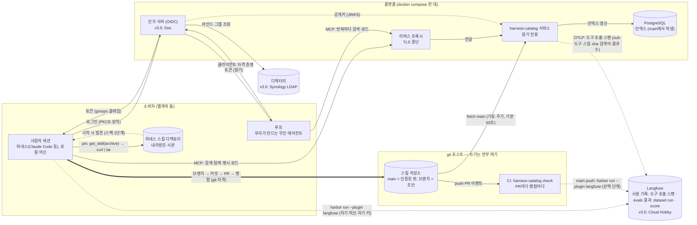
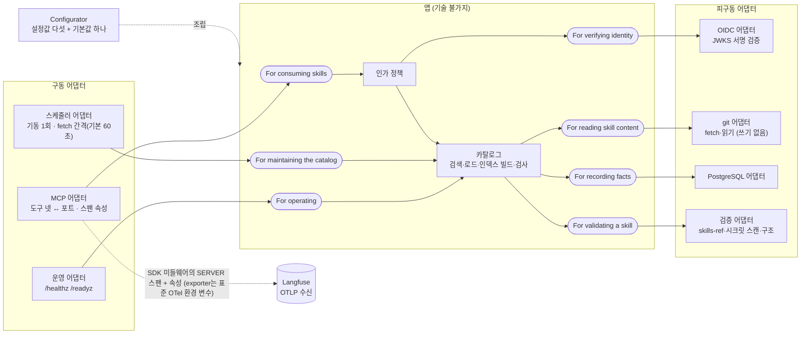
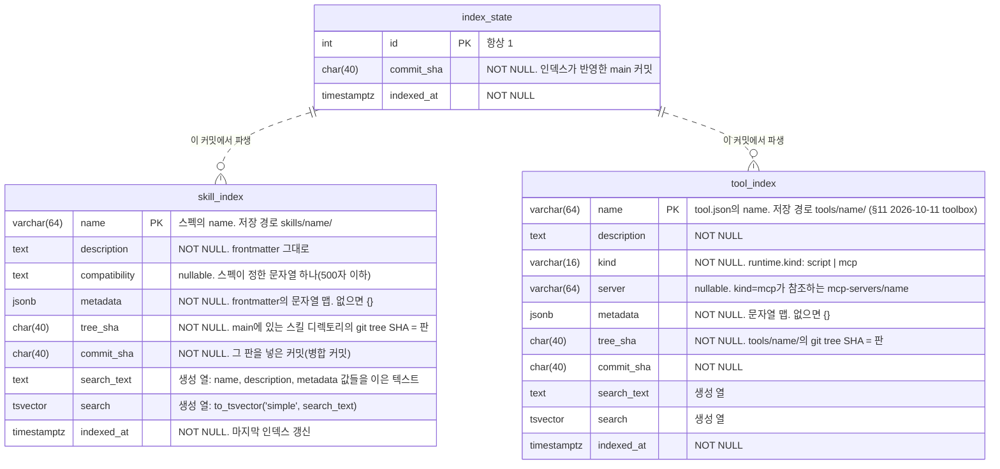
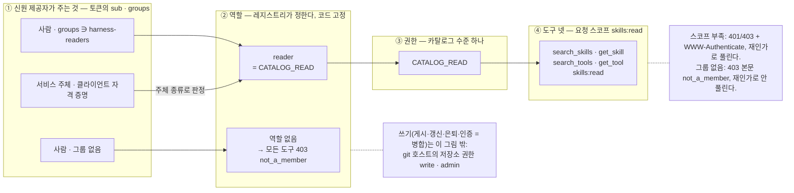

# harness-catalog 설계 v3.3 (초안, 2026-09-26) — 단일 팀, git 워크플로

**이름.** 담는 것이 스킬만이 아니라 하네스 부품 전부(스킬, 나중에 프롬프트·도구 서버, 평가 결과. §1.3, §7)라 2026-09-26에 `skill-catalog`에서 `harness-catalog`로 바꿨다. 서비스도 저장소도 이 한 이름으로 부른다. 본문의 "레지스트리"는 이 서비스를 역할로 부르는 말이다. v2.x는 `~/workspace/skill-catalog/`의 `DESIGN.md`(v2.4)와 `DESIGN-v*.md`에 그대로 있다. v2.x를 고치지 않고 다시 썼다. v3.0(2026-09-25)에 Codex 적대 리뷰(§11)를 반영한 것이 v3.1이고, **v3.2는 범위를 팀 하나로 줄인 판이고, v3.3은 게시·인증을 레지스트리 도구에서 git 호스트의 트렁크 기반 워크플로로 옮긴 판이다**(§11)(v3.1은 v2.x와 같은 자리 `~/workspace/skill-catalog/DESIGN-v3.1.md`에 있다. 멀티 팀 문법이 필요한 날 읽는 문서라 이 저장소에 두지 않는다). 팀이 여럿이 되는 조건과 그때 바뀌는 것은 §7 한 행에 있다. `[it]` 요구에 맞는 가장 단순한 해법을 쓰고, yagni의 물음("나중에 넣기가 지금보다 어려운가")에 멀티 팀은 소비자 쪽에서 "아니오"라서다. `name`이 카탈로그 전체에서 유일하고 식별자가 `<name>`뿐이라(§3), 팀을 나중에 더해도 소비자 쪽 식별자(내려받은 사본의 `PINNED`, `replaced-by`, 사용 기록)는 그대로다. 생산자·운영자 쪽 이행 비용은 남는다(§7). **핵심 계약 몇 개가 §9에 미결로 남아 있어 아직 초안이다.**

한 문장: **스킬은 agentskills.io 디렉토리 하나이고, 스킬의 내용은 그 디렉토리들이 모인 git 저장소 하나에 있으며, 스킬에 대한 사실(사용 기록·평가 결과)은 팀의 Langfuse에 있으며, 인덱스는 PostgreSQL 하나에 있고, 그 앞에 선 레지스트리 서비스 하나가 그 저장소를 **읽기만** 하며 사람과 에이전트에게 같은 MCP 도구 여섯을 낸다. 게시는 그 저장소에 브랜치를 따 PR을 올리고 `main`에 병합하는 것이고, 병합이 곧 인증이다. 레지스트리는 병합된 것을 검사해 인덱스에 올린다. 루프는 반복마다 검색해서 넣고 다음 반복에는 들고 가지 않는다. 사람은 매일 쓰는 스킬을 자기 하네스의 스킬 디렉토리에 내려받아 둘 수 있고, 그 사본은 그 시점의 판이다.**

---

## 0. v2.x는 무엇이 잘못됐는가

v2.x는 KB를 인용했지만 **이미 고른 기제를 정당화하는 데** 썼다. 구조 자체는 Claude Code의 기능 목록(마켓플레이스, plugin eval, OTel)에서 왔다. `[it]` Dehghani는 이것을 실패 양식으로 이름 붙인다. 플랫폼의 표현이 그것이 가능하게 하는 **경험**이 아니라 그것이 포함하는 **메커니즘**에 닻을 내리면 비대한 플랫폼이 나온다. 처방은 반대 순서다. 단일 경험(스킬을 발견한다)의 표현에서 시작해 그것을 가능하게 하는 가장 단순한 도구를 짓고, 헹구고 반복한다.

KB의 잣대로 v2.4를 다시 재면 이렇다.

| 잣대 | v2.4 | 판정 |
|---|---|---|
| `[it]` 깊은 모듈: 인터페이스가 구현보다 훨씬 단순해야 한다 | 팀원이 알아야 하는 것: 마켓플레이스, `/plugin`, `enabledPlugins`, `skillOverrides`, Tier A/B, budget-check, MCP 등록, managed settings, CATALOG 페이지, PR 템플릿, evals 형식, CHANGELOG, 버전, CODEOWNERS, policy.yaml | **얕다.** 기능(스킬을 찾고·쓰고·올린다)에 비해 인터페이스가 크다 |
| `[it]` 복잡성을 아래로: 설정 매개변수는 복잡성을 위로 민다 | 프로젝트마다 Tier 결정, 예산 문턱, skillOverrides, 분기 Tier 리뷰, policy.yaml 값들 | **위로 밀었다.** "사용자가 우리보다 더 나은 값을 정할 수 있는가"를 묻지 않았다 |
| `[it]` 범용 모듈이 더 깊다: 과잉 특수화가 복잡성의 최대 원인 | 같은 스킬에 전달 경로 둘(마켓플레이스 설치·MCP 로드), 소비 양식 넷, 각각 다른 grader·예산·제약 | **특수화됐다.** 하나의 범용 기제(식별자로 스킬을 가져온다)로 덮인다 |
| `[it]` 시간적 분해는 정보 누출을 낳는다 | 저자 → PR 게이트 → 게시 → 설치 → 세션 → 관측의 단계마다 모듈. "스킬이 무엇인가"라는 지식이 lint·catalog.py·publish.yml·budget-check·MCP·CATALOG에 흩어짐 | **누출.** 스펙 한 곳에 있어야 할 지식이 여섯 곳에 있다 |
| `[it]` 포장된 길: 강제하지 않는 것이 요점 | managed settings로 필수 플러그인·OTel 강제, strictKnownMarketplaces | **통치하려 들었다.** 쓰기 불편하면 우회당한다 |
| `[it]` 연합 컴퓨테이셔널 거버넌스: 수작업 인증·중앙 검증은 병목 | PR 게이트 5단, CODEOWNERS + 새 스킬은 리드 승인, evals 없으면 머지 불가 | **인증 병목.** 사람 승인이 게시 경로에 있다(v3.3도 PR을 쓰지만 리뷰어·evals를 병합 조건으로 강제하지 않는다 — §5) |
| `[it]` 발견 가능성의 왼쪽 이동: 스킬 자신이 발견 정보를 갖는다 | SKILL.md가 갖고 있는데 CATALOG.md·MCP 인덱스·마켓플레이스 항목으로 세 번 파생 | **중복.** 파생물 셋 중 둘은 git 호스트의 디렉토리 열람으로 대체된다 |

`[웹]` Databricks UC Skills(2026-09-25 확인)가 단순한 이유는 사용자에게 보이는 표면이 작기 때문이다. 사람은 CLI 명령 셋(`ug configure`, `ug skills`, `ug skills add`)과 Catalog Explorer의 권한 화면과 자연어를 쓰고, 에이전트는 MCP 도구 여섯(`list_skills`, `get_skill`, `get_skill_files`, `create_skill`, `update_skill`, `delete_skill`)을 부른다. 문서에 리뷰·승인·eval 단계는 보이지 않는다(부재 관찰이지 증명은 아니다). 게시는 즉시이고 처음엔 비공개이며 공유는 복사가 아니라 grant다. 그 단위가 agentskills.io의 SKILL.md다.

---

## 1. 출발점 넷

0. **잣대는 사용자 부담이다. 운영자 부담이 아니다.** `[웹]` UC가 사용자에게 시키는 것은 명령 셋과 자연어와 권한 화면뿐이고, `[영상]` toolbox 패턴의 목적도 에이전트의 컨텍스트 부담을 줄이는 것이다. `[it]` 모듈은 개발자보다 사용자가 많으니 사용자보다 개발자가 고생하는 편이 낫다. 이 문서의 모든 결정은 "팀원과 에이전트가 알아야 하고 해야 하는 것이 줄었는가"로 판정한다. 서비스 수를 줄이는 것은 그 결과이지 목표가 아니다. v3.0 초안이 레지스트리를 팀원 머신에 두었던 것은 이 잣대를 뒤집은 오류였다. **가정:** 매 반복 검색이 사본 유지·재다운로드보다 사용자에게 싸다는 것은 아직 측정하지 않은 가정이다. 파일럿에서 잰다(§9).
1. **핵심 상호작용 하나.** `[it]` 플랫폼 설계는 생산자와 소비자 사이의 핵심 상호작용에서 시작한다. 여기서는 **스킬을 올린다 ↔ 스킬을 쓴다**다. 나머지는 전부 이것에서 파생되거나 없어도 된다.
2. **소비자는 사람과 에이전트, 둘 다 1급.** 출처를 가른다. `[웹]` agentskills.io 스펙(2026-09-26 확인)은 소비자를 에이전트로만 적는다. 정의는 "instructions that tell an agent how to perform a specific task", 본문 규정은 "Write whatever helps agents perform the task effectively", description 규정은 "keywords that help agents identify relevant tasks"이고, 사람은 저자로만 나온다("company-, team-, and user-specific context ... that agents load on demand"). 사람을 소비자로 더한 근거는 스펙이 아니라 다음이다. `[it]` 데이터 메시는 "데이터 프로덕트 사용자"를 프로덕트와 상호작용하는 모든 에이전트로 정의하고 거기에 사람(개발자·소유자·소비자·거버넌스 그룹)뿐 아니라 시스템도 포함하며(11장 p.196), 발견 가능성을 기계와 사람의 접근 양쪽에 대해 설계한다(13장 p.234). `[웹]` Netlify의 Agent Experience(2025)는 "AI 에이전트가 소프트웨어의 주 사용자가 되면서 그들의 경험이 사람의 경험만큼 중요하다"고 하되 통합 표면과 분리 표면 중 어느 쪽도 정하지 않는다. `[웹]` Wang 외(arXiv 2603.20300, 2026-03)는 사람 인터페이스(사용성)와 에이전트 인터페이스(신뢰성)의 최적화 목표가 다르다고 보아 분리를 권하면서도 "많은 실제 시스템은 사람과 AI 사용자를 둘 다 섬겨야 하므로 대체가 아니라 이중 청중 설계가 필요하다"고 적는다. `[웹]` Microsoft DevOps Playbook(2026-04)은 "에이전트를 사람 개발자와 나란히 1급 사용자로 다루는 내부 개발자 플랫폼"을 중기 방향으로 든다. `[웹]` Databricks UC Skills 문서는 사람("you")과 에이전트("your agent calls")를 함께 상정한다. 공통분모는 "둘 다 사용자다"이고, 갈리는 자리는 "같은 표면인가 다른 표면인가"이며, 이 설계는 같은 도구 여섯을 둘에게 내는 쪽을 고른다(§6). 스펙은 그것을 막지 않는다(SKILL.md는 사람이 읽는 마크다운이고 사람의 명시 호출은 활성화 단계를 사람이 촉발하는 것이다). 그래서 인터페이스를 둘로 나누지 않는다. 사람은 세션 안에서 검색·탐색하고 골라서 명시 호출하며, 에이전트 루프는 과제를 보고 스스로 검색·로드한다. 둘 다 같은 레지스트리의 같은 도구 여섯이다. 네트워크 호출을 실제로 내는 것은 어느 경우든 에이전트 프로세스이고(그림 1), "1급"은 호출 주체가 둘이라는 뜻이다. 사람이 세션 밖에서 볼 때는 git 호스트의 디렉토리를 본다.
3. **소비의 기본형은 루프다.** `[영상]` 34:19~35:10 toolbox 패턴: 스킬을 검색 가능하게 저장해 두고, 정말 필요할 때만 꺼내 컨텍스트에 넣고, 반복마다 아직 맞는지 보고 아니면 뺀다. 강연이 말하는 것은 이 일반 패턴이고, "반복마다 재검색하고 직전 본문을 버린다"는 그것을 이 설계가 고른 구체 정책이다. 그 정책이 성립하는 자리는 **우리가 만드는 루프**뿐이다. 루프가 반복 경계를 정하고 컨텍스트를 조립하므로 제거의 주체도 루프다. 일반 하네스 세션(Claude Code 등)은 이 정책을 보장하지 않고, 거기서는 한 세션에 한 번 로드하는 것까지가 이 설계의 약속이다(§4). 이 층 구분으로 말하면 이 설계가 만드는 것은 **하네스 부품**(스킬 파일·MCP 커넥터·권한)이고, 루프 엔지니어링의 다섯 장치(트리거·정지 조건·상태 파일·검증 서브에이전트·예산)는 카탈로그를 쓰는 루프 쪽이 따로 짓는다. 루프와 닿는 자리는 둘뿐이다. 반복마다 꺼내 쓰는 소비와, 개선 루프가 PR로 되쓰는 갱신. 그래서 **루프에는 사본이 없다.** 사본은 세션 시작마다 프리픽스에 실리는 "항상 켜진 skills box"이고 그것이 v2.x의 Tier A였다. **사람의 일반 세션은 다르다.** `[웹]` UC는 다운로드의 이유를 "loads automatically each session, and works offline. Best for the handful you use daily"로 적고 라이브는 "a big, fast-changing set"에 권하며, `[altera-skills]` r10 실물 조사는 사람의 지배적 소비가 설치 시점의 큐레이션이고 상주 description 발동이 가장 빠른 길이라고 기록한다. 그래서 사람이 매일 쓰는 소수는 자기 하네스의 스킬 디렉토리에 **내려받아(pin)** 두고, 새 스킬을 만나는 길은 여전히 `search_skills`다(§4 두 맥락). 내려받은 것은 UC와 같은 뜻의 point-in-time 사본이고 갱신은 사용자가 다시 받는다. 루프에까지 사본을 두는 조건은 §7에 있다.
4. **단위는 agentskills.io 스펙 그대로.** `[웹]` 스펙(2026-09-25 확인)이 **강제**하는 것: `name`(1–64자, 소문자·숫자·하이픈, 디렉토리명 일치), `description`(1–1024자), `compatibility` 500자 이하, `metadata`는 문자열 맵. **권고**하는 것: 본문 500줄 이하, 본문 5000토큰 이하, `scripts/`·`references/`·`assets/` 배치, 점진적 공개(메타데이터는 시작 시, 본문은 활성화 시, 파일은 필요 시). **이 설계가 스펙과 갈라서는 자리는 점진적 공개의 1단계 하나다.** 스펙은 시작 시 모든 스킬의 이름·설명을 싣는 것으로 발견을 정하는데, 그것은 §7에서 뺀 상주 방식(Tier A)이다. 이 설계는 그 자리를 `search_skills`(§3, §4)로 대체하고 2단계(활성화 시 본문)와 3단계(필요 시 파일)는 그대로 따른다. 검증기 `skills-ref validate`가 강제하는 것은 앞의 강제 항목이다. **카탈로그가 스킬 파일 형식에 더하는 것은 없다.** 카탈로그가 더하는 것은 파일 밖의 둘, 식별자(`<name>`, 곧 저장 경로 `skills/<name>/`)와 스킬에 대한 사실(§2)이다. `metadata.replaced-by`는 스펙이 허용한 `metadata` 맵 안의 저자 선언이다.

---

## 2. 구조

**그림 1 — 시스템 경계.** 누가 누구와 이야기하고 신원과 권한이 어디서 정해지는가.



그림 1을 읽는 법. 소비자는 둘이고 둘 사이에 선이 없다. 사람의 세션(하네스가 사람 대신 MCP를 부른다)과 루프(코드가 반복마다 부른다)는 같은 인가 서버에서 다른 그랜트로 토큰을 받고, 같은 프록시로 같은 도구를 부른다. 다른 것은 그랜트(사람은 PKCE·장치, 루프는 클라이언트 자격 증명)와 호출의 시점뿐이고, 둘 다 레지스트리에서는 **읽기**만 한다. **쓰기는 레지스트리를 지나지 않는다.** 스킬에 대한 사실 둘은 Langfuse에 있다(점선). 사용 기록은 레지스트리가 도구 호출마다 내는 OpenTelemetry 스팬이고(MCP SDK가 기본으로 내며 MCP 어댑터가 속성을 더한다, §2 데이터 표), 평가 결과는 `harbor run`이 남긴다(§5.1). 레지스트리는 Langfuse를 읽지 않는다. 스킬을 올리고 고치고 지우는 일은 전부 git 호스트에서 브랜치 → 커밋 → PR → `main` 병합으로 하고(굵은 선), 사람의 세션에서는 에이전트가 사람의 git 자격으로 그 일을 대신한다. 레지스트리는 `main`을 fetch해 검사하고 인덱스에 올릴 뿐이라 저장소에 쓰기 자격이 없다(deploy key는 읽기 전용). 내려받기(pin)는 사람의 세션에만 있다. 사람의 세션은 로컬 머신을 전제한다. 클라우드 샌드박스 세션(§4)은 홈 디렉토리도 git 자격도 없어 라이브 읽기만 한다. 디렉터리(팀원이 누구인가)는 플랫폼 밖이고, v3.0의 인가 서버(Dex)는 플랫폼 compose 안에서 디렉터리를 연합해 OIDC 토큰을 낸다. 사내 IdP로 옮기면 인가 서버가 플랫폼 밖으로 나가고 레지스트리는 issuer만 바꾼다(§2 신원 제공자 표). `[it]` 신원 제공자는 주체가 누구인지를 주고 무엇을 하도록 허용할지는 체계가 정한다. 그래서 읽기의 인가는 레지스트리 안에 있고(그림 2), 쓰기의 인가는 git 호스트의 저장소 권한이며, 프록시는 TLS와 라우팅만 한다. `[it]` 게이트웨이는 기능을 떠맡을수록 결합 지점과 공격 표면이 커지고, `[it]` 요구에 맞는 가장 단순한 해법을 쓰라는 지침에서 리버스 프록시(단일 백엔드·TLS)로 충분하다. 읽기의 경계는 둘 다 "팀" 하나다 — 레지스트리는 `harness-readers` 그룹, 저장소는 git 호스트의 읽기 권한이고, 운영자가 두 명단을 같게 유지한다(§2.1 체크리스트).

**그림 2 — 레지스트리 내부.** `[it]` 포트와 어댑터 규정대로 그린다. 앱은 외부 기술을 이름으로 부르지 않고 인수로 받으며, 포트는 의도별 대화이고 이름은 "For …ing"이다.



그림 2의 노드는 열여덟이고 역할은 아래 표다. "For …ing"으로 적힌 일곱이 **포트**다. `[it]` 포트는 앱과 바깥 사이의 의도별 대화이고, 앱이 바깥에 제공하는 것(제공 인터페이스, 구동 쪽)과 앱이 바깥에 요구하는 것(요구 인터페이스, 피구동 쪽)으로 나뉜다. 화살표 방향이 그 구분이다. 왼쪽 셋은 어댑터가 앱을 부르고, 오른쪽 넷은 앱이 어댑터를 부른다. 검증 어댑터의 구현은 CLI 명령 `harness-catalog check`로도 나가서(§2.1 저장소 초기화) pre-commit·CI·인덱스 빌드 세 자리가 같은 검사를 돈다.

| 노드 | 종류 | 역할 | 코드에서의 형태 |
|---|---|---|---|
| MCP 어댑터 | 구동 어댑터 | MCP 요청을 받아 도구 넷을 앱 함수 호출로 바꾸고 결과를 MCP 응답으로 돌려준다. 프로토콜·헤더·JSON-RPC는 여기서 끝난다. **사용 기록도 여기서 끝난다.** `[웹]` MCP Python SDK v2는 인바운드 메시지마다 `SERVER` 스팬(`tools/call load_skill`, 속성 `mcp.method.name`·`gen_ai.tool.name` 등)을 기본으로 내므로, 어댑터는 그 현재 스팬에 인가 정책이 돌려준 주체와 앱이 돌려준 결과의 속성(`langfuse.user.id`=`sub`, 스킬·`sha`, 검색어·결과 수)을 더할 뿐이다. 앱은 스팬을 모른다 | SDK의 `Server` 도구 등록 + `streamable_http_app()` + `opentelemetry.trace.get_current_span().set_attributes(...)` |
| 운영 어댑터 | 구동 어댑터 | 오케스트레이터의 헬스 체크를 받아 앱의 상태를 HTTP로 낸다 | Starlette 라우트 둘(`/healthz`, `/readyz`) |
| 스케줄러 어댑터 | 구동 어댑터 | 시계가 앱을 부른다. 기동 시 1회(구조 검사 + 첫 인덱스 빌드), fetch 주기마다(`FETCH_INTERVAL_SECONDS`, 기본 60. fetch → `main`이 바뀌었으면 검사 + 인덱스 재구축). 인스턴스 안의 백그라운드 작업이고 클론 잠금(§2)을 쥔다 | asyncio 태스크 하나(기동 검사 뒤 fetch 루프). Configurator가 uvicorn과 함께 띄운다 |
| For consuming skills | 제공 포트 | 소비자(사람의 세션, 루프)가 앱에 요구할 수 있는 것. 목록·검색·본문·파일 | 앱 함수 넷의 시그니처 |
| For operating | 제공 포트 | 운영자·오케스트레이터가 앱에 물을 수 있는 것. 살아 있는가, 준비됐는가(구조 검사 통과와 인덱스 존재), 마지막 fetch가 언제인가, DB가 닿는가(`degraded` 사유) | 앱 함수 둘의 시그니처. 카탈로그의 상태를 읽는다 |
| For maintaining the catalog | 제공 포트 | 시계가 앱에 시킬 수 있는 것. 저장소 구조 검사, fetch와 검사·인덱스 재구축(커밋 세대 검사 포함) | 앱 함수 둘의 시그니처. 사람도 에이전트도 부르지 않는다 |
| 인가 정책 | 앱 | 검증된 토큰의 주체와 그룹, 요청한 도구와 스코프로 이 호출을 허용할지 정한다. 소비 포트의 호출이 먼저 여기를 지난다(운영·유지 포트는 토큰이 없는 호출이라 지나지 않는다) | 순수 함수. 입력은 주체·그룹·스코프·도구 |
| 카탈로그 | 앱 | 인덱스로 목록·검색을 하고 스킬 본문과 파일을 돌려준다. 읽기를 기록하지 않는다 — 기록은 MCP 어댑터의 스팬이다. `main` 스냅샷을 검사하고 인덱스를 지으며(§2 인덱스 갱신, 그림 3 규칙 3) 같은 행 집합을 메모리에도 들어 DB 단절 시 깎아서 답한다(§2.1). 기동 시 구조 검사(§2.1)도 여기다 | 함수 넷 + 유지 함수 둘 |
| For verifying identity | 요구 포트 | 앱이 바깥에 요구하는 것. "이 Bearer 토큰을 검증하고 주체·그룹·스코프를 돌려 달라" | `typing.Protocol` |
| For reading skill content | 요구 포트 | "fetch해 달라, `main`의 스킬 트리를 달라, 이 tree SHA의 판을 달라, 표지 파일과 지워진 스킬 이름의 이력을 달라". 쓰기는 없다 | `typing.Protocol` |
| For recording facts | 요구 포트 | "인덱스를 이 커밋의 내용으로 바꿔 달라(더 오래된 커밋이면 거부), 검색해 달라" | `typing.Protocol` |
| For validating a skill | 요구 포트 | "이 저장소가 구조를 갖췄고 이 디렉토리가 스펙에 맞고 비밀이 없으며 이름·대체 규칙을 지키는지 판정해 달라" | `typing.Protocol` |
| OIDC 어댑터 | 피구동 어댑터 | issuer의 JWKS로 서명을 검증하고 `iss`·`aud`·`exp`·`nbf`·`scope`·`groups`를 확인해 주체를 만든다. 바깥 통신은 JWKS 가져오기뿐 | SDK `TokenVerifier` 구현 |
| git 어댑터 | 피구동 어댑터 | 로컬 클론을 유지하고 fetch와 읽기를 한다. commit·push는 없다 | git CLI 호출 |
| PostgreSQL 어댑터 | 피구동 어댑터 | 인덱스의 SQL. 어휘 검색(`tsvector`·`pg_trgm`)도 여기 | psycopg 3 + SQL 파일 |
| 검증 어댑터 | 피구동 어댑터 | `skills-ref validate`·시크릿 스캔·저장소 구조·크기·`tool.json`·`server.json` 검사(일곱)를 돌려 판정으로 바꾼다. 이력은 보지 않는다(§11 2026-10-18). 같은 구현이 `harness-catalog check` CLI다 | 라이브러리 호출 + 서브프로세스 |
| Configurator | 패턴 밖, 필수 | 설정값 다섯(과 기본값 있는 하나)을 읽어 피구동 어댑터 넷을 만들고, 앱을 만들어 넷을 꽂고, 구동 어댑터 셋(MCP·운영·스케줄러)을 만들어 앱을 건넨다. 모든 참가자를 아는 유일한 자리. OTel exporter는 여기서 조립하지 않는다 — 표준 환경 변수(`OTEL_EXPORTER_OTLP_*`)를 읽는 `opentelemetry-sdk`의 자동 구성이 켜며, 변수가 없으면 스팬은 no-op이다 | `bootstrap(settings) -> App` 함수 하나 + uvicorn 기동 |

그림 2를 읽는 법. 앱 안에는 둘이 있다. **인가 정책**(토큰의 주체와 그룹으로 이 호출을 허용하는가), **카탈로그**(`main`을 검사하고 인덱스를 지어 검색하고 본문을 돌려준다). 이 둘은 git도 PostgreSQL도 OIDC도 모른다. `[it]` 강한 준수의 기준은 "앱이 외부 기술에 대해 아무것도 모른다"이고, 그래야 어댑터를 갈아 끼울 수 있다(SQLite로 되돌리기, 다른 IdP, GitLab). 구동 포트는 액터마다 하나다. 소비하는 쪽(사람과 루프), 운영하는 쪽(오케스트레이터의 헬스 체크), 유지하는 쪽(시계. `[it]` 콕번은 타이머 같은 자동 트리거도 구동 액터로 센다). 셋째가 있어야 주기 fetch·기동 검사가 앱 함수로 존재하고 시험에서는 시험 케이스가 시계 대신 그 함수를 부른다. `[it]` 인스턴스화·설정은 포트가 아니라 Configurator의 일이다. **Configurator**가 어댑터를 골라 앱에 꽂으며 `[it]` 패턴 밖이지만 반드시 필요한 다섯째 요소다. **레지스트리 프로세스**의 필수 설정값은 다섯이다. 카탈로그 저장소 URL, git deploy key(읽기 전용), OIDC issuer, 레지스트리 공개 URL(토큰의 audience이자 RFC 9728 메타데이터의 `resource`), PostgreSQL 접속. 기본값이 있는 선택 설정값이 하나 더 있다. 주기 fetch 간격(`FETCH_INTERVAL_SECONDS`, 기본 60). (v3.5 전에는 사용 기록 보존 일수 `USAGE_RETENTION_DAYS`도 있었으나 사용 기록이 Langfuse로 가면서 빠졌다 — §11.) 이것을 설정으로 뺀 근거는 `[it]` 외부 설정의 목록("세율처럼 외부에서 설정되는 매개변수", 환경별 매개변수)이고, fetch 간격은 git 호스트의 fetch 부하 한도와 병합 뒤 반영 지연 사이에서 운영 환경이 정하는 값이라 `[it]` "사용자가 우리보다 더 나은 값을 정할 수 있는가"에 "그렇다"인 드문 경우다. 이 여섯 밖의 레지스트리 설정값은 없다. 플랫폼 운영 설정(Dex의 issuer·LDAP 연결·정적 클라이언트·그랜트, 백업 대상·스케줄)은 §2.1 "운영자가 아는 것"에 따로 센다.

**헥사고날은 여기까지다.** 패턴이 요구하는 것은 "외부 기술을 인수로 받는다" 하나이고, 이 설계는 그것을 강한 준수로 지킨다. 그 밖은 가져가지 않는다. `[it]` 이 패턴은 앱 내부 구조에 대해 아무 말도 하지 않으며 그 점에서 클린·양파와 갈리므로, 앱 안에 도메인·유스케이스·엔티티 층을 따로 세우지 않는다. `[it]` 파이썬에서는 포트가 코드에 드러나지 않아도 되고 추상 기반 클래스는 필수가 아니므로, 그림의 포트 일곱은 개념이고 코드에서는 어댑터를 인수로 받는 함수 시그니처가 포트다. `[it]` 클래스염을 피한다. 그리고 `[it]` DB 대역은 실물의 동작을 보장하지 않으므로 PostgreSQL 어댑터의 시험은 실제 컨테이너로 돌린다. "DB 없이 시험"의 이득은 git과 OIDC 어댑터에서 온다.

**MCP 전송 — Streamable HTTP, 개정판 2026-07-28, 무세션.** `[웹]` 최신 개정판(2026-07-28 확인)은 프로토콜 수준 세션과 `Mcp-Session-Id`를 없앴고 `initialize` 핸드셰이크도 없앴다. 요청마다 `_meta`에 프로토콜 버전과 클라이언트 능력을 싣고, 서버는 단일 엔드포인트에 POST만 받으며, 응답은 JSON 하나이거나 그 요청에 묶인 SSE 스트림이다. GET 스트림, 세션 종료 DELETE, `Last-Event-ID` 재개는 이 개정판에 없다. 서버는 `Origin`을 검증해야 하고, `MCP-Protocol-Version`·`Mcp-Method`·`Mcp-Name` 헤더가 본문과 일치하는지 검증해야 하며(불일치는 400 `HeaderMismatch`), `server/discover`를 구현해야 하고, `tools/list`는 결정적 순서와 `ttlMs`·`cacheScope`를 돌려준다. 이 설계가 이 개정판을 고르는 이유는 레지스트리가 어차피 무상태이기 때문이다. 세션 저장소가 없으니 인스턴스를 늘려도 붙임 세션(sticky session)이 필요 없고, 리버스 프록시는 헤더만 보고 라우팅할 수 있다. 호환은 SDK에 맡긴다. 2025-11-25 이하 개정판의 클라이언트(`initialize`·세션·GET 스트림)는 스펙의 호환 행렬대로 SDK가 감지해 그 시대의 동작으로 응답한다. 파일럿 대상 에이전트 셋이 어느 개정판을 말하는지는 §9의 확인 항목이다. 2024-11-05의 HTTP+SSE는 폐기 상태라 지원하지 않는다.

**인증·인가.** 레지스트리가 인가하는 것은 읽기뿐이다. 쓰기(게시·갱신·은퇴)의 인가는 git 호스트의 저장소 권한이다.

| 물음 | 답 | 근거 |
|---|---|---|
| 누가 신원을 확인하는가 | 사내 OIDC 신원 제공자. 레지스트리는 액세스 토큰(JWT)의 서명을 JWKS 공개키로 검증할 뿐 요청마다 IdP를 부르지 않는다 | `[it]` OIDC가 최종 사용자 SSO의 지배적 기제. `[it]` ID 토큰을 액세스 토큰 대신 쓰지 말라 |
| 토큰 검증 계약 | `iss`가 설정된 issuer, `aud`가 레지스트리의 canonical URI(`[웹]` MCP 인가 스펙: 서버는 토큰이 자기를 대상으로 발급됐음을 RFC 8707대로 검증해야 하고, 클라이언트는 인가·토큰 요청에 `resource` 파라미터로 그 URI를 보내야 한다), `exp`·`nbf`에 60초 시계 오차 허용, 서명 알고리즘은 RS256·ES256만, 필수 클레임은 `sub`·`scope`. **주체 판별:** 서비스 주체는 인가 서버가 클라이언트 자격 증명 그랜트로 낸 토큰이다. 판별은 `groups` 유무가 아니라 토큰의 명시 표지로 한다. **가정:** Dex의 클라이언트 자격 증명 토큰이 `sub`=client ID를 내고 사람 토큰과 구별되는 표지(`azp` 또는 `groups` 부재 + `sub`가 등록된 client ID 중 하나)를 갖는다는 것은 파일럿에서 확인한다(§9). 확인 전에는 "`sub`가 Dex에 등록된 client ID 집합에 있으면 서비스 주체"를 쓴다. 그룹 클레임이 빠진 사람 토큰은 서비스 주체로 오인되지 않고 `not_a_member`로 거부된다. 서비스 주체의 `sub`는 도구 호출 스팬의 사용자 id의 주체로 적힌다. **사용자 결정(2026-10-07, §11) — 실측 뒤 고친 셋.** ① 서비스 주체라는 별도 종류는 없다. 무인 주체는 LDAP 기계 계정이고 그룹으로 reader가 된다. ② `aud`는 레지스트리 canonical URI가 맞되, Dex는 `resource`를 무시하므로 레지스트리가 RFC 9728 문서의 `scopes_supported`에 Dex 교차 클라이언트 스코프 `audience:server:client_id:<canonical URI>`를 광고해 클라이언트가 그것을 요청하게 한다(요청하면 `aud`에 실린다, pilot r1). ③ 스코프는 `openid groups` + 그 교차 클라이언트 스코프이고 **토큰에서 스코프를 검사하지 않는다**(Dex 토큰에 `scope` 클레임이 없다). 인가는 `groups`만 본다. **상태 코드 경계:** 토큰이 없거나 검증(`iss`·서명·`aud`·`exp`)에 실패하면 401 + `WWW-Authenticate: Bearer resource_metadata="…"`. 유효한데 `harness-readers` 그룹이 아니면 403에 `WWW-Authenticate`를 붙이지 않고 본문에 사유(`not_a_member`)만 적는다 — 재인가로 풀리지 않는다. "스코프 부족 403" 경계는 없다. **스코프와 도구:** 도구 여섯이 전부 읽기라 권한 스코프를 갈라 가질 것이 없다 | `[웹]` MCP 인가 스펙(2026-07-28): MCP 서버는 OAuth 2.1 자원 서버이고, RFC 9728 보호 자원 메타데이터를 **반드시** 내야 하며, 클라이언트는 그것으로 인가 서버를 찾는다. `[it]` 모든 종단점에 인가 검사를 두라 (시계 오차·알고리즘·스코프 이름은 이 설계의 결정) |
| 어떤 그랜트를 지원하는가 | 셋(**사용자 결정 2026-10-07**: 무인은 클라이언트 자격 증명이 아니라 **비밀번호 그랜트**다 — Dex에 전자가 없다(r1). `passwordConnector: ldap`을 켜고 기밀 클라이언트 `ci-runner`로 기계 계정의 비밀번호를 보낸다(r2 실측). 켜면 공개 클라이언트에도 열리는데 LDAP 비밀번호를 아는 쪽은 바인드로 이미 같은 일을 할 수 있어 새 노출이 아니다). 브라우저가 있는 사람·에이전트는 인가 코드 + PKCE(`[웹]` MCP 인가 흐름의 기본형이며 `resource` 파라미터와 RFC 9207 `iss` 검증이 붙는다). 브라우저 없는 샌드박스는 장치 인가. 무인 루프·CI는 클라이언트 자격 증명. 비밀번호 그랜트는 받지 않는다. 클라이언트 등록은 플랫폼 팀이 인가 서버에 에이전트 제품마다 사전 등록한 client ID를 쓰고(Dex는 `public: true` 정적 클라이언트), 인가 서버가 지원하면 `[웹]` 스펙이 권하는 Client ID Metadata Documents로 옮긴다. 동적 등록(RFC 7591)은 스펙에서 폐기 예정이라 쓰지 않는다 | `[it]` PKCE는 공개 클라이언트에 필수. 장치 인가는 브라우저 없는 클라이언트용. 클라이언트 자격 증명은 기계 대 기계이고 주체가 클라이언트 자신. `[it]` 필요한 그랜트만 지원하고 필요하면 더하라 |
| 토큰 수명과 폐기 | 액세스 토큰 수명은 IdP 정책을 따르되 1시간 이하를 요구한다. 갱신은 클라이언트와 IdP 사이(리프레시 토큰)이고 레지스트리는 관여하지 않는다. 레지스트리는 폐기 목록을 두지 않는다. 짧은 수명이 폐기를 대신하고, 즉시 차단이 필요하면 IdP에서 사용자나 클라이언트를 비활성화한다(최대 1시간 창). 서비스 자격 증명(클라이언트 시크릿)은 사내 시크릿 저장소에 두고 IdP 정책 주기로 회전한다. JWKS는 캐시(TTL 1시간)하되 모르는 `kid`를 만나면 즉시 재조회해 키 롤오버를 받는다 | `[it]` 짧은 수명의 토큰이 폐기 뒤 남는 창을 줄인다. `[it]` 리프레시 토큰은 안전하게 보관하고 폐기가 접근을 끊는 수단이다 |
| 주체가 둘이다 | 사람 주체(`sub`가 사용자, `groups`에 팀 그룹)와 서비스 주체(`sub`가 클라이언트). 레지스트리에서 둘의 권한은 같다(reader). 다른 것은 사람만 git 호스트에서 쓴다는 것이고, 그것은 레지스트리 밖의 일이다 | `[it]` 클라이언트 자격 증명에서는 주체가 자원 소유자를 대신한 것이 아니라 클라이언트 자신 |
| 팀원은 어디서 오는가 | 읽기는 IdP 그룹 하나 `harness-readers`. 이름은 고정이고 매핑 표도 문법도 없다. 그룹 밖의 디렉터리 사용자는 로그인은 되지만 아무것도 못 한다. 가입·탈퇴는 IdP에서 하고 다음 토큰부터 반영된다(최대 1시간 지연). 중첩 그룹은 IdP가 평탄화해 클레임에 넣는 것을 전제한다. **쓰기는 git 호스트의 저장소 권한**(write·admin)이고 그 명단은 운영자가 `harness-readers`와 같게 유지한다(§2.1 체크리스트) | `[it]` 조직이 일하는 방식을 본뜬 굵은 역할을 쓰고, 서비스 기능 하나에 특정한 세밀한 역할을 디렉터리에 넣지 말라. 읽기 하나면 그룹 하나다 |
| 어디서 인가하는가 | 읽기는 레지스트리 안, 도구 호출마다. 쓰기는 git 호스트. 프록시는 하지 않는다 | `[it]` 게이트웨이가 할 수 있는 것은 굵은 인가까지이고 그 이상은 서비스에 지역적이어야 한다. 상류에 인가를 모으면 배포가 게이트웨이 설정에 묶여 독립 배포 가능성이 깨진다 |
| 무엇을 인가하는가 | 읽기(검색·로드·파일)는 `groups`에 `harness-readers`가 있는 사람 주체와 서비스 주체. 인증은 됐지만 그룹에 없는 사람은 403 본문 `not_a_member`(챌린지 없음) — 디렉터리에 있다는 것이 팀원이라는 뜻은 아니다. 그 밖은 403. 권한·역할·주체의 층은 그림 4 | 위와 같다 |
| 혼란한 대리인은 | 레지스트리가 사용자를 대신해 쓰는 하류가 없다. git으로는 fetch만 하고, DB에는 인덱스만 적는다. 도구 호출 스팬을 OTLP로 내보내지만 그것은 사용자를 대신한 호출이 아니라 레지스트리 자신의 기록이다 | `[it]` 상류가 중개자를 속여 해서는 안 될 일을 시키는 문제. 하류로 보내는 것이 없으면 문제도 없다 |

**신원 제공자의 교체 가능성 — 어댑터는 하나, 디렉터리는 여럿.** 오픈소스 셀프호스팅 제품(Gitea·Langfuse 등)이 설정으로 LDAP·OAuth·SAML 등 여러 신원 원천을 고르게 하는 것은 그 제품이 자기 로그인 화면과 세션을 갖기 때문이다. 이 레지스트리는 그렇지 않다. 클라이언트가 브라우저가 아니라 에이전트이고, `[웹]` MCP 인가 스펙이 HTTP 전송의 인가를 OAuth 2.1로 정하며 인가 서버는 "자원 서버와 함께 호스팅되거나 별개 개체"로 범위 밖에 둔다. OAuth 2.1에는 비밀번호 그랜트가 없고 `[it]` 그것을 쓰지 말라는 것이 이 KB의 권고이기도 하다. 그래서 **레지스트리는 LDAP에 바인드하지 않는다.** 레지스트리가 아는 신원 유형은 OIDC 하나이고, 그림 2의 "For verifying identity" 어댑터는 JWT를 JWKS로 검증하는 것 하나다. `[it]` 마이크로서비스마다 신원 제공자와의 핸드셰이크를 직접 하면 기능이 중복되므로 그것을 한 자리에 모으라는 조문과 같은 배치다.

디렉터리 유형의 다양성은 그 한 자리, 곧 OIDC 인가 서버가 감당한다. 인가 서버가 LDAP·AD·SAML·소셜 로그인을 연합해 OIDC 토큰으로 바꿔 내면, 레지스트리 쪽 설정은 issuer URL 하나만 바뀐다. 이것이 "설정값으로 신원 제공자 유형을 고른다"의 이 설계 판이며, 고르는 자리가 레지스트리가 아니라 인가 서버다.

| 시작점 | 인가 서버 | 판정 |
|---|---|---|
| **v3.0: Synology NAS의 LDAP(Directory Server)** | 둘 중 하나. (a) `[웹]` Synology SSO Server. SAML·OIDC·Synology SSO를 지원하고 NAS가 가입한 디렉터리 사용자를 인증한다. **확인 필요:** 제3자 OIDC 앱 등록, PKCE, 장치 인가, 클라이언트 자격 증명, `groups` 클레임 지원 여부. KB 문서를 이 세션에서 읽지 못했다. (b) `[웹]` Dex. LDAP 커넥터로 사용자 검색·바인드·그룹 검색을 하고 `groups` 스코프로 그룹 클레임을 낸다. 인가 코드·리프레시·장치 코드·토큰 교환을 지원하고 클라이언트 자격 증명은 플래그로 켠다(**실측 정정 2026-10-07, pilot r1: v2.45.1에 클라이언트 자격 증명 그랜트는 없다. 무인 읽기는 PLAN §6-10 결정**). 컨테이너 하나 | **Dex로 시작한다.** 이유 둘. 이 설계가 요구하는 것 중 인가 코드 + PKCE(`[웹]` Dex 2.26부터, `public: true` 클라이언트. **실측 정정: `pkce.enforce` 같은 서버 강제 설정은 없고 PKCE는 클라이언트 몫이다, r1**)·리프레시·클라이언트 자격 증명(**실측 정정: 없다, r1**)·그룹 클레임을 문서로 확인했고, compose에 컨테이너 하나를 더하는 것으로 끝나며 저장소는 같은 PostgreSQL 인스턴스의 **별도 데이터베이스**(`dex`, 별도 역할)를 쓴다. **확인 필요:** 장치 흐름. `[웹]` Dex 이슈 #3983은 장치 흐름이 client_secret을 요구해 RFC 8628과 어긋난다고 보고하므로, 브라우저 없는 샌드박스 경로는 파일럿에서 실측하고 안 되면 v3.0 범위에서 뺀다(§9). 클라이언트 자격 증명 토큰의 `sub`가 client ID로 나오는지도 확인. SSO Server가 (a)의 확인 항목을 전부 만족하면 Dex를 빼고 issuer만 바꾼다 |
| 이후: 사내 IdP(Keycloak·Okta·Entra 등) | 그 IdP가 곧 인가 서버 | issuer URL 교체. 레지스트리 코드 변경 없음. 그룹 `harness-readers` 하나만 그쪽 디렉터리에 만든다 |
| 대안: git 호스트를 신원으로 | Dex의 GitHub 커넥터가 org 팀을 `groups`로 낸다(문면 미확인) | 쓰기가 git 호스트 권한이 된 v3.3에서는 읽기 신원도 같은 곳에 두면 명단이 하나가 된다. **사용자 결정(2026-09-26): LDAP 유지.** 커넥터 실측은 하지 않는다. 명단 둘은 `scripts/membership-diff.sh`로 같게 유지한다(§8) |

Dex를 두면 v3.0 compose는 서비스 1 + PostgreSQL 1 + Dex 1이 된다. 클라이언트 등록은 Dex의 정적 클라이언트 설정에 에이전트 제품마다 하나씩 사전 등록한다(Client ID Metadata Documents는 Dex 지원을 확인하지 못했다). 이 결정으로 **팀 소속의 정본은 Synology LDAP의 그룹**이 되고, 그룹 가입·탈퇴는 NAS에서 한다.

**구성 요소.** 그림 1의 노드는 열(사람의 세션, 루프, 하네스 스킬 디렉토리, 디렉터리, 리버스 프록시, 인가 서버, 레지스트리, PostgreSQL, 저장소, 검증 워크플로)이다. 이 중 이 설계가 새로 만드는 것은 아래 넷이며, 인가 서버(Dex)는 compose에 함께 뜨는 운영 부품이고 신원 제공자 표대로 v3.0에만 있는 임시 부품이다.

| 새로 만드는 것 | 무엇 | 크기 |
|---|---|---|
| **저장소** | git 저장소 하나. `skills/<name>/`. 스킬 **내용**의 정본이자 **쓰기의 유일한 경로**. `main` = 인증된 판, 브랜치 = 초안, 병합 = 게시이자 인증. `main` 직접 push·강제 push 금지는 규율이다(브랜치 보호 없음, §11) | 저장소 1 |
| **PostgreSQL** | 저장소에서 파생한 인덱스(재구축 가능). 정본 사실은 없다 — 스킬에 **대한 사실**(사용 기록·평가 결과)은 Langfuse에 있다 | DB 1 |
| **harness-catalog 서비스** | 호스트 한 대에서 도는 MCP 서버(HTTP 전송). 저장소를 fetch해 검사하고 인덱스를 짓고 도구 넷을 낸다. 사내 SSO로 사용자를 알고, 저장소에는 쓰지 않는다. 같은 코드 저장소의 별도 배포물 `harness-catalog-cli`가 명령 둘을 낸다(§11 2026-09-27 워크스페이스): `harness-catalog init <repo-url>`(저장소 초기화, §2.1)과 `harness-catalog check`(검사, pre-commit·CI가 부른다) | 서비스 1, 플랫폼 팀 소유 |
| **CI 검증** | PR마다·`main` push마다 `harness-catalog check`를 돌린다. 저장소 구조와 스킬마다의 검사(§5)가 한 명령이고, 붉으면 병합하지 않는 것이 규율이다(브랜치 보호가 없어 강제는 아니다). 인덱스 빌드가 같은 검사를 다시 돌려 통과하지 못한 스킬을 인덱스에서 뺀다(아래 인덱스 갱신) | 워크플로 1 |

운영자가 살려 둬야 하는 것: 서비스 1, DB 1, 인가 서버(Dex) 1. 사내 IdP로 옮기면 Dex는 빠진다. v2.4는 MCP 서버·collector·Grafana·gh-pages였고 DB를 "기록 시스템 하나 더"라며 뺐다. v3는 DB를 되돌리되 역할을 좁힌다.

**무엇이 어디에 있는가.**

| 데이터 | 자리 | 성질 | 근거 |
|---|---|---|---|
| SKILL.md 본문, `scripts/`·`references/`·`assets/` | git | 정본 | `[영상]` 13:14~14:25 파일은 쓰기 쉽고 POSIX 의미론을 따르며 비정형에 맞고 모델이 잘 다룬다. 이것을 "내용은 git"으로 옮긴 것은 이 설계의 판단이다 |
| 스펙 앞머리(`name`·`description`·`license`·`compatibility`·`metadata`) | git (SKILL.md 안) | 정본 | `[웹]` 스펙이 정한 자리. DB에 따로 두지 않는다(v3.0의 중복을 뺐다). `metadata`는 자유 맵이고 팀 규약 키는 없다(§11 2026-10-18: `replaced-by`·`requires-tools`를 뺐다) |
| 인덱스(식별자·설명·`compatibility`·`metadata`·`has_scripts`·tree SHA·commit, 어휘 검색용. 전부 `main`의 판) | DB | 파생. `main`에서 언제든 재구축 | `[it]` 파생 데이터는 잃어도 원본에서 다시 만든다 |
| 사용 기록 — 도구 호출마다 OpenTelemetry 스팬 하나. SDK가 내는 것: 이름 `tools/call <tool>`, `mcp.method.name`·`mcp.protocol.version`·`jsonrpc.request.id`·`gen_ai.operation.name=execute_tool`·`gen_ai.tool.name`, 오류 status. MCP 어댑터가 더하는 것: `langfuse.user.id`=`sub`, `langfuse.observation.metadata.skill`·`.sha`(load·file), `.query`·`.result_count`(search만. 검색어는 2000자에서 자르고 제어 문자 제거) | **Langfuse** (OTLP `/api/public/otel`, 표준 `OTEL_EXPORTER_OTLP_*` 환경 변수) | 정본이되 **v3.0은 쌓기만 하고 보지 않는다**(§5). 요청 경로에서 조회하는 색인이 아니라 쌓인 뒤 분석해 개선에 쓰는 데이터다 — 순위·폐기 후보·결과 0 검색어의 골든 편입(`[altera-skills]` `evals/search/queries.yml`)이 그 분석이고 Langfuse 위에서 한다(관측 API·metrics API, 또는 내보내기). 검색어는 사람의 발화라 개인 데이터일 수 있고 보존은 Langfuse 프로젝트의 것이다. 스팬이 빠지면(exporter 큐 초과) 그 호출의 기록만 사라진다 | 사용자 결정(2026-09-27, §11): "직접 발명하는 것은 관측 도구를 이기지 못한다". `[웹]` MCP Python SDK v2 `docs/run/opentelemetry.md`("Your server is already traced. You don't have to add anything"), `src/mcp/server/_otel.py`; OpenTelemetry GenAI 규약 `docs/gen-ai/mcp.md`(MCP 서버 스팬, Development); Langfuse OTel 수신(`langfuse.user.id`·`langfuse.observation.metadata.*` 매핑). 우리 표는 SDK가 이미 내는 사건을 우리 형식으로 한 번 더 적는 것이었다 |
| 평가 결과 — Harbor 잡마다 dataset run(메타데이터 `skill`·`sha`·`scenario_sha`·`model`·`harness`·`baseline`), 트라이얼마다 trace(궤적·토큰·비용)와 `passed` score | **Langfuse** (카탈로그 밖. v3.0은 팀이 이미 쓰는 Cloud Hobby 프로젝트, 이후 셀프호스팅 가능) | 정본. `harbor run --plugin harbor_langfuse`가 남긴다(§5.1). 카탈로그 DB에는 없고 레지스트리는 Langfuse를 부르지 않는다. 사람은 Langfuse UI(dataset run 비교)로 읽고, 폐기 심사도 거기서 한다 | 사용자 결정(2026-09-27, §11): "직접 발명하는 것은 관측 도구를 이기지 못한다". `[웹]` Langfuse 데이터 모델(2026-09-27 확인): Score는 "references exactly one of Trace, Observation, Session, or DatasetRun", DatasetRunItem이 `traceId`로 궤적을 가리킨다 — 판정 한 줄이 궤적에 붙어 있어 실패한 행에서 원인으로 갈 수 있다(v3.3의 `eval_result`에는 이 연결이 없었다). `[영상]` 0qySk1fcf6k 14:29 "evaluation observability"는 중앙 플랫폼의 구성 요소이지 카탈로그 표가 아니다 |
| 게시·인증 사실(누가 언제 무엇을 올리고 누가 병합했는가) | git 이력(커밋 author, PR, 병합 커밋) | 정본. DB의 인덱스 행이 커밋에서 이것을 파생한다 | 커밋과 PR이 곧 기록 |

**SHA는 둘이다.** 이 문서에서 `sha`는 스킬 디렉토리의 **git tree SHA**다. 그 스킬의 내용만으로 정해지고 다른 스킬의 변경에 영향받지 않는다. `get_skill(sha)`, `PINNED`, 도구 호출 스팬과 Langfuse run 메타데이터의 `sha`가 전부 이것이다. 저장소의 **commit SHA**는 이력의 위치이고 `get_skill` 응답에만 `commit`으로 실린다(`search_skills` 항목에는 없다 — 식별자 둘이 나란히 있으면 `sha` 자리에 커밋을 넣는 실수를 부른다). 과거 판을 `get_skill(id, sha)`로 받을 때 레지스트리는 인덱스가 기억한 tree→commit 대응이나 `git log`로 그 tree를 찾는다.

경계 규칙은 하나다. **DB는 SKILL.md 내용을 인덱스 말고는 복제하지 않는다.** DB에 정본 사실은 없다 — 전부 `main`에서 파생한 인덱스다. 스킬에 대한 사실 둘(사용 기록·평가 결과)은 Langfuse에 있고 둘 다 그때의 `sha`를 속성으로 적는다(§2 데이터 표, §5.1). 스킬 식별자에 걸리는 사실은 v3.3에 없다 — 인증도 `main` 병합이라 git 이력이다. `[it]` Meta Mart는 데이터에서 조달되지 않아 재구축할 수 없는 마트이며 백업 대상인데, 이 설계의 DB에는 그 후보가 없다. 사실은 Langfuse에 있고 그 보존·백업은 Langfuse 쪽의 것이다(§7). `[영상]` 20:29~21:13 저장소가 여럿이면 에이전트용 동기화 로직의 오버헤드가 커진다. 그것을 근거로 **카탈로그가 읽고 쓰는 저장소**는 git과 DB 둘에서 멈추기로 **결정**했다. Langfuse는 셋째 저장소이지만 카탈로그가 닿지 않는 자리다 — 레지스트리도 하네스도 Langfuse와 동기화하지 않고, 쓰는 것은 `harbor run`과 레지스트리의 스팬 내보내기뿐이고 둘 다 한 방향이라 강연이 말한 에이전트용 동기화 로직이 생기지 않는다. 강연이 "둘이 최적"이라 말한 것은 아니다. 강연이 그다음(21:19~22:22)에 권하는 "한 데이터베이스에 전부"는 발표자 회사의 제품 홍보라 근거로 쓰지 않는다. **저장소는 하나만 지원한다.** 둘째 저장소(제한 스킬용 등)가 필요해지면 식별자에 저장소 접두를 더하고 검색을 병합하는 것이 확장 경로이며 §7의 조건이다.

**그림 3 — DB 스키마.** 업무 테이블 둘 `skill_index`·`tool_index`(§11 2026-10-11 toolbox)이고 둘 다 `main`에서 파생한 인덱스다. 스킬과 도구는 표를 섞지 않는다 — 소비 모델이 다르다(도구는 스키마로 호출되고 스킬은 산문으로 읽힌다). 사용 기록과 평가 결과는 이 DB에 없다(Langfuse, §2 데이터 표). 그래서 이 DB는 통째로 파생물이고 언제든 git에서 다시 짓는다. 그 밖에 인덱스가 어느 커밋에서 파생됐는지를 적는 한 행짜리 `index_state`와 마이그레이션 러너의 메타 테이블이 있다(§2.1). 저장소의 object format은 SHA-1로 고정하므로 SHA 열은 `char(40)`이다(SHA-256 저장소는 지원하지 않는다). 이름은 문서의 낱말(인덱스, 사용 기록)과 같게 두었다. `[it]` 에번스(6장 pp.160–161)의 "객체의 이름과 연관이 관계형 테이블의 그것에 세심하게 대응해야 한다"를 물리 이름에 적용한 것이다.



생성 열과 인덱스는 다음 DDL이 계약이다. `[웹]` PostgreSQL 저장 생성 열은 IMMUTABLE 함수만 허용하므로 텍스트 검색 구성은 `'simple'`로 고정해 명시하고, `metadata` 값 추출은 IMMUTABLE로 선언한 SQL 함수 하나로 감싼다. `pg_trgm`의 연산자 클래스는 `text`용이라 트라이그램 인덱스는 `search`가 아니라 `search_text`에 건다.

```sql
CREATE EXTENSION IF NOT EXISTS pg_trgm;

CREATE FUNCTION metadata_values(m jsonb) RETURNS text
  LANGUAGE sql IMMUTABLE AS
  $$ SELECT string_agg(v, ' ' ORDER BY k) FROM jsonb_each_text(m) AS t(k, v) $$;

ALTER TABLE skill_index
  ADD COLUMN replaced_by varchar(64)
    GENERATED ALWAYS AS (metadata->>'replaced-by') STORED,
  ADD COLUMN requires_tools text[]
    GENERATED ALWAYS AS (string_to_array(nullif(metadata->>'requires-tools', ''), ' ')) STORED,
  ADD COLUMN search_text text
    GENERATED ALWAYS AS (name || ' ' || description || ' ' || coalesce(metadata_values(metadata), '')) STORED,
  ADD COLUMN search tsvector
    GENERATED ALWAYS AS (to_tsvector('simple', name || ' ' || description || ' ' || coalesce(metadata_values(metadata), ''))) STORED;

CREATE INDEX skill_index_search ON skill_index USING gin (search);
CREATE INDEX skill_index_trgm   ON skill_index USING gin (search_text gin_trgm_ops);
CREATE INDEX skill_index_tools  ON skill_index USING gin (requires_tools);

-- toolbox(§11 2026-10-11): 마이그레이션 0002. 생성 열·인덱스는 skill_index와 같은 식이다.
CREATE TABLE tool_index (
  name          varchar(64)  PRIMARY KEY,
  description   text         NOT NULL CHECK (length(description) <= 1024),
  kind          varchar(16)  NOT NULL CHECK (kind IN ('script', 'mcp')),
  server        varchar(64),
  metadata      jsonb        NOT NULL DEFAULT '{}'::jsonb,
  tree_sha      char(40)     NOT NULL,
  commit_sha    char(40)     NOT NULL,
  indexed_at    timestamptz  NOT NULL
);
ALTER TABLE tool_index
  ADD COLUMN replaced_by varchar(64)
    GENERATED ALWAYS AS (metadata->>'replaced-by') STORED,
  ADD COLUMN requires_tools text[]
    GENERATED ALWAYS AS (string_to_array(nullif(metadata->>'requires-tools', ''), ' ')) STORED,
  ADD COLUMN search_text text
    GENERATED ALWAYS AS (name || ' ' || description || ' ' || coalesce(metadata_values(metadata), '')) STORED,
  ADD COLUMN search tsvector
    GENERATED ALWAYS AS (to_tsvector('simple', name || ' ' || description || ' ' || coalesce(metadata_values(metadata), ''))) STORED;
CREATE INDEX tool_index_search ON tool_index USING gin (search);
CREATE INDEX tool_index_trgm   ON tool_index USING gin (search_text gin_trgm_ops);

-- 0003(§11 2026-10-18): replaced-by·requires-tools를 계약에서 뺐다 — 두 생성 열과 그 인덱스를 두 표에서 지운다. 위 0001·0002 문장은 이력 그대로이고 현행 표는 이 셋을 적용한 모양이다
DROP INDEX IF EXISTS skill_index_tools;
ALTER TABLE skill_index DROP COLUMN IF EXISTS replaced_by, DROP COLUMN IF EXISTS requires_tools;
ALTER TABLE tool_index DROP COLUMN IF EXISTS replaced_by, DROP COLUMN IF EXISTS requires_tools;


```

읽는 규칙 다섯. 근거 라벨은 KB 페이지와 절·쪽을 적었고, 그 원칙에서 이 설계가 끌어낸 판단은 "판단"이라고 표시했다.

1. **`skill_index`는 저장 열에서 3정규형이고, 생성 열 둘(`search_text`·`search`)은 의도한 파생 열이다.** (2026-10-18까지는 넷이었다. `replaced_by`·`requires_tools`는 마이그레이션 0003이 지웠다. 아래 문장의 그 둘은 당시 근거다.) `[it]` 라이스(8장 pp.291–294): 3NF는 각 테이블이 자기 기본 키와 관련된 필드만 담고 이행 의존이 없는 것이며, "데이터베이스는 3정규형이면 보통 정규화됐다고 여겨진다". `[it]` 클레프만(3장 p.74): "작거나 중간 규모의 시스템에서는 정규화된 데이터 모델이 대체로 최선". 저장 열은 전부 `name`에만 의존한다. `replaced_by`·`requires_tools`·`search_text`·`search`는 비키 열에서 나오므로 형식상 3NF 위반인 비정규화 열이고, 그것을 알고 둔다. 넷 다 **생성 열**이라 애플리케이션이 따로 쓰지 않고 DB가 유도한다. `[it]` 클레프만(3장 p.74)이 비정규화를 "중복 사본을 갱신하는 프로세스가 필요한 파생 데이터"로 보라고 한 것의 그 프로세스가 생성 열이다. `metadata`를 jsonb로 둔 것은 `[it]` 클레프만(3장 p.80)의 판정("트리 전체가 한 번에 로드되고 중첩 항목을 직접 참조할 일이 없으면 문서 모델")에 맞는다. `compatibility`가 열 하나인 것은 `[웹]` 스펙이 그 필드를 문자열 하나(500자 이하)로 정했기 때문이다. 루프가 "이 머신에 ffmpeg가 있는가"를 문자열 해석 없이 거르려면 `metadata.requires-tools`에 공백 구분 목록을 적는 팀 규약을 쓴다(§5.1. 토큰 문법은 `[a-z0-9._+-]+`, 소문자, 버전 없음, 중복 무시). DB는 그것을 `requires_tools text[]` 생성 열로 쪼개 GIN 인덱스를 걸며("ffmpeg가 필요한 스킬"을 `@>`로 찾는다), `search_skills`가 배열로 돌려주므로 루프가 자기 환경과 대조한다.
2. **은퇴한 이름은 표가 아니라 git 이력이고, 검사는 `harness-catalog check`가 한다.** §3의 "은퇴한 이름 재사용 금지"를 위해 표를 두지 않는다. `check`가 PR에서 `git log --diff-filter=D --name-only --format= -- 'skills/*/SKILL.md'`로 지워진 적 있는 이름을 얻어 새 디렉토리 이름과 대조하고, 인덱스 빌드도 같은 검사를 돌려 위반 스킬을 인덱스에서 뺀다. 지워진 `SKILL.md`의 경로에서 둘째 성분이 은퇴한 이름이다. 스크립트만 지운 커밋은 `SKILL.md`가 남아 걸리지 않고, 디렉토리 이름 바꾸기는 옛 `SKILL.md`의 삭제로 나타나 옛 이름이 은퇴한다(판단. 근거는 §7의 yagni와 `[it]` 클레프만의 "파생 데이터는 원본에서 다시 만든다").
3. **인덱스 갱신은 트랜잭션 하나이고 뒤로 가지 않는다.** 기동·주기 fetch의 인덱스 빌드는 같은 `main` 스냅샷(commit 하나)에서 행 전체를 만들어 `DELETE` + `INSERT`를 한 트랜잭션으로 커밋한다. MVCC 덕에 읽는 쪽은 커밋 전에는 온전한 구판, 뒤에는 온전한 신판만 본다. 그 트랜잭션은 먼저 `index_state` 행을 `SELECT … FOR UPDATE`로 잠그고, 새 커밋이 저장된 `commit_sha`의 자손(`git merge-base --is-ancestor`)일 때만 덮어쓰며 아니면 아무것도 하지 않고 끝낸다. 인스턴스가 둘일 때 낡은 커밋으로 시작한 빌드가 최신 인덱스를 되돌리는 것을 이것이 막는다(Codex 지적). 단일 인스턴스에서는 같은 규칙이 공짜다. `main`이 강제 push로 되감기면(규율 위반) 자손 검사가 거짓이라 인덱스가 갱신되지 않고 `/readyz`의 `degraded`에 `main_rewound`로 적힌다. 운영자가 확인하고 되돌리거나 인덱스를 다시 짓는다(`harness-catalog reindex --accept-rewind`, 운영 명령).
4. **외래 키를 걸지 않고, 선언할 수 있는 불변식은 제약으로 건다.** 인덱스 갱신이 표를 통째로 덮어쓰므로 자기 참조 외래 키는 재구축을 막는다(`[it]` 클레프만: 파생 데이터는 언제든 지우고 다시 만들 수 있어야 한다). 대신 `[it]` 클레프만(8장 p.281)의 처방대로 선언할 수 있는 불변식(NOT NULL, `compatibility` 길이)은 CHECK로 건다.
5. **개인 데이터, 과거 판, 검색.** 이 DB에는 개인 데이터가 없다. 주체(`sub`)와 검색어(사람의 발화)는 v3.4까지 이 DB의 `usage_record`에 있었고 v3.5부터 도구 호출 스팬의 속성으로 Langfuse에 간다(§2 데이터 표). `[it]` 클레프만(1장 p.24, 3장 p.104)의 추가 전용 로그와 개인 데이터의 충돌은 그쪽 보존 정책의 것이 되고, 삭제 요구는 Langfuse 프로젝트에서 처리한다(v3.5는 그 절차를 정하지 않는다). 과거 판 `get_skill(name, sha)`는 이 표가 아니라 git에서 찾는다(§2 "SHA는 둘이다"). 벡터 열은 §7의 조건까지 없다. 평가 결과는 이 DB에 없다 — 정본은 Langfuse이고(§5.1) 카탈로그 응답에도 실리지 않는다(§3). 루프가 자기 모델·하네스의 결과로 후보를 거르려면 루프가 Langfuse를 읽는 것이 루프의 정책이며, 그것을 카탈로그 응답에 실어야 하는 날이 오면 §7의 재도입 행(주기 복사한 파생 열)이 자리다.

**그림 4 — 권한 모델.** 인증·인가 표의 "무엇을 인가하는가" 행을 권한 → 역할 → 주체의 층으로 편 것이다. `[it]` 게이트웨이·신원 제공자가 할 수 있는 것은 굵은 인가(로그인 여부, 그룹 소속)까지이고 어느 연산을 허용할지는 서비스 자신이 정해야 하므로, 그룹은 신원 제공자가, 역할과 권한은 레지스트리가 소유한다. v3.3에서 레지스트리의 역할은 reader 하나다. 쓰기의 역할(write·admin)은 git 호스트의 저장소 권한이고 이 그림 밖이다. `[웹]` DataHub(Admin·Editor·Reader)·Langfuse(Owner·Admin·Member·Viewer)의 관례(2026-09-26 확인)에서 Reader 층만 레지스트리에 남고, Editor·Admin에 해당하는 것은 git 호스트의 권한이 된다.



| 층 | 내용 | 소유 |
|---|---|---|
| 권한 (카탈로그 수준, 하나) | `CATALOG_READ`: `search_skills`·`get_skill`·`search_tools`·`get_tool`(§11 2026-10-11 toolbox). 스킬 단위 권한은 없다 — 스킬별 읽기 제한은 역할이 아니라 격리 문제이고(`[it]` RBAC와 격리는 같은 것이 아니다) 그 자리는 §7의 둘째 저장소다. 평가 결과의 쓰기·읽기 권한은 Langfuse 프로젝트의 것이다(§5.1) | 레지스트리(코드) |
| 역할 (하나, 고정) | `reader` = CATALOG_READ. 권한 하나에 역할 하나를 두는 이유는 그룹→역할→권한의 층을 코드에 남겨 §7의 둘째 저장소·세밀한 층이 올 때 층을 새로 세우지 않기 위해서다 | 레지스트리(코드) |
| 주체 → 역할 | `groups`에 `harness-readers` = reader. 무인 주체(LDAP 기계 계정)도 같은 그룹으로 reader다 — 주체 종류 판정은 없다(사용자 결정 2026-10-07). 그룹에 없는 사람 = 역할 없음, 모든 도구가 403 `not_a_member`. 그룹 이름은 규약으로 고정하고 설정값에 두지 않는다(설정값 여섯 유지) | 그룹은 신원 제공자, 대응은 레지스트리(코드) |
| 쓰기 | 게시·갱신·폐기·은퇴·인증은 전부 git 호스트에서 브랜치·PR·병합이고, 누가 할 수 있는가는 저장소의 write(브랜치·PR)·admin(병합·설정) 권한이다. 운영자가 저장소 read 명단을 `harness-readers`와 같게 유지한다 | git 호스트 |
| 접근 관리 | 레지스트리에 grant API·화면이 없다. 읽기 권한을 주고 뺏는 일은 신원 제공자의 그룹 편집, 쓰기 권한은 git 호스트의 협업자 설정이다 | 신원 제공자, git 호스트 |
| 없는 것 | 스킬별 소유자(`[웹]` Polaris에 없고 Snowflake는 되모은다), 레지스트리 안의 editor·admin 역할(v3.2에 있었다, §11), 그룹→역할 매핑 설정(§7), 세밀한 층(§7 둘째 저장소) | — |

인가 정책(그림 2)은 이 표를 순수 함수 하나로 옮긴 것이고, 시험은 주체 셋(reader·그룹 없음·서비스) × 도구 넷의 행렬을 이 표와 대조한다. 스코프와 역할의 관계: 스코프는 클라이언트가 요청한 범위(`skills:read` 하나)이고 역할은 주체가 가진 권한이다. 둘 다 통과해야 허용이며, 스코프 부족은 401/403 챌린지(재인가로 풀린다), 그룹 없음은 403 본문(`not_a_member`, 재인가로 풀리지 않는다)이다.

**게시는 git 호스트의 트렁크 기반 워크플로다.** 레지스트리에 쓰기 도구가 없다. 저자(사람의 세션에서는 에이전트가 사람의 git 자격으로)는 `main`에서 브랜치를 따고 `skills/<name>/`을 만들거나 고쳐 커밋하고 PR을 연다. PR마다 CI가 `harness-catalog check`를 돌린다(§5 검사). 병합은 `main`에 대한 git의 compare-and-swap이라 동시 갱신은 git이 풀고(충돌은 브랜치를 `main` 위에 다시 얹는 것), 병합된 판이 곧 **인증된 판**이다 — 소비자가 보는 유일한 판이라 "현재 판"과 "인증 판"이 갈릴 자리가 없다. 되돌리기는 revert PR이다. 순서와 실패 양식은 이렇다.

- **병합 전.** 브랜치는 초안이고 레지스트리에 보이지 않는다. CI가 붉으면 병합하지 않는 것이 규율이다(브랜치 보호가 없어 강제는 아니다, §11). PR의 CI는 evals를 돌려 결과를 PR의 검사 결과와 Langfuse run(메타데이터 `sha`가 브랜치 판)으로 남길 수 있다(병합 판단의 재료). 레지스트리는 `main`만 fetch하므로 브랜치의 판을 모르고, Langfuse를 부르지도 않는다.
- **병합 뒤.** 다음 fetch 주기(설정, 기본 60초)에 레지스트리가 `main`을 받아 검사와 인덱스 빌드를 돌린다. 검사를 통과하지 못한 스킬은 인덱스에서 빠지고 `/readyz`의 `degraded`와 로그에 적힌다 — CI를 우회한 직접 push(규율 위반)가 여기서 잡힌다. 검사와 인덱스 빌드가 실패하면 인덱스는 이전 판으로 남고 다음 주기에 다시 시도한다(§2.1 실패 표).
- **로컬 클론.** fetch와 인덱스 빌드의 스냅샷 읽기는 인스턴스 안에서 **클론 잠금 하나**로 직렬화한다. 레지스트리는 클론에 쓰지 않는다.
- **동시성.** 인스턴스가 둘 이상이어도 각자 `main`을 fetch해 그림 3 규칙 3의 커밋 세대 검사로 인덱스를 갱신하므로 유실도 역행도 없다.

**인덱스 갱신.** 두 가지 계기다. 기동 시 1회(성공 전에는 unready)와 주기 fetch(`FETCH_INTERVAL_SECONDS`, 기본 60초). 병합 뒤 반영 지연의 상한이 곧 이 간격이고 그래서 설정값이다. webhook은 두지 않는다. `[it]` 자원 종류당 TTL 하나가 합리적 출발점이고, 알림 기반은 창이 좁지만 미들웨어 부담이 따른다(원하면 CI의 마지막 단계가 fetch를 한 번 더 유도할 수 있지만 §7의 재도입 행이다). 인덱스 빌드는 `main` 스냅샷에 `harness-catalog check`와 같은 검사를 기준 커밋 `index_state.commit_sha`로 돌린다 — 저장소 구조가 깨졌으면 빌드 전체가 실패하고(`/readyz` 503, §2.1), 스킬 하나가 실패하면 그 스킬만 뺀다. 응답에는 마지막 fetch 시각이 실린다.

**왜 레지스트리가 플랫폼 쪽에 있는가.** v3.0 초안은 이것을 팀원 머신마다 도는 스크립트로 두었고 그것은 틀렸다. `[it]` 모듈은 개발자보다 사용자가 많으므로 사용자보다 개발자가 고생하는 편이 낫다. 머신마다 도는 스크립트는 설치·갱신·클론·자격을 N명에게 떠넘겨 복잡성을 위로 민 것이다. `[it]` 셀프서브 플랫폼 원칙도 같은 방향이다. 도메인 불가지 능력은 각 팀에서 끄집어내 전담 플랫폼 팀이 짓고 유지하는 플랫폼으로 옮긴다. 호스트 쪽에 두면 얻는 것이 넷이다. 설치가 URL 한 줄이다. 검사가 CI와 인덱스 빌드 두 곳에서 같은 구현으로 돈다. 누가 무엇을 로드했는지가 남는다. 클라우드 샌드박스의 에이전트도 같은 URL로 붙는다. 대가는 서비스 하나(소유 팀·언어·당직)와 SSO 연동이다. `[웹]` UC도 레지스트리 MCP를 플랫폼이 호스팅하는데, 그것은 선례이지 이 조직에서도 최선이라는 증명은 아니다.

### 2.1 플랫폼 쪽 — 배포·운영

플랫폼 팀이 소유하는 것은 레지스트리 서비스 하나와 DB 하나다. 잣대는 `[it]` Newman의 배포 원칙 다섯이다. 격리 실행, 자동화 집중, 코드형 인프라, 무중단 배포, 원하는 상태 관리. 도구는 그다음이다.

**원칙 층 (도구와 무관하게 지키는 것).**

| 원칙 | 이 설계에서 |
|---|---|
| 격리 실행 | 서비스 하나에 컨테이너 하나. `[it]` 컨테이너는 신뢰하는 소프트웨어를 격리하는 수단으로 충분하고 이 서비스는 사내 코드다 |
| 자동화 | 이미지 빌드·배포·DB 마이그레이션이 전부 파이프라인. `[it]` "DB 변경을 수동 개입 없이 배포할 수 있는가"가 저자의 판정 질문이다 |
| 코드형 인프라 | 배포 선언(compose 파일, 나중의 Helm 차트)·환경 설정·시크릿 참조가 저장소에 있다. `[it]` 특정 시점의 환경을 재현할 수 있어야 한다 |
| 무중단 배포 | 서비스는 무상태(상태는 git과 DB)라 인스턴스 둘 이상이면 교체가 곧 무중단이다. **v3.0의 compose 한 대에서는 배포마다 수 초의 중단이 있고 그것을 받아들인다.** 무중단은 Helm 칸에서 얻는다 |
| 원하는 상태 | 죽으면 다시 뜬다. compose의 재시작 정책이든 k8s Deployment든 |

**백업과 복구 — v3.0에는 없다.** `[it]` Meta Mart는 재구축할 수 없는 마트이며 백업 대상이다. v3.0의 DB에는 그 후보가 없다. 사용 기록과 평가 결과는 Langfuse에 있어 이 DB의 백업 대상이 아니고(보존은 Langfuse 플랜의 것, §7), 인덱스는 파생물이다. 인덱스는 git에서 다시 짓고, Dex 상태는 재로그인으로 돌아오고, 스킬 내용의 정본은 git 호스트다. `[웹]` 동급 셀프호스팅 제품 셋도 compose에 백업을 넣지 않는다(2026-09-26 확인). Langfuse는 "The docker compose setup lacks high-availability, scaling capabilities, and backup functionality", DataHub quickstart는 수동 `--backup` 명령뿐이고 운영 비권장, Gitea는 수동 `gitea dump`. 그래서 백업 크론은 §7의 재도입 행이고, 아래 표는 **재도입할 때의 형태**다(1·2차 리뷰가 정확성을 잡아 준 것을 보존한다). 재도입 조건은 하나다. git 호스트가 자체 백업이 없는 셀프호스팅이라 독립 사본이 필요할 때. 재도입 시 `pg_dumpall`은 표 둘을 전부 뜬다.

| 항목 | 재도입 시 형태 |
|---|---|
| PostgreSQL | 매일 `pg_dumpall`(레지스트리 DB와 Dex DB 둘 다, 역할 포함)을 VM 밖 객체 저장소로. 보존 30일. 저장소의 정지 암호화를 쓴다. RPO 24시간(Dex의 상태는 리프레시 토큰·장치 코드 같은 단기 것이라 잃으면 재로그인이다), RTO 4시간 |
| 관리형 DB로 옮길 때 | 위 PostgreSQL 행의 크론은 넣지 않는다. `[웹]` RDS는 백업 창에 저장 볼륨 스냅샷으로 인스턴스 전체를 자동 백업하고 보존 기간 안의 임의 시점으로 복구한다(2026-09-26 확인). git 번들 행은 그대로다. 어휘 검색의 `pg_trgm`은 `[웹]` RDS trusted extension이라 `rds_superuser` 없이 데이터베이스 `CREATE` 권한으로 설치되어 기동 시 마이그레이션이 그대로 돈다. 서비스 쪽 변경은 접속값 하나다(`[it]` 외부 설정: 외부 서비스 자격 증명은 코드 밖에) |
| 복구 절차 | 새 VM에 compose를 올리고 덤프를 복원하고 PostgreSQL → Dex → 레지스트리 순으로 기동한다. 기동 시 fetch가 인덱스를 다시 짓는다. 분기마다 한 번 실제로 복원해 본다. 책임자는 플랫폼 팀 |
| git 저장소 | 정본은 git 호스트다. v3.0은 호스트의 백업·미러에 기댄다(조직의 git 운영 정책). 재도입 시에는 그것과 **독립된** 사본을 하나 둔다. 백업 크론이 매일 `git bundle`(전체 refs)을 만들어 같은 객체 저장소에 올리고 보존 30일. 레지스트리의 로컬 클론은 같은 VM에 있어 DR 사본으로 세지 않는다. 복구는 새 저장소에 번들을 `git fetch`로 되밀고 무결성은 `git fsck`로 확인하며 분기 복원 훈련에 포함한다. `main` 강제 push 금지로 이력 파괴를 막는다 |

**실천 층 — v3.0은 docker compose, 그다음이 Helm.** docker compose냐 Helm이냐는 원칙이 아니라 실천이다. `[it]` Newman은 원칙과 실천을 층으로 가르고 실천은 기술 특정이며 자주 바뀐다고 적는다. 그리고 규모 판정을 직접 낸다. 개발자 몇 명과 서비스 몇 개뿐이면 관리형이라도 쿠버네티스는 과잉이고, 지금 되는 것이 있으면 바꾸지 말며, 통제권을 내줄 수 있는 만큼 내주고 조금 더 내주라는 것이다.

`[웹]` 오픈소스 셀프호스팅 제품 셋의 문서가 같은 사다리를 보인다(2026-09-25 확인). Langfuse는 docker compose를 "로컬이나 VM 한 대에서 가장 단순한 방법"으로 두되 고가용성·수평 확장·백업이 없다고 적고, Kubernetes(Helm)를 운영 권장으로 둔다. DataHub는 compose 퀵스타트를 개발·시험용으로, Helm 차트를 운영용으로 가른다. Gitea는 compose 설치와 공식 Helm 차트를 둘 다 낸다. 셋은 선례이지 법칙이 아니고, 이 서비스는 그 셋보다 훨씬 작다.

| 단계 | 배포 형태 | 조건 |
|---|---|---|
| **v3.0** | VM 한 대에 docker compose. 서비스 컨테이너 1 + PostgreSQL 컨테이너 1(볼륨) + Dex 컨테이너 1(LDAP 연합, 같은 PostgreSQL 인스턴스의 별도 데이터베이스). 백업 없음(§2.1). 리버스 프록시는 사내 표준(TLS 종단) | 팀원 수 명~수십 명, 하루 수백 요청, 배포 시 수 초 중단 허용. `[it]` 서비스 하나에 쿠버네티스는 과잉 |
| 이후 | Helm 차트 하나. Deployment 1, Service 1, Ingress 1, Secret(git deploy key·DB 접속), DB는 관리형 인스턴스 | 인스턴스 둘 이상이 실제로 필요해질 때, 또는 플랫폼 팀이 이미 관리형 쿠버네티스에 다른 워크로드를 올려 두어 거기 하나 더하는 것이 compose VM을 따로 두는 것보다 싸질 때. `[it]` 클러스터를 직접 세우고 운영하지 않는다 |
| 대안 | PaaS(Cloud Run·App Service 등)에 이미지 그대로, DB는 관리형 | 조직이 PaaS를 표준으로 쓸 때 |

Helm 칸을 지금 적어 두는 것은 그 칸을 미리 짓기 위해서가 아니라, 아래 DB 엔진 결정이 그 칸의 존재에 걸려 있기 때문이다.

**DB 엔진 — PostgreSQL 컨테이너 (2026-09-25 확정).**

| 축 | SQLite (서비스 컨테이너 안, 볼륨의 파일 하나) | PostgreSQL (컨테이너 하나 더) | 근거 |
|---|---|---|---|
| v3.0 워크로드 | 충분 | 충분 | `[it]` 임베디드 DB는 데이터가 한 기계에 들어가고 동시 트랜잭션이 많지 않으면 적절 |
| Helm 칸(인스턴스 둘 이상) | **못 간다.** 파일 하나를 여러 인스턴스가 공유할 수 없어 엔진을 바꿔야 한다 | 그대로 간다 | `[it]` 파일럿과 운영에 다른 엔진을 쓰면 방언·공급자 차이로 초록 테스트가 운영에서 깨진다 |
| 운영 표면 | 컨테이너 1, 자격 증명 없음, 백업은 파일 복사 | 컨테이너 2, 시크릿 하나 더, 메이저 업그레이드, `pg_dump` | 둘 다 앱 기동 시 마이그레이션으로 자동화된다 |
| 어휘 검색 | FTS5 | tsvector + pg_trgm | 둘 다 된다. **가정:** 한국어 형태소 분석은 둘 다 없고 트라이그램으로 덮는다. 검색 품질은 파일럿에서 잰다(§9) |
| 선례 | `[웹]` Gitea 기본 compose는 SQLite3 | `[웹]` Langfuse·DataHub compose는 DB 컨테이너 | 둘 다 실무에서 쓰인다 |

판정은 PostgreSQL이다. 이 문서가 Helm을 사다리에 올려 두었기 때문이고, SQLite는 그 칸에 오르는 날 엔진 교체를 강요한다. yagni와의 긴장은 인정한다. 지금 치르는 값(컨테이너 하나, 시크릿 하나)이 나중의 엔진 교체보다 싸다는 판단이다. 조직이 Helm 칸을 지우면 SQLite로 되돌린다.

세 형태 모두 빌드 아티팩트는 같은 컨테이너 이미지 하나이고, 로컬에서 도는 이미지가 운영 이미지와 같다. `[it]` 아티팩트를 한 번만 만든다는 조항이다. compose 파일은 같은 저장소의 루트에, compose 지원 파일(빠른 시작용 Dex 설정·DB 초기화)은 `docker/`에, 나중의 Helm 차트는 `helm/`에 두고(오픈소스 공통 골격, §11 사용자 결정), 서비스는 배포 형태를 모른다(설정값 여섯만 환경에서 읽는다).

**서비스가 내놓아야 하는 것.** `[it]` 원하는 상태 관리가 성립하려면 애플리케이션이 살아 있음과 준비됨을 따로 알려야 한다. 살아 있음이 실패하면 재시작, 준비됨이 실패하면 트래픽 제외. 준비됨은 "첫 fetch가 성공하고 저장소 구조 검사(§2.1 저장소 초기화)를 통과해 인덱스가 만들어졌다"이다. 인덱스의 정본 사본은 PostgreSQL이지만(그림 3), 인덱스 빌드는 같은 행 집합을 **프로세스 메모리에도** 들고 있다(같은 fetch에서 나온 같은 파생물이고, 다음 빌드가 통째로 바꾼다). 그래서 DB 연결은 준비됨의 조건이 아니다. git이 끊기면 낡은 인덱스로(응답에 마지막 fetch 시각), DB가 끊기면 메모리 사본으로 `search_skills`를 부분 일치(순위 없음)로 답하고 `get_skill`·`get_skill(path=…)`은 메모리 스냅샷의 판을 로컬 클론에서 읽는다. `/readyz`는 둘 다 200을 유지하고 본문에 `degraded` 사유를 적는다. 트래픽을 빼는 것보다 읽기를 유지하는 쪽이 이 서비스의 가용성 결정이다. 로그는 표준 출력으로, 도구 호출 스팬은 OTLP로 Langfuse로(표준 OTel 환경 변수 `OTEL_EXPORTER_OTLP_ENDPOINT`·`OTEL_EXPORTER_OTLP_HEADERS`·`OTEL_EXPORTER_OTLP_PROTOCOL=http/protobuf`. 레지스트리 설정값이 아니다). 별도 관측 스택은 두지 않는다(§7).

**실패 시 동작 — 시간 초과·서킷 브레이커·기능 깎기.** `[it]` 연쇄 장애 때문에 동기 하류 호출 전부에 서킷 브레이커를 붙이되, 합리적 기본값을 어디에나 붙이고 특정 경우만 바꾼다. 빨리 실패하는 것이 느리게 실패하는 것보다 언제나 낫고, 끊긴 동안 동기 사슬은 빨리 실패하며 기능을 깎는다. 범위는 하류마다 하나씩.

| 호출 | 양식 | 기제 | 끊겼을 때 |
|---|---|---|---|
| 레지스트리 → PostgreSQL | 도구 호출마다 동기 | 시간 초과 + 브레이커 | 읽기는 메모리 사본으로 계속한다(부분 일치, 순위 없음) |
| 레지스트리 → Langfuse (OTLP) | 도구 호출마다, 비동기 배치(`BatchSpanProcessor`) | exporter 기본 재시도, 큐가 차면 드롭 | 요청 경로에 영향 없다. 빠진 스팬만큼 사용 기록이 비고 그것을 알리는 지표는 두지 않는다(v3.0은 보지 않는다, §5) |
| 레지스트리 → git 호스트 fetch | 주기 비동기 | 지수 백오프 | 인덱스가 낡은 채 유지된다. 마지막 fetch 시각을 응답에 적는다. 병합이 반영되지 않는 것뿐이고 쓰기는 애초에 레지스트리를 지나지 않는다 |
| 레지스트리 → 신원 제공자 (JWKS) | 캐시된 키, 주기 갱신 | 없음 | 캐시된 키로 계속 검증한다. 새 `kid`가 왔는데 조회가 실패하면 그 토큰은 거부 |
| CI | 비동기 | 없음 | PR의 병합 조건(규율)이라 실패해도 서빙에 영향 없다. CI가 죽어 검사 없이 병합돼도 인덱스 빌드가 같은 검사를 다시 한다 |
| 루프 → 레지스트리 | 반복마다 동기 | **브레이커. 가장 값진 자리** | 연속 실패 뒤 일정 시간 검색을 건너뛰고 스킬 없이 진행한다(§4 "잃는 것"). 하네스가 아니라 루프 코드에 둔다 |

**구현 언어 — Python (2026-09-26 결정). Java는 조직이 강제할 때의 대안.** 처음 답은 "팀 표준이 Java면 Java"였다. 사실 넷을 확인한 뒤 다시 재면 답이 Python이다. 잣대는 §1 출발점 0(사용자·저자 부담)과 `[it]` "무엇이 바꾸기 어려운가"다. 언어는 코드에 박혀 바꾸기 어려운 결정이므로 지금 정한다.

| 축 | Python | Java 21 + Spring | 근거 |
|---|---|---|---|
| MCP 2026-07-28(§2의 전송 결정) | `[웹]` 공식 SDK v2가 지원하고 같은 서버에서 2025년 세대 클라이언트 전부를 함께 서빙한다. 설정 없음 | `[웹]` 날짜 없음. 추적 이슈가 기한 없는 마일스톤 2.2에 열려 있고 유지보수자가 설계 초기라 답했다(§9). 시작은 2025-11-25 세대이고 최신 클라이언트는 `initialize` 폴백에 기댄다 | 이 설계가 채택한 스펙을 지금 말할 수 있는가 |
| MCP 인가 스펙(RFC 9728·8707·401/403) | `[웹]` SDK 내장. `TokenVerifier`(비동기 메서드 하나, 토큰 in → `AccessToken` out)만 쓰면 보호 자원 메타데이터 게시·`WWW-Authenticate`·`resource` 검증·`required_scopes`는 SDK가 한다. JWT 서명 검증만 우리 몫(PyJWT + JWKS) | Spring Security 자원 서버로 JWT 검증은 되지만 RFC 9728 엔드포인트와 401·403 챌린지는 직접 쓴다. SDK와 Spring AI 문서 모두 "인증 불가지" | 스펙 준수 코드를 누가 소유하는가 |
| 검증기 `skills-ref` | `[웹]` Python 라이브러리라 `from skills_ref import validate`로 부른다 | 서브프로세스. 이미지에 런타임 둘 | `[it]` DRY. 검증 규칙은 참조 구현 한 곳에 |
| 루프(§4의 소비 기본형) | 우리가 만드는 루프는 LLM 도구 생태계상 Python일 가능성이 높고, 레지스트리와 같은 언어면 인지 부하가 준다 | 루프와 언어가 갈린다 | `[it]` 제너럴리스트에게 익숙한 언어를 골라라 |
| 이미지·운영 | 런타임 하나. uv로 잠근 의존, 컨테이너 하나 | JVM + Python. JGit·가상 스레드·Spring Security는 성숙 | `[it]` 인벤토리를 만들고 단순화하라 |
| 팀 표준·포장된 길 | 팀 표준이 Python이거나 없으면 그대로 | 팀 표준이 Java이고 Spring Boot 템플릿(SSO·로깅·배포)이 이미 깔려 있으면 그 길이 싸다 | `[it]` 포장된 길, "지금 되는 것을 바꾸지 마라" |
| 헥사고날 | `[it]` 포트가 코드에 드러나지 않아도 되고 추상 기반 클래스는 필수가 아니다. 어댑터를 인수로 받는 함수가 포트 | 포트를 인터페이스로 명시 선언. 클래스염 경계 | 어느 쪽이든 된다 |

여섯 축 중 넷이 Python 쪽이고, Java 쪽은 "팀 표준"과 "성숙한 라이브러리" 둘뿐이다. 그 둘이 무거운 조직, 곧 Java가 강제 표준이고 Spring Boot 템플릿이 이미 SSO·로깅·배포를 깔아 두어 그것을 타는 편이 싼 조직에서는 Java가 답이고, 그때는 2025-11-25 세대 STATELESS 모드로 시작해 Java SDK 2.2를 기다린다. 그 조건이 아니면 Python이다. 이 문서의 나머지는 언어에 기대지 않는다.

**Python 쪽 구체 — 프레임워크는 따로 두지 않는다.** `[웹]` MCP Python SDK v2의 `streamable_http_app()`이 Starlette 앱을 돌려주고 문서가 uvicorn으로 띄우라고 적는다. 레지스트리가 MCP 밖에 내는 HTTP는 `/healthz`·`/readyz` 둘뿐이고 RFC 9728 메타데이터는 SDK가 낸다. 그래서 FastAPI나 Django 같은 프레임워크를 얹을 이유가 없다. `[it]` 깊은 모듈의 잣대로, 인터페이스를 더하는 것이 곧 비용이다. 쓰는 것은 아래 표가 전부이고 각각 이유가 하나다.

| 자리 | 선택 | 이유 |
|---|---|---|
| MCP 서버·HTTP | `mcp` v2의 `MCPServer` + SDK가 만든 Starlette 앱 + uvicorn | 2026-07-28과 2025년 세대를 함께 서빙. `/healthz`·`/readyz`는 그 Starlette 앱에 라우트 둘을 `Mount("/")` **앞에** 두고, 문서대로 세션 매니저의 lifespan을 호스트 lifespan에서 직접 연다 |
| 인가 | SDK의 `AuthSettings` + `TokenVerifier` 구현. JWT 검증은 PyJWT(`PyJWKClient`가 JWKS 캐시와 `kid` 재조회를 한다) | 스펙 준수는 SDK, 서명 검증만 우리 것 |
| DB | psycopg 3 + `psycopg_pool`. ORM 없음. 마이그레이션은 SQL 파일과 가벼운 러너(yoyo) 하나, 기동 시 적용 | 업무 테이블이 하나(인덱스. 그림 3)와 인덱스 상태 행 하나이고 그 밖은 마이그레이션 러너의 메타 테이블 하나뿐이라 ORM이 감출 것이 없다. 어휘 검색은 `tsvector`·`pg_trgm`을 SQL로 직접 |
| git | 이미지 안의 `git` 바이너리를 서브프로세스로. 레지스트리는 fetch·읽기만 한다 | 순수 파이썬 구현보다 단순하고 검증됐다 |
| 검증 | `skills_ref.validate()` 라이브러리 호출 + 시크릿 스캔은 gitleaks 정적 바이너리 서브프로세스 + 저장소 구조·크기·`tool.json`·`server.json` 검사. 같은 구현이 `harness-catalog check` CLI로 나가 pre-commit·CI가 부른다 | 참조 구현 한 곳(DRY). 세 자리(pre-commit·CI·인덱스 빌드)가 같은 코드를 돈다. gitleaks는 런타임이 아니라 바이너리 하나라 "런타임 하나" 원칙을 깨지 않는다 |
| 동시성 | SDK가 쓰는 anyio. 블로킹 호출(git·DB·검증)은 `anyio.to_thread.run_sync` | 프레임워크를 더 들이지 않는다 |
| 설정 | pydantic-settings로 환경 변수 필수 다섯 + 선택 둘 | SDK 예제와 같은 방식 |
| 시험 | pytest. 앱 시험은 SDK의 인메모리 `Client`로 서버 객체에 직접 붙는다. DB 어댑터 시험은 testcontainers로 실제 PostgreSQL | `[it]` DB 대역은 실물을 보장하지 않는다. git·OIDC 어댑터는 가짜로 |
| 도구 | uv(잠금·이미지), ruff, pyright strict | 정적 타입으로 포트의 시그니처를 검사한다 |
| 이미지 | `python:3.12-slim` + git + gitleaks, 다단계 빌드 | 런타임 하나, 아티팩트 하나 |

이 표에 없는 것은 넣지 않는다. 특히 ORM·의존성 주입 프레임워크·태스크 큐·캐시 라이브러리는 §7의 "필요할 때"로 미룬다.

**바닐라인가 라이브러리인가.** 둘을 가른다. **pydantic은 쓴다.** SDK가 이미 의존하고, 설정(pydantic-settings)·도구 입력 스키마·응답 모델의 검증과 직렬화를 맡는다. 우리가 직접 쓰면 그것이 곧 중복이다. **헥사고날 프레임워크와 DI 프레임워크는 쓰지 않는다.** `[it]` 파이썬 세계에서 DI 프레임워크는 의심받고, 의존을 전부 명시적으로 선언했다면 조립은 부트스트랩 스크립트(합성 루트) 하나로 충분하다. 그것이 그림 2의 Configurator다. 같은 소스가 시그니처를 검사해 이름으로 의존을 맞추는 자기만의 주입기를 짰다가 공저자에게 과잉 설계라는 반론을 받았다고 적는다. DI 프레임워크가 값을 하는 자리는 여러 수준에서 주입이 필요할 때인데, 이 서비스는 어댑터 넷을 앱 함수에 꽂는 한 수준뿐이다. 포트는 `typing.Protocol`로 적는다. `[it]` 추상 기반 클래스는 필수가 아니고 덕 타이핑으로 추상이 성립하며, Protocol은 pyright가 어댑터가 포트를 만족하는지 정적으로 검사하게 해 준다. 실행 시점 강제는 없고 그것으로 충분하다. 요약하면 검증·직렬화·설정은 라이브러리(pydantic), 구조(포트·어댑터·조립)는 바닐라다. 코드 구조는 `[it]` 파이썬의 포트와 어댑터 규정(어댑터를 인수로 받는 함수가 포트, 추상 기반 클래스는 필수 아님)을 따르되 §2 "헥사고날은 여기까지다"의 경계를 지킨다. 대략 모듈 넷(app, adapters, mcp_tools, config)이고 수백 줄에서 천 줄 사이로 본다(추정).

**저장소 초기화 — `harness-catalog init`이 한 번 쓴다.** 카탈로그 저장소가 갖춰야 할 것은 아홉이다(2026-10-18: `.mcp.json`과 `tools/scaffold`, 그리고 `.gitignore`가 더해졌다 — harbor 결과 `jobs/`·파이썬 캐시·클론 안의 pin 사본은 커밋되지 않는다). 표지 파일 `.harness-catalog`(내용 `layout = 1`. 이 저장소가 어느 배치의 카탈로그인지 선언한다), `skills/` 디렉토리와 그 안의 기본 스킬 셋(`pin`·`write`·`review`)과 `tools/scaffold`(init이 패키지 데이터에서 함께 쓴다. §11 2026-10-10·2026-10-11·2026-10-18 행; 그 전에는 `.gitkeep`만 두고 첫 PR로 넣었고, 0.4.0까지는 스킬 셋 `pin-skill`·`write-skill`·`write-tool`이었다), `schemas/tool.schema.json`(`tool.json`의 JSON Schema — 템플릿 파일이 아니라 core `ToolSpec`에서 init이 생성한다. §11 2026-10-11 write-tool 행), CI 워크플로(PR마다·`main` push마다 `harness-catalog check`, 그리고 바뀐 스킬의 evals를 Oracle로 — 모델·자격 없이 참조 해답으로 과제와 검증기를 확인한다. 2026-10-18 전에는 `HARNESS_EVALS=true`로 켜는 모델 evals 잡이었다. §5.1 "CI는 Oracle, 모델 측정은 저자 로컬"), pre-commit 설정(`harness-catalog check`를 로컬 훅으로), README(등록 한 줄, 브랜치 규율, 검색어에 비밀 금지), 그리고 `main` 직접 push·강제 push 금지라는 규율(설정이 아니다 — §11 브랜치 보호 예외). 앞의 여섯은 파일이고 **`harness-catalog init <repo-url>`**이 만든다. 운영자의 git 자격으로 저장소를 clone해 URL에서 호스트(GitHub·GitLab)를 알아내 그 호스트의 워크플로 파일을 놓고, 나머지 다섯을 쓰고, 커밋해 push한다. 이미 있는 파일은 건드리지 않고 없는 것만 더하며(멱등), 표지가 있는데 `layout`이 다르면 멈춘다. 레지스트리 프로세스는 이 명령을 부르지 않는다 — 기동 시 저장소에 쓰지 않고 검사만 한다(`[it]` 토머스·헌트 Tip 38 "일찍 죽어라". 불구가 된 프로그램이 죽은 프로그램보다 더 큰 피해를 준다). init을 기동에서 뗀 이유는 둘이다. 쓰기 자격(운영자)과 읽기 자격(레지스트리 deploy key)이 다르고, CI 형식이 호스트별이라 그것을 아는 코드가 서비스 안에 있으면 git 어댑터의 호스트 중립이 깨진다. CLI는 서비스와 같은 패키지지만 다른 진입점이다. `[it]` 뉴먼은 맞춤 템플릿의 선택과 설정을 플랫폼 팀의 과제로 두되 사용은 선택이어야 한다고 적으며, 자동 템플릿 생성은 보통 짝이 되는 빌드 파이프라인도 함께 만든다고 적는다. 여기서 그 짝이 CI 워크플로다. 템플릿 파일과 기본 스킬 셋의 원본은 코드 저장소의 `packages/cli/src/harness_catalog_cli/templates/` 하나이고 init이 그것을 패키지 데이터로 들고 간다.

**검사는 하나이고 세 자리에서 돈다.** `harness-catalog check [<repo-root>] [--rev <tree>]`는 저장소 구조와 스킬·도구·서버마다의 규칙을 판정해 종료 코드로 말한다(0 통과, 1 위반, 2 검사기 실패 — fail-closed). 입력은 하나다. 검사할 트리(스테이징·`HEAD`·커밋). 이력은 보지 않으므로 기준 커밋이 없고 얕은 클론에서도 같은 판정이다(§11 2026-10-18: 은퇴 이름 재사용 금지와 `replaced-by` 검사를 뺐다). pre-commit 훅은 스테이징 트리, CI는 `HEAD`, 레지스트리의 인덱스 빌드는 fetch한 `main`을 같은 함수에 넣는다. 항목은 §5에 있다. 규칙을 더하는 자리도 하나다.

**기동 시 구조 검사.** 순서대로 넷이다. 앞의 셋(clone, 표지, 배치)이 실패하거나 넷째의 인덱스 빌드 자체가 실패하면 `/readyz`가 503과 사유를 내고 로그에 적으며 저장소에 아무것도 쓰지 않는다. 넷째에서 개별 스킬이 검사에 실패하는 것은 그 스킬을 인덱스에서 빼는 일이지 준비됨 실패가 아니다.

| 검사 | 통과 조건 | 실패 사유 |
|---|---|---|
| clone·fetch | 설정된 URL과 읽기 전용 deploy key로 `main`을 받는다 | `repo_unreachable`, `no_main_branch`(커밋 0인 빈 저장소 포함. `harness-catalog init`을 먼저 하라) |
| 표지 | 루트에 `.harness-catalog`가 있고 `layout`이 이 레지스트리가 아는 값(1)이다 | `not_a_catalog`(임의 저장소), `unsupported_layout`(다른 판의 카탈로그) |
| 배치 | `skills/` 디렉토리와 CI 워크플로 파일이 있다. `tools/`·`mcp-servers/`는 선택이지만 있으면 바로 아래는 디렉토리뿐이고 각 디렉토리에 `tool.json`·`server.json`이 있다(검사 11·12의 구조 부분; 내용 위반은 그 항목만 거부) | `layout_mismatch` |
| 인덱스 빌드 | `skills/*/SKILL.md`에 `check`를 돌려 인덱스를 짓는다. 실패 스킬은 빼고 보고한다 | (개별 스킬 실패는 준비됨을 막지 않는다) |

이 검사로 세 경우가 갈린다. init을 거친 새 저장소는 표지가 있고 `skills/`가 비어 있어 **빈 인덱스로 준비됨**이다. 같은 레지스트리의 재기동이나 이전 레지스트리가 쓰던 저장소는 표지가 있어 그대로 인덱스를 다시 짓는다(은퇴한 이름은 이력에서 읽으므로 이력이 있는 저장소가 정확하다). 카탈로그 구조가 아닌 기존 저장소는 표지가 없어 거부된다. 표지는 스킬 파일 형식에 더하는 것이 아니라 저장소 수준의 선언이라 §1.4를 어기지 않고, 배치가 바뀔 때(§7 멀티 팀의 `teams/<team>/`) `layout = 2`로 올려 구판 레지스트리가 신판 저장소를 거부하게 한다.

**운영자가 아는 것.** 둘로 나뉜다. **레지스트리:** 이미지 태그 하나, 필수 설정값 다섯(카탈로그 저장소 URL, git deploy key(읽기 전용), OIDC issuer, 레지스트리 공개 URL, PostgreSQL 접속), 기본값 있는 선택 설정값 하나(주기 fetch 간격 기본 60초). 도구 호출 스팬의 exporter는 표준 OTel 환경 변수(`OTEL_EXPORTER_OTLP_ENDPOINT`·`_HEADERS`·`_PROTOCOL`)로 켜며 레지스트리의 설정값이 아니다(없으면 스팬은 no-op). `[it]` 설정 매개변수는 복잡성을 위로 미는 것이라 이 여섯 밖의 튜닝 손잡이는 두지 않는다. **플랫폼(v3.0):** Dex 설정 파일 하나(issuer, LDAP 연결과 그룹 검색, 정적 클라이언트, 그랜트, 저장소), 저장소를 만들 때 한 번 돌리는 `harness-catalog init`. 백업 설정은 없다(§7). 사내 IdP로 옮기면 Dex 설정은 사라진다.

---

## 3. 인터페이스 — 사용자가 아는 전부

**설치 1회.** 에이전트의 MCP 설정에 레지스트리 URL 한 줄. 첫 호출에 레지스트리가 401과 `resource_metadata`로 답하면 에이전트가 `[웹]` MCP 인가 스펙대로 인가 서버를 찾아 로그인을 연다. 사람은 브라우저(인가 코드 + PKCE)나 장치 코드로 한 번 로그인하고 토큰 캐시는 에이전트가 관리한다. 무인 루프는 LDAP 기계 계정(`harness-readers` 소속)의 비밀번호로 Dex 비밀번호 그랜트를 써서 토큰을 받는다(§11 사용자 결정 2026-10-07; 이전 판의 "클라이언트 자격 증명"은 Dex에 없다). 사용자가 고르는 설정값은 URL뿐이지만 절차는 "한 줄 + 로그인 한 번"이다. (UC의 `ug configure`에 대응)

**식별자.** 식별자는 스펙의 `name`이고 저장 경로 `skills/<name>/`(도구는 `tools/<name>/`, §11 2026-10-11)과 같다. **`name`은 살아 있는 레코드 사이에서 유일하다 — 스킬과 도구를 합쳐서.** 같은 이름의 스킬과 도구가 공존할 수 없고(검사 11), `mcp-servers/<name>`은 도구가 참조하는 배선 레코드라 이 이름공간 밖이다. 살아 있는 스킬 사이에 같은 `name`이 둘일 수 없는 것은 디렉토리가 하나뿐이라 git이 보장한다. 은퇴는 디렉토리 삭제뿐이고 은퇴한 이름을 다시 쓰는 것을 막지 않는다(§11 2026-10-18 — 2026-10-17까지는 `git log --diff-filter=D`로 막았다). 같은 이름으로 다른 내용을 올리고 싶으면 그것은 은퇴가 아니라 갱신이라 디렉토리를 고쳐 병합한다. 남는 위험 하나(pin해 둔 은퇴 스킬과 같은 이름의 무관한 새 스킬)는 pin의 새 판 확인이 받기 전에 description을 보여 사람이 가르는 것으로 받는다. 세션에서 말하는 이름·내려받은 디렉토리명·`/name` 호출·검색 결과의 이름이 하나로 같다. 팀이 여럿이 되어도 이 규칙은 유지하고 경로에만 `teams/<team>/`이 붙는다(§7).

**도구 넷(스킬 둘 + 도구 둘, §11 2026-10-18; 2026-10-11에는 여섯이었다).** 사람은 세션에서 부르고(검색·탐색·명시 호출), 루프는 조립기가 부른다(§4). 호출 주체가 달라도 도구는 같다. 전부 읽기이고, 쓰기 도구도 기록 도구도 없다 — 게시는 git 호스트(§2, §5), 평가 결과는 Langfuse(§5.1)다. 동사는 `search`와 `get` 둘뿐이다. `get`은 "식별자(와 판)를 받아 정의를 돌려준다"이고, 받은 것을 문맥에 넣는 것은 받아 간 쪽의 일이라 `load`라는 동사를 두지 않는다.

| 도구 | 하는 일 | UC 대응 |
|---|---|---|
| `search_skills(query, limit=10)` | 식별자·설명·SKILL.md `metadata` 값의 어휘 검색. 후보 기본 10, 상한 20. 항목은 **선택에 쓰이는 것만**: 식별자·설명·`sha`(tree)·`compatibility`(있을 때)·`has_scripts`. 응답에 한 번, 마지막 fetch 시각. 필드마다 소비자가 있다: 식별자·설명은 고르는 자리, `sha`는 pin 새 판 확인과 `get_skill(sha)`, `compatibility`는 사람이 로드 전에 읽는 문장, `has_scripts`는 루프 조립기가 세션 전용 스킬(scripts/를 품은 것)을 후보에서 빼는 유일한 신호. 그 밖(커밋 SHA, `metadata` 전체, 파일 목록)은 `get_skill`에 있다 — 후보마다 곱해지는 무관한 필드는 방해 문서와 같다(§4 예산). 평가 결과는 어느 응답에도 없다(Langfuse, §5.1). 읽기 권한은 reader 전부라 필터가 없다. 전체 목록 도구는 없다(§11 2026-10-11 `list_skills` 제거) | `list_skills` |
| `get_skill(id, sha?, path?, archive?)` | 스킬 한 판. 기본은 SKILL.md 본문과 `sha`(tree)·`commit`·`metadata` 전체·파일 목록·`has_scripts`를 **돌려준다.** 컨텍스트에 넣고 빼는 것은 호출자다. `sha`를 생략하면 `main`의 현재 판이다 — 사람과 루프에게 같다. `sha`를 주면 그 판(재현·사고 조사용). `path`를 주면 본문 대신 그 파일 하나를 `file`에(텍스트 또는 base64, 경로 이탈·심볼릭 링크 거부, 파일당 1 MB — 2026-10-17까지의 `get_skill(path=…)`). `archive=true`면 한 판 전체를 받는 **다운로드 명세**를 `archive`에 함께 싣는다(2026-10-17까지의 `get_skill(archive=true)`): `uri`(`{public_url}/archive/<id>/<tree>.tar`), `headers`(`X-Harness-Archive-Token`, HMAC-SHA256, 5분), `size`·`sha256`(tar의 실제 바이트), `digest`(`git-tree:<sha>`), `expires_at`. 파일 내용은 MCP를 지나지 않는다 — 에이전트가 셸에서 `curl`로 받아 sha256을 대조하고 푼다(pin). tar 상한 20 MB(`input_limit`), 없는 판은 `unknown_version`. 서버는 그 URI를 bearer 없이, 헤더 토큰만 보고 낸다(라우트 `GET /mcp/archive/<id>/<tree>.tar`, 실패는 빈 403 하나). 옵트인인 이유: 명세는 5분 토큰을 찍으므로 pin이 아닌 호출마다 발급할 까닭이 없다 | `get_skill`·`get_skill_files` |
| `search_tools(query, limit=10)` | **toolbox(§11 2026-10-11).** `tools/<name>/tool.json`의 식별자·설명·`metadata` 값의 어휘 검색. 결과 항목은 식별자·설명·`sha`(tree)·`kind`(`script`·`mcp`)·`server`(kind가 `mcp`일 때 참조하는 `mcp-servers/<name>`). 스킬과 섞지 않는다 — 응답도 표도 따로다 | (없음 — Anthropic Tool Search·AgentCore semantic search는 하네스/게이트웨이 쪽) |
| `get_tool(id, sha?, archive?)` | 도구 한 판의 정의: `tool.json` 전체(`name`·`description`·`inputSchema`·`outputSchema`·`runtime`·`metadata`)와 `sha`·`commit`·파일 목록. `runtime.kind`가 `mcp`면 참조하는 `server.json`(MCP Registry 형식)을 `server`에 함께 싣고, `script`이고 `archive=true`면 `get_skill`과 같은 모양의 다운로드 명세를 `archive`에 싣는다(라우트 `GET /mcp/archive/tools/<id>/<tree>.tar`, 서명 범위에 `tools/` 접두가 들어가 스킬 토큰과 섞이지 않는다). 레지스트리는 **발견까지**다 — 도구를 부르지도 중계하지도 않는다 | (없음) |

**응답 모양의 정본은 server `driving/responses.py`의 pydantic 모델이다(§11 2026-10-11).** 위 표는 그 모델의 산문이고, 같은 모델이 `tools/list`의 `outputSchema`로 공개되어 성공 응답마다 검증된다. 오류 응답은 `isError`와 `{code, detail}`이며 스키마 밖이다.

이것이 인터페이스의 전부다. `[it]` 깊은 모듈의 잣대로, 이 넷 뒤에 git·검사·인덱스·토큰 계산·인증·아카이브 서명이 숨는다. UC의 `create_skill`·`update_skill`·`delete_skill`과 `ug skills add`(다운로드)에 대응하는 **서버 도구는 없다.** 쓰기는 git 호스트의 브랜치·PR·병합이고(§5.1), 내려받기는 클라이언트 쪽 쓰기라 MCP 서버가 할 수 없으며 필요한 읽기는 `get_skill`로 이미 충분하다. 그 절차는 §4의 "내려받기"이고 결정적 꼬리는 CLI `hc pin`이 맡는다(§11 2026-10-18). **도구 오류 코드.** 인가 실패는 HTTP 401/403(위 인증·인가 표)이고, 도구 안의 실패는 MCP 도구 오류 결과에 `{code, detail}`로 실린다. 코드는 다섯으로 닫는다. `not_found`(없는 스킬·도구·파일), `unknown_version`(`sha`를 받는 도구 둘 — `get_skill`·`get_tool` — 에서 `sha`가 현재 판도 이력의 판도 아님), `not_a_member`(403 본문, 그룹 없음), `input_limit`(길이 상한, 어느 상한인지 동봉), `path_rejected`(경로 이탈·심볼릭 링크·절대 경로). 이 목록 밖의 코드를 내지 않으며 코드를 더하는 것은 이 절의 변경이다. `harness-catalog check`의 위반(형식·시크릿·이름 재사용·대체 연쇄·크기)은 도구 오류가 아니라 그 명령의 출력이다.

**에이전트 확장.** 벤더 종속이 남는 자리는 둘이고 각각 표 한 줄이다. 마켓플레이스·플러그인은 쓰지 않는다(Claude Code 전용). 하네스별 스킬 디렉토리는 사람의 내려받기(§4)에서만 쓰고, 그 규약은 §4의 표 하나로 끝난다.

| 층 | 중립인가 | 벤더별로 남는 것 |
|---|---|---|
| 스킬 형식 | 스펙. `[웹]` 클라이언트 쇼케이스에 Claude Code·Codex·Cursor·Gemini CLI·Copilot/VS Code·Deep Code(DeepSeek)·Mistral Vibe·OpenCode·OpenHands·Roo Code·Kiro·Junie·Goose·Snowflake Cortex Code·Databricks Genie Code 등 40여 개 | 없음 |
| 라이브 로드 전달 | MCP over HTTP. 스킬 형식 지원과 원격 MCP·OAuth 지원은 별개 능력이다. **가정:** 위 에이전트 대부분이 원격 MCP를 지원한다는 것은 확인하지 않았고, 파일럿 대상(Claude Code·Codex·Cursor)만 확인한다(§9) | 서버 URL 등록 위치와 로그인 흐름. 설치 안내 한 줄씩 |

새 벤더를 붙이는 일은 MCP 등록 안내 한 줄을 더하는 것이다. 원격 MCP를 못 쓰는 에이전트라면 스킬은 그냥 git 디렉토리라 사람이 읽거나 복사해 줄 수 있다. 그것은 이 설계의 경로가 아니라 우회다.

---

## 4. 소비 — 양식 둘(라이브·내려받기), 맥락 둘(루프·사람)

소비 양식은 둘이다. 루프는 레지스트리에서 그때그때 가져오고, 사람은 매일 쓰는 소수를 내려받아 둔다. 맥락이 둘이고 약속이 다르다.

**루프(우리가 만드는 것).** 한 반복은 `search_skills(과제 서술)` → 후보의 식별자+설명 → 모델이 고른다 → `get_skill`로 본문(`main`의 현재 판 — 검색이 고른 그 판. 브랜치에 있는 초안은 병합되기 전까지 루프에 닿지 않는다) → 필요하면 `get_skill(path=…)` → 사용. 다음 반복은 다시 검색에서 시작하고 앞 반복의 본문을 들고 가지 않는다. 반복의 경계와 컨텍스트 조립은 루프 코드가 정하므로 이 약속은 루프가 지킨다. `[영상]` 반복마다 조립하고 안 맞으면 뺀다는 것을 이렇게 구체화했다. 프리픽스에 실리는 것은 레지스트리 도구 넷의 이름뿐이다. 후보 하나의 이름+설명은 스펙이 프리픽스 메타데이터 층에 두는 것과 같은 양이라 대략 100토큰으로 본다(추정).

**일반 세션(Claude Code 등 하네스).** 같은 도구를 사람이 부른다. 세션은 둘로 갈린다. **로컬 세션**은 사람의 머신에서 돌아 홈 디렉토리와 git 자격이 있고, **클라우드 샌드박스 세션**은 벤더가 띄운 원격 컨테이너에서 돌아(Claude Code 웹판, Codex 클라우드 태스크, Cursor 백그라운드 에이전트 같은 것) 홈 디렉토리도 git 자격도 없다. 후자는 라이브 읽기만 한다 — pin도 게시(브랜치·PR)도 못 한다. 처음 만나는 스킬은 검색해서 고르고 `get_skill`로 그 세션에 넣는다. 본문이 세션에 얼마나 남는지는 하네스가 정하고 이 설계는 그것을 통제하지 않는다. 매일 쓰는 소수는 아래 "내려받기"로 곁에 두고, 그 뒤로는 하네스가 스펙의 1단계(시작 시 이름·설명 적재)대로 스스로 발견한다. 약속은 "검색은 레지스트리, 상주는 하네스"다.

**내려받기(pin).** UC의 `ug skills add`에 대응하는 사람 쪽 절차다. 사람이 세션에서 "이 스킬 내려받아"라고 하면 에이전트가 `get_skill(id, sha, archive=true)`로 판(`sha`)·파일 목록·다운로드 명세를 한 번에 받고, 그 명세로 **셸에서 `curl`로 tar를 받아**(sha256·크기 대조 뒤 풀기 — 파일 내용은 모델을 지나지 않는다, §11 2026-10-11; 그 전에는 `get_skill(path=…)`로 하나씩 받아 에이전트가 썼다) 아래 표의 자리에 쓰고, 옆에 `PINNED` 파일 한 줄(`<name> <tree sha> <일자>`)을 남긴다. 서버 도구는 없다. 절차의 판단 부분(무엇을, 어느 범위에)은 카탈로그의 스킬 하나(`pin`)로 실려 로컬 세션의 어느 하네스에서든 같은 지시를 따르게 한다(클라우드 샌드박스 세션은 홈 디렉토리를 읽지 않으므로 사용자 범위 pin이 닿지 않는다. 그곳은 라이브다). 사본의 뜻은 UC와 같다. `[웹]` "a point-in-time copy"이며 새 판은 사용자가 다시 받는다. 새 판이 있는지는 `search_skills(<name>)`의 `sha`와 `PINNED`의 sha를 견주면 나오고, 그 확인도 같은 스킬의 지시다. 사람이 고르는 것은 **범위 하나**뿐이다.

| 고르는 것 | 선택지 | 근거 |
|---|---|---|
| 범위 | **프로젝트**(저장소에 커밋, 팀원 전원과 공유) 또는 **사용자**(홈 디렉토리, 나만) | `[웹]` 파일럿 하네스 다섯 모두 두 범위를 읽는다(아래 표). `[altera-skills]` consumption/README: 어느 범위에 둘지는 개인·프로젝트가 각자 판단 |
| 어느 에이전트용인가 | **고르지 않는다.** `.agents/skills/`에 쓰고 `.claude/skills/`는 그것을 가리키는 심볼릭 링크로 둔다(사용자 범위는 `~/.agents/skills/`와 `~/.claude/skills/`). **가정:** 심볼릭 링크로 한 번만 로드되는 것은 Claude Code와 Codex 문서로 확인했고 Cursor(호환 경로를 함께 스캔)·Gemini CLI·VS Code는 실측 전이다(§9). 실측에서 두 번 보이면 그 하네스는 링크 대신 사본 하나를 더 두는 것으로 `pin`이 갈라 처리한다 | `[웹]` 아래 표대로 `.agents/skills/`를 Codex·Cursor·Gemini CLI·VS Code/Copilot이 읽고 Claude Code만 `.claude/skills/`를 읽는다. UC도 둘 다에 쓴다. Claude Code는 스킬 항목이 심볼릭 링크여도 되고 여러 위치가 같은 대상을 가리키면 한 번만 로드하며, Codex도 심볼릭 링크를 따른다 |

하네스별 스킬 디렉토리(`[웹]` 각 제품 문서, 2026-09-26 확인):

| 하네스 | 프로젝트 범위 | 사용자 범위 | 같은 이름이 둘일 때 |
|---|---|---|---|
| Claude Code | `.claude/skills/` (시작 디렉토리와 저장소 루트까지의 부모) | `~/.claude/skills/` | 사용자 범위가 프로젝트 범위를 이긴다 |
| Codex | `.agents/skills/` (cwd, 부모, 저장소 루트) | `~/.agents/skills/` | 둘 다 선택기에 보인다 |
| Cursor | `.agents/skills/`, `.cursor/skills/` (호환: `.claude/skills/`, `.codex/skills/`) | `~/.agents/skills/`, `~/.cursor/skills/` (호환: `~/.claude/skills/`, `~/.codex/skills/`) | 문서에 규칙 없음 |
| Gemini CLI | `.gemini/skills/` 또는 별칭 `.agents/skills/` | `~/.gemini/skills/` 또는 별칭 `~/.agents/skills/` | 같은 층에서는 `.agents/skills/`가 우선 |
| VS Code / Copilot | `.github/skills/`, `.claude/skills/`, `.agents/skills/` | `~/.copilot/skills/`, `~/.claude/skills/`, `~/.agents/skills/` | 문서에 규칙 없음 |

`pin`의 지시에 규칙 넷이 더 있다. 첫째, `name`이 카탈로그 전체에서 유일하므로(§3) 내려받은 디렉토리명과 카탈로그의 이름이 같다. 그래도 내려받기 전에 그 이름의 디렉토리가 이미 있으면 멈추고 알린다. 카탈로그 밖에서 만든 개인 스킬과의 충돌은 여기서만 잡힌다. 둘째, `PINNED`는 스킬 디렉토리 안의 파일 하나이고 한 줄이다. `<name> <tree sha 40자> <ISO 8601 UTC 시각>`, UTF-8, 끝에 개행. 새 판 확인은 이 sha와 `search_skills(<name>)`의 sha를 견주는 것이고, sha가 다르면 새 판이다. 은퇴한 이름이 다시 쓰일 수 있으므로(§3) 받기 전에 description을 보여 같은 스킬인지 사용자가 확인한다. 사용자가 사본을 고쳤는지는 `PINNED`로 알 수 없다. 재다운로드는 덮어쓰기이며, 고친 사본을 지키려면 이름을 바꿔 두라는 것이 `pin`의 지시다. 셋째, 같은 이름의 우선순위가 하네스마다 다르므로(위 표), 새 판 확인은 프로젝트 범위와 사용자 범위의 `PINNED`를 함께 읽어 같은 스킬이 둘 다 있으면 낡은 쪽을 알리고 하나로 합치게 한다. 두 사본의 sha가 같으면 어느 쪽이 이겨도 결과가 같다. 넷째, 쓰기는 원자적이다. 파일을 같은 범위 디렉토리 아래의 임시 디렉토리(`.<name>.pin-tmp/`)에 전부 받아 `get_skill`이 준 파일 목록과 대조한 뒤 한 번에 이름을 바꾼다. 도중에 실패하면 임시 디렉토리를 지우고 기존 사본은 그대로다. 빈 디렉토리는 git에 없으므로 만들지 않는다. 이 넷째 규칙 전체가 결정적이라 CLI `hc pin`이 맡는다(§11 2026-10-18).

**스크립트.** `get_skill(path=…)`이 내용과 SHA를 돌려주고, 세션이 작업 디렉토리에 써서 실행한 뒤 버린다(루프는 scripts/를 품은 스킬을 쓰지 않는다 — 코드는 도구다, §11 2026-10-18). 영구 사본이 아니므로 낡음이 없다. **실행 보안은 소비자 쪽 하네스의 것이다.** 카탈로그의 스크립트는 사내 저자가 PR로 올려 `main`에 병합된 파일이고(`check`가 크기와 경로를 강제한다), 실행은 그 에이전트의 보통 명령 실행 경로(권한 확인, 샌드박스, 시간 초과)를 지난다. 카탈로그가 별도 샌드박스를 더하지 않는다. 루프는 스크립트를 돌리기 전에 자기 정책대로 확인을 받고, 어느 SHA의 스크립트를 돌렸는지 로그에 남긴다. 신뢰 경계는 "인증된 사내 저자 + git 이력 + 검증"이며 그 이상(서명, 격리 실행)은 §7의 조건이다.

**예산.** 컨텍스트는 유한한 주의 예산이고 토큰마다 한계 효용이 준다(`[웹]` Anthropic 컨텍스트 엔지니어링, 2026-09-26 확인). 실측은 셋이다. `[it]` Liu 외(TACL 2024): 답을 담은 문서 하나에 방해 문서를 더할수록 정확도가 떨어져 문서 20~30개 설정이 문서를 안 준 것보다 낮았고, 20개를 넘기면 이득이 1~1.5%뿐이다. `[it]` 후옌: 도구가 많을수록 효율적으로 쓰기 어렵고 도구 설명이 컨텍스트를 채운다. `[웹]` Anthropic Tool Search: 도구 30~50개를 넘으면 선택 정확도가 떨어진다. 그래서 이 설계의 예산 장치는 다른 호스트들과 같은 셋이다 — 후보 수(`limit` 기본 10, 상한 20. 20의 근거가 위 Liu의 포화점), 후보 항목의 필드 최소화(`search_skills` 행: 소비자를 적을 수 없는 필드는 싣지 않는다), 본문은 고른 뒤 하나만(`get_skill`). 호스트 쪽 예산도 실재한다(`[웹]` Codex는 초기 스킬 목록을 컨텍스트의 2% 또는 8,000자로 자르고 설명을 먼저 줄이며, Claude Code는 스킬당 설명을 1,536자에서 자른다; 2026-09-26 확인). 스킬 본문의 크기는 저자 쪽 규칙(스펙 권고 500줄·5000토큰, `check`가 경고)이지 선택 시점의 신호가 아니다 — 확인한 호스트·구현 여덟(Codex·Claude Code·Deep Agents·Anthropic Tool Search·langgraph-bigtool·Oracle DevRel·MCP Registry·Databricks) 어느 것도 크기를 모델에게 주지 않는다. Liu의 U자(첫머리·끝 편향) 때문에 description은 핵심 용례와 발동 낱말을 앞에 쓴다(§5.1 검수). 경고 문턱은 두지 않는다. `[it]` "사용자가 우리보다 더 나은 값을 정할 수 있는가"에 대한 답이 "루프가 `limit`으로 정한다"이기 때문이다.

**잃는 것.** 레지스트리가 죽으면 라이브 로드가 안 된다. 대부분의 스킬은 안내 자료라 없어도 작업이 계속되고, 사람은 git 호스트에서 읽을 수 있다. 그러나 runbook·배포 절차처럼 작업 자체가 스킬에 걸린 것은 예외이고, 그런 스킬이 확인되면 §7의 조건대로 루프에도 사본을 둔다. 사람은 내려받은 것이 있으면 레지스트리 없이도 그것을 쓴다. 루프는 하네스의 디렉토리 자동 발견을 쓰지 않는다. 루프가 그 일을 한다.

**버전.** git SHA다. `get_skill`이 SHA를 돌려주고 `sha`로 특정 판을 다시 받을 수 있다. 되돌리기는 revert PR이다. semver·CHANGELOG는 두지 않는다.

---

## 5. 거버넌스 — 계산적이고, 게시는 git 호스트의 PR이며, 병합이 인증이다

`[it]` 결정은 전역, 실행은 지역. 게시를 막는 것은 코드 하나(`harness-catalog check`)이고 그것이 검사하는 항목은 열이다.

| # | 검사 | 자리 |
|---|---|---|
| 1 | 저장소 구조: `.harness-catalog`(`layout = 1`), `skills/`, CI 워크플로 파일, pre-commit 설정, README가 있다 | 저장소 |
| 2 | `skills/` 바로 아래는 디렉토리뿐이고 각 디렉토리에 `SKILL.md`가 있다 | 저장소 |
| 3 | 스펙 준수: `skills-ref validate`(`name` = 디렉토리명, 길이·문자 규칙, `compatibility` 500자, `metadata` 문자열 맵) | 스킬 |
| 4 | 시크릿 없음: 텍스트 파일 전부 gitleaks | 스킬 |
| 5·6 | (비어 있음. 은퇴 이름 재사용 금지·`replaced-by` 검사는 §11 2026-10-18에서 뺐다) | |
| 7 | 크기 상한: 파일 50개, 파일당 1 MB, 합계 5 MB. 심볼릭 링크 없음 | 스킬 |
| 8·9·10 | (비어 있음. `requires-tools` 문법·은퇴 권고·복사 스크립트 드리프트는 §11 2026-10-18에서 뺐다 — 의존성은 스크립트 안에만, 공유 코드는 도구) | |
| 11 | **toolbox(§11 2026-10-11).** `tools/` 바로 아래는 디렉토리뿐이고 각 디렉토리에 `tool.json`이 있다. `tool.json`은 `name`(= 디렉토리명, 스킬과 같은 문법)·`description`(비지 않음, 1024자 이하)·`inputSchema`(`type: object`인 JSON Schema 객체)·`runtime`(닫힌 판별자 `kind`: `script`면 `path`가 디렉토리 안의 파일이고 `command`(문자열 배열)가 그 경로를 포함한다; `mcp`면 `server`가 `mcp-servers/`에 있고 `tool`이 비지 않는다)·선택 `metadata`(문자열 맵, `replaced-by`·`requires-tools`는 스킬과 같은 규칙). 항목 4(시크릿)·5(은퇴 이름)·7(크기)도 도구 디렉토리에 같이 적용 | 도구 |
| 12 | **toolbox.** `mcp-servers/` 바로 아래는 디렉토리뿐이고 각 디렉토리에 `server.json`이 있다. `server.json`은 MCP Registry 형식의 부분집합을 지킨다: `name`(디렉토리명과 같거나 `<이름공간>/<디렉토리명>`)·`version`·`packages` 또는 `remotes` 중 하나 이상. 레지스트리는 서버에 접속하지 않고 이 파일만 읽는다 | 서버 |

같은 명령이 세 자리에서 돈다. 저자 머신의 pre-commit 훅(커밋 전), PR과 `main` push의 CI(병합 전), 레지스트리의 인덱스 빌드(병합 뒤, 소비 전). 앞의 둘이 붉으면 병합하지 않는 것이 규율이고 — 브랜치 보호를 걸 수 없어(§11) 강제는 아니다 — 셋째는 규율이 깨져도 위반 스킬이 소비되지 않게 한다. **사람의 판단은 PR 리뷰다.** 리뷰어를 요구하지 않는다(팀 하나에서 셀프 병합이 병목보다 낫다, `[it]` 연합 컴퓨테이셔널 거버넌스: 수작업 인증은 병목). 리뷰를 받고 싶은 변경은 PR에서 받고, 병합한 사람이 그 판의 인증자다. 그래서 인증은 별도 사실이 아니라 병합 커밋이다. `[웹]` Snowflake CoCo가 certify를 별도 관리자 행위로 둔 것(§11 인증된 판)은 게시가 저자의 개인 저장소에서 일어나기 때문이고, 게시 자체가 공유 저장소의 병합인 이 설계에서는 병합이 그 자리다(dbt Cloud·Backstage처럼 카탈로그 파일이 git에 있고 병합이 곧 반영되는 꼴 — 모델 지식).

- **소유.** 팀이 소유한다. 저장소의 write 권한을 가진 사람 누구나 어느 스킬이든 브랜치에서 고칠 수 있다. 스킬별 소유자는 두지 않는다(CODEOWNERS를 쓰는 것은 팀의 선택이지 설계 요건이 아니다). 커밋 author는 소유자가 아니라 그 판을 올린 행위자이고, 병합한 사람(git 호스트가 PR에 기록하는 병합자. squash·rebase 병합에서는 커밋 author가 아니라 PR의 병합자 기록을 본다)이 인증자다. 저자를 밝히고 싶으면 `metadata`에 적는다.
- **비공개.** 카탈로그에 올리기 전의 스킬은 저자의 개인 디렉토리(어디든, 카탈로그 밖)나 아직 병합되지 않은 브랜치에 있다. 그것이 비공개다. `[it]` 특수 사례를 없애 흔한 경우가 엣지까지 처리하게 한다. "비공개 게시 상태"를 따로 두지 않는다.
- **공유.** 팀(`harness-readers` 그룹)과 서비스 주체가 전부 읽는다. 디렉터리에 있을 뿐 그룹에 없는 사람은 읽지 못한다. **v3에는 스킬 단위 읽기 제한이 없다.** 팀 안에서는 저장소를 읽을 수 있으면 레지스트리로도 읽는다. 읽기 제한이 필요한 스킬이 생기면 git 호스트 권한이 걸린 둘째 저장소가 그 자리이고 레지스트리가 저장소 둘을 읽게 된다(§7).
- **품질.** 게이트 대신 피드백 루프다. `[it]` 중복·저품질을 인증으로 막지 말고 검색 순위와 넛지로 격하하라. v3.0은 순위를 두지 않는다(이름순). 목록이 한 화면을 넘을 때 Langfuse의 사용 기록(도구 호출 스팬)에서 순위를 계산해 인덱스 열로 넣는다.
- **감사.** 쓰기는 git 이력(커밋 author, PR, 병합 커밋). 읽기는 Langfuse의 도구 호출 스팬(§2 데이터 표). 속성은 주체(`langfuse.user.id`=`sub`)·도구(`gen_ai.tool.name`)·스킬 식별자·SHA·시각이고, `search_skills` 스팬에는 검색어와 결과 수가 더 있다(검색어는 2000자에서 자르고 제어 문자를 지운다. 어떤 질의가 어떤 스킬로 이어졌는지는 같은 주체의 뒤따르는 `get_skill`로 읽는다. MCP 2026-07-28에 세션이 없어 요청 간 상관 키는 두지 않는다. 검색어에 비밀을 넣지 말라는 안내는 `pin`·`write`과 같은 자리인 카탈로그 README에 둔다). 보존과 접근은 Langfuse 프로젝트의 것이다. v3.0은 쌓기만 하고 보지 않으며, 순위와 채택률이 나중에 이 기록에서 나온다.
- **evals.** 있으면 팀이 자기 스킬 디렉토리 안에 Harbor 태스크 형식으로 두고(§5.1) `harbor run`으로 자기가 돌린다. 결과는 Langfuse에 남는다(플러그인). 병합 조건이 아니다. PR의 CI가 돌려 검사 결과로 보이는 것과 `main` push의 CI가 병합된 판으로 돌려 Langfuse에 남기는 것은 팀의 선택이다.
- **검사기 운영.** `check`는 레지스트리 이미지와 CI가 같은 패키지 판을 쓴다(pre-commit 훅과 CI는 코드 저장소의 판 태그로 핀한다. 설치 명세는 PLAN distribution D22). 검사기 자체가 실패하면 통과로 치지 않는다(종료 코드 2, fail-closed). 시크릿 스캔 오탐은 저자가 해당 파일을 고치는 것이 유일한 길이고 예외 승인 절차는 두지 않는다.

### 5.1 등록 절차 — 사람이 스킬을 올리는 여정

`[it]` 플랫폼의 인터페이스는 능력 목록이 아니라 사용자 여정에서 도출한다. 데이터 프로덕트 개발자의 여정이 착상·탐색·부트스트랩, 빌드·테스트·배포, 유지·진화·은퇴의 세 단계인 것처럼 스킬 저자의 여정도 셋이다. `[it]` 거버넌스 지침에도 "개발·온보딩·등록 프로세스의 상세 지침"과 "생성부터 은퇴까지의 수명 주기"가 명시 항목으로 들어 있다. 아래에서 **필수**는 기계가 거부하는 것, **권고**는 사람의 판단이다.

**① 착상·탐색.**

| 단계 | 누가 | 무엇을 | 필수/권고 |
|---|---|---|---|
| 착상 | 사람 | `[영상]` 36:27~36:37 하루 종일 돌린 워크플로가 성공했을 때, `[it]` 실세계 용법에서 시작한다 | 권고 |
| 중복 확인 | 사람 + `search_skills` | 같은 일을 하는 스킬이 있는지 검색한다. 있으면 ③ 갱신 경로로 | 권고 |
| 부트스트랩 | 사람 + 에이전트 | 스킬 뼈대(SKILL.md frontmatter·본문 절·`evals/`)와 그 스킬이 부를 도구(`tools/<name>/`)를 카탈로그 클론의 브랜치에 만든다. 뼈대를 만드는 것은 레지스트리 기능이 아니라 **스킬 하나(`write`)와 도구 하나(`scaffold`)**다(§11 2026-10-18). `[웹]` Anthropic의 `skill-creator`(anthropics/skills, `init_skill.py`로 디렉토리 생성)와 Codex 내장 `$skill-creator`가 같은 일을 하며, 카탈로그는 `pin`과 같은 방식으로 `write` 스킬을 실어 이 팀의 규약(결정/비결정 분리, 실패 대응 표, 종속성 적는 법)을 뼈대에 넣는다. 도구(`tool.json`)의 같은 자리는 `write-tool`이다(§11 2026-10-11). 여기까지는 카탈로그 밖이다 | 권고 |

**② 빌드·테스트.**

| 단계 | 누가 | 무엇을 | 필수/권고 |
|---|---|---|---|
| 작성 | 사람 + 에이전트 | SKILL.md 본문. `[영상]` 36:49~37:01 여러 세션의 절차를 증류해 더 나은 SKILL.md로 | 권고 |
| 스크립트 의존성 | 사람 + 에이전트 | **의존성은 스크립트 안에만 적는다(§11 2026-10-18).** 파이썬이면 `[웹]` PEP 723 인라인 메타데이터(`# /// script` … `dependencies = [...]`)로 적고, `[웹]` uv의 `uv run --script <path>`가 첫 실행 때 격리 환경을 만들어 설치한다(둘은 다른 출처다. PEP 723은 형식만, 설치는 uv의 동작). 호출은 `uv run --script scripts/x.py`로 통일해 실행 비트에 기대지 않는다. 바이너리(git·yt-dlp 같은 시스템 도구)는 스크립트가 쓰는 순간 있어야 하고, 없으면 스크립트가 종료 4와 설치 안내 한 줄(stderr)로 말한다 — 바깥에 베껴 적는 필드(`metadata.requires-tools`, 2026-10-17까지)는 없다. 같은 사실을 두 곳에 적으면 어긋나고, 어긋남을 잡으려면 검사가 또 하나 생기기 때문이다. `compatibility`는 네트워크·특정 제품 같은 조건이 있을 때만 사람이 읽는 자유 문장이고 대부분의 스킬에는 없다(스펙). 첫 실행은 네트워크가 필요하므로 내려받은 스킬의 "오프라인"은 본문과 이미 설치된 환경까지다. 판을 고정하려면 `uv lock --script`의 잠금 파일을 함께 두거나 `exclude-newer`를 쓴다(권고). **여러 스킬이 같은 코드를 쓸 때** 그 코드는 도구다(`tools/<name>/`, §11 2026-10-18 기본형 공용). 라이브러리 규모면 카탈로그 저장소의 `packages/<lib>/`에 패키지로 두고 도구의 스크립트가 PEP 723 `dependencies`에 `<lib> @ git+<url>@<sha-or-tag>#subdirectory=packages/<lib>`로 참조한다(2026-09-27 uv 0.11.8로 실측). 스킬 간 복사는 하지 않는다 |
| description 검수 | 사람 | `[웹]` UC 문서가 사람의 검수를 결정적이라 적는 자리. 무엇을·언제 쓰는지, 검색될 낱말이 들어 있는지, **핵심 용례와 발동 낱말이 앞에 있는지**(`[웹]` Codex: 호스트가 설명을 자를 수 있으니 "front-load the key use case and trigger words"; `[it]` Liu의 첫머리 편향) | 권고 (기계가 검사하지 않는다) |
| 로컬 검증 | 기계 | `skills-ref validate` | 권고 (서버가 어차피 다시 한다) |
| 써 보기 | 사람 | 자기 세션에서 실제 과제에 써 본다 | 권고 |
| evals(둔다면) | 사람 + 에이전트 | 스킬 디렉토리 안 `evals/<case>/`에 **Harbor 태스크**를 둔다(`[웹]` Harbor: Terminal-Bench 2를 낸 쪽의 오픈소스 평가 러너, Apache-2.0, 2026-09-26 확인. 태스크 = `task.toml` + `instruction.md` + `environment/Dockerfile` + `tests/test.sh` + `tests/test_outputs.py` + `solution/solve.sh`(선택, Oracle용). 검증기는 Harbor 공식 뼈대 `harbor tasks init`의 모양 — bash 진입점이 pytest를 돌려 CTRF 보고와 `/logs/verifier/reward.txt`에 0/1을 쓴다. §11 2026-10-10 행). 써야 하는 과제 하나와 쓰지 말아야 하는 과제 하나(`no-trigger-*`)가 최소다(`[altera-skills]` `gates/eval_coverage.py`의 규약). 스킬 주입은 Harbor의 스킬 원천 문법 `<org>/<catalog>@<sha>`(기본 하위 디렉토리 `skills/`)이 우리 저장소 배치와 그대로 맞아, 같은 데이터셋을 스킬 있이(`skills=[catalog@sha]`)·없이(`skills=[]`) 두 잡으로 돌리면 `passed`·`baseline_passed`가 나온다. 판정자는 검증기가 정한다(코드·pytest·LLM 판정자 무엇이든). 형식·개수는 이 최소 위에 팀이 얹는다. 카탈로그는 이 디렉토리를 읽지도 돌리지도 않는다. **결과는 Langfuse에 남는다** — `harbor run --plugin harbor_langfuse:LangfusePlugin`이 스킬마다 dataset(`<catalog>/<skill>`, item = 케이스), 잡마다 dataset run(메타데이터 `skill`·`sha`·`scenario_sha`·`model`·`harness`·`baseline`), 트라이얼마다 trace와 `passed` score(BOOLEAN, reward ≥ 1)를 만든다. 사람은 자기 머신에서 자기 Langfuse 키로, `main` push의 CI(mini 러너)는 러너 환경의 키로 — 둘 다 지원하고 CI 쪽은 선택이다(아래 "CI 게이트의 켜고 끄기"). 스킬 있이·없이 두 run을 Langfuse UI의 run 비교로 본다. 다시 돌리는 때 셋: 스킬 본문을 고쳤을 때, 주요 모델이 나왔을 때, 분기마다(`[altera-skills]` `evals/LEDGER.md` 규약. `[영상]` 0qySk1fcf6k: 최신 모델에 대해서도 검증하라). 스킬 없이(baseline) 2회 연속 전 케이스 통과면 폐기 심사 대상(같은 LEDGER). 최소 예시는 아래 | 권고 (게이트 아님, §7) |

evals의 최소 예시. 케이스 하나가 Harbor 태스크 디렉토리 하나다.

```
skills/yt-subs/
  SKILL.md
  scripts/yt_subs.py
  evals/
    fetch-manual/
      task.toml                 # schema_version, [environment] skills_dir = "/skills", timeout
      instruction.md            # 이 유튜브 영상 자막 추출해줘: <URL>
      environment/Dockerfile    # FROM <팀 베이스 이미지>  (한 줄. 베이스는 uv·yt-dlp 등 팀 도구를 담는다)
      tests/test.sh             # 결과 파일 존재·언어·소스(manual)를 검사 → /logs/verifier/reward.txt 에 1 또는 0
    no-trigger-format/
      task.toml
      instruction.md            # SRT랑 VTT 차이가 뭐야?
      environment/Dockerfile
      tests/test.sh             # 궤적에 get_skill/스킬 파일 읽기가 없고 답이 직접 나왔는지 검사(궤적은 Harbor가 남긴다)
```

실행은 `harbor run --dataset ./skills/yt-subs/evals --agent claude-code --model <모델> --env docker`이고, 스킬 있이·없이 두 잡의 reward가 `passed`·`baseline_passed`다. 있이·없이 둘 다 통과하면 기본 모델이 이미 하는 일이라 스킬이 하는 일이 없는 것이고, 있이만 통과하면 스킬이 값을 한 것이다. 음성(`no-trigger-*`)은 description이 과잉 발동하는지 잡는데 답의 내용만으로는 판정이 어려워 궤적을 보는 검증기가 필요하고, 그것을 쓰기 전까지는 사람이 눈으로 판정해 Langfuse UI에서 annotation score로 남겨도 된다(권고의 하한. `[웹]` Score `source`는 `API`·`EVAL`·`ANNOTATION` 셋). Harbor를 고른 근거는 형식의 채택이다(`[웹]` 2026-09-26 실측: 기존 벤치마크 어댑터 88개, 설치 에이전트 51개 — Claude Code·Codex·Cursor·Gemini CLI 포함, 릴리스 월 1~2회). 우리 형식(`prompt.txt` + `expected.md`)은 이전 저장소의 사설 규약이었다. Harbor는 빠르게 움직이므로(스키마 1.1) 판을 핀한다. 모델 호출의 자격은 사람 머신에서는 구독이고, CI에서는 `CLAUDE_FORCE_OAUTH=1` + `CLAUDE_CODE_OAUTH_TOKEN`(`claude setup-token`)으로 역시 구독이다(`[웹]` Harbor `claude_code.py` 실측). API 키는 쓰지 않는다. 라이브 소비(레지스트리 MCP)를 샌드박스에서 시험하려면 `task.toml`의 `[[environment.mcp_servers]]`에 레지스트리 URL을, `[environment.env]`에 서비스 주체 토큰을 주되 tailnet에 닿는 `--env docker`에서만 된다.

**결과의 자리는 Langfuse다 — 카탈로그가 만들지 않는다.** 사용자 결정(2026-09-27, §11)의 문장은 "직접 발명하는 것은 관측 도구를 이기지 못한다"이고, 팀은 이미 Langfuse Cloud Hobby를 쓴다. v3.3까지 있던 `eval_result` 표·`record_eval` 도구는 뺐다. 대응은 이렇다(`[웹]` Langfuse 데이터 모델·실험 SDK, 2026-09-27 확인). 스킬 하나 = dataset `<catalog>/<skill>`, 케이스 하나 = dataset item(`input` = `instruction.md`, `metadata.case`), `harbor run` 한 번 = dataset run(`metadata`에 `skill`·`sha`·`scenario_sha`·`model`·`harness`·`baseline`), 트라이얼 하나 = trace(입력·출력·토큰·비용, Harbor `result.json`의 `trial_uri`를 메타데이터로) + run item + score `passed`(BOOLEAN). Score는 "exactly one of Trace, Observation, Session, or DatasetRun"에 붙고 run item이 `traceId`를 가지므로 판정에서 궤적으로 간다 — v3.3의 표에는 없던 연결이다. 플러그인은 Harbor `JobPlugin`(`on_job_start`/`on_job_end`) 구현이고 이 저장소의 `packages/harbor-langfuse/`에 둔다(Harbor 자체가 `packages/harbor-langsmith/`로 같은 배치를 쓴다. 그 플러그인은 852줄이고 root run·phase run·usage·feedback을 올리며 ATIF 스텝은 올리지 않는다 — clone 실측. 우리 것은 그것을 본뜨고 상류 기여 후보다). 레지스트리는 Langfuse를 부르지 않고 응답에 평가를 싣지 않는다(§3). 폐기 심사(baseline 2회 연속 통과)와 재실행 판단은 Langfuse의 run 목록(`GET /api/public/datasets/{name}/runs`)이나 UI에서 사람이 한다. Hobby 플랜의 한도는 월 50k units(trace·observation·score 각 1)·데이터 접근 30일·사용자 2명이고, 30일은 분기 단위 폐기 심사에 모자라므로 그 심사가 필요해지는 때가 셀프호스팅(§7)의 조건이다. 궤적에는 프롬프트와 스킬 본문이 실리며 그것이 SaaS로 나가는 것은 사용자가 감수한 것이다(Hobby를 이미 쓴다).

**CI는 Oracle, 모델 측정은 저자 로컬 — 켜고 끄는 변수가 없다(2026-10-18 개정).** Harbor는 사람의 머신에서도 CI에서도 같은 명령이다. CI 쪽은 `harness-catalog evals`가 바뀐 스킬의 evals를 `--agent oracle`로 돌린다: 모델도 자격도 없이 `solution/solve.sh`를 그대로 실행해 "과제가 풀리는 과제이고 검증기가 그 끝 상태를 받아들이는가"를 PR마다 확인한다. 스킬이 모델을 움직이는가(스킬 있이·없이)는 저자가 자기 클론에서 자기 자격(`CLAUDE_CODE_OAUTH_TOKEN` 등)으로 돌려 Langfuse에 남긴다 — write 스킬 9단계, review 점검표 E3. 개정 전(2026-10-10~18)에는 CI가 모델로 돌리되 git 호스트 변수 `HARNESS_EVALS=true`와 러너 `.env`의 하네스 자격이 있어야 했고, 실제로는 켜진 적이 없었다(PR마다 skipping). 사용자 지적: "모델 측정은 CI가 아니라 저자가 자기 클론에서 돌리는 것이 맞다". 비용(모델 호출)이 0이 되고 자격 보관처가 사라진다. 신뢰 경계(Codex 2026-10-18): 이 잡은 tailnet 안의 지속형 러너에서 PR의 Dockerfile·검증기를 실행하므로 같은 저장소 브랜치의 PR(쓰기 권한자)과 `main` push에만 돌고 포크 PR에는 돌지 않는다 — 워크플로의 `if`와 GitLab `rules`가 그것을 건다.

**③ 게시·갱신·은퇴.** 전부 git 호스트에서 브랜치 → 커밋 → PR → 병합이다. 사람의 세션에서는 에이전트가 사람의 git 자격으로 하고(`write` 스킬이 절차를 안내한다), 병합은 사람이 git 호스트에서 한다.

| 단계 | 누가 | 무엇을 | 필수/권고 |
|---|---|---|---|
| 게시 | 저자(저장소 write) | `main`에서 브랜치를 따 `skills/<name>/`을 넣고 커밋, PR. pre-commit과 CI의 `check`가 열 항목(§5)을 본다. 이름이 살아 있거나 은퇴한 이름이면 `check`가 거부해 저자가 이름을 바꾼다. 병합되면 다음 fetch 주기에 검색된다 | 필수(`check` 통과 — 규율), 권고(리뷰) |
| 갱신 | 저자 | 같은 절차. 브랜치를 `main`에서 따므로 남의 변경 위에 얹게 되고 충돌은 git이 알려 준다. 병합된 판이 새 현재 판이고 이력은 git에 남는다. 소비자는 매 반복 검색하므로 이전 판을 붙들고 있는 곳이 없다 | 필수(`check`) |
| 인증 | 병합하는 사람(저장소 write·admin) | PR을 보고 병합한다. 리뷰어를 요구하지 않고 셀프 병합도 된다. git 호스트가 PR에 기록하는 병합자가 인증자다 | 권고(리뷰), 필수(병합 없이 소비되는 판은 없다) |
| 은퇴 | 저자 | 폐기 표시 뒤 30일이 지나면 디렉토리를 지우는 PR. 자동 삭제는 없다. 이력은 git에 남고 그것이 tombstone이며, 그 이름은 다시 쓰지 않는다(`check` 5) | 권고(30일) |

**④ 개인 스킬의 승격.** 별도 절차가 없다. ①~③이 그것이다. `[영상]` 37:32~37:36 "재사용 가능하고 개선 가능한 스킬로 승격"이 PR 병합이고, 구판 제거와 갱신은 같은 절차다.

**무엇이 사람의 판단이고 무엇이 기계인가.** 사람은 넷을 판단한다. 만들 가치가 있는가, 설명이 맞는가, 이 PR을 병합하는가, 언제 폐기하는가. 기계는 §5의 열을 검사한다. 그 밖의 승인자는 없다.

---

## 6. 사람과 에이전트가 같은 것을 본다

| 하고 싶은 것 | 사람 (세션 안, 명시적) | 에이전트 루프 (자동) |
|---|---|---|
| 있는 스킬 찾기 | 세션에서 검색한다(`search_skills`. 전체 목록 도구는 없다, §11 2026-10-11). 세션 밖에서는 git 호스트의 `skills/` 열람 | 과제 서술로 `search_skills` |
| 이해하기 | 검색 결과의 설명을 읽고 본문을 연다(`get_skill`, 또는 git 호스트 렌더링) | 조립기가 `get_skill`로 같은 본문을 가져다 놓는다 |
| 쓰기 | 고른 스킬을 `get_skill`로 이 세션에 넣는다 | 설명이 과제와 맞으면 그 회차에서. 다음 회차에는 들고 가지 않는다 |
| 매일 쓰는 것 곁에 두기 | "내려받아"라고 지시한다. 에이전트가 `pin`의 절차대로 범위를 묻고 디렉토리에 쓴다(§4). 그 뒤 하네스가 스스로 발견한다 | 없음. 루프는 반복마다 검색한다 |
| 올리기 | 사람이 지시하고 검수한다. 에이전트가 사람의 git 자격으로 브랜치·커밋·PR을 만든다(`write`) | 세션 중 만든 스킬은 사람의 지시 뒤에만 PR. 병합은 사람 |
| 인증하기 | PR을 보고 병합한다(git 호스트) | 없음. 루프는 병합하지 않는다 |
| 믿기 | commit 이력과 author(행위자)·병합자(인증자), PR, SHA, `compatibility`, 마지막 fetch 시각, 인덱스에 있다는 사실 자체(= `check` 통과). 평가 결과는 Langfuse에서(카탈로그 응답에 없다, §5.1) | 같은 것. 응답 필드로 받는다. 자기 모델·하네스의 결과로 후보를 거르려면 루프가 Langfuse를 읽는 것이 루프의 정책이고 카탈로그는 관여하지 않는다 |

같은 문서(SKILL.md), 같은 저장소, 같은 도구 넷. 다른 것은 호출 주체와 시점뿐이다. `[it]` 발견 정보는 스킬 자신에게 있고 카탈로그는 그것을 두 번 쓰지 않는다.

---

## 7. 무엇을 뺐고 언제 다시 넣는가

| v2.4 요소 | v3 | 다시 넣는 조건 |
|---|---|---|
| 마켓플레이스·플러그인·`plugin.json`·`marketplace.json` | 없음 | 넣지 않는다. 스펙 밖이고 에이전트 종속 |
| Tier A(자동 설치, 프리픽스 상주) | 자동 설치 없음. 사람이 고른 것만 내려받는다(§4) | 넣지 않는다. 무엇을 곁에 둘지는 사람이 정한다 |
| 루프의 사본 | 없음. 매 반복 검색·로드. **현재의 결정이지 원칙이 아니다** | 레지스트리 불가용이 실제로 작업을 막을 때, 작업 자체가 걸린 스킬(runbook)이 확인될 때, 또는 매 반복 검색 비용이 사본보다 비싸다고 실측될 때. 그때 루프 코드가 §4의 내려받기를 같은 규약으로 쓴다 |
| 내려받기 CLI(UC의 `ug`) | **들어왔다(§11 2026-10-18).** 결정적 꼬리만 `hc pin --scope … < get_skill(archive=true) 응답`: 받기·크기와 sha256 대조·풀기·파일 목록 대조·PINNED·원자적 교체·심링크(스킬) 또는 `.mcp.json`의 `toolbox` 항목(도구). 판단(무엇을, 어느 범위에)과 인증(`get_skill`은 하네스의 OAuth 세션)은 스킬 `pin`의 산문 | 검색까지 CLI로 옮기지는 않는다 — CLI에 로그인·토큰 보관을 넣는 것은 하네스가 이미 하는 일의 중복이다 |
| Tier B, `enabledPlugins`, `skillOverrides`, budget-check CI, 40/4k 문턱 | 없음. 예산은 후보 수(`limit`)·필드 최소화·본문 on-demand로 잡는다(§4). 본문 크기는 저자 쪽 규칙 | 노출 과다로 라우팅이 깨진 사례가 나올 때 |
| PR 게이트 5단, 리드 승인, evals 머지 조건 | PR은 있되 게이트는 `check` 하나(규율)이고 리뷰어·evals는 병합 조건이 아니다(§5) | 게시 사고가 실제로 나고 되돌리기로 부족할 때. 그때도 레지스트리 밖의 git PR이 먼저다 |
| L1/L2/LLM/Δ evals, 판정자 스냅샷, version-watch, 전량 재실행 | 형식은 Harbor 태스크, 러너는 `harbor run`, 판정자는 검증기 스크립트가 정한다. 게이트 아님 | 넣지 않는다. §5.1의 evals 행은 권고이지 플랫폼 표준이 아니다 |
| 폐기 후보 보고(`[altera-skills]` `usage_report.py`: 직전 3개월 load 0인 스킬을 월 1회 심사 안건으로) | 없음. 사용 기록(도구 호출 스팬)은 Langfuse에 쌓기만 한다 | 목록이 한 화면을 넘을 때(§5 순위와 같은 조건). 보고는 카탈로그 기능이 아니라 Langfuse 위의 분석이다 — 관측 API(`name`·`userId`·기간·메타데이터 필터)나 v2 metrics API(스킬별 집계는 메타데이터가 그룹화 차원이 아니라 스킬마다 필터 질의, `[웹]` `dataModel.ts` 실측), 또는 내보낸 뒤 분석. 넣을 때 셋을 지킨다. 창은 Langfuse 보존 안에서 정하고, 기록이 없는 달과 0건인 달을 구분해 누락 월은 산정에서 빼며, 후보는 안건이지 자동 폐기가 아니다. 3개월이라는 수치는 설치형 환경의 것이라 파일럿 데이터로 다시 잰다 |
| 게시 시 유사 스킬 경고(`[altera-skills]` `gates/overlap_check.py`: description 토큰 Jaccard ≥ 0.5) | 없음. 사람이 `search_skills`로 확인(§5.1) | 같은 일을 하는 스킬이 실제로 둘 이상 생겼을 때. 응답에 유사 목록을 싣는 경고로 넣고 차단하지 않는다. 문턱 0.5는 이전 저장소의 소수 정답쌍에 맞춘 값이라 v3의 description 집합으로 다시 잰다 |
| 읽기 전용 MCP + 마켓플레이스라는 채널 둘 | 읽기는 레지스트리 하나, 쓰기는 git 호스트 하나 | 넣지 않는다 |
| `publish_skill`·`certify_skill` 도구, `certification` 표, 인증 ref, editor·admin 역할(v3.2, §11) | 없음. 게시·갱신·은퇴·인증은 git 호스트의 브랜치·PR·병합 | 넣지 않는다. git 호스트가 이미 주는 것(리뷰·권한·이력·CAS)을 레지스트리에 다시 만든 것이었고, 두 "현재 판"의 모순(8차 리뷰)이 그 값이었다. 무인 게시가 필요하면 CI 봇의 PR이 그 자리다 |
| 병합 → 즉시 반영(webhook 또는 CI가 부르는 `/refresh`) | 없음. 반영 지연 상한 = `FETCH_INTERVAL_SECONDS` | 지연이 실제로 문제 될 때. 그때도 CI의 마지막 단계에서 fetch를 유도하는 것이 webhook보다 먼저다 |
| 레지스트리 DB를 뺀 것 | PostgreSQL 하나. 역할은 §2 표대로 | (되돌렸다) |
| 레지스트리 안의 LDAP·SAML 등 신원 유형별 어댑터 | 없음. OIDC 하나. 디렉터리 연합은 인가 서버(Dex → 사내 IdP)가 한다 | 넣지 않는다. MCP 인가가 OAuth 2.1이라 레지스트리가 비밀번호를 받을 자리가 없다 |
| toolbox — 턴마다 고르는 도구 선택 | **발견 레지스트리로 들어왔고(§11 2026-10-11), 실행기도 들어왔다(§11 2026-10-18).** `tools/<name>/tool.json`과 `mcp-servers/<name>/server.json`, 읽기 도구 `search_tools`·`get_tool`, 검사 11·12, `tool_index`. 레지스트리는 발견까지고 호출을 중계하지 않는다. 호출은 로컬 어댑터 `hc toolbox <dir>`(stdio MCP 서버: inputSchema 검증 → 셸 없는 argv 서브프로세스 → outputSchema 검증, 해시 고정·최소 환경·상한·감사 로그)이 맡고, 세션은 pin이, 카탈로그 클론은 `init`의 `.mcp.json`이, 루프는 조립기가 mcpServers에 등록한다 — 어디서나 MCP 하나 | **남은 것 하나.** 턴마다 고르는 일(지연 적재·검색·3~5개·턴 끝에 제거)은 하네스의 몫이다 — Claude Code `ToolSearch`, Anthropic `defer_loading`, OpenAI `allowed_tools`. 레지스트리에 넣지 않는다 |
| 프롬프트 카탈로그(루프의 시스템·요약·판정자 프롬프트를 버전 매겨 공유) | 없음. 루프의 프롬프트는 그 루프 저장소의 파일(`[it]` 후옌: 프롬프트를 코드에서 떼어 파일로, git으로 버전) | `[it]` 후옌의 계기 그대로. 여러 루프가 같은 프롬프트를 공유하는데 한쪽이 옛 판에 머물러야 할 때. 그때 같은 레지스트리의 둘째 단위로 넣되 스킬과 섞지 않는다. 단위는 `prompts/<name>/`(frontmatter에 모델·샘플링·입력/출력 스키마, 본문에 템플릿. `[it]` 후옌이 든 Dotprompt 꼴), 버전은 tree SHA, 도구는 `get_prompt(name, sha?)`, 의존 추적은 사용 기록. SKILL.md와 다른 이유: 스킬은 에이전트가 description으로 고르는 지시이고 프롬프트는 코드가 정해진 자리에 끼우는 템플릿이다 |
| 백업 크론(PostgreSQL 덤프, git 번들, 복원 훈련) | 없음. compose는 셋. DB는 파생물뿐, Dex 상태는 재로그인, git은 호스트의 백업, 사용 기록·평가 결과는 Langfuse | git 호스트가 자체 백업 없는 셀프호스팅일 때. 형태는 §2.1 표 그대로. 관리형 DB면 PostgreSQL 쪽은 넣지 않는다. `[웹]` Langfuse·DataHub·Gitea compose 모두 백업을 넣지 않는다(§10) |
| 세션 안의 스킬 사용 관측(로드된 스킬이 실제로 쓰였는가, 과제가 됐는가) | 없음. 카탈로그의 사용 기록은 가져간 사실(검색어·결과 수·로드·pin)까지다(§2 데이터 표, §6 감사) | 넣지 않는다 — 경계 밖이다(사용자 결정 2026-09-27). 그 관측은 하네스와 루프의 책임이고 저장소는 팀의 Langfuse다. `[웹]` Claude Code는 OpenTelemetry로 `claude_code.tool_result`(`tool_name`, `OTEL_LOG_TOOL_DETAILS=1`이면 `mcp_tool.name`·`skill_name`)와 `skill.name` 속성의 비용·토큰 메트릭, 베타로 스팬을 내보내며(2026-09-27 확인, https://code.claude.com/docs/en/monitoring-usage ), Langfuse는 OTLP/HTTP를 받는다. 레지스트리와 잇는 키는 사용자와 시각뿐이다(MCP가 무세션). 과제의 성패는 텔레메트리가 아니라 evals(§5.1)의 일이다 |
| 레지스트리 안의 평가 결과 표·기록 도구(v3.3의 `eval_result`·`record_eval`) | 없음. 평가 결과의 정본은 Langfuse(§5.1)이고 카탈로그 응답에 평가가 없다 | 루프가 자기 모델·하네스의 최근 결과로 후보를 거르려는데 루프 안에서 Langfuse API를 부를 수 없을 때(지연·한도). 그때도 정본은 Langfuse이고 레지스트리에 두는 것은 스케줄러가 주기 복사한 파생 열(재구축 가능, 백업 대상 아님)이다. 기록 도구는 다시 두지 않는다 |
| Langfuse 셀프호스팅 | 없음. 팀이 이미 쓰는 Langfuse Cloud Hobby 프로젝트 | 30일 데이터 접근이 폐기 심사(분기, 2회 연속)나 미사용 스킬 판정(90일)에 모자랄 때, 사용자 2명·월 50k units을 넘을 때, 프롬프트·스킬 본문의 SaaS 반출이 §5의 경계에 걸릴 때. 형태는 `[웹]` web·worker·Postgres·ClickHouse·Redis/Valkey·S3 여섯, 권장 4코어·16 GiB·약 100 GB, compose는 "lacks high-availability, scaling capabilities, and backup functionality"(2026-09-27 확인). 라이선스는 MIT(`ee` 폴더 제외, 저작권자 ClickHouse, Inc.). 카탈로그 compose와 별개 스택이고 이 설계는 그 운영을 정하지 않는다 |
| 벡터·하이브리드 검색 | 없음. `tsvector`+`pg_trgm` 어휘 검색(§2.1) | 파일럿(§9)에서 바꿔 말한 질의의 miss가 실측될 때. 한 후보는 `pgvector`로 설명 임베딩 열 하나를 더하고 어휘 순위와 코사인 순위를 RRF로 융합하는 것(같은 DB 안, 새 의존은 임베딩 모델 호출). 실제 형태는 파일럿의 miss 유형을 보고 정한다. `[웹]` 참조 구현(Oracle 노트북)은 toolbox·skillbox에 벡터만, 지식 메모리에만 하이브리드(RRF k=60)를 쓰며 그 이유를 "순수 벡터는 정확한 토큰을 저평가한다"로 적는다. 우리는 그 반대쪽(토큰)에서 시작한다 |
| 멀티 팀(팀별 경로·그룹·권한) | 없음. 팀 하나, 읽기 그룹 `harness-readers` 하나, 쓰기는 저장소 권한, 경로 `skills/<name>/` | 둘째 팀이 생겨 "자기 팀 것만 고친다"가 필요할 때. 그때 바뀌는 것은 넷이다. 경로가 `teams/<team>/<name>/`, 읽기 그룹이 `skills-<team>-readers`(그리고 `<team>` 문법·정규화·중첩 그룹 규칙, v3.1 §2에 있던 것), 쓰기 권한은 git 호스트의 CODEOWNERS 또는 팀별 저장소, 응답에 소유 팀 필드. 이행 비용은 생산자·운영자에게 남는다(저장소 경로 이동과 그에 걸린 CI·열린 PR, 인덱스 재구축). **바뀌지 않는 것**은 `name` 전역 유일과 식별자 `<name>`이라, 소비자 쪽(내려받은 사본·사용 기록)은 그대로 유효하다(v3.1 §3의 B+ 결정이 이것을 위해 남아 있다) |
| 서비스 주체의 게시 | 없음. 서비스 주체는 읽기뿐이고 게시는 git 호스트의 PR이다 | 무인 루프가 사람 개입 없이 게시해야 할 때. 그때도 레지스트리가 아니라 CI 봇 계정이 PR을 여는 것이 자리다 |
| 그룹→역할 매핑 설정 | 없음. 그룹 이름 `harness-readers` 하나가 역할 reader에 고정 | 역할이 셋 이상 필요할 때. 선례는 `[웹]` Airflow/FAB의 `AUTH_ROLES_MAPPING`(§10) |
| 스킬·팀 단위 읽기 제한 | 없음. 전원 읽기 | 제한 스킬이 생길 때 둘째 저장소 + 저장소 접두 식별자 + 검색 병합 |
| 스크립트 서명·격리 실행 | 없음. 사내 저자 + git 이력 + 검증 + 소비자 하네스의 실행 권한 | 외부 저자를 받거나 사고가 날 때 |
| Helm 차트, 고가용성, 수평 확장, 무중단 배포 | docker compose 한 대, 배포 시 수 초 중단 | 인스턴스 둘 이상이 실제로 필요하거나 관리형 쿠버네티스에 얹는 편이 싸질 때 (§2.1) |
| OTel → Grafana, managed settings | 없음. 도구 호출 스팬은 이미 OTLP로 Langfuse에 간다(§2). 빠진 것은 메트릭과 대시보드다 | 대시보드가 필요한 결정이 생길 때. 그때도 exporter를 컬렉터로 돌리는 환경 변수 변경이지 코드가 아니다 |
| CATALOG.md gh-pages | 없음. git 호스트 디렉토리 | 넣지 않는다 |
| policy.yaml, lint 규칙 엔진, ADR 디렉토리 | 없음. 규칙은 `harness-catalog check`의 열 항목(§5) 하나. 결정은 이 문서 | 항목이 코드 한 곳에 안 담기고 팀마다 달라져야 할 때 |
| semver·CHANGELOG·플러그인 버전 | git SHA, `sha`로 특정 판 로드 | 하위 호환을 약속해야 하는 소비자가 생길 때 git 태그 |
| Tier 분기 리뷰, 승급 절차 | 없음. PR 병합이 승급이다 | 넣지 않는다 |

잃는 것은 사고 전 사람 차단과 관측 스택이다. `[it]` yagni의 질문("나중에 넣기가 지금보다 어려운가")에 대해, 위 항목 대부분은 "아니오"다. 예외는 초기 데이터 모델에 박히는 둘, 곧 식별자 형식과 도구 호출 스팬의 속성 규약이다. 그래서 그 둘은 지금 정했다. 멀티 팀은 이 예외에 들지 않는다. 아래 행대로 식별자가 변하지 않기 때문이다.

---

## 8. 일상 변경마다 손대는 곳

| 변경 | 손대는 곳 |
|---|---|
| 스킬 추가·수정 | 브랜치 → 커밋 → PR → 병합(`write`이 안내). 다음 fetch 주기에 반영 |
| 스킬 은퇴 | 디렉토리 삭제 PR. 그것뿐이다(§11 2026-10-18) |
| 잘못 병합한 판 되돌리기 | revert PR |
| 프로젝트에서 쓰기 시작 | 에이전트 MCP 설정에 URL 한 줄 + 로그인 한 번 |
| 새 팀원 | 디렉터리(v3.0은 Synology LDAP)의 그룹 `harness-readers`에 추가(다음 토큰부터) + 카탈로그 저장소의 write 권한. 불변식은 "저장소를 읽을 수 있는 사람 = `harness-readers`"이고, `scripts/membership-diff.sh`가 두 명단을 뽑아 차이를 낸다(운영자가 팀원을 바꿀 때 돌린다) |
| 읽기만 하는 사람 | 그룹 `harness-readers`와 저장소 read 권한 |
| 정당한 `main` 되감기(운영자가 이력을 되돌린 경우) | `/readyz`의 `main_rewound`를 확인하고 `harness-catalog reindex --accept-rewind`. 그 전까지 인덱스는 되감기 전 판을 서빙한다 |
| 둘째 팀 | §7 멀티 팀 행 |
| 무인 루프 하나 추가 | IdP에 클라이언트 등록. 읽기만 한다 |
| 새 에이전트 제품 도입 | 인가 서버에 client ID 사전 등록 하나 + 그 제품의 MCP 개정판·로그인 흐름 확인(§9). 사용자 쪽은 URL 한 줄. 스펙과 MCP가 에이전트 중립 |
| 검사 규칙 추가 | `harness-catalog check` 한 곳. pre-commit·CI·인덱스 빌드가 같은 판을 쓰도록 패키지 판을 올린다 |
| 레지스트리 갱신 | 서비스 한 대 배포 |
| 카탈로그 저장소 신설(최초 1회) | `harness-catalog init <repo-url>`(운영자 git 자격) + 읽기 전용 deploy key 등록(`main` 보호는 없다, §11). 이후 레지스트리 설정값의 저장소 URL. 표지 없는 저장소를 가리키면 기동이 준비되지 않는다 |

---

## 9. 열린 질문 (구현 착수 전에 닫아야 하는 것)

- 레지스트리의 소유 팀. 언어는 Python으로 결정(§2.1). Java는 조직이 Java를 강제 표준으로 두고 Spring Boot 템플릿이 이미 깔려 있을 때만 대안이며, 그 경우 Java SDK의 2026-07-28 지원(마일스톤 2.2, 기한 없음, 2026-09-26 확인)을 기다리는 동안 2025-11-25 세대로 시작한다.
- Synology SSO Server가 제3자 OIDC 앱 등록·PKCE·장치 인가·클라이언트 자격 증명·`groups` 클레임을 지원하는지. 지원하면 Dex를 빼고 SSO Server를 인가 서버로 쓴다.
- Dex + Synology LDAP 조합의 실측 둘. 장치 흐름이 공개 클라이언트로 되는지(이슈 #3983의 client_secret 요구), 클라이언트 자격 증명 토큰의 `sub`가 client ID로 나오는지. 앞이 안 되면 브라우저 없는 샌드박스 경로를 v3.0 범위에서 뺀다. **실측(2026-10-07, pilot r1, Dex v2.45.1 정적 사용자):** 장치 흐름은 공개 클라이언트로 **된다**(답). 클라이언트 자격 증명 그랜트는 Dex가 **지원하지 않는다**(서버 코드에 없음) — 무인 읽기의 토큰 취득 방식은 사용자 결정(PLAN §6-10) → **결정(2026-10-07): LDAP 기계 계정 + 비밀번호 그랜트**. 덤으로 `resource` 파라미터는 무시되고 `aud`는 client_id이며(§6-11 → **결정: RFC 9728 문서에 교차 클라이언트 스코프 광고**), 스코프 `skills:read`는 `invalid_scope`다(§6-12 → **결정: `openid groups`, 토큰 스코프 검사 없음**). LDAP 연합 판의 `groups` 평탄화는 NAS가 닿을 때 r2.
- 파일럿 대상 에이전트(Claude Code·Codex·Cursor)가 어느 MCP 개정판을 말하는지(2026-07-28 무세션인지, 2025-11-25 세션 방식인지), RFC 9728 발견과 PKCE 로그인과 장치 인가를 실제로 지원하는지, 사전 등록 client ID와 Client ID Metadata Documents 중 무엇을 쓰는지.
- 가정 셋의 실측. 매 반복 검색이 사본보다 사용자에게 싼가. 트라이그램 어휘 검색이 한국어 설명에서 쓸 만한가. 하루 요청 수백이라는 부하 추정이 맞는가.
- 일반 하네스 세션에서 `get_skill` 본문이 언제까지 남는지(하네스 몫이라 이 설계는 기대지 않지만 사용자 안내에는 필요하다).
- 스킬 수가 몇 개를 넘으면 이름순 목록이 안 되는지. 그때가 순위의 시점이다.
- 내려받기의 실측. `.agents/skills/` + `.claude/skills/` 심볼릭 링크 조합을 파일럿 하네스 셋(Claude Code·Codex·Cursor)이 실제로 한 번만 로드하는지(Cursor는 호환 경로도 읽어 두 번 보일 수 있다). `pin`의 지시만으로 에이전트가 임시 디렉토리 → 대조 → 이름 바꾸기를 지키며 디렉토리 전체를 빠짐없이 쓰는지.
- 서비스 주체 판별의 표지. Dex 클라이언트 자격 증명 토큰의 `sub`·`azp`·`groups` 실물(§2 가정). 그리고 무인 읽기(루프, Harbor 샌드박스의 라이브 소비 시험)용 정적 클라이언트 등록 절차(클라이언트 자격 증명 그랜트 켜기). **실측(2026-10-07, r1):** 그런 토큰은 없다(위 항목). 표지는 §6-10의 결정이 정한다.
- `write`의 지시만으로 에이전트(Claude Code·Codex)가 브랜치·커밋·PR을 사람의 git 자격으로 올바르게 만드는지, 그리고 그 세션이 클라우드 샌드박스일 때 어떻게 멈추는지.

---

## 10. 출처

라벨: `[it]` = syntopicon IT KB. `[웹]` = 2026-09-25 확인. `[영상]` = Total Recall 강연 자동 자막(`yt-subs/DesSEX_9Z5A.en.auto.srt`, 타임스탬프 기준. 저장 계층·파일 대 DB 10:41~18:10, 다중 저장소 동기화 20:29~21:13, toolbox·skills box 34:19~35:10, 스킬 승격 36:19~37:36). **가정:** 으로 표시한 것은 확인하지 않은 가정이며 §9에서 잰다. 무표기는 모델 지식이고 결정의 근거로 쓴 자리에는 "이 설계의 결정"이라고 적었다. `[it]` 문장의 인용 위치는 본문에 붙인 요지로 대신했고, 페이지별 절 단위 위치는 KB 페이지 안에 있다.

- `[it]` dependency-inversion-principle·ports-and-adapters-in-practice(파이썬의 포트와 어댑터, 추상 기반 클래스는 필수가 아님), dependency-injection-and-bootstrap(파이썬에서 DI 프레임워크는 의심받는다, 부트스트랩 스크립트로 충분, 자기만의 주입기는 과잉 설계, DI 프레임워크가 필요한 경계), ports-and-adapters-defined(Java는 포트를 명시 선언), dry-principle, self-serve-data-platform-principle(제너럴리스트에게 익숙한 언어, 인벤토리 단순화), service-to-service-authentication-and-authorization(신원 제공자와 체계의 경계, SSO 게이트웨이의 대가 셋, 굵은 인가와 세밀한 인가, 혼란한 대리인, 상류 인가가 독립 배포 가능성을 깨는 이유, JWT), oauth2-grants-scopes-and-identity-layer(인가 코드 + PKCE, 장치 인가, 클라이언트 자격 증명과 그 주체, 필요한 그랜트만, 리프레시 토큰과 폐기, ID 토큰을 액세스 토큰으로 쓰지 말라, 모든 종단점에 인가), api-gateway-capabilities-and-deployment(프록시·로드 밸런서·게이트웨이 기능표, 가장 단순한 해법), ports-and-adapters-defined(앱·포트·액터·어댑터·Configurator, 강한 준수, For …ing), stability-patterns(시간 초과·재시도·벌크헤드·서킷 브레이커·기능 깎기), microservice-deployment-principles(배포 원칙 다섯, 원칙과 실천의 층), microservice-deployment-options(배포 사다리, 어림법 셋, 컨테이너의 격리 경계), container-orchestration-and-kubernetes(쓸 것인가의 지침 셋, 서비스 몇 개면 과잉, 헬스 체크 둘), data-product-guidelines(거버넌스 지침 열하나 중 등록 프로세스·수명 주기), data-platform-user-journeys(여정 세 단계에서 인터페이스 도출), metadata-management(Meta Mart는 재구축 불가·백업 대상, 카탈로그 정의, 시프트 레프트 대비), storage-engine-classification(임베디드 DB의 적용 조건), what-in-memory-database-doubles-lose(파일럿·운영 동일 엔진, DB 대역의 한계), system-of-record-and-derived-data(정본과 파생의 구분, 파생은 재구축 가능해야 한다), caching-in-distributed-systems(황금률, 자원 종류당 TTL 하나, 알림 기반의 대가), deep-and-shallow-modules(인터페이스가 구현보다 단순해야 한다, 클래스염), pull-complexity-downwards(설정 매개변수는 복잡성을 위로 민다), general-purpose-modules(과잉 특수화, 특수 사례 없애기), information-hiding-and-leakage(시간적 분해, 뒷문 누출), platform-team-and-paved-road(강제하지 않는 것이 요점, 채택률), self-serve-data-platform-principle(메커니즘이 아니라 경험, 핵심 상호작용, 인지 부하), federated-computational-governance-principle(수작업 인증은 병목, 결정은 전역·실행은 지역, 순위와 넛지), data-product-discoverability(발견 가능성의 왼쪽 이동, 기계와 사람 양쪽), context-length-and-efficiency(문서 20개 포화), yagni-and-evolutionary-architecture
- `[웹]` 셀프호스팅 설치 사다리(compose → Helm) 확인 — Langfuse https://langfuse.com/self-hosting/deployment/docker-compose , https://langfuse.com/self-hosting/deployment/kubernetes-helm ; DataHub https://docs.datahub.com/docs/quickstart , https://docs.datahub.com/docs/deploy/kubernetes ; Gitea https://docs.gitea.com/installation/install-on-kubernetes/ , https://gitea.com/gitea/helm-gitea , https://docs.gitea.com/installation/install-with-docker
- `[웹]` Dex — LDAP 커넥터 https://dexidp.io/docs/connectors/ldap/ , OAuth2 설정(그랜트 종류) https://dexidp.io/docs/configuration/oauth2/ , PKCE 지원(2.26+, 공개 클라이언트) https://github.com/dexidp/dex/issues/1114 , 장치 흐름의 client_secret 요구 https://github.com/dexidp/dex/issues/3983 ; Synology SSO Server(서비스·OIDC 튜토리얼, 본문은 렌더링되지 않아 검색 요약으로만 확인) https://kb.synology.com/en-me/DSM/help/SSOServer/sso_server_service?version=7 , https://kb.synology.com/en-uk/DSM/tutorial/set_up_oidc_for_dsm_in_sso_server
- `[웹]` MCP Python SDK 문서(`docs/run/authorization.md`: TokenVerifier·AuthSettings·RFC 9728 게시, `docs/run/asgi.md`: `streamable_http_app()`이 Starlette 앱, Mount 순서와 lifespan 규칙) https://github.com/modelcontextprotocol/python-sdk ; Spring AI MCP Server Boot Starter https://docs.spring.io/spring-ai/reference/api/mcp/mcp-server-boot-starter-docs.html , MCP Java SDK https://github.com/modelcontextprotocol/java-sdk (2026-07-28 추적 이슈 https://github.com/modelcontextprotocol/java-sdk/issues/1011 , https://github.com/modelcontextprotocol/java-sdk/issues/1010 , 닫힌 설계 PR https://github.com/modelcontextprotocol/java-sdk/pull/1089), Python SDK v2 릴리스 https://github.com/modelcontextprotocol/python-sdk/releases , TypeScript SDK v2 릴리스 https://github.com/modelcontextprotocol/typescript-sdk/releases , skills-ref https://github.com/agentskills/agentskills/tree/main/skills-ref
- `[웹]` MCP 스펙 2026-07-28 — 전송 개요 https://modelcontextprotocol.io/specification/2026-07-28/basic/transports , Streamable HTTP https://modelcontextprotocol.io/specification/2026-07-28/basic/transports/streamable-http , 인가 https://modelcontextprotocol.io/specification/2026-07-28/basic/authorization , 변경 이력 https://modelcontextprotocol.io/specification/2026-07-28/changelog
- `[웹]` Agent Skills 스펙 — https://agentskills.io/specification , 클라이언트 쇼케이스 https://agentskills.io/clients
- `[altera-skills]` 이전 세대 설치형 카탈로그 저장소 `~/workspace/altera-skills` — `gates/eval_coverage.py`, `gates/overlap_check.py`, `evals/LEDGER.md`, `mcp-server/usage_report.py`, `catalog.yml`(origin_kinds), `schema/skill-metadata.yaml`. 설치형(상주 description) 환경의 실측이라 수치는 v3에서 재보정 대상이다.
- `[웹]` 사람·에이전트 1급 사용자(2026-09-26 확인) — Netlify Agent Experience https://www.netlify.com/agent-experience/ ; Wang et al., "From Human Interfaces to Agent Interfaces" arXiv 2603.20300 https://arxiv.org/html/2603.20300 ; Microsoft "DevOps Playbook for the Agentic Era" https://devblogs.microsoft.com/all-things-azure/agentic-devops-practices-principles-strategic-direction/
- `[웹]` 하네스별 스킬 디렉토리(2026-09-26 확인) — Claude Code https://code.claude.com/docs/en/skills ; Codex https://learn.chatgpt.com/docs/build-skills ; Cursor https://cursor.com/docs/context/skills ; Gemini CLI https://geminicli.com/docs/cli/skills/ ; VS Code/Copilot https://code.visualstudio.com/docs/copilot/customization/agent-skills
- `[웹]` Amazon RDS for PostgreSQL(2026-09-26 확인) — 자동 백업 https://docs.aws.amazon.com/AmazonRDS/latest/UserGuide/USER_WorkingWithAutomatedBackups.html ; trusted extensions(`pg_trgm`) https://docs.aws.amazon.com/AmazonRDS/latest/UserGuide/PostgreSQL.Concepts.General.FeatureSupport.Extensions.html
- `[웹]` 영상 발표자의 참조 구현(2026-09-26 확인) — oracle-devrel/oracle-ai-developer-hub `notebooks/agent_harness/enterprise_data_agent_heavyweight.ipynb`(Part 7 하이브리드 RRF, Part 10 toolbox, Part 11 skillbox, Part 12 agent_turn), `workshops/agent_memory_workshop/docs/part-5-web-search.md`(`@toolbox.register_tool(augment=True)`) https://github.com/oracle-devrel/oracle-ai-developer-hub
- `[웹]` Airflow FAB auth manager 접근 제어·Flask-AppBuilder 보안(LDAP 그룹→역할 매핑, 2026-09-26 확인) https://airflow.apache.org/docs/apache-airflow-providers-fab/stable/auth-manager/access-control.html , https://flask-appbuilder.readthedocs.io/en/latest/security.html
- `[웹]` toolbox 구현 조사(2026-09-26 확인, 보류 판정의 근거) — langgraph-bigtool https://github.com/langchain-ai/langgraph-bigtool ; mcp-gateway https://github.com/RaiAnsar/mcp-gateway ; lazy-tool https://github.com/mcp-shark/lazy-tool ; Anthropic Code execution with MCP https://www.anthropic.com/engineering/code-execution-with-mcp ; Cloudflare Code Mode https://blog.cloudflare.com/code-mode/ ; MCP Registry server.json https://github.com/modelcontextprotocol/registry/blob/main/docs/reference/server-json/generic-server-json.md ; Anthropic Tool Search https://platform.claude.com/docs/en/agents-and-tools/tool-use/tool-search-tool
- `[웹]` Anthropic skill-creator(anthropics/skills, `init_skill.py`) https://github.com/anthropics/skills/tree/main/skills/skill-creator ; Codex `$skill-creator` https://learn.chatgpt.com/docs/build-skills
- `[웹]` 셀프호스팅 compose의 백업 부재(2026-09-26 확인) — Langfuse https://langfuse.com/self-hosting/deployment/docker-compose ; DataHub quickstart https://docs.datahub.com/docs/quickstart ; Gitea backup https://docs.gitea.com/administration/backup-and-restore
- `[it]` aggregates-and-consistency-boundaries(버전 번호와 낙관적 동시성 제어, 충돌은 재시도) — §2 게시의 동시성 근거
- `[it]` context-length-and-efficiency(Liu 외 TACL 2024 "Lost in the Middle": 방해 문서와 U자 곡선, 문서 20개 포화), agent-tool-selection(후옌 6장: 도구가 많을수록 효율적으로 쓰기 어렵다, 삭제 연구) — §4 예산과 `list_skills` 필드 최소화의 근거
- `[웹]` Anthropic "Effective context engineering for AI agents" https://www.anthropic.com/engineering/effective-context-engineering-for-ai-agents ; Tool Search tool(30~50개 넘으면 선택 정확도 하락, `limit` 기본 5) https://platform.claude.com/docs/en/agents-and-tools/tool-use/tool-search-tool ; Codex 스킬(초기 목록 2%/8,000자, 설명 먼저 줄임) https://learn.chatgpt.com/docs/build-skills ; Claude Code 스킬(설명 1,536자 절단, 압축 예산 5k/25k) https://code.claude.com/docs/en/skills ; langgraph-bigtool https://github.com/langchain-ai/langgraph-bigtool — 2026-09-26 확인, 선택 시점 크기 신호 부재의 근거
- `[it]` tenant-isolation-concepts-and-enforcement-timing(RBAC와 인가와 격리는 같은 것이 아니다), medallion-security-and-access-management(플랫폼 역할은 굵은 층, 데이터 권한은 카탈로그의 세밀한 층), federated-computational-governance-principle(역할 정의는 중앙 저작·지역 실행, 전역 정책 최소화) — 그림 4 권한 모델의 근거
- `[웹]` Apache Polaris 접근 통제(권한 열거, 카탈로그 역할→주체 역할 2단, 카탈로그 수준만) https://polaris.apache.org/releases/1.0.0/access-control/ ; Snowflake 접근 통제 개요(DAC+RBAC, 관리형 접근 스키마, 권한→역할→사용자) https://docs.snowflake.com/en/user-guide/security-access-control-overview — 2026-09-26 확인
- `[it]` prompt-iteration-and-versioning(후옌: 모델마다 특이성, 프롬프트를 코드에서 떼기, 메타데이터, Dotprompt, git 버전 관리의 한계와 프롬프트 카탈로그) — §2 평가 결과 행·§7 프롬프트 카탈로그 행의 근거
- `[altera-skills]` `schema/eval-result.yaml` 머리말이 인용한 DataHub assertionRunEvent("정의와 실행 결과 분리, append-only")와 HF model-index(revision 고정) — v3.3까지의 `eval_result`의 골격이었다(v3.4에서 Langfuse로, §11). DataHub 문서(2026-09-27 확인)의 `assertionRunEvent`는 `externalUrl`·`nativeResults`·`runtimeContext`로 원 시스템의 상세를 가리키는데, 우리 표에는 그 연결이 없었다. 원 출처는 그 파일의 인용이며 이 문서가 직접 확인한 것은 아니다
- `[it]` dead-programs-tell-no-lies(Tip 38 일찍 죽어라, 불구가 된 프로그램의 피해) — §2.1 기동 시 구조 검사의 근거
- `[it]` normalization-and-denormalization(3NF, 비정규화는 파생 데이터, OLTP는 정규화), relational-versus-document-model(문서 모델이 맞는 자리), fact-table(팩트 대리 키 비필수, null 외래 키), data-modeling-fundamentals(가장 낮은 grain), designing-objects-for-relational-databases(한 행이 한 객체, 이름은 양쪽에서 같게), acid-transactions(불변식은 제약으로 선언), system-of-record-and-derived-data(추가 전용 로그와 삭제 요구) — 그림 3의 근거
- `[웹]` Langfuse(2026-09-26·27 확인) — 개요 https://langfuse.com/docs , 평가 핵심 개념 https://langfuse.com/docs/evaluation/core-concepts , 관측 데이터 모델(trace·observation·session) https://langfuse.com/docs/observability/data-model , 실험 데이터 모델(Dataset·DatasetItem·DatasetRun·DatasetRunItem의 `traceId`) https://langfuse.com/docs/evaluation/experiments/data-model , Score 데이터 모델("references exactly one of Trace, Observation, Session, or DatasetRun", `source` API·EVAL·ANNOTATION, 자료형 NUMERIC·CATEGORICAL·BOOLEAN·TEXT) https://langfuse.com/docs/evaluation/evaluation-methods/data-model , 실험 SDK(`langfuse.run_experiment(name, data, task, evaluators, run_evaluators, metadata, run_name)`) https://langfuse.com/docs/evaluation/experiments/experiments-via-sdk , 공개 API(`GET /api/public/datasets/{datasetName}/runs`, `POST /api/public/dataset-run-items`, `GET/POST /api/public/v2/datasets`) https://cloud.langfuse.com/generated/api/openapi.yml , 요금(Hobby 무료 50k units·30일·2명, Core $29·90일) https://langfuse.com/pricing , 셀프호스팅 구성 https://langfuse.com/self-hosting , compose 한계·권장 사양 https://langfuse.com/self-hosting/deployment/docker-compose , 라이선스(MIT, `ee` 제외) https://github.com/langfuse/langfuse/blob/main/LICENSE
- `[웹]` MCP Python SDK v2의 OpenTelemetry(2026-09-27 확인, clone `f1b6589` 2026-09-23) — `docs/run/opentelemetry.md`("Every inbound message becomes a `SERVER` span named after the method and its target", exporter 없으면 no-op, 클라이언트가 `_meta`에 W3C trace context 주입), `src/mcp/server/_otel.py`(속성 `mcp.method.name`·`mcp.protocol.version`·`jsonrpc.request.id`·`gen_ai.operation.name`·`gen_ai.tool.name`, 오류 status), `docs/migration.md`(`opentelemetry-api` 필수 의존) https://github.com/modelcontextprotocol/python-sdk
- `[웹]` OpenTelemetry GenAI 규약의 MCP 문서(2026-09-27 확인, 상태 Development) — 서버 스팬 `{mcp.method.name} {target}`, `SERVER`, opt-in `gen_ai.tool.call.arguments`·`result` https://github.com/open-telemetry/semantic-conventions-genai/blob/main/docs/gen-ai/mcp.md
- `[웹]` Langfuse OTel 수신(2026-09-27 확인) — `/api/public/otel`(HTTP/JSON·protobuf, gRPC 미지원, Basic 인증), 속성 매핑 `langfuse.user.id`·`langfuse.trace.metadata.*`·`langfuse.observation.metadata.*` https://langfuse.com/integrations/native/opentelemetry ; v2 metrics API의 관측 뷰 차원(메타데이터는 필터 열이지 그룹화 차원이 아님) https://github.com/langfuse/langfuse/blob/main/packages/shared/src/features/query/dataModel.ts , https://github.com/langfuse/langfuse/blob/main/web/src/features/metrics/metricsFilterColumns.ts ; 데이터 보존 설정은 Pro·Enterprise·셀프호스팅 EE https://langfuse.com/docs/administration/data-retention
- `[웹]` DataHub 사용 통계(2026-09-27 확인, 선례) — 쿼리 수·상위 사용자·상위 쿼리를 자기 aspect로 저장해 Stats·Queries 탭에 보인다 https://docs.datahub.com/docs/features/dataset-usage-and-query-history
- `[웹]` LangSmith(2026-09-27 확인, 비교용) — 관측 개념(Run·Trace·Feedback = "a tag and a score, bound to a run") https://docs.langchain.com/langsmith/observability-concepts , 평가 개념(Experiment = outputs·scores·traces per example) https://docs.langchain.com/langsmith/evaluation-concepts
- `[웹]` Snowflake Cortex Code(CoCo) 스킬 카탈로그와 certify(2026-09-26 확인) — https://docs.snowflake.com/en/user-guide/cortex-code/cortex-code-desktop/skills , 프리뷰 해설(certify는 accountadmin, 판 없는 링크는 최근 인증 판으로) https://daily.dev/posts/sharing-and-governing-skills-in-snowflake-coco-bgmos0mbc ; 같은 부류의 오픈소스 — Open SSR https://github.com/cobibean/shared-skills-registry-mcp , skills-mcp https://github.com/jignesh-ponamwar/skills-mcp , skills.sh https://www.skills.sh/
- `[웹]` Harbor(평가 러너, 2026-09-26) — 문서 https://docs.harborframework.com/ (`llms.txt` 색인: 태스크 = instruction·environment·test script), 저장소 https://github.com/harbor-framework/harbor (clone `d10ac31` 실측: `examples/tasks/hello-skills`·`hello-mcp`, `task.toml` schema 1.1의 `skills_dir`·`[[environment.mcp_servers]]`, `src/harbor/skills.py`의 스킬 원천 `org/name@ref`·기본 하위 디렉토리 `skills/`, `agents/installed/claude_code.py`의 `CLAUDE_FORCE_OAUTH`, `models/job/plugin.py`의 `on_job_start`/`on_job_end`, `adapters/` 88개, `environments/` 30여 개), PyPI `harbor-langsmith`, LangChain 통합 문서 https://docs.langchain.com/langsmith/harbor-integrations ; LangSmith 가격(제3자 정리, 문면) https://inference.net/content/langsmith-pricing/
- `[웹]` Databricks Unity Gateway Skills — https://docs.databricks.com/aws/en/agents/uc-skills/ , https://docs.databricks.com/aws/en/agents/uc-skills/create-share-uc-skills , https://docs.databricks.com/aws/en/agents/uc-skills/use-uc-skills
- `[웹]` Codex·Cursor 스킬 디렉토리 — https://developers.openai.com/codex/skills , https://cursor.com/docs/skills

---

## 11. 결정 이력 — Codex 적대 리뷰 반영과 사용자 결정 (이전 판의 표기 `<team>` 등은 당시 계약이며 현행 계약은 본문이다)

반영한 것과 반영하지 않은 것을 가른다.

| 지적 | 반영 |
|---|---|
| `load_skill(name)`이 팀 없이 모호 | 식별자를 `<team>/<name>`으로 통일 (§3) |
| DB 읽기 제한이 git 열람으로 우회됨 | v3에 읽기 제한이 없음을 명시. 제한은 둘째 저장소로 (§2, §5, §7) |
| 매 반복 폐기를 하네스가 보장하지 않음 | 약속을 루프(우리 코드)와 일반 세션(한 번 로드)으로 가름 (§1.3, §4). `load_skill`은 반환 계약으로 (§3) |
| push·DB·인덱스의 부분 성공 | 게시 순서와 재조정 규칙 (§2) |
| 인덱스 갱신 계기 없음 | 기동·게시 직후·60초 주기, 마지막 fetch 시각 응답 (§2) |
| 그룹→팀 매핑, 토큰 수명, 검증 계약 | 인증·인가 표에 행 셋 추가 (§2) |
| 폐기·대체가 git과 DB에 이중 | git만 정본. DB 폐기 행 삭제 (§2, §5.1) |
| 백업 복구 절차 없음 | RPO·RTO·보존·복원 훈련·git DR (§2.1) |
| 스크립트 실행 보안 없음 | 신뢰 경계와 소비자 하네스 책임, 게시 상한 (§4) |
| 동시 갱신 유실 | `expected_sha` (§3) |
| 삭제 표현, 입력 상한 | `retire` 플래그, 파일 수·크기·종류 상한 (§3) |
| 설정값 5/6 불일치, PR 모드가 도구에 없음 | PR 모드 삭제. 남의 팀·승인 필요 게시는 레지스트리 밖 git PR (§3, §5) |
| "게이트가 없다", "규칙 둘뿐" | "사람 승인 게이트 없음", 규칙 넷 (§5) |
| 사용 기록의 보존·필드 | 90일, 검색어 미저장, 접근은 플랫폼 팀 (§5) |
| 검수·실사용이 필수처럼 읽힘 | 필수/권고 열 추가 (§5.1) |
| `replaced-by` 형식·검사·은퇴 기간 | 식별자 형식, 존재·연쇄 검사, 30일 (§5.1) |
| 스펙의 권고를 강제로 적음 | 강제/권고 구분 (§1.4) |
| 무중단 배포가 compose 한 대에서 성립 안 함 | 수 초 중단 허용으로 정정 (§2.1) |
| 근거 라벨의 과장(UC "인터페이스 하나", "같은 도구", "게이트 없음", 세 제품이 법칙, 100토큰, 20→10, 트라이그램) | 문장을 낮추고 **가정:** 태그 도입 (§0, §2.1, §3, §4, §10) |
| 구성 요소 수 | "운영 경로 아홉, 새로 만드는 넷" (§2) |
| 준비됨·장애별 동작 | 준비됨 정의와 실패 표에 CI·JWKS 행 (§2.1) |
| §9가 초안임을 숨김 | 첫 줄과 §9 제목에 명시 |
| (리뷰 뒤 사용자 결정) 신원 제공자 유형을 설정으로 고르고 Synology LDAP으로 시작 | 유형 선택은 인가 서버 층(Dex → 사내 IdP), 레지스트리는 OIDC 하나. 그룹 이름을 `skills-<team>`으로 (§2, §2.1, §7, §8, §9) |
| (리뷰 뒤 사용자 질문) 구현 언어 | 처음엔 Java 21 + Spring 조건부였다가, Java SDK의 2026-07-28 지원에 날짜가 없고 Python SDK가 스펙과 서버 인가를 내장하며 검증기가 Python인 것을 확인해 **Python**으로 정정. Java는 조직 강제 표준일 때의 대안 (§2.1) |
| (리뷰 뒤 사용자 질문) MCP 전송 개정판 미지정 | Streamable HTTP 2026-07-28 무세션 채택, MCP 인가 스펙(RFC 9728·8707·9207) 반영, audience를 client ID에서 레지스트리 canonical URI로 정정 (§2) |

반영하지 않은 것. Helm 칸 사전 서술 삭제(사용자 결정: compose 우선, Helm 지원 예정), PostgreSQL이 yagni 위반(사용자 결정, 긴장은 §2.1에 적음), 사용 기록 수집 삭제(순위·채택률의 재료라 보존 기간을 정해 유지), 다중 저장소 확장 계약 상세(범위 제한과 방향만 §2·§7에), `[it]` 문장별 절 인용(요지로 대신, §10).

### 2차 리뷰(2026-09-26, 21건) 반영

| 지적 | 반영 |
|---|---|
| 서비스 주체 토큰에 `groups`가 없어 검증 계약과 권한 행 키가 안 이어짐 | 필수 클레임을 `sub`·`scope`로 줄이고 `groups` 유무로 주체를 판별, 서비스 주체의 `sub`=client ID (§2) |
| `expected_sha`와 push 사이 경쟁, 다중 인스턴스 원자성 | git push의 compare-and-swap을 최종 보호로, non-fast-forward 시 tree 재확인·재적용·3회 재시도 (§2) |
| push 성공 뒤 응답 유실 시 재시도 불가 | tree SHA 기반 멱등 성공 규칙 (§2) |
| Dex가 같은 PostgreSQL을 쓰는데 백업 범위 밖 | 별도 데이터베이스·역할, `pg_dumpall`, 복구 순서 (§2, §2.1) |
| 401/403 경계 충돌, 스코프-도구 매핑 없음, 403에 `resource_metadata` 누락 | 경계·매핑·챌린지 형식을 검증 계약 행에 명시 (§2) |
| Dex PKCE 미확인인데 결정, 장치 흐름 근거 과장 | PKCE는 2.26+로 확인(`[웹]`). 장치 흐름은 이슈 #3983 때문에 실측 항목으로 (§2, §9) |
| 설정값 다섯이 Dex·백업 설정을 가림 | 레지스트리 설정과 플랫폼 운영 설정을 분리 (§2, §2.1) |
| 그림 1 노드 수(아홉→여덟), 백업 크론이 그림에 없음 | 정정 (§2) |
| SHA가 tree인지 commit인지 미정 | tree SHA를 `sha`, commit SHA를 `commit`으로 정의 (§2, §3) |
| 인덱스에 `replaced-by` 없음 | 인덱스 필드에 추가 (§2, §3) |
| 사용 기록 "추가 전용" 대 "90일 보존" | 월 파티션 폐기로 표현 (§2, §5) |
| push 실패 시 로컬 커밋 잔존 | 임시 작업 트리 사용, 실패 시 폐기 (§2) |
| 로컬 클론을 git DR로 간주 | 독립 `git bundle` 일일 백업, `git fsck`, 복원 훈련 (§2.1) |
| DB 단절 시 `/readyz` 동작 미정 | 준비됨=인덱스 존재. DB 단절 시 200 + `degraded` (§2.1) |
| `retire`에 `expected_sha` 미강제 | 갱신·은퇴 모두 필수 (§3, §5.1) |
| "디렉토리 그대로" 대 "텍스트 파일만" | 바이너리 허용, 시크릿 스캔은 텍스트 대상 (§3, §4) |
| `<team>` 문법 없음 | `name`과 같은 문법, 위반 그룹은 무시 (§2) |
| `team` 인자 표현 불일치 | 당시 `id`의 첫 성분으로 통일. 이후 B+ 결정으로 `id`는 `<name>`도 받고 팀은 그룹에서 정해진다 (§2, §3, §5.1) |
| "에이전트 교체 = URL 한 줄" 과장 | client 등록 + 개정판·로그인 확인으로 (§8) |
| "테이블 셋" 부정확 | 업무 테이블 셋 + 마이그레이션 메타 테이블 (§2.1) |
| MCP 전송 서술·Python SDK 지원 주장 | 유지(스펙·저장소와 일치 판정) |

### 3차 리뷰(2026-09-26, altera-skills에서 가져올 제안 넷)

| 제안 | Codex 판정 | 반영 |
|---|---|---|
| `metadata.origin` 중첩 규약 + 검사기 규칙 | 축소. 중첩 객체는 §1.4 "문자열 맵"과 충돌, 필수화는 저자 부담 | 넣지 않는다. 밖에서 가져오는 경로가 설계에 없고, 생기면 스펙의 `license`와 커밋 메시지가 출처 자리다 |
| 폐기 후보 규칙(3개월 load 0) | 보류. 데이터 모델 변경이 없어 나중에 넣어도 같고, 3개월은 설치형 수치 | §7 재도입 행으로. 90일 보존과의 경계, 관측 누락 월 제외, 재보정을 조건에 적음 |
| `publish_skill` 유사 스킬 경고(Jaccard 0.5) | 보류. §5의 순위 유예 결정과 충돌, 문턱은 이전 저장소 정답쌍에 맞춘 값 | §7 재도입 행으로 |
| evals 권고 형식(with/without lift, 양성·음성 각 1) | 축소. 양성·음성 각 1은 근거 있음, with/without 두 세트는 42개 중 2개만 실재 | §5.1에 권고 행 하나. 두 세트는 "한 번 재 보라"로 낮춤 |
| 충돌 지적: 검색어 미저장 vs 결과 0 검색어 | — | 검색어는 계속 저장하지 않는다. 결과 0 횟수만 세는 것은 가능하나 지금 넣지 않는다 |

### 사용자 결정(2026-09-26): 사람의 내려받기 경로 추가

| 결정 | 내용 | 근거 |
|---|---|---|
| 사람의 일반 세션에 내려받기(pin)를 둔다 | 루프는 라이브 유지. 사람은 매일 쓰는 소수를 하네스 스킬 디렉토리에 내려받고 하네스가 발견한다. 사본은 point-in-time, 갱신은 사용자 | `[웹]` UC의 다운로드 이유("loads automatically each session, works offline, the handful you use daily"), `[altera-skills]` r10(설치 시점 큐레이션이 지배적, 상주 발동이 가장 빠름) |
| 서버 도구·CLI를 더하지 않는다 | 읽기는 `load_skill`·`get_skill_file`, 절차는 카탈로그의 스킬 하나 | §3 "설치 1회, URL 한 줄" 유지 |
| 사람이 고르는 것은 범위 하나 | 프로젝트 또는 사용자. 에이전트 종류는 고르지 않는다 | `[웹]` 하네스 다섯의 디렉토리 규약: `.agents/skills/`를 넷이 읽고 Claude Code만 `.claude/skills/`. 심볼릭 링크로 둘을 하나로 |
| `name`을 카탈로그 전체에서 유일하게, `id`는 `<name>`도 받는다(B+) | 내려받은 사본이 팀 식별자를 잃어도 충돌이 없고, 사용자가 팀 접두어를 모른다. 은퇴한 이름은 재사용 가능, `PINNED`는 전체 식별자, 두 범위의 `PINNED`를 함께 확인 | `[웹]` 스펙이 디렉토리명 = `name`을 강제해 디렉토리에 팀을 실을 자리가 없다. `[it]` 이름 충돌 비용을 소비자마다가 아니라 저자가 한 번 치른다(§1.0) |

### 사용자 결정(2026-09-26): 범위를 단일 팀으로 (v3.2)

| 바뀐 것 | v3.1 | v3.2 | 근거 |
|---|---|---|---|
| 저장 경로·식별자 | `teams/<team>/<name>/`, `<team>/<name>` 또는 `<name>` | `skills/<name>/`, `<name>` | `[it]` 가장 단순한 해법. B+가 `name`을 전역 유일로 두어 되돌리기 비용이 없다 |
| 인가 | 그룹 `skills-<team>` ↔ 경로 매핑, 팀 문법, 다른 팀 경로 금지 | 그룹 `skills` 하나. 읽기는 인증된 전부, 쓰기는 그 그룹의 사람 | 팀이 하나면 "자기 팀 것만"이 공집합이다 |
| 서비스 주체 게시 | 권한 행 `(client_id, team)` | 없음. 서비스 주체는 읽기 전용(이후 평가 결과 결정으로 읽기 + `record_eval`) | §6 "올리기"는 어차피 사람의 지시 뒤에만. 무인 게시는 §7 재도입 |
| DB 테이블 | 셋(인덱스·권한 행·사용 기록) | 둘(인덱스·사용 기록. 이후 평가 결과 결정으로 셋 + `index_state`. 그림 3) | 정본 사실이 사용 기록 하나로 줄었다(이후 평가 결과가 더해져 둘). 은퇴한 이름은 표가 아니라 게시 시 git 질의 |
| `publish_skill` | `team?` 인자, 팀 추론 | 없음 | |
| 멀티 팀 | 기본 | §7 재도입 행(바뀌는 것 넷, 안 바뀌는 것: 식별자) | yagni: 나중에 넣기가 지금보다 어렵지 않다 |

### 사용자 결정(2026-09-26): toolbox는 넣지 않는다

| 결정 | 근거 |
|---|---|
| toolbox 보류, §7 행으로만 | 팀 능력은 전부 스킬의 `scripts/`로 표현되어 에이전트 머신에서 실행되고, MCP 서버로 띄워 둔 능력이 없다. toolbox는 서버 능력(실행 지점이 밖)에만 필요하고, `[웹]` 서버 도구를 스크립트 모양으로 인출하는 방식(Anthropic Code execution with MCP, Cloudflare Code Mode)도 결국 서버를 부르며 샌드박스 실행 환경을 요구한다 |

### 3차 리뷰(2026-09-26, v3.1→v3.2 변경분, 35건) 반영

| 지적 | 반영 |
|---|---|
| `platform/pin-skill`은 v3.2 식별자 문법에 없음 | `pin-skill` (§4) |
| 은퇴 이름 재사용 시 `PINNED`로 정체성 구분 불가 | 은퇴 이름 재사용 금지. 인덱스가 git 이력의 삭제 이름을 예약 (§3, §4) |
| pin의 원자성·부분 설치·재다운로드 계약 없음 | 임시 디렉토리 → `load_skill` 파일 목록 대조 → 이름 바꾸기. 실패 시 기존 사본 유지. 바이너리 base64, 빈 디렉토리 없음 (§4) |
| §4 머리 "라이브 하나" 잔재 | 소비 양식 둘로 정정 (§4) |
| §5 검사 넷 vs 다섯 | 다섯으로 통일, `expected_sha` 포함 (§5) |
| `PINNED` 위치·형식 미정 | 스킬 디렉토리 안, 한 줄, sha 40자 + ISO 8601 UTC. 수정 사본 판별 불가 명시 (§4) |
| PEP 723/uv 출처 혼합, 실행 비트, uv 의존, 오프라인, 잠금 | 출처 분리, `uv run --script` 호출, `uv`를 `compatibility`에, 오프라인 범위, `uv lock --script` 권고 (§5.1) |
| 심볼릭 링크 전 하네스 단정 | Claude Code·Codex만 확인, 나머지 가정 + 실측 (§4, §9) |
| 403에서 스코프 부족과 그룹 부족 혼합 | 분리. 그룹 부족은 챌린지 없이 `not_a_member` (§2) |
| `groups` 유무로 사람/서비스 판별 | 명시 표지로 판별, Dex 실물은 가정 + §9 (§2) |
| §6 "소유 팀(식별자)" 잔재, §3 "다른 팀" 잔재 | 삭제 (§3, §6) |
| 사용 기록이 게시 경로에 있음 | 게시 순서에서 제거. 게시 기록은 커밋 (§2) |
| `skills/` 빈 디렉토리, CI 형식 선택, 완료 검사 | `.gitkeep`, 호스트별 워크플로 파일, `/readyz`·CI 초록 두 검사 (§2.1) |
| author=소유자 표현 | 행위자로 정정 (§5) |
| 멀티 팀 "넷", "git mv 한 번" 과소 | 다섯 + 생산자·운영자 이행 비용 명시 (§0, §7) |
| toolbox 행이 미래 형태를 확정 (yagni) | 제약 셋만 남기고 축소 (§7) |
| 그룹→역할 행·벡터 행의 사전 확정 | 축소, "한 후보" (§7) |
| 종료 코드 규약을 한 사례로 일반화, 스크립트 "10개" 모집단 불명 | 팀 규약으로 명시(2/3/4), 경로와 조건 특정 (§5.1) |
| 사용자 범위 pin은 로컬 세션 한정 | 명시 (§4) |
| 유지 판정(하네스 경로 표, Claude 우선순위, Databricks 인용, 소유 정책, §8, §9, 한 문장) | 변경 없음 |

### 사용자 결정(2026-09-26): 백업 크론을 v3.0에서 뺀다

| 판정 | 근거 |
|---|---|
| Codex(문서 내부 기준): 유지 | §2가 사용 기록을 정본·백업 대상으로 선언했고 §2.1이 그 위에 RPO·RTO·보존·복원 훈련을 약속했다. 1·2차 리뷰는 필요성이 아니라 정확성을 잡았다 |
| 외부 실물·§5: 과잉 | `[웹]` Langfuse·DataHub·Gitea compose 모두 백업 없음. §5 "v3.0은 쌓기만 하고 보지 않는다". §7 yagni: 크론 하나를 나중에 더하는 것은 데이터 모델을 건드리지 않는다 |
| 결정: 뺀다 | 갈리는 문장은 "사용 기록이 v3.0에서 Meta Mart인가"이고, 읽지 않는 기록은 아직 아니라고 정했다. §2 데이터 표의 사용 기록 지위를 "v3.0에서는 잃어도 되는 사실"로, §2.1 백업 표를 "재도입 시 형태"로, compose를 셋으로, 그림 1·구성 요소·운영자 설정에서 크론을 뺐다 |

### 4차 리뷰(2026-09-26, 그림 3 DB 스키마, 22건) 반영

| 지적 | 반영 |
|---|---|
| 두 표(인덱스·은퇴 이름) 교체의 원자성·교집합 불변식 없음 (치명) | `retired_name` 표 자체를 없앴다(사용자 질문 계기). 은퇴 이름은 게시 시 git 질의. 인덱스 갱신은 트랜잭션 하나 (규칙 2·3) |
| `pg_trgm` 연산자 클래스는 `text`용이라 `tsvector` 열에 못 건다 | `search_text` 생성 열 추가, 트라이그램 인덱스는 거기에. DDL 명시 |
| 생성 열의 IMMUTABLE 요건, 검색 구성 미명시 | `to_tsvector('simple', …)` 고정, `metadata_values()` IMMUTABLE 함수. DDL 명시 |
| `replaced_by`가 `metadata`와 중복(3NF 위반) | `metadata->>'replaced-by'` 생성 열로 |
| 도구별 `skill_name`·`tree_sha` null 규칙 없음 | 복합 CHECK. `list_skills`도 null 쪽으로 명시 |
| 월 파티션 폐기로 90일을 정확히 못 지키고, 소규모에 파티션은 선반영 | 파티션 삭제, 하루 한 번 행 삭제 (§2, §5, 규칙 4) |
| "내용 열 전부 NOT NULL"이 `compatibility` nullable과 모순, `retired_at` 설명 불일치, 이름 통일 | 정정·삭제 |
| 에번스·클레프만·킴벌·라이스 귀속 과다, 쪽 없음 | 절·쪽 추가, 설계의 판단은 "판단"으로 표시 |
| 유지 판정(대리 키 없음, PK 없음, jsonb 인덱스 불필요, 미래 표 미포함) | 변경 없음 |

### 사용자 결정(2026-09-26): 보존 일수는 설정값, 검색어는 저장

| 결정 | 내용 | 근거 |
|---|---|---|
| 사용 기록 보존 일수를 설정값으로(기본 90) | 필수 설정값 다섯 + 기본값 있는 선택 하나. `USAGE_RETENTION_DAYS` | `[it]` 외부 설정의 대상 목록(외부에서 정해지는 매개변수). 보존 기간은 조직 데이터 정책의 값이라 운영자가 더 나은 값을 안다 |
| `search_skills`의 검색어와 결과 수를 저장 | 다른 도구 행은 NULL(CHECK). 같은 보존 삭제. 요청 간 상관 키는 없음(무세션 MCP) | `[altera-skills]` 결과 0 검색어를 골든에 편입하는 개선 루프. 개인 데이터 위험은 보존 삭제로 (`[it]` 클레프만 3장 p.104). v3.1의 "검색어 미저장"을 뒤집었다 |

### 사용자 결정(2026-09-26): 평가 결과 기록을 v3.0에 넣는다

| 결정 | 내용 | 근거 |
|---|---|---|
| `eval_result` 표 + `record_eval` 도구(여섯째) + `list_skills`의 모델별 최근 결과 | 결과는 DB, 시나리오는 git. 추가 전용, 보존 삭제 없음, 백업 대상 아님(복구는 불가능하지만 v3.0에서 손실 감수. 5차 리뷰에서 정정). 서비스 주체는 기록만(처음엔 `skills:eval` 스코프였으나 5차 리뷰에서 주체 종류 판정으로 바꿈) | `[영상]` 0qySk1fcf6k "evaluation observability", 최신 모델 재검증. §2 규칙(사실은 DB). `[altera-skills]` LEDGER의 재실행 계기·폐기 신호 |
| `compatibility`는 스펙대로 문자열 하나 유지, 기계 판독은 `metadata.requires-tools` 팀 규약 | 500자는 부족하지 않다. 문제는 기계 판독이고 그 답은 스펙 안의 `metadata` 맵 | `[웹]` 스펙의 필드 정의와 예시 |

### 5차 리뷰(2026-09-26, 평가 결과·동시성·그림 3, 36건) 반영

| 지적 | 반영 |
|---|---|
| 다중 인스턴스에서 낡은 커밋의 인덱스 빌드가 최신 인덱스를 되돌림 (치명) | `index_state` 한 행 + `FOR UPDATE` + 자손 커밋일 때만 덮어씀 (그림 3 규칙 3) |
| `record_eval`이 외부 입력을 검증 없이 정본으로 기록 (치명) | `id` 존재·`sha` 판 검증, 길이 상한, `scenario_sha`는 서버가 산출 (§3) |
| 평가 제출의 멱등 키 없음 | `run_id`(클라이언트 UUID) 기본 키 |
| `list_skills` 최근 평가의 판·동률 미정 | 현재 판만, `(model, harness)`별, 동률은 `run_id` (규칙 6) |
| §7 "읽기 전용", §2 "정본 사실 하나", 테이블·설정값 수 잔재 | 정정 |
| "평가 결과는 재실행으로 복구" 논증 오류 | 잃으면 안 돌아오지만 손실을 감수하는 것으로 정정. 백업 재도입 조건에 추가 (§2.1) |
| 보존 삭제 작업의 주체·주기·실패·다중 인스턴스 | 프로세스 자신, 24시간, 다음 주기 재시도, 멱등 (규칙 4) |
| `skills:eval`을 Dex에 부여하는 방법 없음 | 스코프 둘로 되돌리고 서비스 주체는 주체 종류로 `record_eval` 허용 (§2) |
| 잠금 범위 불명(스킬별 vs fetch) | 클론 잠금 하나로 직렬화 (§2) |
| 은퇴 이름 파싱 계약, 새 이름 경쟁의 재검사 | `skills/*/SKILL.md` 삭제 경로 파싱, 재시도 시 새 `main`에 재검사 (규칙 2) |
| DDL: `pg_trgm` 확장, `string_agg` 순서, `:param` 문법, CHECK 상한, SHA 길이 | `CREATE EXTENSION`, `ORDER BY k`, `%(retention_days)s`, 길이·음수 CHECK, SHA-1 고정 명시 |
| 생성 열을 3NF라 한 것 | "저장 열은 3NF, 생성 열 셋은 의도한 파생 열" (규칙 1) |
| `requires-tools` 문법 없음 | 토큰 문법 명시 |
| 영상 타임스탬프 "약 12분" | 11:30~11:43으로 정정 |
| 평가 DB 전체가 소규모 팀에 과잉(삭제 판정), 검색어 수집은 사용 시점까지 미루라 | **유지.** 둘 다 사용자 결정(§11 앞 표). 반론은 여기 기록 |

### 사용자 결정(2026-09-26): 이름을 `harness-catalog`로

| 결정 | 근거 |
|---|---|
| 제품·서비스·저장소·표지 파일 이름을 `skill-catalog`/`skill-registry`에서 `harness-catalog` 하나로 | 담는 것이 스킬만이 아니라 하네스 부품 전부다(§1.3 "이 설계가 만드는 것은 하네스 부품", §7의 프롬프트·도구 서버 재도입). `[it]` 에번스의 유비쿼터스 언어(문서가 쓰는 낱말이 곧 이름). 서비스와 카탈로그를 한 이름으로 부르는 것은 깊은 모듈의 잣대(사용자가 알아야 할 이름 하나). MCP 도구 이름은 단위별(`*_skill*`)이라 그대로 |

### 6차 리뷰(2026-09-26, 전체 모순 검증, 19건) 반영

| 지적 | 반영 |
|---|---|
| 그림 1·인가 표·§11의 "서비스 주체 읽기 전용" 잔재 (치명) | 읽기 + `record_eval`로 통일 |
| DB 단절 시 "메모리 인덱스"가 정의되지 않음 (치명) | 인덱스 빌드가 같은 행 집합을 프로세스 메모리에도 둔다고 정의. 단절 시 부분 일치·순위 없음·평가 없음, `record_eval`은 거부 (§2.1) |
| 평가 결과 "재실행으로 복구" 잔재 (§2 표, §11) (치명) | 손실 감수로 정정 |
| PostgreSQL 노드·구성 요소·그림 2 포트·어댑터에서 평가 결과 누락 (치명) | 추가 |
| `index_state`—`skill_index` 1:1 표기 (치명) | 1:N |
| Meta Mart 후보 하나 → 둘, §7 백업 조건에 평가 결과, DB 엔진 판정의 "덤프 크론" | 정정·삭제 |
| 기계 검사 다섯을 인덱스 빌드에서도 전부 돌린다고 읽힘 | validate 하나만 |
| 준비됨 검사 넷의 실패 의미 | 앞 셋과 빌드 자체 실패만 503, 개별 스킬 제외는 아님 |
| §11 테이블 수·정본 수·서비스 주체 요약 | 후속 결정 주석 |
| §10에 후옌·DataHub assertionRunEvent 출처 없음 | 추가(후자는 이전 저장소 파일의 인용임을 명시) |
| "규칙 셋"→넷, §4 제목 "라이브 하나", 초기화 "다섯/이 넷" | 정정 |
| (사용자 결정) 저장소 템플릿은 별도 템플릿 저장소가 아니라 harness-catalog 코드 저장소의 `deploy/repo-template/` | 명시. 호스트 템플릿 저장소 기능 언급 삭제 |

### 보정(2026-09-26): 그림 2에 스케줄러 액터와 운영 포트의 연결 추가

| 빠졌던 것 | 반영 |
|---|---|
| 60초 fetch·24시간 보존 삭제·기동 검사를 부르는 액터가 그림에 없었다 | 구동 어댑터 "스케줄러"와 제공 포트 "For maintaining the catalog" 추가. 노드 열아홉, 포트 여덟, 구동 어댑터 셋 |
| "For operating"이 앱 안의 어느 것에도 이어지지 않았다 | 카탈로그로 연결(준비됨·마지막 fetch·degraded는 카탈로그의 상태) |
| 인덱스 빌드·메모리 사본·구조 검사의 소속이 표에 없었다 | 카탈로그 앱의 책임으로 명시. 요구 포트 문장에 fetch·이력·커밋 세대·보존 삭제 추가 |

### 사용자 결정(2026-09-26): 주기 fetch 간격을 설정값으로

| 결정 | 내용 | 근거 |
|---|---|---|
| 주기 fetch 간격을 설정값으로(기본 60초) | 필수 설정값 다섯 + 기본값 있는 선택 둘. `FETCH_INTERVAL_SECONDS`. 기동 1회와 게시 직후 동기 갱신은 그대로이고 바뀌는 것은 주기 하나다. 24시간 보존 삭제 주기는 고정 | `[it]` 외부 설정의 대상(환경별 매개변수). 간격은 git 호스트의 fetch 부하 한도와 우회 push의 허용 지연 사이의 값이라 운영 환경이 정한다. 보존 일수를 설정으로 뺀 것과 같은 근거 |

### 사용자 결정(2026-09-26): 오픈소스 패키지로 내고 배치는 공통 골격을 따른다

| 결정 | 내용 | 근거 |
|---|---|---|
| harness-catalog를 어디서든 설치 가능한 오픈소스 패키지로 낸다 | 코드 저장소의 배치는 이 문서가 인용한 오픈소스 여섯(Dex·Langfuse·MCP registry·Gitea·DataHub·Polaris)의 공통 골격을 따른다. compose·Dockerfile은 루트, 파이썬 패키지는 `src/harness_catalog/`(마이그레이션은 패키지 데이터 — **이 배치는 2026-09-27 행이 `packages/` 워크스페이스로 대체했다**), compose 지원 파일은 `docker/`, 예시 설정은 `examples/`, 문서는 `docs/`, 스크립트는 `scripts/`, Helm은 `helm/`(§7대로 지금 없음). 기본 compose는 Dex 정적 사용자로 어느 머신에서나 뜨는 빠른 시작이고, Synology LDAP 연합(§2 신원 제공자 표)은 `examples/synology-ldap/` 오버레이가 된다. 저장소 템플릿은 `examples/catalog-template/`(6차 리뷰의 `deploy/repo-template/`을 대체). 계획 문서는 `plans/`, 실측 기록은 `research/` | 사용자 결정. 여섯 저장소의 최상위 배치는 2026-09-26 `gh api repos/<r>/contents`로 실측했다(Dex·Langfuse·MCP registry는 compose를 루트에, DataHub·Gitea는 `docker/`, Polaris는 `helm/`, Dex는 `examples/`). 서비스가 배포 형태를 모른다는 §2.1의 결정과 설정값 일곱은 그대로다 |

### 7차 리뷰(2026-09-26, PLAN 다섯의 Codex 교차 검증, 17건) — 설계에 닿은 것

| 지적 | 반영 |
|---|---|
| PLAN이 DESIGN에 없는 공개 오류 코드를 정하면서 "새 코드는 DESIGN에 먼저"라고 적어 자기모순 | 오류 코드 열둘을 §3 도구 표 아래에 계약으로 적었다. PLAN은 그 목록을 참조만 한다 |
| PLAN이 도구 응답에 `degraded` 필드를 더함 | 계약 초과. `degraded`는 §2.1대로 `/readyz` 본문에만. 도구 응답 필드는 §3 그대로 |
| §9 열린 질문이 "여덟"으로 세어짐 | 글머리표는 아홉이고 첫째(소유 팀·언어)는 사용자 결정이다. PLAN 쪽 정정 |
| 우회 push 반영 검증이 고정 60초 | 설정값의 두 주기로 정정(PLAN). 설계 변경 없음 |
| 나머지 열셋(단계 순환 의존, pin 재다운로드 원자성, 토큰 취득 절차, 마이그레이션 패키징·재시도, 이미지 태그, 비밀 취급, 미래 조건절, 표본 수 목표) | PLAN 쪽 반영. 설계 변경 없음 |

### 사용자 결정(2026-09-26): `main` 보호는 v3.0 요건에서 뺀다

| 결정 | 내용 | 근거 |
|---|---|---|
| 카탈로그 저장소와 코드 저장소의 `main`에 브랜치 보호를 걸지 않는다 | §2.1 저장소 초기화의 요건이 다섯에서 넷(템플릿 파일)으로 준다. 강제 push 금지는 팀 규율이고, 레지스트리의 push는 deploy key로 보통 push뿐이라 설정이 없어도 이력을 파괴하지 않는다. 코드 저장소의 `main` + PR 흐름도 규율이다 | 실측(2026-09-26): `alteralab`은 GitHub Free 플랜이고 비공개 저장소에 룰셋·classic protection이 둘 다 403 "Upgrade to GitHub Pro or make this repository public". 플랜 업그레이드·공개 전환·로컬 훅 셋을 두고 사용자가 보호를 우선하지 않기로 했다 |

### 사용자 결정(2026-09-26): 인증된 판 — 게시는 막지 않고 소비의 기본값을 사람이 정한다

| 결정 | 내용 | 근거 |
|---|---|---|
| 일곱째 도구 `certify_skill`과 표 `certification` | 인증자(IdP 그룹 `skills-certifiers`, 사람 주체)가 스킬의 판 하나를 인증·철회한다. `sha` 없는 `load_skill`·`get_skill_file`은 현재 인증 판이 있으면 그 판을 돌려주고, `list_skills`·`search_skills`가 `certified_sha`·`certified_at`·`certified_by`를 싣는다. 갱신은 인증을 옮기지 않아 새 판은 인증 전까지 루프에 닿지 않는다. 미인증 스킬은 현재 판이 기본값이라 새 스킬은 즉시 쓰인다. 게시의 검사 다섯과 "게시를 막는 사람 승인 없음"은 그대로다. 스킬별 소유자는 두지 않는다(그룹 하나가 인증자다). 바뀐 자리: 한 문장, 그림 1·2·3, §2 인증·인가 표(그룹 둘, 인가 행), 데이터 표, §2.1 백업 후보 셋, §3 도구 일곱·오류 코드 열셋, §4 루프·pin, §5·§5.1·§6·§7·§8 | 사용자 결정. 선례는 `[웹]` Snowflake CoCo의 certify(문면, §10): 저자는 자유롭게 올리고 소비자의 기본값은 인증 판이며 인증은 게시를 막지 않는다. 설계 안의 근거는 `[it]` 연합 컴퓨테이셔널 거버넌스(결정은 전역·실행은 지역)와 §5의 "게이트 대신 피드백 루프" — 인증은 그 루프를 닫는 사람 쪽 고리다. 대가: 표 하나·도구 하나·그룹 하나, 그리고 인증을 잃으면 미인증 판이 기본값이 되는 창(§2.1) |

### 사용자 결정(2026-09-26): 권한 모델을 명시한다 (그림 4)

| 결정 | 내용 | 근거 |
|---|---|---|
| 권한 넷 → 역할 넷 → 주체의 층을 표와 그림으로 적는다. 그룹→역할 대응은 코드 고정 | 권한 `CATALOG_READ`·`SKILL_PUBLISH`·`SKILL_CERTIFY`·`EVAL_RECORD`, 역할 `reader`·`author`·`certifier`·`service`, 그룹 `skills`·`skills-certifiers`. 스킬별 소유자·역할 계층·grant API·매핑 설정은 두지 않는다. 동작은 §2 인가 표와 같고 어휘와 시험 기준이 생겼다 | 사용자 결정. `[it]` 굵은 인가는 신원 제공자까지, 연산 허용은 서비스가(Newman); 역할 정의는 중앙 저작·지역 실행(Dehghani); RBAC≠격리(Golding). `[웹]` Polaris(권한 열거, 카탈로그 수준만, 소유자 없음)·Snowflake(관리형 접근 스키마가 소유자 grant권을 되모음)의 공통분모만 가져왔다. 대응을 설정으로 빼지 않은 이유는 설정값 일곱 유지와 매핑 오류가 인가 오류로 나타나는 위험 |

### 사용자 결정(2026-09-26): 읽기도 그룹 소속을 요구한다

| 결정 | 내용 | 근거 |
|---|---|---|
| "인증된 주체 전부가 읽는다"를 "팀 그룹(`skills`·`skills-certifiers`)과 서비스 주체가 읽는다"로 | 디렉터리에 있을 뿐 그룹에 없는 사람은 로그인은 되지만 모든 도구가 403 `not_a_member`다. 그림 4의 `reader`는 구성용 이름으로만 남고 그룹 없는 주체에 대응하지 않는다 | 사용자 지적. 앞 판의 근거 "저장소를 읽을 수 있으면 레지스트리로도 읽는다"는 카탈로그 저장소가 비공개(§11 배치 결정)인 지금 성립하지 않았다 — 디렉터리 전원이 읽는 것과 저장소 구성원이 읽는 것은 다른 집합이다. 권한은 그룹 소속에서만 나오는 것이 그림 4의 층 구분과도 맞는다. 두 명단(그룹, 저장소 읽기 권한)을 같게 두는 것은 운영자 체크리스트 |

### 사용자 결정(2026-09-26): 역할을 관례의 3단 계층으로 — reader · editor · admin

| 결정 | 내용 | 근거 |
|---|---|---|
| `author`·`certifier`·`service`를 `reader` ⊂ `editor` ⊂ `admin`으로 바꾸고 그룹 셋을 1:1로 둔다 | reader = CATALOG_READ + EVAL_RECORD, editor = reader + SKILL_PUBLISH, admin = editor + SKILL_CERTIFY. 그룹 `harness-readers`·`skills-editors`·`skills-admins`(옛 `skills`·`skills-certifiers`). 서비스 주체 = reader. 오류 코드 `not_a_certifier` → `insufficient_role`(그룹은 있으나 역할이 낮음). 합집합 규칙은 계층으로 대체 | 사용자 재검토 요청. `[웹]` DataHub Admin("can do everything")·Editor("read and edit, cannot take administrative actions")·Reader, Langfuse Owner·Admin·Member("create scores, cannot configure")·Viewer(2026-09-26 확인) — 인증은 administrative action이라 admin의 것이고, 평가 기록은 Member급이라 reader의 것이다. 이름이 역할을 그대로 말해 `[it]` 굵은 역할("조직이 일하는 방식을 본뜬")에 더 가깝다. 동작 변경은 둘: 인증자 그룹 이름, `record_eval`이 reader에게 열림 |

### 8차 리뷰(2026-09-26, publish·certify 모순, Codex 20건) 반영 — 사용자 결정 (A)

| 지적 | 반영 |
|---|---|
| `load_skill()` 무인자의 뜻이 §2(현재 판)와 규칙 7·§3(인증 판)에서 달라 정상 수정 절차가 반드시 `conflict` (치명) | 편집은 latest에서: `load_skill(id, sha=latest_sha)` → `expected_sha=latest_sha`. `sha` 없는 로드는 사람·루프 모두 **유효 판**(인증 판 ?? latest) (§2 수정의 흐름, §3) |
| 검색·목록은 현재 판, 로드는 인증 판 — 모델이 새 설명으로 골라 옛 본문을 받는다 (치명) | 인덱스를 유효 판에서 짓고 latest 필드(`latest_sha`·`latest_valid`·`latest_evals`)를 따로 싣는다. 검색·목록·로드·pin이 유효 판 하나를 본다 (그림 3, §3, §4) |
| 인증 판의 저장 수명이 소비 계약보다 약하다 — `main` 이력은 editor가 고쳐 쓸 수 있다 (치명). 제안했던 DB 파일 복사는 "내용의 정본은 git"을 깬다 | **사용자 결정 (A):** 레지스트리 소유 ref `refs/harness-catalog/certified/<name>`이 인증 commit을 보존하고, editor는 카탈로그 저장소 쓰기 자격을 갖지 않는다(admin과 deploy key만). PR 경로는 admin의 것. DB 복사는 폐기 (그림 1, §2 데이터 표, 규칙 7) |
| 인증 사본 손실 시 latest로 조용히 하강하면 인증의 존재 이유와 충돌 (치명) | fail-closed: `certified_version_unavailable` + `/readyz` degraded. 인증 행을 잃어도 ref에서 현재 인증 판을 되읽는다 (규칙 7, §2.1) |
| 인덱스 빌드의 validate가 latest에만 돌아 latest가 깨지면 인증 구판까지 사라진다 (치명) | latest와 유효 판을 각각 validate. latest 실패는 `latest_valid=false`로 편집 상태만, 인증 판 실패는 fail-closed (§2 인덱스 갱신) |
| 규칙 3의 세대 검사가 git 세대만 보고 인증 세대를 못 본다 | `certification.generation` + `index_state.certification_generation`, 둘 다 CAS. 인증 직후 동기 갱신, fetch는 인증 ref도 받는다 (그림 3, 규칙 3) |
| `eval_result`의 "현재 판" 의미 변화 미명시 | `evals`는 유효 판, `latest_evals`는 latest (규칙 6, §3) |
| `replaced-by`가 latest 메타데이터라 검색과 로드가 갈린다 | 인덱스가 유효 판의 `replaced-by`를 싣는다. 폐기 선언을 소비자에게 보이려면 그 판을 인증한다 (§3, §5.1) |
| 제안했던 admin 전용 retire는 "팀원 누구나 고친다"를 훼손 | editor는 폐기 표시·미인증 스킬 retire까지. 인증 판이 있는 스킬의 retire는 `retire_requires_revoke` — 서빙 종료 결정은 admin 철회 (§3, §5.1 ③) |
| DB 단절 시 "로컬 클론에서 그대로 읽는다"가 어느 판인지 정하지 못함 | 메모리 스냅샷의 유효 판 해석대로, 스냅샷에 없으면 답하지 않음 (§2.1) |
| `current_sha`라는 이름의 모호성 | `latest_sha`로 통일 |
| Snowflake 근거는 소비 의미까지이고 물리 저장 구조를 옮길 근거가 아니다 (경미) | 데이터 표의 근거 문장을 그렇게 고쳤다 |
| 확인된 일관 항목: retire의 `expected_sha`, `usage_record.tree_sha`(실제 반환 판), `name_taken`과 인증의 무충돌, 이름순 검색에는 순위 왜곡 없음, 규칙 3의 git 세대 보호 | 변경 없음 |

### 사용자 결정(2026-09-26): v3.3 — 게시·인증을 레지스트리 도구에서 git 호스트의 트렁크 기반 워크플로로

| 결정 | 내용 | 근거 |
|---|---|---|
| `publish_skill`·`certify_skill`·`certification` 표·인증 ref·editor·admin 역할을 없애고, 게시·갱신·폐기·은퇴는 브랜치 → 커밋 → PR → `main` 병합으로, 병합 = 인증으로 | 레지스트리는 읽기 전용(도구 다섯: 읽기 넷 + `record_eval`, 역할 reader 하나, 그룹 `harness-readers` 하나, DB 표 셋, 오류 코드 여섯). 쓰기 권한은 git 호스트의 저장소 권한. 검사는 `harness-catalog check` 하나가 pre-commit·CI·인덱스 빌드 세 자리에서 돈다(항목 아홉, §5). 저장소 초기화는 `harness-catalog init <repo-url>`(운영자 자격, 멱등, 호스트별 CI 파일). deploy key는 읽기 전용. 반영 지연 상한 = `FETCH_INTERVAL_SECONDS`. **브랜치 보호는 비용 때문에 예외**(§6-8 유지): `main` 직접 push·강제 push 금지는 규율이고 인덱스 빌드의 검사와 규칙 3의 되감기 검출(`main_rewound`)이 규율 위반을 소비 전에 잡는다 | 사용자 제안(dbt Cloud처럼 게시·인증을 기능으로 두지 않고 git 워크플로로). 8차 리뷰가 드러낸 것: 레지스트리의 쓰기 도구는 git 호스트가 이미 주는 리뷰·권한·이력·CAS를 다시 만든 것이었고 그 위에 두 "현재 판"의 모순이 생겼다. `[it]` 포장된 길(팀이 이미 아는 절차), 요구에 맞는 가장 단순한 해법. 대가: 병합 뒤 반영 지연 한 주기, 클라우드 샌드박스 세션은 게시 불가, 읽기 신원(LDAP)과 쓰기 신원(git 호스트)이 둘(§9 Dex GitHub 커넥터가 합칠 후보). §0의 "PR 게이트 = 인증 병목" 판정은 리뷰어·evals를 병합 조건으로 강제하지 않는 것으로 답한다 |

### 9차 리뷰(2026-09-26, v3.3 검증, Codex 19건) 반영

| 지적 | 반영 |
|---|---|
| 레지스트리는 `main`만 fetch하면서 브랜치 판의 `record_eval`을 허용 (치명) | 브랜치 판 기록을 없앴다. PR의 CI는 evals를 검사 결과로 보이고, 기록은 `main` push의 CI가 병합된 판으로 (§2, §3, §5, 그림 3 규칙 6) |
| 검사 9(삭제 전 `replaced-by`)의 입력 커밋 계약이 없고 검사 5는 전체 이력이 필요 (치명·중요) | `check --base <commit>` 입력을 정의하고 세 자리의 기준(HEAD·merge-base·직전 main·`index_state`)과 얕은 클론의 종료 2를 적었다 (§2.1, §5) |
| §7의 v3.2 잔재(그룹 셋, 사람 토큰, `publish_skill` 승급, "규칙 다섯") | 정정 (§7) |
| 읽기(LDAP)·쓰기(git 호스트) 명단의 동기 불변식 없음 | "저장소를 읽을 수 있는 사람 = `harness-readers`"를 불변식으로, `scripts/membership-diff.sh`가 차이를 낸다 (§8) |
| 정당한 `main` 되감기의 승인 절차 없음 | `reindex --accept-rewind` 행 (§8) |
| 그림 2 "모든 제공 포트가 인가를 지난다" vs 운영·유지 포트 | 소비·평가 포트만으로 정정 |
| `requires-tools` "검사 없음" vs 검사 8 | 토큰 문법은 검사 8, 설치 여부는 안 본다 |
| "병합 커밋 author = 인증자"는 squash·rebase에서 부정확 | git 호스트의 PR 병합자 기록으로 |
| §0 "인증 병목" 판정과 PR 워크플로의 긴장 | §0 행에 v3.3의 답(리뷰어·evals 비강제)을 붙였다 |
| PLAN 잔재(도구 일곱·유효 판·`name_taken`·그룹 셋·브랜치 보호 완료 조건·`git_push_unavailable`·"§9 아홉") | PLAN 쪽 정정. §9는 열하나 |

### 사용자 결정(2026-09-26): `list_skills` 응답은 선택에 쓰이는 필드만

| 결정 | 내용 | 근거 |
|---|---|---|
| `list_skills`·`search_skills` 항목에서 `commit`·`metadata` 전체·본문 토큰 수를 빼고, `evals`는 `model`·`harness` 인자를 줄 때만 그 조합의 한 행. 무거운 것은 `load_skill`로 | 남는 필드는 식별자·설명·`sha`·(있을 때) `replaced-by`·`requires_tools`·`compatibility`. 규칙: 응답 필드마다 "누가 어느 호출에 이 값을 넣는가"를 적을 수 있어야 싣는다. 그림 3에서 `body_tokens` 열 삭제. §4 예산을 주의 예산·후보 수·필드 최소화·on-demand 본문으로 다시 씀 | 사용자 지적(본문 토큰 수는 뺀 게이트의 잔상이고 어느 호스트도 주지 않는다 — 확인 여덟 사례, §10). `[it]` Liu 2024(방해 문서로 20% 넘게 하락, 20개 포화), 후옌(도구 수), `[웹]` Anthropic(주의 예산, 30~50개 넘으면 정확도 하락, "ambiguous decision points"). `commit`은 `sha` 옆의 둘째 식별자라 오용 자리, `metadata` 전체는 선택과 무관한 문자열, 자기 보고 평가를 기본 주입하면 검증 없는 신호를 권위로 읽는다(판단) |

### 사용자 결정(2026-09-26): evals 형식은 Harbor 태스크

| 결정 | 내용 | 근거 |
|---|---|---|
| §5.1의 evals 권고 형식을 `prompt.txt`+`expected.md`에서 Harbor 태스크 디렉토리(`task.toml`·`instruction.md`·`environment/Dockerfile`·`tests/test.sh`)로 바꾼다. 러너는 `harbor run`, `passed` = reward 1, baseline은 스킬 없이 돌린 잡 | 카탈로그는 여전히 evals를 읽지도 돌리지도 않는다(`scenario_sha`만). `record_eval`은 그대로이고 붙이는 주체는 사람(자기 머신, 구독) 또는 `main` push의 CI(mini 러너, 서비스 주체, `setup-token` 구독 토큰, Harbor 플러그인). LangSmith·Langfuse는 두지 않되 Harbor `--plugin` 자리를 §7에 적었다 | 사용자 결정. `[웹]` Harbor는 Terminal-Bench 2를 낸 쪽의 러너이고 어댑터 88개·에이전트 51개로 사실상 표준이며, 스킬 원천 문법(`org/name@sha`, `skills/`)이 이 저장소 배치와 그대로 맞고 MCP 서버 선언으로 라이브 소비도 시험된다. 우리 형식은 사설 규약이었다. 대가: 케이스마다 컨테이너 하나, 음성 케이스는 궤적 검증기 필요(그 전까지 사람 판정 허용), Harbor 판 핀 |

### 사용자 결정(2026-09-27): v3.4 — 평가 결과의 정본은 Langfuse, 레지스트리의 `eval_result`·`record_eval`을 뺀다

| 결정 | 내용 | 근거 |
|---|---|---|
| 평가 결과를 카탈로그 DB에 두지 않는다. `eval_result` 표·`record_eval` 도구·`EVAL_RECORD` 권한·`skills:write` 스코프·"For recording evals" 포트·앱의 "평가 기록"·오류 코드 `unavailable`을 뺀다. 도구 넷, 포트 일곱, 표 둘, 스코프 하나, 오류 코드 다섯 | 결과는 `harbor run --plugin harbor_langfuse`가 Langfuse에 남긴다(dataset = 스킬, run = 잡, trace + `passed` score = 트라이얼). 플러그인은 이 저장소 `packages/harbor-langfuse/`(Harbor의 `packages/harbor-langsmith/` 배치를 본뜬다). 레지스트리는 Langfuse를 부르지 않고 `list_skills`·`load_skill`에 평가가 없다. 사람은 Langfuse UI·API로 읽고 폐기 심사도 거기서 한다. v3.0은 팀의 Cloud Hobby, 셀프호스팅은 §7 조건 | 사용자 결정: "직접 발명하는 것은 관측 도구를 이기지 못한다. 이미 Langfuse Hobby를 쓰고 있고 추후 직접 서빙할 수도 있다. LLMOps에 무조건 있어야 하는 것 중 하나". 실측(2026-09-27): Langfuse Score는 항상 Trace·Observation·Session·DatasetRun 중 하나에 붙고 DatasetRunItem이 `traceId`를 가진다 — 판정에서 궤적으로 가는 연결이 v3.3의 표에는 없었다. Harbor의 `harbor-langsmith`가 정확히 이 저장 코드(852줄)라 "저장을 우리가 발명한다"는 전제부터 틀렸다. 대가: `list_skills`의 모델별 최근 평가(v3.3 규칙 6)가 사라진다(루프가 거르려면 Langfuse를 읽는다, §7 재도입 행), Hobby의 30일 접근·2명·50k units(§7 셀프호스팅 행), 프롬프트·스킬 본문의 SaaS 반출(사용자 감수) |
| 이 결정이 뒤집는 이전 행 | "평가 결과 기록을 v3.0에 넣는다"(2026-09-26)와 그 뒤 5차·9차 리뷰의 `record_eval` 관련 항목, "evals 형식은 Harbor 태스크"의 "`record_eval`은 그대로" 부분 | 위 행이 현행이다. 이전 행은 이력으로 남긴다 |
| 세션 안의 스킬 사용 관측은 이 설계의 범위 밖 | 카탈로그의 관측은 가져간 사실(검색·로드·pin)까지이고 `usage_record`는 레지스트리 DB에 그대로 둔다(OTel로 Langfuse에 보내는 안은 채택하지 않았다 — 하네스 텔레메트리와의 조인이 이 저장소의 책임이 아니라서 이득이 없다). 세션 안의 사용은 하네스·루프의 텔레메트리, 과제의 성패는 evals | 사용자 결정: "세션에서 사용되는 건 루프 엔지니어링 쪽 에이전트나 그것들의 책임". §7에 행 추가 |

### 사용자 결정(2026-09-27): v3.5 — 사용 기록도 Langfuse로, 레지스트리의 `usage_record`를 뺀다

| 결정 | 내용 | 근거 |
|---|---|---|
| 사용 기록을 카탈로그 DB에 두지 않는다. `usage_record` 표·보존 삭제 작업·설정값 `USAGE_RETENTION_DAYS`·"For recording facts"의 기록 절·DB 단절 시 "기록은 버린다" 규칙을 뺀다. 설정값 여섯(필수 다섯 + `FETCH_INTERVAL_SECONDS`), 표 하나(`skill_index`) + `index_state`, 규칙 다섯, 포트 일곱·노드 열여덟 | 사용 기록은 도구 호출마다 MCP SDK가 기본으로 내는 OpenTelemetry `SERVER` 스팬이고, MCP 어댑터가 `langfuse.user.id`=`sub`, 스킬·`sha`, 검색어·결과 수를 속성으로 더해 표준 `OTEL_EXPORTER_OTLP_*` 환경 변수로 Langfuse에 보낸다. DB는 통째로 파생물이 되어 백업 후보가 없다. 분석(순위·폐기 후보·결과 0 검색어)은 Langfuse 위에서 한다 | 사용자 결정: "langfuse 쪽에 두는 것으로 하라. usage record는 색인하여 탐색하기 위해 쓰는 것이 아니라 쌓인 데이터를 기반으로 추후 분석하여 개선하기 위함". 실측(2026-09-27): MCP Python SDK v2가 이미 같은 사건의 스팬을 내고 있어 `usage_record`는 그것을 우리 형식으로 한 번 더 적는 것이었다; OTel GenAI 규약 `mcp.md`가 그 스팬을 정한다; Langfuse가 OTLP를 받고 사용자·메타데이터를 매핑한다. 대가: v2 metrics API에서 스킬별 집계는 메타데이터 그룹화가 없어 스킬마다 필터 질의(분석이라 문제 아님), 주체·검색어가 Langfuse 프로젝트로(보존은 그쪽 정책), Claude Code가 `_meta`에 `traceparent`를 넣는지 미실측(pilot Q15) |
| 이 결정이 뒤집는 이전 행 | v3.4 행의 "`usage_record`는 레지스트리 DB에 그대로 둔다(OTel 안 채택 안 함)", "보존 일수는 설정값, 검색어는 저장"(2026-09-26), 4차·5차 리뷰의 `usage_record` 항목 | 위 행이 현행이다 |

### 사용자 결정(2026-09-27): 공유 스크립트 규약, `write-skill`, CI evals 게이트의 켜고 끄기

| 결정 | 내용 | 근거 |
|---|---|---|
| 여러 스킬이 쓰는 스크립트: 라이브러리 규모면 `packages/<lib>/` 패키지 + PEP 723 git 직접 참조(SHA 고정), 작으면 복사. `check` 항목 10(복사본 드리프트 경고). 스킬 간 호출·`${CLAUDE_PLUGIN_ROOT}`는 쓰지 않는다 | §5, §5.1 | 사용자 승인("ㅇㅇ"). 실측: uv 0.11.8에서 git 직접 참조 스크립트 실행, Anthropic 저장소의 `scripts/office/` 3중 복사(해시 동일), 스펙·Claude Code·Codex 문서에 스킬 간 호출 문법 없음 |
| 스킬 이름 `new-skill` → `write-skill` | DESIGN 본문·PLAN 전부. §11 이전 행의 표기는 당시 이름 | 사용자 결정 |
| Harbor evals는 사람 머신과 CI 둘 다. CI 잡은 워크플로 파일에 항상 있고 git 호스트 변수 `HARNESS_EVALS=true` + 러너 환경에 `HARNESS_EVALS_AGENTS`(기본 `claude-code codex`)의 하네스마다 자격 + Langfuse 키가 있을 때만 돈다. 자격 이름은 Harbor 에이전트 구현이 읽는 것 그대로(Claude 전용이 아니다). 켜기 = 러너 `.env`에 자격 + 러너 재기동 + 변수 true, 끄기 = 변수 false. 레지스트리 설정·재기동과 무관 | §2.1 init, §5.1 "CI 게이트의 켜고 끄기", distribution D19·D21 | 사용자 요구("CI 게이트는 옵셔널, API KEY를 설정 파일에, 켜고 끄기 양방향"). 카탈로그 재기동이 CI 파일을 고치는 형태는 읽기 전용 레지스트리(§2)와 부딪혀 스위치를 git 호스트 변수로 옮겼다. `[웹]` GitHub `jobs.<id>.if`는 `vars`만 가능(`secrets` 불가), GitLab `rules:if`는 프로젝트 변수 가능, actions/runner는 루트 `.env`를 잡 환경으로 읽는다(소스 실측) |

### 사용자 결정(2026-09-27): 코드 배치는 배포물 넷의 uv 워크스페이스

| 결정 | 내용 | 근거 |
|---|---|---|
| 파이썬 코드를 배포물 넷(`harness-catalog-core`·`harness-catalog-cli`·`harness-catalog-server`·`harbor-langfuse`)의 uv 워크스페이스 `packages/`로 가른다. 위 2026-09-26 행의 `src/harness_catalog/` 단일 패키지는 이 행이 대체한다 | 서버는 여전히 컨테이너 이미지 하나(§2.1 "아티팩트 하나"). 이미지 밖에서 쓰는 `cli`(저자·운영자·CI의 `check`·`init`)와 `harbor-langfuse`(evals 러너)는 같은 판 태그를 박은 git 하위 디렉토리 명세로 설치한다(PLAN distribution D22). 판은 lockstep, 경계 규칙 셋은 PLAN service D1 | 사용자 결정(배포물을 소비자 단위로. 저자 머신의 `check`가 서버 의존을 끌고 오면 안 된다). 선례 Airflow·Polaris. 이 행은 2026-10-07에 기록했다(당시 PLAN에만 적혀 있었다) |

### 사용자 결정(2026-10-07): 읽기 그룹 이름은 `harness-readers`

| 결정 | 내용 | 근거 |
|---|---|---|
| LDAP 읽기 그룹을 `harness-readers`에서 `harness-readers`로 | 서비스 이름을 `harness-catalog`로 바꾼 이유(스킬만이 아니라 하네스 부품 전부)를 그룹 이름도 따른다. 코드의 규약 상수·인가 정책·시험·템플릿·Dex 설정·PLAN 전부를 같은 커밋에서 바꿨다. 실측 기록 r1·r2는 당시 이름으로 남긴다 | 사용자 결정. NAS LDAP Server에 `harness-readers` 그룹과 첫 사용자 `gyojunan`을 만들었다(2026-10-07) |

### 사용자 결정(2026-10-07): 무인 주체·`aud`·스코프 — Dex 실측(r1·r2) 뒤의 셋

| 결정 | 내용 | 근거 |
|---|---|---|
| 무인 읽기 주체는 LDAP 기계 계정 + Dex 비밀번호 그랜트 | 서비스 주체 종류를 없앤다. 기계 계정(예: `svc-harness`)을 `harness-readers`에 넣고, Dex `oauth2.passwordConnector: ldap` + 기밀 클라이언트 `ci-runner`로 `grant_type=password`. 러너의 비밀은 계정 비밀번호 하나. 비밀번호 그랜트가 공개 클라이언트에도 열리는 것을 안다 | r2 실측(기밀 클라이언트 200·틀린 자격 401·공개 클라이언트도 200). 후보 (가)~(마) 비교는 PLAN §6-10 |
| `aud` = canonical URI를 지키되 클라이언트가 교차 클라이언트 스코프를 요청하게 한다 | 레지스트리의 RFC 9728 문서 `scopes_supported` = `openid groups audience:server:client_id:<canonical URI>`. Dex는 레지스트리를 공개 클라이언트(id = canonical URI, `trustedPeers` = 하네스 셋 + `ci-runner`)로 등록한다. 클라이언트가 그 스코프를 요청하면 `aud`에 URI가 실리고 레지스트리는 그대로 검증한다. 하네스 셋이 PRM의 스코프를 요청하는지는 pilot r3 | r1 실측(`e.cross_client_audience`), Codex 리뷰(client ID 허용 목록 기각) |
| 스코프를 토큰에서 검사하지 않는다 | Dex 토큰에 `scope` 클레임이 없고 `skills:read`를 낼 수 없다. 요구 스코프는 PRM 광고용이며 검증기는 유효한 토큰에 그 스코프를 그대로 부여한다. 인가는 `groups`뿐. 403 `insufficient_scope` 경계를 없앤다 | r1 실측(`a3.custom_scope_skills_read` invalid_scope, 토큰 클레임에 scope 없음) |
| §2 그림 2 해설의 선택 설정값 문장 정정(2026-10-10) | "기본값이 있는 선택 설정값이 둘(`USAGE_RETENTION_DAYS`·`FETCH_INTERVAL_SECONDS`)"로 남아 있던 문장을 v3.5(사용 기록 → Langfuse, 설정값 여섯) 결정에 맞춰 하나로 고쳤다. 계약 변경 아님 — §2.1 "운영자가 아는 것"·코드·docs/configuration.md와 이미 같았다 | Codex 설정 리뷰 2026-10-10: DESIGN·코드·문서 사이의 설정값 수 불일치 지적 |
| compose 파일의 자리를 루트에서 `docker/`로(2026-10-10) | 사용자 결정. 2026-09-26 행의 "compose·Dockerfile은 루트"를 "Dockerfile은 루트, compose 셋과 `.env.example`은 `docker/`"로 바꾼다. 근거: 루트 추적 파일 23개의 정리 요구와, 여섯 저장소 재실측에서 DataHub가 compose를 `docker/`에 두는 선례(Dex·Langfuse·MCP registry는 루트, Gitea·Polaris는 compose 없음). 두 관례가 공존하므로 취향의 선택이며, 대가는 compose 상대 경로·`.env`·기본 비밀 경로가 `docker/` 기준이 되는 것과 명령의 `-f docker/…`. 운영·개발 compose에 `name: harness-catalog`를 박아 프로젝트 이름(기존 기본값 = 루트 디렉토리 이름)과 볼륨 이름을 보존한다. 빌드 컨텍스트와 Dockerfile·`.dockerignore`는 루트 그대로(plans/distribution D11). 세부는 plans/distribution.md §2와 2026-10-10 행 |
| `examples/`를 없앤다(2026-10-10) | 사용자 결정. 2026-09-26 행의 "예시 설정은 `examples/`"를 거둔다. 근거: 그 디렉토리에 두려던 둘 중 카탈로그 저장소 템플릿은 `init`이 찍어야 해서 CLI 패키지 데이터(`packages/cli/…/templates/`)로 갔고, 남은 Synology LDAP 오버레이는 예시가 아니라 mini에서 돌아가는 운영 설정이며 compose 지원 파일이다. 공개하더라도 예시는 디렉토리가 아니라 문서(operations.md LDAP 절)가 가리키면 되고, 변형이 늘면 `docker/<변형>/`이 받는다. 배치: LDAP 오버레이는 `docker/synology-ldap/`, 러너 `.env` 견본은 `.github/runner.env.example`. 세부는 plans/distribution.md §2와 2026-10-10 행 |
| `init`이 기본 스킬 둘을 함께 쓴다(2026-10-10) | 사용자 결정("처음 카탈로그 저장소를 세울 때 기본 스킬은 다 넣어 주는 것이 바람직하다. PR로 넣는 것은 바람직하지 않다"). D14 "빈 카탈로그 + 첫 PR"을 거둔다. 그 규칙의 실제 근거는 사본 수(C-DUP-2)였다 — 원본 `skills/`가 패키지 밖에 있어 init이 쓰려면 사본이 필요했다. 원본을 CLI 패키지 데이터 `templates/skills/`로 옮기면 사본 없이 init이 쓸 수 있다. `init`은 없는 것만 쓰므로 스킬 갱신은 여전히 PR이고, `check`는 그대로 돈다. 빠른 시작 seed도 같은 원본을 쓴다. 두 스킬이 레지스트리 계약(`PINNED`·`load_skill`·`check`)을 문장으로 옮긴 것이라 코드와 함께 판이 가는 것도 맞다 | plans/distribution.md D14 개정, plans/skills.md 관할 경로 |
| evals 검증기를 Harbor 공식 뼈대로(2026-10-10) | 사용자 결정. §5.1의 evals 권고 형식에서 검증기를 `harbor tasks init`이 만드는 모양 그대로 둔다 — bash 진입점 `tests/test.sh`가 pytest로 `tests/test_outputs.py`를 돌려 CTRF 보고(`/logs/verifier/ctrf.json`)와 종료 코드로 `reward.txt`를 쓴다. 검사 논리는 pytest 단언에만 둔다. 계기: Harbor 문서·소스·`harbor tasks init` 출력을 실측해 보니 우리 sh 조건문 검증기는 계약(reward.txt)은 지켰지만 공식 모양이 아니었다. 더해 `solution/solve.sh`를 두어 Oracle 에이전트로 모델 없이 태스크·검증기를 먼저 확인한다. 공식 뼈대와의 차이는 pytest·uv를 이미지에 미리 넣는 것(검증 때 네트워크 없음) 하나 | plans/skills.md D(검증기 모양)·원장 2026-10-10 |
| CI 워크플로의 논리를 CLI로(2026-10-10) | 사용자 결정("템플릿 워크플로에 배시가 막 박혀 있다 — 좋은 구조인가"). `init`이 찍는 GitHub·GitLab 워크플로는 배선만 하고 `harness-catalog ci check`·`ci evals --agent <x>`를 부른다. 기준 커밋·바뀐 스킬·하네스 자격·harbor 호출·gitleaks 확보는 CLI 모듈(`ci.py`·`gitleaks.py`)로 옮겨 pytest가 검사한다. 근거: YAML 안 셸은 게이트·테스트 밖이고, 같은 블록이 네 벌 복제됐고, `init`은 없는 파일만 쓰므로 YAML 논리는 카탈로그마다 영구히 굳는다(CLI 논리는 핀 한 줄로 따라온다). YAML에 남는 것은 자격 주입(CLI 설치 전에 필요)이며 deploy key 한 경로로 줄여 로컬 composite action 하나로 둔다. `HARNESS_EVALS_AGENTS`는 JSON 배열. 코드 저장소를 공개하거나 패키지를 색인에 내면 그 자격 단계도 사라진다(§3-8의 공개 결정에 걸린 몫) | plans/distribution D24·2026-10-10 행, plans/service §2 |
| 다섯째 도구 `get_skill_archive`와 아카이브 라우트(2026-10-11) | 사용자 결정. pin이 `get_skill_file`로 파일을 하나씩 받아 에이전트가 쓰는 절차는 내용이 모델을 두 번(도구 결과·쓰기 호출) 지나고 파일 15개면 턴 30번이었다. 선례 전부(Databricks UC `ug skills add`, Codex skill-installer, Vercel `npx skills`, Claude Code 플러그인 소스, Anthropic Skills API `…/content` zip)가 설치를 모델 밖에서 하고, MCP 커뮤니티 패턴과 SEP-2631 초안(`files/authorizeDownload`)이 "바이트가 아니라 다운로드 명세를 넘긴다"이다. 결정: 도구는 `uri`·`headers`(HMAC-SHA256 토큰, 5분, 서명 범위에 만료 포함)·`size`·`sha256`·`digest`를 돌려주고, 라우트 `GET /mcp/archive/<id>/<tree>.tar`는 헤더 토큰만 검증해(형식→만료 창→상수 시간 비교, 실패는 빈 403) 작업 디렉토리의 캐시 tar를 낸다. **자격은 URL에 싣지 않는다**(RFC 9110 §17.9 — URI는 공유되라고 있는 것; uvicorn·프록시 접근 로그에 자격이 남지 않게). tar는 `git archive --mtime=@<커밋 시각> <commit>:skills/<name>`(git ≥ 2.42, `tar.umask`·속성 파일도 `-c`로 고정; tree-ish만 주면 git은 생성 시각을 mtime으로 써 바이트가 매번 달라진다 — Codex 리뷰 실측)이라 같은 판은 언제 만들어도 같은 바이트(캐시가 지워져도 명세의 sha256이 맞는다), 쓰는 동안 20 MB 상한을 강제. 캐시 tar는 사이드카 sha256으로 검증해 재사용하고, 발급마다 mtime을 갱신하며, 스케줄러 틱마다 "마지막 발급 뒤 토큰 수명+여유(7분)"를 넘은 것을 지우고 기동 때 전부 지운다 — 그 시점엔 유효한 토큰이 없다. 서명 키는 프로세스 수명(기동 때 무작위) — 복제본 하나 전제(distribution D1·D11), 재기동이 곧 회전, 옛 토큰은 403이라 pin-skill이 한 번 재발급한다. 설정값은 늘지 않는다. `public_url`이 `/mcp`로 끝나므로 라우트는 `/mcp/archive/…`이고 tailscale serve의 `/mcp` 매핑을 그대로 탄다(라우트는 MCP Mount 앞에 등록). `get_skill_file`은 루프의 파일 하나 읽기용으로 남는다. 서버 도구는 여전히 전부 읽기이고 CLI는 없다. 근거 조사: syntopicon `[it]` 웹훅 서명 검증 절차(Dynowski 9장)·RFC 9110 §17.8/17.9·Newman 11장 회전; Codex 설계 리뷰 1회(경로 정합·헤더 토큰·실제 바이트 상한·sha256 사전 검증·엄격 파싱·단일 복제본 명문화 반영) | plans/service.md D·원장 2026-10-11, tests/http(명세→GET→tar 일치·403·재사용), tests/core(서명·캐시·상한), tests/adapters(결정적 바이트) |
| 보정(2026-10-11): evals 검증기 행의 근거 | 2026-10-10 행의 "공식 뼈대와의 차이는 pytest·uv를 이미지에 미리 넣는 것(검증 때 네트워크 없음) 하나"는 둘이 틀렸다. Harbor의 `network_mode` 기본값은 `public`이라 검증 때 네트워크가 없는 것이 아니다 — 미리 넣는 이유는 검증 중 PyPI 내려받기를 없애 검증 예산과 결정성을 지키는 것이고(Harbor PR #2596이 같은 방향, Terminal-Bench 규칙 `check-verifier-tooling-baked`), 공식 뼈대와의 차이는 하나가 아니라 이미지 전체(`ubuntu:24.04` 두 줄 vs `python:3.12-slim`+git+uv+pytest+`/skills`+`WORKDIR /work`)다. 공식을 따르는 것은 검증기의 인터페이스와 보고 형식(`tests/test.sh`→pytest→CTRF→`reward.txt`)이다. 함께 고친 것: eval Dockerfile의 `COPY --from=ghcr.io/astral-sh/uv`를 PyPI `pip install`로(루트 Dockerfile이 mini에서 GHCR denied를 실측한 뒤 바꾼 것과 같은 이유 — CI evals는 mini 러너에서 이미지를 빌드한다), `[verifier] environment_mode = "shared"` 명시(검증기가 에이전트 컨테이너의 끝 상태를 직접 본다는 설계를 묵시 기본값에 맡기지 않는다), Dockerfile 머리는 write-skill의 scaffold.py가 소유하고 실린 네 케이스는 그 머리로 시작함을 시험으로 고정(사용자 지적: write-skill이 만드는 스킬의 evals도 같아야 한다). 계약은 바뀌지 않았다. Codex 리뷰 1회 | plans/skills.md D11 보정·원장 2026-10-11 행, tests/cli/test_scaffold.py |

### 사용자 결정(2026-10-11): toolbox — 발견 레지스트리로, 단위는 도구

| 결정 | 근거 |
|---|---|
| 2026-09-26 "toolbox는 넣지 않는다"의 재도입 조건을 **보정**한다. 조건은 "팀이 MCP 서버로 띄워 둔 능력이 생길 때"가 아니라 **"팀원의 하네스가 적재하는 도구 정의가 문맥을 해칠 만큼 많고, 어떤 도구·서버가 있는지 한 곳에서 볼 수 없을 때"**이고, 이것은 성립한다 | 옛 조건은 셋이 틀렸다(사용자 지적 "DESIGN에 적힌 내용이 잘못됐다고 생각 못 해봤나"). (1) `[영상]` toolbox가 푸는 문제는 실행 위치가 아니라 도구 정의의 문맥 비용이다 — 로컬 stdio MCP 서버도 똑같이 문맥을 먹는다. (2) 전제 "MCP 서버로 띄워 둔 능력이 없다"는 낡았다 — 이 저장소의 `.mcp.json`이 graft·openwiki를 판까지 고정해 싣고, altera-catalog도 팀 MCP 서버다. (3) "팀 능력은 전부 스킬의 `scripts/`"는 관찰이 아니라 선택이었고, 스키마·도구 단위 권한·비밀의 서버 측 보관이 필요한 능력은 도구가 맞다. 조사: 선례 열넷 대조(아티팩트 "툴박스 선례 조사" 2판; Codex 교차 검증 1회·원문 grep) |
| **단위는 도구다 — `tools/<name>/tool.json`.** 도구 = 스키마가 있는 호출 가능한 것(`name`·`description`·`inputSchema`·`runtime`). MCP 서버는 도구의 구현 종류 중 하나이고 `mcp-servers/<name>/server.json`(MCP Registry 형식)은 `kind: mcp` 도구가 참조하는 배선 레코드다. 디렉토리 이름은 `servers/`가 아니라 `tools/`·`mcp-servers/`(사용자 지적 "servers는 직관적이지 못하다", "tool이 서버가 맞아? 스크립트일 수도") | `[웹]` 선례의 "tool"은 전부 스키마 있는 호출 가능한 것이다 — Oracle(`toolbox(name, description, parameters JSON, embedding)` + 메모리의 Python callable), langgraph-bigtool(callable), Anthropic Tool Search(`name·description·input_schema`, 실행은 클라이언트), Google MCP Toolbox(YAML SQL → MCP 도구), AgentCore("APIs, Lambda functions… into MCP-compatible tools"). MCP Registry `server.json`만 서버 단위이고 도구 목록이 없다 — 그것은 포장 방식의 단위다. 2026-09-26 §7 행의 "단위는 server.json"은 그 혼동이었다. 우리 스킬의 `scripts/`는 이미 toolbox 의미의 도구다(입출력이 정해진 결정적 호출 가능 객체); 다만 SKILL.md 없이 검색·호출되려면 스키마가 있는 `tool.json`이 필요하다. `tools/`와 `metadata.requires-tools`(시스템 CLI 의존)의 낱말 겹침은 안다 — 뜻이 다르고("호출할 수 있는 것" vs "설치되어 있어야 하는 것"), 혼동이 실측되면 `requires-tools` 쪽을 바꾼다 |
| **`runtime.kind`는 있다 — 닫힌 판별자로서.** 값은 `script`(디렉토리 안 `path`를 `command`로 실행)와 `mcp`(`server`의 `tool`)만. 열린 분류(`category`·`tags`)는 두지 않는다 | 사용자 질문("tool의 kind는 있으면 좋은 것인가"). 레지스트리가 서로 다른 구현을 한 종류로 등록하는 순간 소비자는 "어떻게 부르는가"를 알아야 하고 검사기는 종류별로 다른 필드를 검증해야 한다 — 판별자 없는 합집합은 필드 유무로 추측하게 되어 깨지기 쉽다. 분류는 설명이 색인이라는 원칙(검색은 이름·설명·인자 설명을 본다)에 맡기고, `http`(OpenAPI)는 필요할 때 §7 |
| **레지스트리는 발견까지.** 읽기 도구 둘 `search_tools(query, limit)`·`get_tool(id, sha?)`. 호출 중계·비밀 보관·아웃바운드 인증은 하지 않는다. `kind: script`의 파일은 `get_skill_archive`와 같은 명세(`/mcp/archive/tools/<id>/<tree>.tar`, 서명 범위에 `tools/`)로 받는다 | §2 "혼란한 대리인"과 2026-09-26 제약 둘째 유지. `[웹]` MCP Registry는 메타데이터만 들고, AWS Labs mcp-gateway-registry는 제어면(레지스트리)과 데이터면(프록시)을 다른 프로세스로 가른다. 중계가 필요하면 Docker MCP Gateway·AgentCore·ContextForge 같은 제품을 옆에 두고 레지스트리는 그들에게 `server.json`을 주는 쪽이다 |
| **스킬과 섞지 않는다.** 응답 도구·검사 항목(11·12)·인덱스 표(`tool_index`)·이름공간이 따로다. 같은 것은 판(tree SHA)·은퇴 규칙·시크릿 스캔·크기 상한·`main` 전용 게시 | `[웹]` Oracle 참조 구현이 toolbox와 skillbox를 다른 표로 두고 "Tools answer 'what can I call?'. Skills answer 'what do I know how to do?' … Same retrieval pattern, different consumption model"이라 적는다. **정정:** 2026-09-26 §7 행이 Part 11에서 인용한 "합치면 모든 소비자가 kind로 걸러야 한다"는 문장은 노트북에 없다(원문 grep). Part 5는 메모리에 대해 반대로 "표를 나누지 말고 metadata.kind로 거르라"고 적는다. 분리의 근거는 인용이 아니라 소비 모델 차이다 |
| **턴마다 고르는 일은 레지스트리에 넣지 않는다.** 벡터 색인도 지금 넣지 않는다 | `[웹]` 사용 층 선례 전부(Anthropic Tool Search·Claude Code ToolSearch·OpenAI `allowed_tools`·AgentCore·bigtool)가 그 일을 모델 API나 하네스에서 한다. 레지스트리가 하는 선례는 하네스를 함께 만든 Oracle만이고 그것도 턴 시작에 한 번이다. 두 논문(arXiv 2603.20313·2604.21816)의 성과는 100~120개 도구·단일 턴 규모이고, `[it]` 후옌의 처방은 먼저 줄이는 것이다. 우리 규모(수십)에서는 `tsvector`+`pg_trgm`으로 시작하고 miss를 실측한 뒤 §7 |
| **`kind: script` 도구의 하네스 측 호출 경로는 다음 결정.** 지금은 소비자가 `get_tool`로 정의를 읽어 Bash로 돌린다(스킬의 scripts/와 같은 경로) | `[웹]` Claude Code는 스키마 있는 도구를 MCP로만 받는다(Skills=prompt, Hooks=lifecycle, Agent SDK custom tools=in-process MCP 서버; Codex 검증 C7, 부재 기반). 선례의 답은 Google MCP Toolbox 꼴의 얇은 로컬 어댑터(CLI 한 명령)다. 그 어댑터는 실행 지점을 에이전트 머신에 두므로 "발견까지" 제약과 충돌하지 않지만, 필요 여부는 파일럿에서 본다(§7 toolbox 행) |
| 배치: 카탈로그 저장소에 `tools/`·`mcp-servers/` 선택 디렉토리(없어도 layout 1). 검사 11·12. `tool_index` 표(마이그레이션 0002). 설정값은 늘지 않는다. 템플릿 `init`은 바뀌지 않는다(두 디렉토리는 저자가 PR로 만든다) | plans/service.md D18·D19, tests/core(tool.json 검증·검사 11·12·search_tools·get_tool), tests/adapters(pg tool_index·git tools 트리), tests/http(두 도구·tools 아카이브 라우트) |

### Codex 설계 리뷰(2026-10-11, toolbox 계약, 21건) 반영

| 지적 | 반영 |
|---|---|
| 이름이 "카탈로그 전체에서 유일"인데 스킬·도구 이름공간의 교차 중복을 정하지 않았다 | **전역 유일, 스킬과 도구를 합쳐서.** 같은 이름의 스킬과 도구는 공존할 수 없고(검사 11), 검사 5의 은퇴 이름은 `skills/`·`tools/` 삭제 이력을 합친다(§3 식별자) |
| 닫힌 오류 코드 설명이 스킬 API에 한정 | 코드 다섯 유지, 설명을 스킬·도구·파일과 `sha`를 받는 모든 도구로 일반화(§3) |
| 권한 표·그림 4가 도구 다섯만 | `CATALOG_READ`에 `search_tools`·`get_tool` 추가(§2 권한 표, `authz.READ_TOOLS` 일곱) |
| `tools/`·`mcp-servers/` 구조 오류의 readiness 동작이 불명확 | 스킬과 같은 규칙: 구조(파일 직속·`tool.json`/`server.json` 없음)는 `layout_mismatch`로 unready, 내용 위반(스키마·참조 서버 없음·경로)은 그 항목만 거부(§2.1 배치 행) |
| `command`가 `path`를 "포함"한다는 규칙이 모호하고 셸 주입면 | **`command`는 argv 배열이고 셸을 거치지 않는다. `path`는 `command`의 원소 정확히 하나와 같다.** 실행 ABI도 지금 정한다(아래 행) |
| script `path`의 정규형·링크 거부 규칙 없음 | `get_skill_file`의 경로 규칙과 같다(절대 경로·`..`·`\\`·NUL·빈 조각 거부) + 그 판의 트리에 **non-link blob**으로 있어야 한다(검사 11) |
| `inputSchema` 크기·깊이 상한 없음 | 직렬화 ≤ 32 KiB, 중첩 깊이 ≤ 16, 최상위 `type`이 `object`. 스키마 의미 검증(`$ref` 해석 등)은 소비자 몫. 두 수치는 파일럿 조정 대상 |
| `server.json` 허용 필드·시크릿 정책 없음; `get_tool`이 파일 전체를 돌려주면 시크릿 유출 | 최상위 허용 필드는 MCP Registry 형식의 것으로 닫는다(`$schema`·`name`·`version`·`title`·`description`·`websiteUrl`·`repository`·`packages`·`remotes`·`_meta`). `environmentVariables`·`headers`·`packageArguments`의 항목이 `isSecret: true`면 `value`·`default`를 가질 수 없다(검사 12). 시크릿은 저장소에 없다는 전제이고 gitleaks(검사 4)가 두 디렉토리도 본다. 그 위에서 `get_tool`은 `server.json`을 그대로 돌려준다 |
| ContentStore의 `root`가 임의 문자열이면 pathspec 경계가 없다 | `root`는 닫힌 Literal `skills \| tools \| mcp-servers`. 외부 입력이 root가 되지 않는다 |
| 서명 이름 `tools/<name>`은 현재 정규식이 `/`를 거부해 늘 ValueError | **토큰 v2**: payload `v2:<kind>:<name>:<tree>:<exp>`, `kind ∈ {skills, tools}`를 별도 필드로. 라우트는 `/mcp/archive/<name>/<tree>.tar`(skills)·`/mcp/archive/tools/<name>/<tree>.tar`(tools)가 각자 kind를 고정해 검증한다. 수명 5분이라 호환 유지는 없다(재기동이 곧 회전) |
| 캐시 키 `<tree>.tar`는 커밋 시각(mtime)에 걸린 바이트를 키에 반영하지 않고 스킬·도구가 충돌할 수 있다 | 캐시 경로 `archives/<kind>/<tree>.<commit>.tar`(+사이드카). 명세의 size·sha256은 늘 그 파일의 실제 바이트라 소비자 쪽 대조는 영향 없다. eviction은 두 하위 디렉토리를 훑는다. 단일 복제본 전제는 toolbox에도 그대로(distribution D1·D11) |
| `tool_index` DDL 계약 문자열이 그림 3에 없다 | 그림 3 아래 DDL 블록에 `tool_index`를 추가(마이그레이션 0002와 같은 문자열) |
| 계약 문자열 시험이 `skill_index`만 본다; 0001→0002 업그레이드 시험 없음 | tests/adapters/test_pg에 `tool_index`의 열·생성식·제약·인덱스 검증, "0001만 적용된 채 데이터 있는 DB → 0002 적용 → 다시 migrate는 0"을 수용 조건으로 |
| 두 표 교체의 순서·중간 실패 시험 없음 | 한 트랜잭션: `DELETE skill_index` → `DELETE tool_index` → 두 INSERT → `index_state` upsert. 도구 행 삽입 실패(제약 위반)를 주입해 양쪽 모두 롤백됨을 시험 |
| DB 교체가 UNAVAILABLE이어도 검색이 복구된 DB의 구판 순위를 쓸 수 있다(기존 결함) | 검색은 `_db_synced`(마지막 스냅샷이 DB에 반영됨)일 때만 DB 순위를 쓰고 아니면 메모리 검색으로 — 스킬·도구 둘 다 |
| Bash 소비 경로의 실행 ABI가 없으면 상호운용이 불가 | **`kind: script` 실행 ABI(지금 결정):** `command`를 argv로 직접 실행, cwd = 도구 디렉토리(아카이브를 푼 곳), 입력은 `inputSchema`에 맞는 JSON 객체 하나를 **stdin**으로, 결과는 stdout(텍스트), 종료 코드 0 = 성공·그 밖 = 실패(stderr가 사유). 환경은 하네스가 준 그대로. 샌드박스·시간 초과·권한 확인은 §4 "스크립트"대로 하네스의 몫. 로컬 MCP 어댑터가 오면 이 ABI를 그대로 감싼다 |
| 미룰 것의 표시 | 턴마다의 선택·벡터 검색·호출 중계·`kind: http`·로컬 MCP 어댑터는 §7에 명시적으로 남기고 D18·D19 수용 기준에서 뺀다 |

### Codex 코드 리뷰(2026-10-11, toolbox 구현, 10건) 반영

| 지적 | 반영 |
|---|---|
| 은퇴 이름을 기준 커밋(base)의 이력으로만 봐 기준 뒤에 지우고 다시 만든 이름이 빠진다(버그) | 검사 대상 커밋의 전체 이력으로 본다(`deleted_names(commit, root)` 두 뿌리 합산). 시험 `test_retired_name_seen_in_reviewed_commit_history` |
| 검사 12에서 거부된 서버를 참조하는 도구가 색인되고 `get_tool`이 그 `server.json`을 돌려준다(버그) | 서버를 먼저 검사해 통과한 것만 참조 대상으로 넘긴다. 참조 실패 사유에 "(or rejected by item 12)". 시험 `test_tool_referencing_rejected_server_is_rejected` |
| 디렉토리 이름을 문법 검사 전에 파일 경로에 결합(위험) | 세 inspect 모두 이름 문법(`NAME_RE`)을 먼저 보고 어긋나면 내보내지 않고 그 항목만 거부 |
| 시크릿 리터럴 검사가 `packages`·`remotes` 아래 모든 객체를 재귀로 봐 확장 객체를 오탐(위험) | `environmentVariables`·`headers`·`packageArguments`·`runtimeArguments` 항목만 본다. 시험 `test_secret_rule_scoped_to_registry_collections` |
| signer 없는 구성에서 `get_tool`이 script 도구에 `archive: null`을 조용히 낸다(버그) | `get_skill_archive`와 같은 오류("archive download is not enabled") |
| FakeStore의 `resolve_version`이 root·head를 무시(위험) | 뿌리별 이력 표, head가 다르면 None — GitStore와 같은 모양 |
| `tool_index` 계약 문자열 시험이 GIN 인덱스 둘과 전체 DDL을 비교하지 않음 | `test_tool_index_ddl_equals_design_contract`: 그림 3 아래 블록과 0002 파일을 문장 단위로 정규화해 같음을 단언; 인덱스 둘 확인 |
| 축출 시험이 옛 평면 사이드카 경로를 본다 | 중첩 경로와 `archives/tools/` 하위까지 단언 |
| CLI 출력의 `tool <name>`·`server <name>` 꼴이 미검증 | `test_check_reports_tool_and_server_findings` |
| 운영 경로(기동 → run_migrations → enable → 재동기)가 미검증 — 0001만 있는 라이브 DB가 메모리 검색에 머물 수 있다 | `tests/http/test_server_db.py`(pg): 0001만 적용된 데이터 있는 DB로 서버 프로세스를 띄워 0002 적용·DB 활성·두 표가 새 커밋으로 동기·`search_tools`가 DB 순위로 답함을 확인 |

### 사용자 결정(2026-10-11): `list_skills` 제거 — 읽기 도구 여섯

| 결정 | 근거 |
|---|---|
| `list_skills`를 뺀다. 읽기 도구는 여섯: `search_skills`·`load_skill`·`get_skill_file`·`get_skill_archive`·`search_tools`·`get_tool`. 둘러보기는 `search_skills`로 주제를 좁혀 묻고, pin의 새 판 확인은 `search_skills(<name>)`의 `sha`로, 은퇴 판정은 그 검색이 0건인 것으로 한다. 전체 목록을 돌려주는 도구는 두지 않는다 | 사용자 결정("list skills는 제거하라"). 전체를 한 응답에 돌려주고 페이지도 필드 선택도 없어 응답이 카탈로그 크기에 비례해 자란다 — §4 예산이 인용한 Liu 외의 "문서 20~30개를 넘기면 정확도 하락"을 목록 자체가 넘긴다. 쓰임 셋 중 둘러보기는 작은 카탈로그에서만 적절하고, pin 확인은 핀한 수 k가 아니라 전체 N을 받으며(`search_skills(name)` k번이 같은 `sha`를 준다), catalog-health 루프의 목록 diff는 코드가 받는 것이라 MCP 도구가 아니어도 된다. toolbox가 `list_tools` 없이 `search_tools`만 둔 것(§11 2026-10-11 toolbox)과 같은 판단이고, 선례의 사용 층(Oracle 매니페스트 k=4, Deep Agents 목록 한 줄 → `read_file`)도 전체 목록을 모델에 주지 않는다. 2026-09-26 "`list_skills` 응답은 선택에 쓰이는 필드만" 행의 필드 규정은 `search_skills` 항목의 규정으로 남는다 |
| 코드: core `Catalog.list_skills` 삭제(`ListResult`·`SkillListing`은 `search_skills`가 그대로 쓴다), `authz.READ_TOOLS` 여섯, MCP 등록 해제. 시험은 `search_skills`로 옮긴다. 클라이언트가 보는 도구 목록이 줄어드는 비호환 변경이므로 다음 판은 0.4.0 | `tests/core/test_catalog`·`test_toolbox`·`test_authz`(READ_TOOLS 행렬), `tests/http/test_server` |
| 문서: §2 그림 4·권한 표, §3 SHA 문단, §4 도구 표·pin 문단·예산 문단, §6 표, pin-skill·write-skill 지시, 템플릿 README, docs/using·authoring·configuration, plans/service·skills | 이 행과 같은 커밋 |

### 사용자 결정(2026-10-11): 응답 모양은 pydantic 모델로 고정하고 `outputSchema`로 공개한다

| 결정 | 근거 |
|---|---|
| 읽기 도구 여섯의 성공 응답은 server `driving/responses.py`의 pydantic 모델(`extra="forbid"`)이 정본이다. MCP 어댑터는 그 모델 인스턴스를 만들어 직렬화하고, 반환 주석 `Annotated[CallToolResult, <모델>]`로 SDK(mcp 2.3.0)가 `tools/list`에 `outputSchema`를 싣고 성공 응답의 `structuredContent`를 그 모델로 검증하게 한다. `get_tool`의 `tool`은 core `ToolSpec`, `server`는 core `ServerSpec`(별칭 `$schema`·`_meta` 그대로), `archive`·`get_skill_archive`는 `DownloadDescriptor`. 오류 응답은 `isError` + `{code, detail}`이고 `outputSchema` 밖(MCP 규정대로) | 사용자 결정("응답 모델은 산문이 아니라 pydantic으로 고정하는 것이 맞지 않나"). 입력 쪽(`tool.json`·`server.json`)은 core의 pydantic 모델과 검사 11·12로 닫혀 있는데 응답 쪽은 §4 표의 산문뿐이라 클라이언트·루프 코드가 검증할 스키마가 없었다. 산문은 규정이고 모델은 검증이라 둘 다 있어야 계약이다. 응답 내용은 바뀌지 않으므로(선언된 키는 값이 없어도 `null`로 모두 실린다 — 유일한 차이) 호환은 깨지지 않는다. `[웹]` MCP 2025-06-18+ 도구 정의의 `outputSchema`와 `structuredContent` 규정, SDK `func_metadata`의 `Annotated[CallToolResult, Model]` 경로(실측) |
| 시험: `tools/list`가 여섯 모두에 `outputSchema`(`type: object`, `additionalProperties: false`)를 싣고, 여섯 호출의 `structuredContent`가 그 스키마에 맞으며 `content[0].text`의 JSON과 같다 | `tests/http/test_server.py` |

### 사용자 결정(2026-10-11): 도구 저작 — `write-tool`과 `schemas/tool.schema.json`

| 결정 | 근거 |
|---|---|
| 기본 스킬 셋째 **`write-tool`**: `tools/<name>/tool.json`을 뼈대 스크립트로 만들고(kind: script면 ABI 골격 스크립트, kind: mcp면 없을 때 `mcp-servers/<server>/server.json` 골격), 계약 점검표(`references/tool-contract.md`)를 지나, 검사 11·12로 검증하는 데까지. 도구에는 Harbor evals를 두지 않는다 — 결정적 호출이라 스크립트 자체 시험과 검사 11이 검증이다. 스킬 자체의 evals는 쌍(양성 `new-script-tool`·음성 `no-trigger-skill-request`) | 사용자 결정("스키마를 통해 toolbox에 원하는 tool도 등록하는 스킬… 만들어둬야 하는 것 아닌가"). write-skill이 스킬에 하는 일(규약을 뼈대에 넣는 것, §5.1 ① 부트스트랩 행)을 도구에도 한다. 저자가 §4·D18을 읽고 손으로 쓰는 대신 뼈대가 모양을 맞춰 두고 TODO만 채운다 |
| **`tool.json`의 JSON Schema를 모델에서 생성해 카탈로그에 싣는다.** core `tool_json_schema()` = `ToolSpec.model_json_schema()`(+ draft 2020-12 `$schema`·`$id`). `harness-catalog init`이 `schemas/tool.schema.json`으로 쓰고(없는 것만), `harness-catalog schema tool`이 같은 것을 찍어 기존 카탈로그가 갱신한다. `tool.json`에 선택 키 **`$schema`**(문자열)를 허용한다 — 편집기 검증용 포인터이고 레지스트리는 해석하지 않는다(`get_tool.tool`에 그대로 실린다). 모양 밖의 규칙(이름 정규식·경로 정규형·inputSchema 상한·`command`가 `path`를 정확히 한 번)은 여전히 검사 11만 본다 | 응답 쪽(§11 2026-10-11 응답 모델)과 같은 원칙 — **모델이 정본, 스키마는 공개본.** 저자는 타이핑 중에 검증받고, 모델이 바뀌면 스키마가 따라간다(손으로 쓴 스키마는 낡는다). `server.json`은 MCP Registry의 공식 `$schema`가 이미 있어 우리 것을 두지 않는다. `$schema` 허용은 D18 변경 — `extra="forbid"`라 허용하지 않으면 포인터를 둘 수 없다 |
| 배치: 템플릿 `skills/write-tool/`(SKILL.md·`references/tool-contract.md`·`scripts/scaffold_tool.py` — write-skill의 `scripts/scaffold.py`와 상대 경로가 같으면 검사 10이 드리프트로 경고하므로 이름을 달리 둔다·evals 둘), `init`의 `template_files`가 스키마를 생성해 더함, CLI `schema` 명령. 시험: scaffold 산출물이 `parse_tool`·`parse_server`와 생성 스키마를 통과, 멱등, 입력 오류 2; init이 스키마를 쓰고 그 내용이 생성기와 같음; CLI `schema tool` == 생성기; 실린 evals 여섯이 write-skill scaffold의 Dockerfile 머리·test.sh와 같음 | `tests/cli/test_scaffold_tool.py`·`test_init`·`test_scaffold`, `tests/core/test_toolbox`(`$schema` 수용·스키마 생성·jsonschema 적합) |

### 사용자 결정(2026-10-12): `kind: script` 종료 코드 0/1/2와 소비자 규약

| 결정 | 근거 |
|---|---|
| D18 실행 ABI의 "종료 0 성공·그 밖 실패"를 셋으로 가른다. 종료 코드 0 통과 · 1 도구는 정상 동작했고 결과가 부정 · 2 도구 자체 실패(판정을 못 냄). 어느 경우에도 조용히 끝나지 않는다 — 0·1은 stdout에 결과(1이면 왜 부정인지), 2는 stderr에 사유(입력 JSON이 틀렸으면 어느 키가 왜) | 사용자 결정("D18에 종료 코드 1/2와 소비자 규약 올려라"). 소비자가 둘인데 루프 엔진은 "채점기가 깨진 것"(2)과 "코드가 틀린 것"(1)을 가르지 못하면 `verdicts`가 오염되고 fail-closed가 불가능하다. 계보는 `grep`·`diff`(0 일치·1 불일치·2 trouble)와 pytest(1 실패·2 이상 러너 문제)이고, Harbor 검증기도 그 코드를 reward로 접는다. 모델이 읽는 자리(MCP `isError`, Anthropic `is_error`)는 플래그 하나로 충분하지만 코드가 읽는 자리는 셋이 필요하다. 평가 보고서 B-1(loop-verify)이 이 셋을 먼저 적었다 |
| 소비자 규약: 호출한 쪽은 종료 코드·stdout·stderr 셋을 전부 모델의 다음 관측으로 되돌린다(세션 Bash는 하네스가 이미 그렇게 한다; 루프 엔진은 기록과 별개로 조립기의 되먹임 절에 넣는다). 2라도 관측은 돌려주고, 회차를 멈출지는 예산(재시도 상한)이 정한다. 사전 승인에 걸려 실행되지 않은 것도 거부 사유가 관측으로 간다. 종료 코드는 코드가 읽는 채널(1 → 판정 실패, 2 → 오류), 텍스트는 모델이 읽는 채널이고 둘은 대립하지 않는다 | 사용자 지적("Oracle이나 Deep Agents처럼 observation으로 에러를 채워주는 게 맞지 않나. 표면만 보지 말고"). Oracle 워크숍은 도구 예외를 `{"error": …}` 결과로 돌려 모델이 스스로 고치게 하고(예산 `max_iterations 8`), Deep Agents는 게이트가 핸들러를 부르지 않을 때도 오류 `ToolMessage`를 돌려준다(RubricMiddleware `max_iterations 3`). 원칙은 "도구의 모든 결말이 관측이 되어야 루프가 끊기지 않는다"이고, 종료 코드만 적으면 엔진이 2를 오류로 기록하고 끝내 관측이 사라질 수 있다. write-skill 스크립트 규약(2 입력·3 대상 없음·4 도구 없음)은 "왜 실패했나"의 축이라 다른 것이며 그대로 둔다 |
| 자리: plans/service.md D18, write-tool `references/tool-contract.md` §3, 뼈대 스크립트 docstring, docs/using·템플릿 README의 ABI 문장. 루프 엔진 쪽(되먹임 절·예산)은 `loop-engine-design.md`의 몫이고 이 저장소 밖. 서버 코드는 바뀌지 않는다 — 레지스트리는 종료 코드를 보지 않는다 | 이 행과 같은 커밋 |

### 보정(2026-10-12, Codex 설계 리뷰): 종료 코드 1을 없애고 결과는 `outputSchema`의 구조화 stdout으로

| 결정 | 근거 |
|---|---|
| 2026-10-12 "종료 코드 0/1/2" 행을 **대체**한다. `kind: script` 실행 ABI(§11 2026-10-12 보정): `runtime.command`를 셸 없이 argv로 직접 실행하고 cwd는 도구 디렉토리, 입력은 `inputSchema`에 맞는 JSON 객체 하나를 stdin으로. `outputSchema`를 선언한 도구는 정상 완료 시 그 스키마에 맞는 UTF-8 JSON 객체 **하나만** stdout에 내고 종료 0 — 통과·불통과 같은 도메인 판정은 오직 그 객체의 도구별 필드로 표현하고(공통 필드를 강제하지 않는다), 사람이 읽을 설명이 필요하면 `summary`·`message` 같은 스키마에 선언된 필드에 넣어 소비자가 렌더한다; 로그·진행 표시·별도 PASS/FAIL 줄을 stdout에 섞지 않는다. `outputSchema`가 없는 도구의 정상 결과는 stdout 텍스트와 종료 0. **0이 아닌 종료는 신뢰할 결과를 만들지 못한 도구 실행 실패**이며 사유를 stderr에 내고 stdout에 부분 결과를 두지 않는다 — 종료 1을 "결과가 부정"의 뜻으로 쓰지 않는다(mirror도 금지: 소비자마다 정본이 둘이 된다). 소비자 규약: 종료 코드·stdout·stderr를 **구분된 관측**으로 모델에 되돌리되 크기 상한과 잘림 표시를 적용한다; 구조화 결과는 JSON 파싱과 `outputSchema` 검증을 통과해야만 코드가 쓰고, 실패하면 정상 판정이 아니라 계약 오류 관측으로 바꾼다; 사전 승인 거부는 실행 결과와 구별된 `not_executed` 관측이다. 뒷날 MCP 어댑터는 검증된 정상 객체를 `structuredContent`와 같은 JSON의 `TextContent`로, 비정상 종료를 진단 `content`와 `isError: true`로 **결정적으로 변환**한다(무번역이 아니다) | 사용자 질문("자작하기보다 LangChain의 structured output을 따르는 것이 표준인가")과 Codex 리뷰(판정 `수정`). `[웹]` LangChain `with_structured_output`은 모델 출력 규약이라 층이 다르고 도구 결과는 `ToolMessage.status: success\|error` + `content`다; MCP 2025-06-18은 `Tool.outputSchema`(선택)를 선언하면 서버가 그 스키마에 맞는 `structuredContent`를 **MUST** 내고 클라이언트는 **SHOULD** 검증하며, 같은 JSON의 `TextContent` 사본은 SHOULD, 도구 유래 오류는 `isError: true`로 보고한다. 둘 다 "성공/오류 상태"와 "도메인 결과"를 가르고 후자를 내용에 둔다 — 어제의 종료 1은 그 둘을 전송 층에 섞은 것이었다. 정정 둘: pytest 종료 코드는 1 실패·2 사용자 중단·3 내부 오류·4 사용법·5 수집 0·6 경고 상한이라 "2 이상 러너 문제"는 부정확했고(grep·diff의 0/1/2는 맞다), 어댑터는 파싱·검증·`TextContent` 생성·`isError` 설정을 하므로 "번역 없이 통과"는 과장이다. **미확인 하나:** `/goal` 평가자(prompt Stop hook, 도구를 부르지 않음)가 Bash의 JSON stdout을 어떤 텍스트로 받는지는 공개 문서로 확정되지 않았다 — 파일럿 §9 측정 항목 |
| `tool.json`에 선택 필드 **`outputSchema`**(MCP `Tool.outputSchema`와 같은 이름, JSON Schema object). 검사 11은 `inputSchema`·`outputSchema` 둘에 같은 규칙: 최상위 `type: object`, 직렬화 ≤ 32 KiB, 깊이 ≤ 16, **Draft 2020-12 메타스키마 통과**, `$ref`는 문서 안(`#…`)만 — 원격·상대 URI `$ref`는 등록 시 네트워크 해석을 하지 않기 위해 거부. core에 `jsonschema` 의존이 생긴다(서버 쪽 mcp가 이미 끌어오던 것) | Codex: "레지스트리가 출력 적합성은 못 보지만 스키마 자체의 유효성 검사까지 생략할 이유는 없다". 레지스트리가 쓰는 `outputSchema`와 이름·방언이 같아야 `get_tool.tool`이 어댑터의 `Tool` 정의로 그대로 간다. 기존 레코드 넷(graft·openwiki)은 `$ref` 없음 — 보정으로 깨지지 않는다(실측) |
| 위험 처방: 소비자 둘의 드리프트는 이 ABI 문장이 유일한 명세이고 적합성 시험은 루프 엔진이 둔다; 채점기(loop-verify)와 일반 도구에 공통 결과 필드를 강제하지 않는다 — 엔진이 verdict를 읽으려면 그 도구가 `outputSchema`를 선언해야 하고, 선언 없는 도구는 verdict 소스가 될 수 없다; 세 채널을 모델에 무제한 주입하지 않는다(상한·잘림·비밀 정책은 엔진) | Codex 누락·위험 항목 다섯. write-skill 스크립트 규약(2 입력·3 대상 없음·4 도구 없음)은 "왜 실패했나"의 축이라 그대로 — 0이 아닌 값의 뜻은 도구가 stderr에 적는다 |


### 2026-10-18: toolbox-next 묶음 — 도구 넷, 검사 일곱, 기본형은 공용 스킬, toolbox, CLI 다섯, 은퇴는 삭제뿐, 의존성은 스크립트 안에만

사용자 결정 열 개를 한 묶음으로 적는다(0.5.0). 공통 원칙은 사용자의 말 그대로 "복잡한 조건 이것저것 다 고려하며 분기하기보다 간단한 게 최고"이고, 판단 잣대는 "이 분기가 막는 사고가 얼마나 자주 나고 사람이 그 자리에서 알아챌 수 있는가"다. Codex 적대 리뷰(`~/workspace/loop-engineering/codex-review-duplication-audit-2026-10-18.md`)가 여섯 항목을 확증·부분 확증·반박으로 가른 결과를 반영했다. 각 행의 구현 커밋은 "자리" 열에 있다.

| 결정 | 근거 | 자리 |
|---|---|---|
| **레지스트리 도구 여섯 → 넷, 동사 `get` 통일.** `search_skills`·`get_skill(id, sha?, path?, archive?)`·`search_tools`·`get_tool(id, sha?, archive?)`. `load_skill`은 `get_skill`로 이름이 바뀌고, `get_skill_file(id, path)`은 `get_skill`의 `path` 인자로, `get_skill_archive`는 `archive` 옵트인으로 접힌다. `get_tool`의 `archive`도 옵트인으로 맞춘다(대칭) | 넷 다 "식별자(와 판) → 정의"이고 문맥에 넣는 것은 받아 간 쪽의 일이라 `load`라는 동사가 레지스트리의 일을 잘못 말했다(Oracle의 `load_skill`은 개념어로 산문에만). `get_skill_archive`는 쓰는 곳이 pin 하나뿐이었고 `get_tool`은 이미 `archive`를 응답에 싣고 있어 스킬 쪽 도구 셋이 비대칭이었다. 옵트인인 이유는 명세가 5분 토큰을 찍기 때문이다 | server `responses.py`(`GetSkillResponse`·`SkillFilePayload`, `LoadSkillResponse`·`SkillFileResponse`·`SkillArchiveResponse` 삭제), `mcp_tools.py`, core `Catalog.get_skill`, `authz.READ_TOOLS`; §3 표 |
| **`replaced-by`와 "은퇴한 이름 재사용 금지"를 뺀다.** 은퇴는 디렉토리 삭제뿐, 후속은 검색으로, 남는 규칙은 "살아 있는 이름은 스킬·도구 합쳐 유일"(검사 11)만. 검사 5·6·9와 응답의 `replaced_by`, DB 생성 열, 이력 조회(`deleted_names`)를 지운다 | "지워질 디렉토리의 마지막 판에 적는 메타데이터"는 저자가 설명을 들어야 하는 모양이었고, 재사용 금지는 CI·색인에 전체 이력 클론을 요구하는 유일한 이유였다(`git log --diff-filter=D`). 이 둘이 막던 사고는 "pin해 둔 은퇴 스킬 X와 같은 이름의 무관한 새 스킬 X"뿐이고, pin의 새 판 확인이 받기 전에 description을 보여 사용자에게 묻는 것으로 충분하다고 봤다. 같은 이름으로 다른 내용을 올리는 것은 은퇴가 아니라 갱신이다 | core `check.py`(`_history_findings`·`_base_replaced_by`·`replaced_by_findings` 삭제, `check_commit`에서 `base` 제거), `ports.py`·`adapters/git.py`, 마이그레이션 `0003_drop_replaced_requires.sql`; §3·§5·§5.1·§8 |
| **`requires-tools`를 뺀다 — 의존성은 스크립트 안에만.** 파이썬 패키지는 PEP 723 머리(uv가 집행), 바이너리는 없을 때 스크립트가 종료 4 + 설치 안내 한 줄. 검사 8, 규약 3절 "종속성 두 자리", 응답의 `requires_tools`, 조립기·toolbox의 사전 거르기를 지운다. `compatibility`는 스펙대로 선택 자유 문장 | 사용자 지적("버전 따로, required tools 따로면 안 맞을 때 또 검사하나, 정보는 한군데"). 같은 사실(스크립트가 무엇을 쓰는가)을 바깥에 베껴 적는 필드였고 검사 8은 문법만 봐 어긋남을 잡지도 못했다. 잃는 것은 루프가 호출 전에 바이너리 유무를 미리 못 거르는 것뿐이고 호출 한 번 실패로 같은 정보를 한 단계 늦게 얻는다 | 위와 같은 커밋; conventions·tool-contract(템플릿 커밋) |
| **검사 10(복사 스크립트 드리프트)을 뺀다.** 남는 검사는 일곱(1·2·3·4·7·11·12)이고 번호는 비워 둔다. 기준 커밋이 사라져 `check`의 `--base`가 없어지고, `ci check`·`ci base` 명령도 없어진다(워크플로 한 줄이 `harness-catalog check --rev HEAD`). CI의 check 잡은 얕은 체크아웃으로 충분하고 evals 잡만 `fetch-depth: 0`이다 | 복사할 코드가 없어진다 — 여러 스킬이 쓰는 코드는 도구이고(아래 행), 템플릿의 scaffold 사본 둘도 `tools/scaffold` 하나가 된다. 검사 10이 보던 드리프트의 발생 조건 자체가 사라진다 | core `check.py`, cli `__main__.py`(`check`·`evals`), 템플릿 `.pre-commit-config.yaml`·`check.yml`·`.gitlab-ci.yml`; §2.1·§5 |
| **`search_skills` 항목에 `has_scripts`.** `SkillEntry`가 트리에서 `scripts/` 유무를 계산해 인덱스에 들고, `SkillHit`에 실린다 | 루프 조립기가 세션 전용 스킬을 후보에서 빼는 유일한 신호(아래 "기본형" 행). 선언 키·검사 항목을 더하지 않고 사실에서 유도한다 | core `model.SkillEntry.has_scripts`, `catalog._build`, `SkillHit`; §3 표 |
| **스킬의 기본형은 세션·루프 공용이다.** 저자 규칙: "코드가 필요하면 처음부터 `tools/<x>/tool.json`으로 만들고 스킬은 그 이름을 참조한다. `skills/*/scripts/`는 왜 세션 전용이어야 하는지 한 줄을 적을 때만 두는 예외이고, 루프는 그런 스킬을 쓰지 않는다(`has_scripts`)." 참조는 스킬 루트 기준 상대 경로·마크다운 링크·한 단계 깊이(agentskills 스펙 File references 절 원문). `@` 포함은 CLAUDE.md의 import 기제라 SKILL.md 규약 밖 | 사용자 질문("애초부터 둘 다 쓸 수 있는 형태로 구성하는 게 가장 좋은 방법 아닌가")이 순서를 뒤집었다. 승격의 진짜 비용은 플래그 인자→stdin JSON ABI 전환이라 처음부터 그 모양이면 0이고, 규칙이 "코드는 tools/에" 하나로 줄며, 전역 검색·중복 방지가 첫날부터 된다. 예외를 남기는 이유는 conventions 1절의 문턱(호출자 하나·열 줄 안·사람이 읽을 보고서)대로 저작 비용이 이득보다 큰 보조가 있어서다. 2026-10-13~17의 중간안(어댑터 보류, pin-tool·write-tool 분리, `metadata.tools`·`metadata.unattended`, "scripts/ 전면 금지")은 전부 철회 | 템플릿 커밋: `write`(첫 질문 "코드가 필요한가"), `tools/scaffold`(kind: skill\|tool, `--tool x`), conventions; §4·§5.1 |
| **어댑터 `toolbox` — 이름은 역할어, 명령은 `hc toolbox <dir>` 하나, 어디서나 MCP.** 디렉토리의 `*/tool.json`을 MCP 도구로 노출하고, 호출이 오면 inputSchema 검증 → 셸 없는 argv 서브프로세스(cwd 도구 디렉토리, stdin JSON) → 종료 0의 stdout을 outputSchema로 검증해 structuredContent, ≠0은 isError. mcpServers의 서버 키도 `toolbox`라 승인 패턴은 `mcp__toolbox__<tool>`. 세션은 pin이 하네스 설정(`.mcp.json`)에 항목을 쓰고, 카탈로그 클론은 `init`이 `.mcp.json`(`hc toolbox ./tools`)을 두며, 루프는 조립기가 회차마다 등록한다. `run` 하위 명령과 "Bash 폴백"은 두지 않는다. 안전 요건(Codex 2026-10-18): 해시 고정 실행물, 셸 없는 argv, 경로 정규화, 최소 환경, 시간·자원·출력 상한, 비 JSON fail-closed, 감사 로그 | §7 toolbox 행의 보류("Bash 경로로 충분한지 파일럿 뒤")를 루프를 전제로 뒤집었다. 사람이 없는 자리에서 Bash 경로는 인자 검증·승인·관찰이 전부 모델의 성실성에 달리고, Claude Code는 스키마 있는 도구를 MCP로만 받는다. 레지스트리가 실행하면 안 되는 이유: MCP에서 호출은 서버가 실행하므로 팀의 임의 코드가 중앙에서 돌고 실행이 필요한 자리(워크트리·사용자 저장소)와 다른 머신에서 돈다 — Google MCP Toolbox가 서버에서 실행하는 것은 대상이 서버에서 닿는 DB라서다. 이름 `toolbox`는 Oracle "THE TOOLBOX PATTERN"·Google MCP Toolbox와 같은 자리의 낱말. 같은 날 세 번 좁혔다: Bash 폴백 → 같은 실행기의 `run` → 세션에도 어댑터를 늘 두어 길 하나 | cli 커밋: `toolbox.py`(stdio MCP 서버), `init`의 `.mcp.json`; §4·§7 |
| **CLI는 다섯: `init`·`check`·`evals`·`toolbox`·`pin`. 별칭 `hc`.** `ci check`·`ci base`는 `check`가 이력을 안 보게 되어 사라지고, `ci evals`는 `evals`로, `schema tool`은 없애되 `check`가 저장된 `schemas/tool.schema.json`이 현재 모델과 다르면 경고하고 `init --refresh`가 생성 파일을 다시 쓴다. `hc`는 pyproject `[project.scripts]`의 두 번째 진입점이고, 사람이 치는 문서는 `hc`, 기계가 읽는 자리(pre-commit·CI yml·커밋 저자)는 긴 이름 | 사용자("harness-catalog init 이렇게 길게 하지 말고 hc"). Codex 반박을 반영: `schema tool`을 scaffold가 갱신하게 하는 것은 저자가 스킬 뼈대를 만들 때 저장소 공용 파일이 바뀌는 예상 밖 부작용이라 `check` 경고 + `init --refresh`로. `toolbox run`은 "세션에도 어댑터가 늘 있다"로 불필요 | cli 커밋 |
| **pin의 결정적 꼬리는 CLI `hc pin <name> --scope … --descriptor …`.** 검색·판 확인·범위 묻기·`get_skill(archive=true)`(인증이 하네스의 OAuth 세션에 있다)는 스킬 `pin`의 산문이 맡고, 받기·크기와 sha256 대조·풀기·파일 목록 대조·PINNED 쓰기·원자적 교체·심링크는 CLI가 한 번에 한다. 경계를 건너는 것은 다운로드 명세 하나(길면 stdin). 도구 pin은 `.agents/tools/<name>/`에 놓고 `.mcp.json`에 `toolbox` 항목을 쓴다 | pin-skill 11단계 중 일곱은 모델 판단이 없는 파일 작업인데 모델이 셸을 한 줄씩 짓고 있었고, 저자에게 "결정적 연산은 코드로"라고 하면서 기본 스킬이 반대를 했다. §7 "내려받기 CLI 없음"의 근거(소비자 머신에 CLI 없음)는 루프가 toolbox 때문에 CLI를 설치하면서 깨진다. Google의 `npx skills`가 CLI만으로 되는 것은 인증 없는 공개 git을 읽기 때문이고 우리는 그 조건이 없다 | cli 커밋: `pin.py`; 템플릿 `pin` 스킬; §4·§7 |
| **기본 스킬은 둘(`pin`·`write`), 기본 도구는 하나(`scaffold`).** write-skill·write-tool은 `write` 하나로 합치고 두 스킬에 복사돼 있던 scaffold*.py는 `tools/scaffold/`로 승격(kind: skill\|tool). `init`이 tools/도 찍는다. 옛 스킬·예외의 scripts/→tools/ 전환(승격) 분기는 우선순위를 낮춘다 | 규모(스킬·도구 수백) 전제: 집은 tools/ 하나. 기본형이 공용으로 바뀌면서 새 스킬에는 승격 절차가 필요 없다 | 템플릿 커밋 |
| **저자 규칙의 첫 단계는 "코드가 필요한가"가 아니라 "결정적 부분과 판단을 가른다"다. 결정적 부분은 도구이고 — 있으면 이름으로 엮고 없으면 새로 만든다 — 판단은 본문이다.** `scaffold`의 `tool`(하나, 새로 만듦)을 `tools`(목록)로 바꾼다: 있는 이름은 `tool.json`을 읽어 SKILL.md 단계에 호출 줄을 적고, 없는 이름은 뼈대를 함께 만든다. 묶음(toolset) 객체는 두지 않는다 — 스킬 본문이 묶음을 소유하고, 노출 경계는 `hc toolbox <dir>`의 디렉토리다 | 사용자 지적("스킬을 쓰다가 코드가 필요하면 도구를 만든다는 전제는 잘못됐다 — 만들 때 결정적/비결정적을 분리하고, 도구는 이미 존재하고 엮는 방향도 바람직"). 이전 문면은 도구를 스킬의 부산물로 보았고 규모가 커지면 "있는 도구를 의도에 맞게 엮는" 방향이 더 흔하다. Google MCP Toolbox의 toolset·skills-generate와 방향이 같되, 그 생성 스킬은 도구마다 스크립트 래퍼를 두는 포장(우리 규칙의 scripts/ 메모지)이라 가져오지 않는다 | `write` SKILL.md 1·2·4단계, conventions §1, `tools/scaffold`(`tools[]`), tests/cli/test_scaffold.py |
| **이미지 정본은 GHCR이 아니라 NAS의 Harbor(portainer 저장소 `stacks/harbor`, goharbor v2.15.4).** CI는 robot으로 `ds923plus.tail2f9fe3.ts.net:9443/alteralab/harness-catalog:<태그>`에 push, 배포·eval은 public 프로젝트라 익명 pull. 휠(`hc`)은 Nexus `pypi-internal`로 — evals 구멍 1·2를 닫는 전제 | 사용자 결정("GHCR 말고 여기서 이미지를 관리하고 싶다"). GHCR 비공개 이미지는 러너·Mac·eval 컨테이너마다 로그인이 필요했고(self-hosted 러너 pull denied 실측), portainer의 2026-09-27 결정(이미지=Harbor, 패키지=Nexus)이 이미 있었다. 함정 둘(Portainer env_file 경로·Synology ACL)은 portainer `stacks/harbor/README.md` | ci.yml 이미지 잡, deploy.sh, docs/operations·configuration·development, .env.example |
| **CI evals는 Oracle, 모델 측정은 저자 로컬.** `hc evals`의 기본 `--agent`가 `oracle`(자격·Langfuse 불필요, 스킬마다 잡 하나); 템플릿 워크플로의 evals 잡은 PR·main마다 항상 돌고 `HARNESS_EVALS`·`HARNESS_EVALS_AGENTS`·러너 하네스 자격은 없어진다. 모델 에이전트는 저자가 `--agent claude-code` 등으로 자기 자격과 Langfuse 키를 가지고 돌린다 | 사용자 결정("구멍 3은 CI가 아니라 저자가 ~/workspace/catalog에서 직접"). CI에서 가치 있는 것은 "풀리는 과제인가, 검증기가 받는가"이고 그것은 Oracle이 비용 0으로 증명한다. 모델 자격을 러너에 두는 설계는 켜진 적이 없었다 | cli `ci.py`(`ORACLE`), `__main__.evals`, 템플릿 check.yml·.gitlab-ci.yml, runner.env.example, §5.1 |
| **셋째 기본 스킬 `review` — 있는 스킬 하나를 저작 지침과 팀 규약으로 심사한다.** 점검표 `references/checklist.md`는 항목마다 출처(agentskills 스펙 · Anthropic Skill authoring best practices · Codex Build skills · 팀 conventions)를 붙인 A 발견·B 구조·C 본문·D 팀 규약·E 검증 다섯 묶음. 결정적 검사(`hc check`·줄 수·Oracle·있이/없이)를 먼저, 판단 항목은 본문 인용을 근거로 표에 적고 멈춘다; 고치기는 사용자가 항목을 고른 뒤 `review/<name>` 브랜치. 새 도구는 없다 | 사용자 질문("write 뒤 스킬이 Anthropic·OpenAI 지침의 최적 형태인지 검증하고 리팩토링하는 스킬은 안 필요한가"). write의 점검표는 팀 규약이지 저작 품질이 아니고, 기존 스킬의 심사·갱신은 write가 명시적으로 제외한 영역이라 발동이 겹치지 않는다. 판단이 대부분이라 산문 스킬이고 결정적 부분은 있는 검사·실행으로 충분해 도구를 더하지 않는다 | 템플릿 `skills/review`(SKILL.md·checklist·evals 쌍 review-vague-skill/no-trigger-new-skill), README, docs/authoring, conventions §5 |
| **루프 쪽은 이 저장소 밖으로 미루되 갈고리 셋은 지금 둔다.** `archive` 옵트인(조립기의 tree-sha 캐시가 받는 명세), `has_scripts`(조립기가 거르는 신호), `hc toolbox <dir>`(조립기가 mcpServers에 등록할 명령). 조립기 자체(상위 3 검색, tree-sha 캐시, 스킬·도구의 회차 워크트리 실체화, `needs_human`), loop-verify·loop-state 저장소, Tool Search 분담 측정, evals 보일러플레이트 축소는 루프 저장소와 `hc evals` 설계의 몫 | 사용자("루프를 제외하고 카탈로그 맞게 작업"). §7 "루프의 사본 없음" 행을 건드리는 "스킬도 회차 워크트리에 실체화" 제안은 루프 설계 때 §11 행으로 | 이 문서 §7 |
| **Codex 감사에서 바꾸지 않기로 한 것.** `runtime.path`는 유지(검사 11이 "링크 아닌 일반 파일인 실행 구현"의 식별자로 쓴다. `command`만으로는 어느 인자가 실행 파일인지 계약이 없다). 스크립트 종료 코드 규약 둘(conventions 2·3·4, tool-contract 0/≠0)은 범위가 달라 충돌이 아니므로 둘 다 유지. 산문 사본(도구 표 세 곳, 검사 목록 두 곳, 하네스 디렉토리 표 두 곳)은 정본을 하나씩 정하고 나머지는 링크로 줄인다 — 실제 어긋남이 있었다(DESIGN §4 Cursor 행의 `.codex/skills/`가 pin-skill 표에 없음) | Codex 판정: ② 부분 확증, ③ 확증(어긋남 발견), ⑤ 반박 | 템플릿·문서 커밋 |

### 사용자 결정(2026-10-18): 루프 명세를 셋째 항목 종류로 — 초안, kata 설계에서 넘어옴

**결정.** 카탈로그가 `skills/`·`tools/`·`mcp-servers/` 옆에 **`loops/<name>/LOOP.md`**를 셋째 항목 종류로 담는다. 루프 명세는 사람이 쓰고 PR로 들어오고 트리 SHA로 판이 매겨지는 텍스트라 스킬과 같은 종류이고, 이 저장소가 이미 하는 일(검색·`get`·merge 인증·`check`·pin)을 그대로 받는다. 명세 하나가 여러 대상 저장소에서 재사용된다(GitHub Actions의 reusable workflow와 같은 모양). §3의 "루프 엔지니어링의 다섯 장치는 루프 쪽이 짓는다"는 그대로다 — 여기 두는 것은 **명세**이고, 상태(장부)와 장치(트리거·채점 실행·예산 집행)는 루프 엔진 kata(`~/workspace/kata/DESIGN.md`)에만 있다. 레지스트리는 여전히 실행하지 않는다.

**모양.** `LOOP.md` = YAML 머리(`name`·`description`·`verify`·`sealed`·`allowed_paths`·`budget`) + 모델이 읽는 목표·정지 템플릿 본문. 어느 저장소에서 언제 돌리는가는 명세가 아니라 kata 쪽 `kata.toml`의 바인딩이다. 본문은 얇다 — 대상 저장소의 `AGENTS.md`·`SPEC.md`를 되풀이하지 않는다.

**바뀌는 것(P1, kata 쪽 일정에 맞춰).** `.harness-catalog`의 `layout = 2`; `check` 항목 하나(머리 스키마, `description` 길이·발동 낱말은 스킬과 같은 규칙); 색인에 `loop_index`; 도구 `search_loops`·`get_loop(id, sha?)`(응답은 `get_skill`과 같은 모양, archive 옵트인 포함); `scaffold`에 `kind=loop`; `write`·`review` 스킬의 점검표에 루프 행. 그 전까지 `loops/`는 check가 무시하고 색인하지 않으며, kata P0는 카탈로그 클론을 트리 SHA로 직접 읽는다.

**근거.** `[it]` Pragmatic Programmer Tip 28(모든 것이 버전 관리 아래), Topic 32(설정으로 빼는 것은 환경·자격 증명·기계 이름 — 곧 바인딩), Cockburn(포트는 외부 시스템에). 검토해 버린 대안: kata 데이터 디렉터리(비git), 대상 저장소 `.kata/`(저장소마다 중복), 별도 루프 저장소(새 저장소). 결정의 전말은 kata `DESIGN.md` §5·§9.3·§16.
