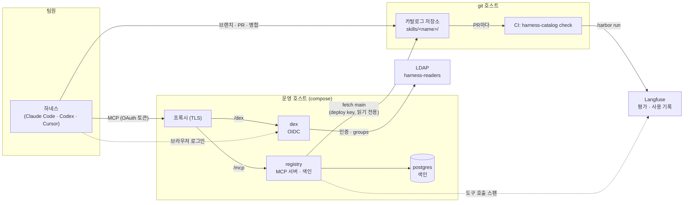

# harness-catalog

팀의 에이전트 스킬을 git 저장소에 두고, 각자의 하네스(Claude Code·Codex·Cursor)에서 MCP로 찾아 쓰게 하는 스킬 카탈로그입니다.

상태: **파일럿** (v0.1.0). Claude Code 2.1.258 + Synology LDAP Server 조합으로 등록 → 로그인 → 검색 → PR → 병합 → 색인까지 끝에서 끝까지 실측했습니다. Codex·Cursor는 클라이언트만 등록되어 있고 아직 붙여 보지 않았습니다.

## 목차

- [무엇인가](#무엇인가)
- [빠른 시작](#빠른-시작)
  - [팀원: 하네스에서 쓰기](#팀원-하네스에서-쓰기)
  - [저자: 스킬 올리기](#저자-스킬-올리기)
  - [운영자: 레지스트리 띄우기](#운영자-레지스트리-띄우기)
- [문서](#문서)
- [저장소 구성](#저장소-구성)
- [판과 호환](#판과-호환)
- [기여](#기여)
- [라이선스](#라이선스)

## 무엇인가

스킬 하나는 git 저장소의 디렉토리 하나입니다. `skills/<name>/SKILL.md`와, 필요하면 스크립트·참고 파일·평가 과제가 함께 있습니다. 이 저장소를 **카탈로그 저장소**라 부르고, `main`에 병합된 것이 곧 게시된 판입니다. 스킬을 만들고 고치고 지우는 일은 전부 브랜치 → PR → 병합이며, 병합한 사람이 그 판을 인증한 사람입니다.

**레지스트리**는 `main`을 주기적으로 받아 검사·색인하고, 하네스가 MCP로 물으면 답하는 서버입니다. 도구는 넷(`list_skills`·`search_skills`·`load_skill`·`get_skill_file`)이고 쓰기 도구는 없습니다. 저장소에는 읽기 전용 deploy key로만 닿습니다. 레지스트리가 뚫려도 카탈로그는 바뀌지 않고, 레지스트리가 죽어도 카탈로그는 git에 그대로 있습니다.

로그인은 팀 LDAP 계정으로 한 번 합니다. 레지스트리 앞의 Dex가 LDAP을 OIDC로 감싸고, LDAP 그룹 `harness-readers`에 든 사람만 도구를 부를 수 있습니다.



이 저장소(`alteralab/harness-catalog`)는 레지스트리·CLI·이미지·템플릿을 담은 **코드 저장소**입니다. 카탈로그 저장소(우리 팀은 `alteralab/catalog`)와는 별개입니다. 설계의 근거는 [DESIGN.md](DESIGN.md), 진행과 결정의 원장은 [PLAN.md](PLAN.md)와 `plans/`에 있습니다.

## 빠른 시작

### 팀원: 하네스에서 쓰기

필요한 것: Claude Code 2.1 이상, 레지스트리 URL, LDAP 계정이 `harness-readers` 그룹에 있을 것.

```sh
claude mcp add --transport http --scope user harness-catalog https://<레지스트리 호스트>/mcp
```

`~/.claude.json`의 그 항목에 `"oauth": { "clientId": "claude-code" }`를 더하고 Claude Code를 새로 시작합니다. `/mcp`에서 harness-catalog를 고르면 브라우저가 열리고, LDAP 계정으로 한 번 로그인하면 끝입니다. 이제 "카탈로그에 어떤 스킬 있어?"라고 물으면 됩니다. 자세한 것은 [docs/using.md](docs/using.md).

### 저자: 스킬 올리기

필요한 것: 카탈로그 저장소 clone, `uv`, `gitleaks`, (evals를 돌리려면) `harbor`.

```sh
git switch -c skill/<name>
mkdir -p skills/<name> && $EDITOR skills/<name>/SKILL.md
pre-commit install                                   # 커밋마다 harness-catalog check
harness-catalog check . --rev HEAD --base main       # 직접 돌릴 때
gh pr create
```

PR의 CI가 같은 검사를 돌리고, 사람이 병합하면 레지스트리가 한 주기(기본 60초) 안에 색인합니다. 하네스에서 `write-skill` 스킬을 불러 "이 절차를 스킬로 만들자"라고 하면 뼈대를 잡아 줍니다. 규약과 검사 항목은 [docs/authoring.md](docs/authoring.md).

### 운영자: 레지스트리 띄우기

필요한 것: Docker(compose v2), TLS를 맡을 리버스 프록시, LDAP(또는 빠른 시작용 정적 사용자), 카탈로그 저장소의 읽기 전용 deploy key.

```sh
git clone https://github.com/alteralab/harness-catalog && cd harness-catalog
cp .env.example .env && chmod 600 .env             # REGISTRY_IMAGE, HC__*, DEX_ISSUER, HC_PUBLIC_URL
scripts/make-secrets.sh secrets ~/.ssh/catalog-deploy-key
docker compose up -d
curl -fsS http://127.0.0.1:8000/readyz
```

카탈로그 저장소가 아직 없으면 `harness-catalog init <repo-url>`이 세웁니다. 프록시 경로·LDAP 연동·런북은 [docs/operations.md](docs/operations.md).

## 문서

| 문서 | 누구에게 | 내용 |
|---|---|---|
| [docs/using.md](docs/using.md) | 팀원 | 등록, 로그인, 찾기·적재, 곁에 두기(pin), 기계 계정, 문제 해결 |
| [docs/authoring.md](docs/authoring.md) | 스킬 저자 | 스킬의 모양, 팀 규약, 올리는 절차, 검사 항목, evals, 갱신·은퇴 |
| [docs/operations.md](docs/operations.md) | 운영자 | 구성, 카탈로그 저장소 신설, 설치, 프록시, Dex·LDAP, 런북 |
| [docs/configuration.md](docs/configuration.md) | 운영자 | 레지스트리 설정값 참조(생성 문서) |
| [docs/development.md](docs/development.md) | 개발자 | 배치, 개발 환경, 시험, 게이트, 릴리스 |
| [DESIGN.md](DESIGN.md) | 모두 | 설계와 결정의 근거 |
| [PLAN.md](PLAN.md), `plans/` | 개발자 | 실행 계획, 측정 결과, 결정 원장 |

## 저장소 구성

`tree -L 2 --dirsfirst` 출력에 역할을 달았습니다.

```
.
├── docker/                      # 이미지에 딸린 설정
│   ├── dex/                     #   Dex 설정 (gomplate, 빠른 시작용 정적 사용자)
│   └── postgres/                #   PostgreSQL 초기화 (DB·역할 둘)
├── docs/                        # 독자별 안내
│   ├── using.md                 #   팀원: 등록·로그인·찾기·pin
│   ├── authoring.md             #   저자: 규약·절차·검사 항목·evals
│   ├── operations.md            #   운영자: 설치·프록시·Dex/LDAP·런북
│   ├── configuration.md         #   설정값 참조 (harness-catalog config docs 생성)
│   └── development.md           #   개발자: 배치·시험·게이트·릴리스
├── examples/
│   ├── catalog-template -> ../packages/cli/src/harness_catalog_cli/templates
│   └── synology-ldap/           #   Synology LDAP Server 연동 오버레이 (compose + Dex 설정)
├── packages/                    # uv 워크스페이스, lockstep 배포물 넷
│   ├── core/                    #   harness-catalog-core: 모델·카탈로그 앱·검사 항목·git/검증 어댑터
│   ├── server/                  #   harness-catalog-server: MCP 서버·OIDC·PostgreSQL·스케줄러·마이그레이션
│   ├── cli/                     #   harness-catalog-cli: check·init·config, 카탈로그 저장소 템플릿
│   └── harbor-langfuse/         #   harbor-langfuse: Harbor 플러그인 → Langfuse
├── plans/                       # 실행 계획과 원장 (PLAN.md가 우산)
│   ├── pilot/                   #   측정 결과 r1~r3 (Dex 그랜트, LDAP, 하네스 첫 접촉)
│   ├── service.md
│   ├── distribution.md
│   ├── pilot.md
│   └── skills.md
├── scripts/
│   ├── make-secrets.sh          #   운영 비밀 파일 여섯 생성 (멱등)
│   └── dev-token.sh             #   기계 계정 토큰 (비밀번호 그랜트)
├── skills/                      # 첫 카탈로그에 올린 메타 스킬 둘 (각자 evals 포함)
│   ├── pin-skill/
│   └── write-skill/
├── tests/                       # pytest (core는 가짜 어댑터, adapters는 testcontainers, http는 실제 서버)
├── tools/
│   └── pilot/                   #   Dex 그랜트 실측 · 하네스 첫 접촉 캡처 stub
├── Dockerfile                   # registry 이미지 (python:3.12-slim + git + gitleaks)
├── docker-compose.yml           # 운영: registry · postgres · dex (docker secrets)
├── docker-compose.dev.yml       # 개발: postgres · dex만
├── pyproject.toml               # 워크스페이스 루트 (배포물 아님)
├── uv.lock
├── altera-rules.yml             # 규칙 게이트 표면 선언
├── REVIEW.md                    # 리뷰 루브릭 (altera-rules review 표면)
├── DESIGN.md                    # 설계와 결정의 근거
└── PLAN.md                      # 실행 계획 우산
```

## 판과 호환

네 패키지는 uv 워크스페이스의 lockstep 배포물이라 판이 같고 태그 `vX.Y.Z` 하나로 함께 나갑니다. 이미지에는 `server`만 들어가고, 카탈로그 저장소의 훅과 CI는 `core`와 `cli`를 그 태그로 설치합니다. 의존성은 전부 `==`로 고정합니다.

실측한 조합은 Python 3.12, uv 0.11.8, gitleaks 8.30.1, Harbor 0.24.0, Dex v2.45.1, PostgreSQL 17, Claude Code 2.1.258, Synology DSM LDAP Server입니다.

## 기여

브랜치를 따고 PR을 엽니다. 커밋 훅(`pre-commit install`)이 altera-rules 게이트(ruff·ast-grep·shellcheck·선언 드리프트)를 돌리고, CI가 pyright와 pytest를 돌립니다. 설계 계약을 바꾸는 변경은 코드보다 DESIGN.md §11의 결정 행이 먼저입니다. 개발 환경은 [docs/development.md](docs/development.md).

## 라이선스

미정입니다. 저장소 공개 전환과 함께 정합니다.
