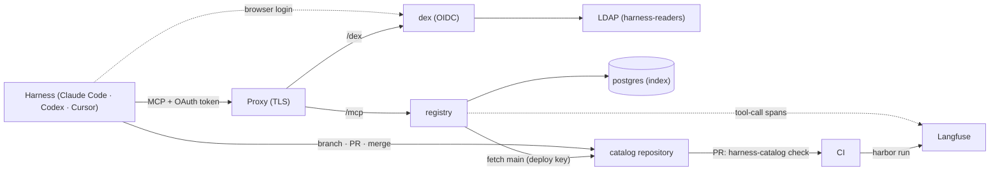

# System overview

harness-catalog keeps a team's agent skills in a git repository and lets each person's harness (Claude Code, Codex, Cursor) find and load them over MCP. The design's governing idea is that **publication is a git merge and the registry only reads**: there is no write tool, no upload, and the registry reaches the repository with a read-only deploy key.

## Two repositories

| Repository | Holds | Who writes |
|---|---|---|
| **Code repository** (this one, `alteralab/harness-catalog`) | The registry server, CLI, Harbor plugin, container image, compose files, templates and the design documents | Platform maintainers |
| **Catalog repository** (the team's, e.g. `alteralab/catalog`) | `skills/<name>/` directories. What is merged into `main` is what is published | Skill authors through branches and PRs; the registry only fetches |

## Runtime pieces

- **registry** — one process: an MCP server (four read tools), a scheduler that fetches `main` on an interval, checks it and rebuilds the index, and two operational routes (`/healthz`, `/readyz`). See [catalog app](catalog-app.md), [MCP server](mcp-server.md), [scheduler and operational surface](scheduler-and-ops.md).
- **postgres** — the search index, a derivative of `main` that can be rebuilt at any time, plus Dex's own storage in a separate database. See [PostgreSQL index](index-store.md).
- **dex** — the OIDC issuer that federates the team LDAP; harnesses log in through it, machine accounts use a password grant. See [authentication and authorization](auth.md).
- **Langfuse** — outside the system: receives tool-call spans from the registry and evaluation results from `harbor run`. The registry never reads it. See [evals and records](../workflows/evals-langfuse.md).

## Inside the registry: ports and adapters

The application (`Catalog`) depends on three protocols and nothing else:

| Port | Responsibility | Adapter |
|---|---|---|
| `ContentStore` | fetch `main`, read trees and blobs, export a skill, answer history questions (ancestry, retired names, which commit carried a tree) | `GitStore` over the `git` binary ([page](git-content-store.md)) |
| `SkillValidator` | validate a `SKILL.md`, scan a skill directory for secrets | `SkillsRefValidator` over `skills_ref` and `gitleaks` |
| `FactStore` | replace the index under a generation check, search, report the stored commit | `PgFactStore` over psycopg ([page](index-store.md)) |

Driving adapters call the app from outside: the MCP tool bindings, the scheduler loop, the readiness route and the CLI's `check` command. `bootstrap` is the configurator that builds the adapters from the six settings, wires the app, and composes the Starlette application whose lifespan starts the migration task and the scheduler and stops them in order on shutdown. Tests exploit the same seam: core tests substitute fake adapters and never touch git or a database.

## Distributables

The code repository is a uv workspace of four packages that share one version and one tag:

| Package | Depends on | Ships as |
|---|---|---|
| `harness-catalog-core` | — | library used by the other two |
| `harness-catalog-server` | core | the container image (`harness-catalog-server serve`) |
| `harness-catalog-cli` | core | `harness-catalog check / init / config`, installed from the git tag by the catalog repository's hook and CI |
| `harbor-langfuse` | — | Harbor plugin, installed where evals run |

`cli` and `server` never import each other; the image contains only `server` and its dependencies, built from `pyproject.toml`, `uv.lock` and `packages/` alone.

## Request and data flow in one sentence each

- **Reading a skill:** harness → proxy → registry; the token is verified against Dex's JWKS; `harness-readers` membership permits the call; the app answers from its in-memory snapshot (search ranked by PostgreSQL when available).
- **Publishing a skill:** author → branch → PR; CI runs `harness-catalog check`; a person merges; the registry's next fetch (default 60 s) runs the same checks and replaces the index.
- **Records:** every tool call is a span; every eval run is a Langfuse experiment; neither lives in the registry's database.

## Related

- [Design decisions in brief](../concepts/design-decisions.md) — why the registry is read-only, why the DB is a derivative, why one group
- [Deployment](../operations/deployment.md) — how the three containers and the proxy are stood up
- [Skill lifecycle](../workflows/skill-lifecycle.md) — the catalog repository's contract
